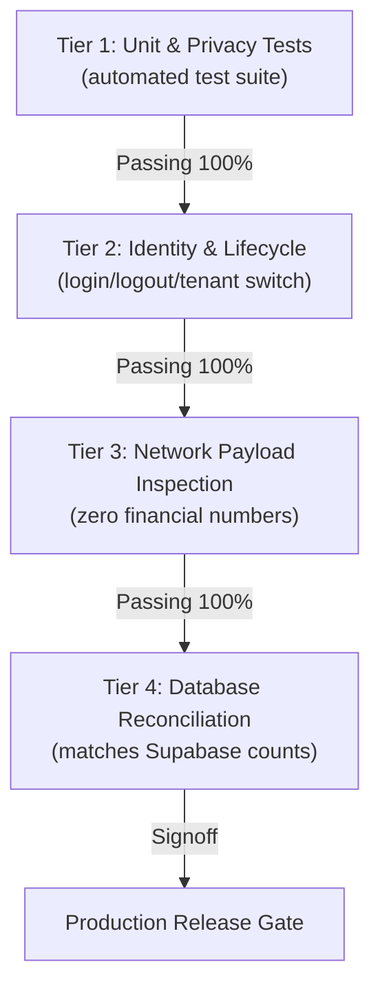

# BOURXE: Master Acceptance Criteria & Verification Protocol

- **Document Version:** 1.0.0
- **Status:** Master Quality Assurance Specification (`[PROPOSAL]` / Under Review)
- **Scope:** Verification Protocols, Automated Privacy Testing Standards, and Data Integrity Benchmarks for Future Implementation Phases
- **Current Task Compliance Note:** `[NO LIVE TESTING EXECUTED]` — This document specifies the testing rules for future implementation phases. No synthetic events or network tests were run during the current documentation task.

---

## 1. Acceptance Framework Overview

Before any code implementing the Product Intelligence & Observability initiative can be merged into the main branch or deployed to production, it must pass a rigorous, multi-tiered verification process. This framework ensures that telemetry operates with **100% data integrity, zero performance degradation, and zero financial or PII leakage**.

---

## 2. Tier 1: Automated Unit & Privacy Tests

Building upon the established Sentry privacy regression test suite (`src/tests/sentry-privacy.test.js`), a dedicated test file must be implemented during Phase 3: `src/tests/analytics-privacy.test.js`.

### 2.1 Required Automated Test Cases
1. **Compound Sensitive Key Redaction:**
   - Verify that any event property containing compound financial or commercial words (`invoice_number`, `client_name`, `total_amount`, `unit_price`, `bank_account`, `po_number`) is strictly stripped before dispatch.
2. **False-Positive Controls:**
   - Verify that legitimate technical properties (`app_version`, `timestamp`, `platform`, `module_name`, `step_number`) are **not** falsely redacted.
3. **Recursive Depth Protection:**
   - Verify that nested objects deeper than 4 levels fail closed with a safe redaction marker (`[REDACTED_NESTED_STRUCTURE]`).
4. **Circular Reference Protection:**
   - Verify that cyclic JavaScript objects are handled gracefully using `WeakSet` without causing maximum call stack errors.
5. **PII Regex Scrubbing:**
   - Verify that email addresses and Nigerian phone numbers (`+234...`, `080...`, `090...`) inside string properties are masked.

---

## 3. Tier 2: Identity & Lifecycle Verification

To ensure that user sessions and multi-tenant entities are attributed correctly without cross-session bleed:

### 3.1 Verification Checklist
- [ ] **Anonymous Distinct ID Generation:** Verify that unauthenticated visitors receive a persistent anonymous distinct ID.
- [ ] **Login Transition:** Verify that calling `identifyUser(userId)` upon Supabase login aliases the anonymous distinct ID with the authenticated Supabase Auth UUID.
- [ ] **PII Exclusion on Identification:** Verify that `posthog.identify()` is passed ONLY the opaque UUID and never the user's plain-text email address.
- [ ] **Logout Flush:** Verify that clicking logout triggers `posthog.reset()`, clearing stored tokens and immediately generating a fresh anonymous distinct ID.
- [ ] **Multi-Tenant Entity Switching:** Verify that switching active business entities updates `posthog.group('tenant', newEntityId)` and does not retain properties from the previous entity.

---

## 4. Tier 3: Network & Zero-Leakage Inspection

During staging validation (Phase 4), network payloads dispatched to the PostHog ingestion endpoint (`/capture/`) must undergo forensic inspection.

### 4.1 Inspection Protocol
1. Open Chrome DevTools / Network tab.
2. Filter for outgoing requests to `posthog.com` or the configured ingestion host.
3. Trigger core workflows:
   - Create a Quotation with line items and VAT.
   - Create an Invoice and export a PDF.
   - Conduct a Bolu conversational session with Gate 1 approval and Gate 2 save.
4. Inspect the `batch` JSON payload of every captured request:
   - **CONFIRM:** `event` name matches the approved taxonomy (`document_created`, `bolu_gate2_confirmed`).
   - **CONFIRM:** `properties` contains only counts (`line_item_count: 2`) and types (`document_type: "quotation"`).
   - **CONFIRM ZERO:** Unit prices, totals, tax values, customer names, addresses, invoice IDs, and chat prompt text must be completely absent from the payload.

---

## 5. Tier 4: Staging Funnel & Data Reconciliation

Before Phase 5 dashboards are signed off, event counts inside PostHog must reconcile with the authoritative database records in Supabase:

| Metric | PostHog Metric Calculation | Authoritative Supabase Database Query | Acceptable Variance |
| :--- | :--- | :--- | :---: |
| **New Invoices Created** | Count of `document_created` with `document_type: "invoice"` | `SELECT COUNT(*) FROM invoices WHERE created_at >= ...` | < 3% (due to ad-blockers) |
| **New Quotations Created**| Count of `document_created` with `document_type: "quotation"` | `SELECT COUNT(*) FROM quotations WHERE created_at >= ...` | < 3% |
| **Bolu Saved Documents** | Count of `bolu_gate2_confirmed` | Count of `bolu_messages` with `status = 'persisted'` | 0% |
| **New User Registrations**| Count of `user_signed_up` | `SELECT COUNT(*) FROM auth.users WHERE created_at >= ...` | 0% |

---

## 6. Sentry vs. PostHog Responsibility Verification

Verify that telemetry boundaries are strictly preserved:

1. **Simulate a Frontend Crash:**
   - Throw a test error inside a React component.
   - **Verify:** Sentry captures the exception and React component stack trace.
   - **Verify:** PostHog receives **zero** error events.
2. **Execute a Standard Document Flow:**
   - Create and save a valid invoice.
   - **Verify:** PostHog captures `document_created` and `document_exported`.
   - **Verify:** Sentry receives **zero** error issues or noise.

---

## 7. Master Operational Acceptance Checklist (Production Signoff)

All items must be signed off by the Product Owner and Engineering Lead prior to Phase 7 completion:

- [ ] All 17 Master PRD initiative documents reviewed and approved.
- [ ] Sentry error monitoring verified operational with 48 passing privacy tests.
- [ ] Automated analytics privacy test suite (`analytics-privacy.test.js`) passing 100%.
- [ ] Network payload inspection confirmed zero financial data leakage.
- [ ] Production and Development PostHog projects verified separate.
- [ ] Session Replay verified permanently disabled in code and account settings.
- [ ] Autocapture verified disabled; explicit tracking operational.
- [ ] Cookie consent banner integration verified (`'declined'` disables tracking).
- [ ] PostHog dashboards operational and reconciling with Supabase.
- [ ] Zero impact on frontend startup latency (< 5ms overhead).
- [ ] Hardware gate adhered to: Zero `bun run build` executed.
