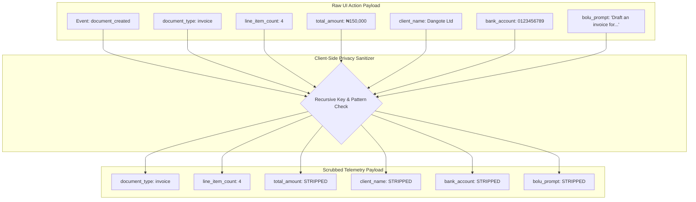
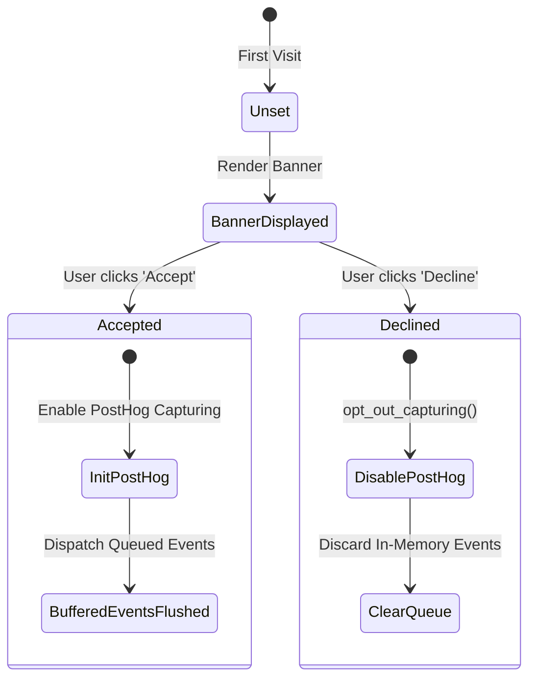

# BOURXE Governance Specification: Consent, Privacy & Data Minimization

- **Document Version:** 1.0.0
- **Status:** Privacy Architecture Specification (`[PROPOSAL]` / Under Review)
- **Regulatory Framework:** Nigeria Data Protection Act (NDPA / NDPR) & International Best Practices
- **Scope:** Cross-System Privacy Standards, Prohibited Data Blacklist, Consent Lifecycle, and Scrubbing Engines

---

## 1. Privacy Principles & Commitment

At BOURXE, data privacy is an architectural requirement, not an afterthought. Nigerian SMEs entrust BOURXE with their proprietary pricing structures, client lists, invoice documents, and daily transactions. Any leakage of this commercial data into third-party analytics or monitoring platforms would violate customer trust, contractual confidentiality, and statutory data protection laws.

### 1.1 Core Principles
1. **Strict Data Minimization:** Collect only the minimum behavioral data necessary to answer approved product questions. Never collect data simply because it is technically possible.
2. **Total Commercial Redaction:** Financial figures, prices, line items, customer names, bank details, and trade secrets are barred from analytics storage.
3. **Multi-Tenant Isolation:** Analytics data for one business entity must never bleed into or be visible to another business entity.
4. **Pseudonymous Identity:** User actions are attributed using opaque system identifiers (UUIDs), never plain-text emails, phone numbers, or company names.
5. **Fail-Closed Privacy Architecture:** If a sanitizer fails or encounters an unverified payload, it must drop the event or redact the field rather than risk data leakage.

---

## 2. Prohibited Data Blacklist (Cross-System)

The following data fields are **strictly blacklisted** from all telemetry, error breadcrumbs, and product analytics payloads:

### 2.1 Complete Redaction Matrix

| Prohibited Category | Blacklisted Keys / Patterns | Reason for Prohibition | Enforcement Layer |
| :--- | :--- | :--- | :--- |
| **Financial Figures** | `amount`, `subtotal`, `total`, `price`, `unit_price`, `vat`, `tax`, `discount`, `balance`, `currency_symbol` | Confidential SME commercial numbers | Key substring filter & numeric stripping |
| **Banking Records** | `bank_name`, `account_number`, `bvn`, `nin`, `sort_code`, `routing_number` | High-risk financial security data | Key matching & regex pattern filter |
| **Customer / Supplier PII** | `customer_name`, `client_name`, `supplier_name`, `contact_person`, `delivery_address` | NDPA / PII compliance | Key matching & string redaction |
| **Direct Contact Info** | `email`, `phone`, `phone_number`, `whatsapp_number` | Personal data protection | Regex pattern matching (`+234...`, email regex) |
| **Document Content** | `line_items`, `item_description`, `notes`, `payment_terms` | Proprietary commercial data | Deep object stripping |
| **AI Conversations** | `prompt`, `completion`, `message_text`, `chat_history`, `clerk_thought` | Sensitive business communication | Key matching on all Bolu properties |
| **Credentials & Secrets** | `password`, `token`, `secret`, `jwt`, `api_key`, `refresh_token` | System authentication security | Regex pattern matching & key blacklist |

---

## 3. Consent Management Lifecycle (`CookieConsentBanner.tsx`)

BOURXE includes an accessible, non-blocking consent UI in `src/components/compliance/CookieConsentBanner.tsx`. It manages state in `localStorage['bouxre_cookie_consent']`.

### 3.1 Enforcement Rules
1. **Unset Consent:** When consent is unset, the analytics wrapper buffers events in-memory up to 50 items. No data is written to disk or transmitted to the network until the user interacts with the banner.
2. **Accepted Consent:** PostHog initializes and flushes any buffered in-memory events.
3. **Declined Consent:** PostHog calls `posthog.opt_out_capturing()` or remains completely uninitialized. The in-memory buffer is purged.
4. **Sentry Exception Handling:** Sentry initializes unconditionally at `src/main.tsx:15` and is not gated by the consent banner. It applies deep privacy scrubbing. The legal basis for this processing requires qualified review; this document does not assert compliance.

---

## 4. Session Replay & Autocapture Restrictions

### 4.1 Session Replay (Video Recording)
- **Policy:** **SESSION REPLAY IS PERMANENTLY DISABLED BY DEFAULT.**
- **Rationale:** Video session recording captures DOM state and user cursor movements. In an invoicing application, even masked DOMs present leakage risks regarding table structures, item quantities, and client identifiers.
- **Future Re-evaluation:** If evaluated in Phase 6, it requires explicit tenant opt-in, strict DOM masking (`maskAllInputs: true`, `maskTextContent: true`), and restriction to non-sensitive pages.

### 4.2 PostHog Autocapture
- **Policy:** **AUTOCAPTURE IS DISABLED.**
- **Rationale:** Default autocapture records all DOM clicks and element text. In financial forms, button text or adjacent input values can easily leak commercial numbers.
- **Enforcement:** BOURXE relies exclusively on explicit, typed manual instrumentation via `trackEvent()`.

---

## 5. Retention & Deletion Governance (NDPA Alignment)

1. **Retention Periods:**
   - Raw analytics events in PostHog: Proposed rolling 12-month expiration; account configuration is unverified.
   - Sentry crash reports: Proposed 90-day expiration; account configuration is unverified.
   - Local in-browser error registry: Capped at 200 entries in `localStorage`.
   - Bolu usage ledger and business audit records: No retention policy is implemented.
2. **Data Subject Rights (Right to Erasure):**
   - `[PROPOSED]` Account deletion via Supabase and PostHog Person Deletion API calls are proposed controls. No implementation exists in the repository.
   - The Bolu usage ledger retains `user_email` after account deletion (`ON DELETE SET NULL`). This requires product-owner and legal review.
