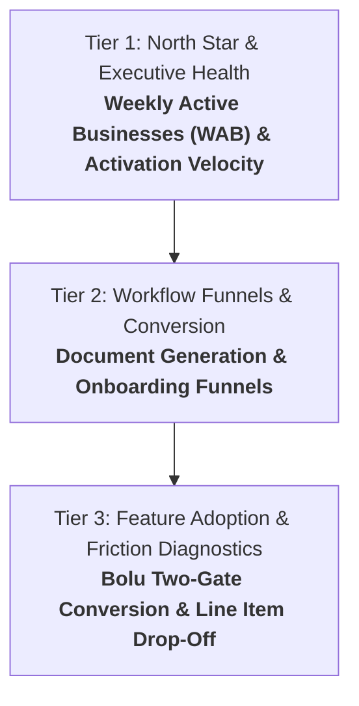
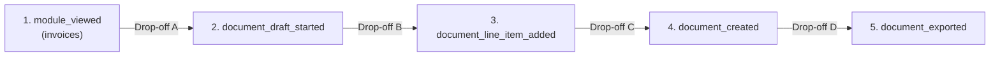

# BOUXRE: Dashboards, Funnels & Product Metrics Specification

- **Document Version:** 1.0.0
- **Status:** Metrics Specification (`[PROPOSAL]` / Under Review)
- **Target Platform:** PostHog Dashboards & Reporting Engine
- **Governance Gate:** Implemented during Phase 5 (Analytics, Funnels & Dashboards)

---

## 1. Metrics Framework & Hierarchy

To ensure that reporting provides clear operational direction, BOUXRE structures metrics into a three-tiered hierarchy:

---

## 2. Core Dashboard Specifications (Phase 5)

### Dashboard 1: Executive Overview Dashboard
Designed for product leadership to monitor platform growth and operational volume at a glance.

| Widget Title | Chart Type | Calculation Formula | Source Event(s) |
| :--- | :--- | :--- | :--- |
| **Weekly Active Businesses (WAB)** | Rolling 7-day Line Chart | Count of unique `tenant_id` emitting any workflow event in past 7 days. | `document_created`, `module_viewed` |
| **New Activated Businesses** | Weekly Bar Chart | Count of `tenant_id` issuing first document within 7 days of `user_signed_up`. | `user_signed_up`, `document_created` |
| **Commercial Document Volume** | Stacked Area Chart | Total count of finalized documents by type (Invoices vs Quotations). | `document_created` (`document_type`) |
| **Bolu Assistant Utilization Rate**| Percentage Gauge | Ratio of documents created via Bolu vs total documents created. | `document_created` (`creation_mode`) |

---

### Dashboard 2: Document Creation Funnel
Tracks the complete journey from entering the module to exporting a finalized document, pinpointing where SMEs experience friction.

- **Drop-Off A Diagnostic:** High drop-off between Step 1 and Step 2 indicates confusion on how to initiate a new invoice.
- **Drop-Off B Diagnostic:** High drop-off between Step 2 and Step 3 indicates difficulty configuring client contact information.
- **Drop-Off C Diagnostic:** High drop-off between Step 3 and Step 4 indicates friction with pricing, discounts, or tax rate calculations.
- **Drop-Off D Diagnostic:** Drop-off between Step 4 and Step 5 indicates users saving records without distributing them to clients.

---

### Dashboard 3: Onboarding & Activation Funnel
Measures the velocity and drop-off rate of newly registered SME accounts.

1. **Step 1:** `onboarding_started` (Wizard launched)
2. **Step 2:** `onboarding_step_completed` (`step_name: 'business_profile'`)
3. **Step 3:** `onboarding_step_completed` (`step_name: 'tax_defaults'`)
4. **Step 4:** `onboarding_step_completed` (`step_name: 'first_client'`)
5. **Step 5:** `onboarding_completed` (Checklist finished)
6. **Step 6 (Activation Milestone):** `document_created` within 7 days of registration.

---

### Dashboard 4: Bolu AI Assistant Adoption & Two-Gate Funnel
Evaluates whether the conversational assistant successfully converts natural-language SME requests into persisted commercial records.

1. **Step 1:** `bolu_session_started` (Chat rail or sheet opened)
2. **Step 2:** `bolu_proposal_generated` (Proposal card rendered)
3. **Step 3 (Gate 1):** `bolu_gate1_approved` (User approves line items and calculated VAT)
4. **Step 4 (Gate 2):** `bolu_gate2_confirmed` (Document successfully saved to Supabase)

> **Key Performance Indicator:** **Gate 1 to Gate 2 Confirmation Rate.** If this rate falls below 85%, it indicates that proposed document calculations or database save actions are encountering user hesitation or technical friction.

---

### Dashboard 5: 30-Day Cohort Retention Table
Groups business entities (`tenant_id`) into weekly signup cohorts and measures operational retention across Weeks 1, 2, 3, and 4.

| Cohort Week | New Businesses | Week 1 Retention | Week 2 Retention | Week 3 Retention | Week 4 Retention |
| :---: | :---: | :---: | :---: | :---: | :---: |
| **Week 44** | 120 | 62% | 48% | 42% | 38% |
| **Week 45** | 145 | 65% | 51% | 45% | - |
| **Week 46** | 160 | 68% | 54% | - | - |

---

## 3. Data Reconciliation Protocol (PostHog vs. Supabase)

To guarantee that product analytics numbers reflect commercial reality, PostHog funnel totals must be reconciled against the authoritative Supabase PostgreSQL database:

| Metric | PostHog Calculation | Authoritative Supabase Database Query | Tolerance Threshold |
| :--- | :--- | :--- | :---: |
| **Invoices Created** | Count of `document_created (invoice)` | `SELECT COUNT(*) FROM invoices WHERE created_at >= ...` | < 3% (Ad-blocker variance) |
| **Quotations Created**| Count of `document_created (quotation)`| `SELECT COUNT(*) FROM quotations WHERE created_at >= ...` | < 3% |
| **Bolu Saved Documents**| Count of `bolu_gate2_confirmed` | Count of `bolu_messages` with `status = 'persisted'` | 0% |
| **User Registrations** | Count of `user_signed_up` | `SELECT COUNT(*) FROM auth.users WHERE created_at >= ...` | 0% |
