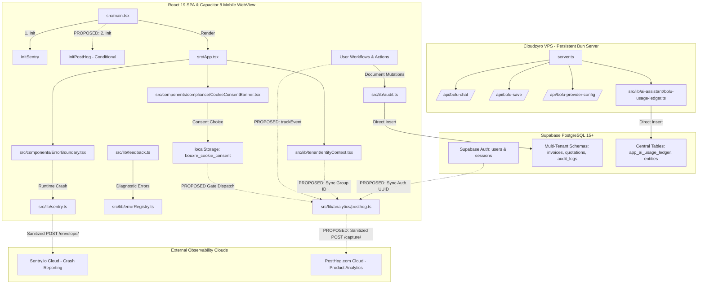

# BOUXRE: Unified Observability & Telemetry Architecture

- **Document Version:** 1.0.0
- **Status:** Architectural Blueprint (`[PROPOSAL]` / Under Review)
- **Scope:** System Boundaries, Integration Topology, Network Routing, and Separation of Concerns

---

## 1. Unified Architectural Topology



---

## 2. Subsystem Boundaries & Separation of Concerns

To prevent telemetry pollution, bundle bloat, and conflicting data, each subsystem is assigned a strict, non-overlapping responsibility domain:

| Subsystem | Primary Owner | Data Ingested | Target Storage | Explicit Exclusions |
| :--- | :--- | :--- | :--- | :--- |
| **Sentry** | Engineering Lead | Unhandled exceptions, React crash component stacks, sanitized URL breadcrumbs. | Sentry Cloud | Feature clicks, user journeys, financial totals, customer PII. |
| **PostHog** | Product Manager | Pageviews, module navigation, onboarding steps, document lifecycle states. | PostHog Cloud | Error traces, exceptions, invoice prices, customer names, chat prompt text. |
| **Local Error Registry** | Device / User | Recent 200 frontend errors for local in-app debugging and support inspection. | `localStorage` | Remote network transmissions. |
| **Document Audit Trail** | Regulatory / SME | Application-level records of document creation, edits, cancellations, and status changes. Database immutability not enforced. | Supabase Tenant DB | Third-party analytics clouds. |
| **Bolu AI Ledger** | AI Ops / Finance | Token consumption, inference duration, TTFT, token velocity, estimated USD cost. | Supabase Central DB | Prompt text, document draft contents. |
| **Cookie Consent** | Compliance Officer | User choice (`accepted` or `declined`) governing analytics activation. | `localStorage` | Remote network transmissions. |

---

## 3. Client Initialization & Bootstrap Sequence

Proposed initialization timing. Current `src/main.tsx` initializes Sentry only; PostHog is not installed and the consent banner gates no tracker:

```typescript
// 1. Early Sentry initialization (Must run first)
initSentry()

// 2. Conditional PostHog initialization (Respects local consent)
initPostHog()

// 3. React DOM mounting
const container = document.getElementById('root')
if (container) {
  const root = createRoot(container)
  root.render(<App />)
}
```

---

## 4. Failure Isolation & Network Resilience

1. **Ad-Blocker & Network Interception:**
   - In Nigerian corporate and mobile environments, DNS blockers or browser shields (uBlock, Brave) frequently block analytics endpoints (`*.posthog.com`).
   - The analytics wrapper executes all tracking in non-blocking try/catch wrappers. Any network rejection fails silently and cannot interrupt React rendering, form submission, or Supabase database writes.
2. **Capacitor Mobile Offline Mode:**
   - On Android/iOS devices running on intermittent cellular connections, the wrapper buffers events in memory up to 50 events.
   - When connectivity drops, critical business actions (document drafting, offline reading) proceed normally.
3. **Zero Main-Thread Latency:**
   - Event scrubbing and metadata envelope attachment execute asynchronously, preserving 60fps UI responsiveness.

---

## 5. Multi-Tenant Group Attribution Model

BOUXRE operates multi-tenancy where a single user account can access or own multiple business entities. 

- **Tenant Isolation:** Postgres Row-Level Security (RLS) enforces database isolation.
- **Analytics Mapping:** PostHog Group Analytics maps entity context:
  ```typescript
  // When active entity changes in EntityContext.tsx
  posthog.group('tenant', activeEntityId, {
    industry: 'retail | services | manufacturing',
    plan_tier: 'starter | pro',
    created_at: '2026-01-15T00:00:00Z'
  })
  ```
- **Privacy Rule:** The `activeEntityId` is always the opaque Supabase UUID (`entity_id`), never the plain-text commercial business name.
