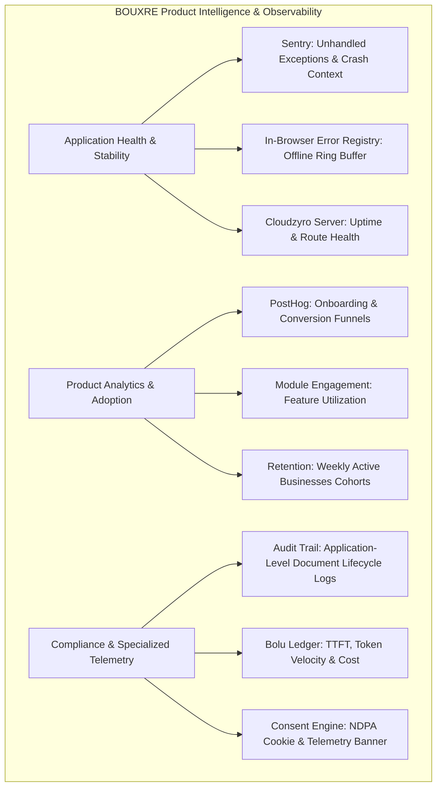

# BOUXRE Master Product Requirements Document (PRD): Product Intelligence & Observability

- **Initiative Title:** BOUXRE Product Intelligence, Observability & Analytics Infrastructure
- **Document Version:** 1.0.0
- **Status:** Master PRD Specification (`[PROPOSAL]` / Under Review)
- **Target Platform:** BOUXRE (Nigerian SME Business Operations Suite)
- **Runtime Environment:** React 19, Vite 7, TypeScript 5.9, Tailwind CSS 3.4, Supabase (PostgreSQL 15+), Bun, Capacitor 8 (Android/iOS), Vercel, Cloudzyro VPS.

---

## 1. Executive Summary

### 1.1 The Operational Context
BOUXRE serves Nigerian Small and Medium Enterprises (SMEs) with critical business tools: quotation creation, tax-compliant invoicing, purchase orders, client correspondence, inventory management, and conversational document drafting via the Bolu AI assistant. 

SMEs operate in fast-paced commercial environments characterized by intermittent mobile connectivity, shared desktop terminals, and strict requirements for financial confidentiality.

### 1.2 The Core Problem
Historically, BOUXRE has operated with an asymmetrical operational awareness:
1. **Document Auditability Exists:** The platform maintains application-level compliance logs (`src/lib/audit.ts`) for completed business documents in PostgreSQL tenant schemas. Database immutability is not enforced.
2. **AI Inference is Quantified:** The Bolu assistant tracks tokens, latency, TTFT, and dollar costs in `app_ai_usage_ledger`.
3. **Application Health Was Dark:** Until recent Sentry integration, frontend runtime crashes and unhandled exceptions were lost on user devices.
4. **Product Experience Remains Completely Dark:** The product team has **zero visibility** into how users discover features, where they stall during multi-step invoice creation, what proportion of draft quotations are converted to finalized invoices, or what causes user churn.

### 1.3 The Umbrella Objective
This master initiative establishes **Product Intelligence & Observability** as a first-class platform capability. The objective is to combine **system health monitoring** (knowing when code breaks) with **product behavioral intelligence** (understanding how users work) while strictly upholding **SME commercial confidentiality and data minimization**.

> **Plain-Language Summary for Non-Technical Stakeholders:**
> We are building the tools needed to understand how BOUXRE performs and how people use it. Sentry alerts us when an error occurs so we can fix bugs before users complain. PostHog tells us how users move through the app—such as whether they complete their first invoice or get stuck on tax calculations. Local registries allow users to review system logs on their own devices. **All of this is done without ever collecting customer names, invoice prices, bank account details, or business conversation text.**

---

## 2. Business Objectives & Product Outcomes

### 2.1 Business Objectives
1. **Accelerate SME Time-to-Value:** Reduce the time required for a new Nigerian business to register, set up their profile, and issue their first commercial document.
2. **Eliminate Operational Churn:** Uncover UI friction points that lead users to abandon invoicing or inventory workflows midway through.
3. **Prioritize Evidence-Based Roadmap Investments:** Direct engineering effort toward the features and modules that drive sustained weekly active business utility, rather than speculative requests.
4. **Maintain Uncompromising Customer Trust:** Ensure that enterprise analytics telemetry adheres strictly to the Nigeria Data Protection Act (NDPA) and international security standards.

### 2.2 Product Capabilities Matrix

---

## 3. Explicit Non-Goals (Scope Boundaries)

To safeguard system performance and user privacy, the following capabilities are **explicitly prohibited**:

- **NO Employee or Staff Surveillance:** The platform will never record keystrokes, mouse heatmaps, or worker productivity rankings.
- **NO Ingestion of Commercial Data:** Product analytics will never receive or store invoice prices, line item descriptions, totals, tax amounts, bank details, or client identities.
- **NO Ingestion of AI Prompt Text:** Text entered into Bolu chat or generated in document proposals will never be sent to external analytics.
- **NO Unrestricted Session Replay:** Video session recording is permanently disabled by default.
- **NO Replacement of Existing Security Boundaries:** Analytics grouping is not a substitute for Supabase Postgres Row-Level Security (RLS).
- **NO Tool Duplication:** Sentry handles errors; PostHog handles behavioral analytics. Neither shall duplicate the other.

---

## 4. User Personas & Stakeholder Needs

| Persona | Core Need | Platform Capability Delivered |
| :--- | :--- | :--- |
| **SME Business Owner** | Fast, confidential operations; wants records secure from competitors. | Protected by client-side data scrubbing and zero commercial data transmission. |
| **Invoicing Clerk / Staff** | Intuitive document workflows without confusing multi-step forms. | Benefits from simplified UX driven by funnel drop-off analytics. |
| **Product Manager** | Objective data showing feature adoption, conversion funnels, and retention. | Receives actionable cohort, funnel, and drop-off reports in PostHog. |
| **Engineering Lead** | Rapid crash alerts with scrubbed diagnostic context; zero bundle bloat. | Sentry error alerts with sanitized stack traces; lightweight wrapper architecture. |
| **Data Protection Officer** | Verifiable compliance with the Nigeria Data Protection Act (NDPA). | Explicit consent controls, pseudonymous IDs, and audited data minimization. |

---

## 5. Functional Requirements (FR)

### 5.1 Application Health & Error Observability (Sentry & Local Registry)
- `[COMPLETED]` **FR-01:** The client application shall initialize Sentry (`@sentry/react@11.13.0`) prior to React DOM mounting, guarded by `Sentry.isInitialized()`.
- `[COMPLETED]` **FR-02:** Unhandled React component lifecycle exceptions shall be caught by `ErrorBoundary.tsx` and forwarded to Sentry via `captureReactError()`.
- `[COMPLETED]` **FR-03:** All outgoing Sentry error events shall be scrubbed recursively to remove JWTs, Bearer tokens, Nigerian phone numbers, email addresses, and commercial keys.
- `[COMPLETED]` **FR-04:** The application shall maintain a client-side ring buffer of up to 200 diagnostic events in `localStorage['bd-error-registry']` viewable in `ErrorsDashboard.tsx`.

### 5.2 Product Analytics & Behavioral Telemetry (PostHog)
- `[PROPOSAL]` **FR-05:** The application shall provide a lightweight, typed analytics singleton (`src/lib/analytics/posthog.ts`) exposing `trackEvent()`, `identifyUser()`, `resetUser()`, and `setTenantGroup()`.
- `[PROPOSAL]` **FR-06:** Behavioral tracking shall follow the standardized `[object]_[action]` taxonomy (e.g., `document_created`, `module_viewed`).
- `[PROPOSAL]` **FR-07:** Each event shall automatically include standard context properties: `app_version`, `platform` (web or android), `environment`, `is_authenticated`, and `timestamp`.

### 5.3 Identity Lifecycle & Multi-Tenant Attribution
- `[PROPOSAL]` **FR-08:** Upon successful Supabase login, the analytics wrapper shall call `identifyUser(userId)` using the opaque Supabase Auth UUID. User email addresses shall NOT be passed as person properties.
- `[PROPOSAL]` **FR-09:** Upon user logout, the analytics wrapper shall invoke `resetUser()` to clear local state and generate a fresh anonymous distinct ID, preventing cross-session bleed on shared devices.
- `[PROPOSAL]` **FR-10:** Multi-tenant entity context shall be tracked via PostHog Group Analytics (`posthog.group('tenant', entityId)`) using opaque Supabase `entity_id` UUIDs.

### 5.4 Consent Management & Telemetry Gating
- `[PROPOSAL]` **FR-11:** The analytics wrapper shall strictly respect `localStorage['bouxre_cookie_consent']` managed by `CookieConsentBanner.tsx`.
- `[PROPOSAL]` **FR-12:** If consent is `'declined'`, the analytics SDK shall operate in complete opt-out mode or remain uninitialized. If unset, events are buffered in memory without persistence until the user decides.

### 5.5 AI Assistant & Document Observability
- `[COMPLETED]` **FR-13:** The Bolu assistant shall track TTFT, total latency, token velocity, and estimated USD cost per inference stream in `app_ai_usage_ledger`.
- `[COMPLETED]` **FR-14:** Document mutations (create, update, status change) shall generate audit records in tenant database schemas via `src/lib/audit.ts`. Database immutability is a separate requirement; it is not implemented.
- `[PROPOSAL]` **FR-15:** Bolu interaction milestones (`bolu_session_started`, `bolu_proposal_generated`, `bolu_gate1_approved`, `bolu_gate2_confirmed`) shall be captured by product analytics without including prompt or proposal text.

---

## 6. Non-Functional Requirements (NFR)

### 6.1 Performance & Resource Overhead
- `[PROPOSAL]` **NFR-01:** Total analytics bundle overhead shall not exceed 45 KB gzipped.
- `[PROPOSAL]` **NFR-02:** All telemetry calls must be asynchronous and execute in under 5 milliseconds on the main thread, preserving smooth 60fps UI animations.
- `[PROPOSAL]` **NFR-03:** Telemetry transmission shall use browser `sendBeacon` or background batched HTTP requests to prevent network congestion on mobile connections.

### 6.2 Resilience & Offline Behavior
- `[PROPOSAL]` **NFR-04:** The analytics wrapper must operate cleanly inside Capacitor Android webviews and handle device offline states without throwing unhandled exceptions.
- `[PROPOSAL]` **NFR-05:** When offline, analytics events shall be dropped or buffered in memory up to a maximum limit of 50 events.
- `[PROPOSAL]` **NFR-06:** Failure or blocking of third-party analytics endpoints (e.g., via ad-blockers) must fail silently without impacting document creation, editing, or database saves.

### 6.3 Security & Data Privacy
- `[PROPOSAL]` **NFR-07:** Client-side payload scrubbing must execute prior to network dispatch, guaranteeing that no commercial keys (`amount`, `price`, `total`, `client_name`, `bank_account`) ever reach analytics storage.
- `[PROPOSAL]` **NFR-08:** Navigation URLs in telemetry must have query parameters stripped to prevent leaking search terms or token parameters.

---

## 7. Unified Acceptance Criteria & Approval Status

| Workstream | Acceptance Condition | Evidence / Status |
| :--- | :--- | :---: |
| **Sentry Error Tracking** | `@sentry/react@11.13.0` operational; 48 passing privacy tests; audit approved with conditions. | `[VERIFIED COMPLETED]` |
| **In-Browser Diagnostics** | `errorRegistry.ts` active; `ErrorsDashboard.tsx` functional. | `[VERIFIED COMPLETED]` |
| **AI Inference Ledger** | `bolu-usage-ledger.ts` operational; records latency & tokens in DB. | `[VERIFIED COMPLETED]` |
| **Document Audit Trail** | `src/lib/audit.ts` operational; logs records in tenant schemas. Immutability not enforced. | `[VERIFIED COMPLETED]` |
| **Consent Infrastructure** | `CookieConsentBanner.tsx` operational in UI. | `[VERIFIED COMPLETED]` |
| **Master PRD Signoff** | Product owner approves unified scope, non-goals, and privacy governance. | `[DECISION REQUIRED]` |
| **PostHog Account Readiness** | PostHog cloud region, project keys, and project separation verified. | `[UNKNOWN / PENDING]` |
| **PostHog Integration** | Client wrapper implemented with deep scrubbing and 100% test coverage. | `[NOT STARTED]` |
| **Core Instrumentation** | Onboarding, invoice, and quotation workflows tracked in staging. | `[NOT STARTED]` |
| **Dashboards & Validation** | PostHog funnels operational and reconciled with Supabase records. | `[NOT STARTED]` |
| **Production Handover** | 14 consecutive days of production operation with zero privacy leakage. | `[NOT STARTED]` |
