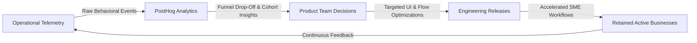

# BOUXRE: Product Intelligence Strategy & Behavioral Operating Model

- **Document Version:** 1.0.0
- **Status:** Strategic Architecture Specification (`[PROPOSAL]` / Under Review)
- **Focus:** SME Behavioral Insights, Feature Adoption, Activation Milestones, and Retention Loops

---

## 1. Vision & Strategic Operating Model

Product intelligence at BOUXRE exists to answer one fundamental question: **How do we make Nigerian SMEs more efficient, resilient, and commercially successful?**

Historically, software development has relied on anecdotal feedback or trial-and-error. By establishing a structured product intelligence operating model, BOUXRE replaces speculation with empirical evidence.

### 1.1 Core Strategic Principles
1. **Decision-Driven Instrumentation:** We do not track events for curiosity. Every instrumented event must link directly to an operational question and an actionable roadmap decision.
2. **Quality Over Quantity:** A small, well-governed catalog of 16 events is vastly superior to 200 noisy, unmaintained clicks.
3. **Data Minimization as Trust:** Nigerian SMEs entrust BOUXRE with their proprietary pricing and customer lists. We measure behavioral actions, never commercial contents.
4. **Actionable Metrics vs. Vanity Numbers:** Total pageviews and raw button clicks do not prove business health. We measure completed workflows, activation velocity, and weekly active business retention.

---

## 2. Core Operational Questions BOUXRE Must Answer

| Operational Question | Telemetry Required | Informed Product Decision |
| :--- | :--- | :--- |
| **How long does onboarding take?** | Time from `onboarding_started` to `onboarding_completed`. | Simplify setup wizard; remove unnecessary initial form fields. |
| **Where do users abandon invoice creation?** | Drop-off between `document_draft_started`, `document_line_item_added`, and `document_created`. | Identify friction in line-item entry, tax calculations, or discount forms. |
| **What % of quotations convert to invoices?** | Ratio of `document_created (quotation)` to subsequent `document_created (invoice)`. | Introduce one-click "Convert Quotation to Invoice" workflow. |
| **Does the Bolu AI assistant accelerate workflows?** | Completion rate of `bolu_gate2_confirmed` vs manual invoice creation duration. | Refine natural-language proposal card layout and validation hints. |
| **Which modules drive 30-day retention?** | Correlation between module views (`inventory`, `reports`, `correspondence`) and Week-4 WAB. | Prioritize high-retention modules for mobile-first enhancements. |

---

## 3. Core SME User Journeys

### Journey 1: The New SME Onboarding & Activation Journey
1. **Signup & Organization Setup:** User registers via Supabase Auth, names their initial business entity, and configures default currency (`NGN`) and tax rates (`VAT 7.5%`).
2. **First Document Initiation:** User opens the Quotation or Invoice module and clicks "New Document".
3. **Client Configuration:** User enters client details or selects an existing contact.
4. **Line Item Generation:** User inputs items, quantities, and prices.
5. **Document Issuance & Export:** User saves the document and generates a PDF or shares via WhatsApp/email.

### Journey 2: The Routine Invoicing Cycle
1. SME owner or invoicing clerk logs in from desktop browser or Capacitor Android mobile app.
2. Opens Invoices module and drafts a new invoice or duplicates a past transaction.
3. Finalizes document and marks payment terms.
4. Exports invoice PDF.

### Journey 3: The Bolu AI Assistant Conversational Workflow
1. User opens Bolu AI Assistant workspace (`localhost:5000/settings?section=bolu-provider` or main chat rail).
2. Submits natural language instruction: *"Create a quotation for Tecno Power Solutions for 10 rolls of 1.5mm cable at 700 each..."*
3. Reviews structured interactive proposal card.
4. **Gate 1 Approval:** User verifies line items and calculated VAT.
5. **Gate 2 Confirmation:** User confirms document persistence to Supabase via Cloudzyro API.
6. Reviews finalized document artifact.

---

## 4. Activation & Retention Framework

### 4.1 Proposed Activation Milestone (`[PROPOSAL]`)
In BOUXRE, an account is not considered "activated" simply by registering or confirming an email address.

> **Proposed Definition of Activation:**
> An SME is considered **Activated** when they **complete their business profile and issue at least one finalized invoice or quotation within their first 7 days.**

**Rationale:** An SME that completes a real commercial transaction has experienced BOUXRE's core value proposition and is dramatically more likely to become a long-term retained user.

### 4.2 Retention Metrics & Cohorts
- **Weekly Active Businesses (WAB):** Number of distinct business entities that issue at least one document or update records within a rolling 7-day window.
- **30-Day Retention Cohorts:** Grouping SMEs by signup week and tracking the percentage that continue active operational tasks at Days 7, 14, 21, and 30.
- **Feature Stickiness Ratio:** Ratio of Daily Active Businesses (DAB) to Monthly Active Businesses (MAB).

---

## 5. Metrics Framework: Decision Matrix

| Metric Category | Vanity Metric (Avoid Focusing On) | Actionable Metric (Focus On) | Informed Product Decision |
| :--- | :--- | :--- | :--- |
| **User Acquisition** | Total Registered Accounts | Activated Businesses within 7 Days | Determine whether onboarding guides require simplification. |
| **Engagement** | Total Button Clicks & Pageviews | Completed Document Workflows per Week | Identify which core modules deliver sustained utility. |
| **Document Generation** | Draft Invoices Started | Ratio of Started Drafts to Finalized Exports | Identify friction points in line item entry or tax calculation. |
| **AI Assistant** | Total Chat Messages Exchanged | Gate 1 & Gate 2 Proposal Confirmation Rate | Evaluate whether Bolu's structured proposals accurately match SME intent. |
| **Retention** | Total Registered Logins | 4-Week Rolling Entity Retention | Prioritize features that retain SMEs past their first month. |
