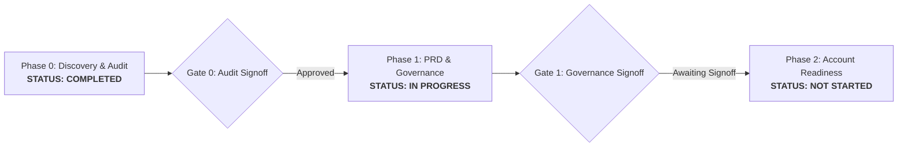

# BOURXE Master Initiative: Product Intelligence & Observability

- **Master Directory:** `docs/prd/product-intelligence-observability/`
- **Initiative Category:** Core Platform Infrastructure, Telemetry & Observability
- **Governance Gate:** Gated on Phase 1 Governance Approval (See [WATERFALL-ROADMAP.md](WATERFALL-ROADMAP.md))
- **Status:** Master Initiative Specification (`[PROPOSAL]` / Under Review)
- **Last Updated:** November 17, 2026

---

## 1. Initiative Executive Overview

The **BOURXE Product Intelligence & Observability** initiative establishes the unified, authoritative strategy and architecture for understanding, monitoring, measuring, and optimizing the BOURXE platform.

BOURXE is an operational and financial management platform designed for Nigerian Small and Medium Enterprises (SMEs), handling invoice creation, quotation generation, purchase order tracking, inventory management, customer records, and AI-assisted workflows (Bolu).

This umbrella initiative brings together:
1. **Application Health & Crash Observability (Sentry):** Real-time frontend exception monitoring, error boundary capture, and privacy-hardened diagnostic context.
2. **Product Analytics & Behavioral Telemetry (PostHog):** Measurement of user onboarding, feature adoption, workflow drop-offs, and 30-day cohort retention.
3. **Document Auditability & Regulatory Trails (`src/lib/audit.ts`):** Application-level compliance and document lifecycle audit logs within multi-tenant PostgreSQL schemas. Database immutability is not enforced.
4. **AI Assistant Observability (`src/lib/ai-assistant/bolu-usage-ledger.ts`):** TTFT (Time to First Token), latency, token velocity, and inference cost tracking for Bolu AI interactions.
5. **In-Browser Diagnostic Resilience (`src/lib/errorRegistry.ts`):** Offline ring-buffer error storage and local administrative log inspectors (`ErrorsDashboard.tsx`).
6. **User Privacy & Consent Infrastructure (`src/components/compliance/CookieConsentBanner.tsx`):** Transparent user consent management adhering to the Nigeria Data Protection Act (NDPA) and data minimization principles.

Neither Sentry nor PostHog defines this initiative. They are specialized subsystems operating within an integrated, privacy-first observability fabric.

---

## 2. Master Document Package Navigation

The initiative documentation package consists of 17 cross-referenced specifications organized into three distinct tiers:

```
docs/prd/product-intelligence-observability/
├── CORE STRATEGY & REQUIREMENTS
│   ├── README.md                      (Master Index & Navigation)
│   ├── PRD.md                         (Unified Product Requirements Document)
│   ├── CURRENT-STATE-AUDIT.md         (Comprehensive Current-State Technical Audit)
│   ├── COMPLETED-WORK.md              (Historical Record of Implementations & Audits)
│   ├── PRODUCT-INTELLIGENCE-STRATEGY.md (Vision, Learning Agenda & Metric Hierarchy)
│   └── OBSERVABILITY-ARCHITECTURE.md   (Unified Architecture & System Boundaries)
│
├── WORKSTREAM SPECIFICATIONS
│   ├── SENTRY.md                      (Frontend Crash Monitoring & Privacy Hardening)
│   ├── POSTHOG.md                     (Product Analytics, Account Readiness & Setup)
│   ├── CONSENT-AND-PRIVACY.md         (Consent Lifecycle, NDPA Compliance & Blacklists)
│   ├── IDENTITY-AND-SESSION-MODEL.md  (Auth Lifecycle, Tenant Context & Shared Devices)
│   ├── EVENT-TAXONOMY.md              (Standard Grammar, Metadata Envelope & Catalog)
│   └── DASHBOARDS-AND-METRICS.md      (Funnels, Activation, Cohorts & Reporting Specs)
│
└── DELIVERY & GOVERNANCE
    ├── WATERFALL-ROADMAP.md           (Sequential 8-Phase Phased Implementation Roadmap)
    ├── WATERFALL-ROADMAP.html         (Self-Contained Responsive Visual Roadmap)
    ├── DECISIONS-AND-OPEN-QUESTIONS.md (Pending Product Owner Decision Register)
    ├── RISKS-AND-DEPENDENCIES.md      (Risk Matrix, Mitigations & Account Dependencies)
    └── ACCEPTANCE-AND-VERIFICATION.md (Future Verification Gates & Testing Protocols)
```

---

## 3. Directory Content Summary

| Document | Subject Area | Core Scope & Purpose |
| :--- | :--- | :--- |
| [`PRD.md`](PRD.md) | Master PRD | High-level business goals, product objectives, user personas, non-goals, and core capabilities. |
| [`CURRENT-STATE-AUDIT.md`](CURRENT-STATE-AUDIT.md) | Technical Baseline | Forensic investigation of Sentry, PostHog, Supabase Auth, Bolu Ledger, Error Registry, and Consent. |
| [`COMPLETED-WORK.md`](COMPLETED-WORK.md) | Historical Record | Factual timeline of verified implementations, independent audits, regression tests, and minor follow-ups. |
| [`PRODUCT-INTELLIGENCE-STRATEGY.md`](PRODUCT-INTELLIGENCE-STRATEGY.md) | Strategic Vision | Core questions BOURXE must answer, user journey models, activation definitions, and decision feedback loops. |
| [`OBSERVABILITY-ARCHITECTURE.md`](OBSERVABILITY-ARCHITECTURE.md) | Architecture Design | Interaction model between client SPA, Cloudzyro backend, Supabase DB, Sentry, and PostHog. |
| [`SENTRY.md`](SENTRY.md) | Error Monitoring | `@sentry/react@11.13.0` integration, privacy scrubbing, 48 regression tests, and follow-up items. |
| [`POSTHOG.md`](POSTHOG.md) | Product Analytics | PostHog technical audit (0% installed), account readiness requirements, wrapper design, and plan limits. |
| [`CONSENT-AND-PRIVACY.md`](CONSENT-AND-PRIVACY.md) | Privacy & Compliance | Blacklisted commercial fields, data minimization, cookie consent integration, and NDPA compliance. |
| [`IDENTITY-AND-SESSION-MODEL.md`](IDENTITY-AND-SESSION-MODEL.md) | Identity & Tenancy | Supabase Auth UUID distinct IDs, multi-tenant group isolation, shared-device logout flushes, and biometric auth. |
| [`EVENT-TAXONOMY.md`](EVENT-TAXONOMY.md) | Event Data Dictionary | Standard `[object]_[action]` grammar, global context envelope, and 16 proposed non-sensitive events. |
| [`DASHBOARDS-AND-METRICS.md`](DASHBOARDS-AND-METRICS.md) | Dashboards & KPIs | Executive Overview, Onboarding Funnel, Document Creation Funnel, and Weekly Active Businesses (WAB). |
| [`WATERFALL-ROADMAP.md`](WATERFALL-ROADMAP.md) | Implementation Plan | 8 sequential phases (Phase 0 to Phase 7) with explicit entry/exit criteria and approval gates. |
| [`WATERFALL-ROADMAP.html`](WATERFALL-ROADMAP.html) | Visual Plan | Standalone responsive visual roadmap with zero external CDN dependencies or JavaScript requirements. |
| [`DECISIONS-AND-OPEN-QUESTIONS.md`](DECISIONS-AND-OPEN-QUESTIONS.md) | Decision Register | Pending product owner decisions: cloud region, environment separation, session replay, activation metrics. |
| [`RISKS-AND-DEPENDENCIES.md`](RISKS-AND-DEPENDENCIES.md) | Risk Assessment | Detailed analysis of privacy risks, session bleed, ad-blocker interception, bundle size, and account limits. |
| [`ACCEPTANCE-AND-VERIFICATION.md`](ACCEPTANCE-AND-VERIFICATION.md) | Quality Assurance | Verification protocols, automated privacy test requirements, network inspection, and database reconciliation. |

---

## 4. Epistemic Classification Standard

To preserve factual integrity and prevent unverified assumptions from driving engineering decisions, every claim, specification, and finding across this documentation package is classified under one of the following epistemic tags:

- `[VERIFIED]`: Directly proven via repository source code, configuration files, test execution, or package manifests.
- `[USER-CONFIRMED]`: Explicitly stated by the product owner/user. No such confirmation is recorded in the repository for PostHog account ownership.
- `[COMPLETED]`: A capability or task that is fully implemented, verified, and operational in code.
- `[PROPOSED]`: A recommended architectural or product design awaiting formal authorization.
- `[DECISION REQUIRED]`: A critical fork requiring product-owner review and signoff before work can proceed.
- `[UNKNOWN]`: External or account-side information that cannot be determined from repository inspection alone.

---

## 5. Current Initiative Status & Next Milestones



- **Current Status:** **Phase 1: PRD & Governance Approval** (`IN PROGRESS / DECISION REQUIRED`).
- **Immediate Next Action:** Product owner review of [`DECISIONS-AND-OPEN-QUESTIONS.md`](DECISIONS-AND-OPEN-QUESTIONS.md) and signoff on [`PRD.md`](PRD.md).
- **Application Code State:** Strictly untouched. Zero application code or runtime configuration was modified.
- **Hardware Constraint:** Fully respected. Host 4 GB RAM limit strictly enforced (`bun run build` permanently excluded).
