# BOUXRE Master Waterfall Roadmap: Product Intelligence & Observability

- **Document Version:** 1.0.0
- **Status:** Active Roadmap & Master Delivery Plan
- **Model:** Strict Sequential Phased Waterfall
- **Initiative Scope:** End-to-End Product Intelligence, Crash Observability & Analytics Infrastructure

---

## 1. Governance Rules & Phased Gating

To safeguard BOUXRE from architectural regressions, unverified assumptions, and privacy violations, this roadmap enforces strict **sequential phase gating**:

1. **No Out-of-Order Execution:** A downstream phase may not begin until all entry criteria are satisfied and the prior phase's approval gate has been formally signed off.
2. **Approval Gate Authority:** Phase gates require explicit signoff from the product owner or designated engineering lead.
3. **Hardware Policy Adherence:** Verification steps must respect the 4 GB RAM host constraint (`bun run build` permanently prohibited).
4. **No Synthetic Progression:** Phases are marked `COMPLETED` only when substantiated by repository evidence or verified account configuration.

---

## 2. Master Phase Overview

```mermaid
flowchart TD
    P0["Phase 0: Discovery & Audit<br/><b>STATUS: COMPLETED</b>"] --> Gate0{Gate 0: Audit Signoff}
    Gate0 -->|Approved| P1["Phase 1: PRD & Governance<br/><b>STATUS: IN PROGRESS</b>"]
    Gate0 -.->|Blocked| P0
    P1 --> Gate1{Gate 1: Governance Signoff}
    Gate1 -->|Approved| P2["Phase 2: Account Readiness<br/><b>STATUS: NOT STARTED</b>"]
    P2 --> Gate2{Gate 2: Key Provisioning}
    Gate2 -->|Approved| P3["Phase 3: Core Integration<br/><b>STATUS: NOT STARTED</b>"]
    P3 --> Gate3{Gate 3: Integration Tests}
    Gate3 -->|Approved| P4["Phase 4: Core Instrumentation<br/><b>STATUS: NOT STARTED</b>"]
    P4 --> Gate4{Gate 4: Staging Validation}
    Gate4 -->|Approved| P5["Phase 5: Dashboards & Funnels<br/><b>STATUS: NOT STARTED</b>"]
    P5 --> Gate5{Gate 5: Dashboard Signoff}
    Gate5 -->|Approved| P6["Phase 6: Advanced Capabilities<br/><b>STATUS: NOT STARTED</b>"]
    P6 --> Gate6{Gate 6: Experimentation Gate}
    Gate6 -->|Approved| P7["Phase 7: Production Handover<br/><b>STATUS: NOT STARTED</b>"]
```

| Phase # | Phase Name | Primary Objective | Current Status |
| :-: | :--- | :--- | :---: |
| **0** | **Discovery & Technical Audit** | Establish factual baseline across error monitoring, analytics, and privacy. | `COMPLETED` |
| **1** | **PRD & Governance Approval** | Secure alignment on Master PRD, event taxonomy, and privacy rules. | `IN PROGRESS / DECISION REQUIRED` |
| **2** | **Account & Project Readiness** | Provision PostHog projects, select cloud host, and configure retention. | `NOT STARTED / BLOCKED` |
| **3** | **Core SDK Integration & Abstraction** | Implement client wrapper, bootstrap sequence, and privacy scrubber. | `NOT STARTED / BLOCKED` |
| **4** | **Core Product Instrumentation** | Instrument onboarding, navigation, document workflows, and Bolu. | `NOT STARTED / BLOCKED` |
| **5** | **Analytics, Funnels & Dashboards** | Build conversion funnels, retention cohorts, and executive dashboards. | `NOT STARTED / BLOCKED` |
| **6** | **Advanced Capabilities & Flags** | Optional feature flags, experiments, and assistant metrics. | `NOT STARTED / BLOCKED` |
| **7** | **Acceptance & Operational Handover** | Zero-leakage verification, documentation update, and monitoring. | `NOT STARTED / BLOCKED` |

---

## 3. Phase-by-Phase Detailed Specifications

### Phase 0: Discovery & Technical Audit
- **Objective:** Establish the exact repository state regarding existing telemetry, dependencies, and privacy controls.
- **Scope:** Root manifests, lockfiles, environment templates, application bootstrap, routing, and Sentry audit review.
- **Prerequisites:** Full read-only repository access.
- **Deliverables:**
  - `CURRENT-STATE-AUDIT.md` (Forensic inventory across Sentry, PostHog, Audit Trail, Bolu Ledger)
  - `COMPLETED-WORK.md` (Historical timeline of verified work)
- **Dependencies:** None.
- **Entry Criteria:** Initiated by user request.
- **Exit Criteria:** Audit completed; all findings substantiated with source evidence; zero code modified.
- **Acceptance Criteria:** Verified 0% PostHog presence; verified Sentry operational status; verified 48 passing privacy tests.
- **Risks:** Unverified account-side assumptions (mitigated by explicit `[UNKNOWN]` classification).
- **Approval Gate:** **Gate 0: Audit Signoff** — Completed and verified.
- **Status:** **`COMPLETED`**

---

### Phase 1: PRD & Governance Approval
- **Objective:** Secure formal user signoff on the Master PRD, event taxonomy, and privacy restrictions.
- **Scope:** Strategy review, non-goals approval, blacklisted financial fields review, and activation definition.
- **Prerequisites:** Phase 0 completion.
- **Deliverables:**
  - `PRD.md` (Master PRD)
  - `PRODUCT-INTELLIGENCE-STRATEGY.md`
  - `OBSERVABILITY-ARCHITECTURE.md`
  - `EVENT-TAXONOMY.md`
  - `CONSENT-AND-PRIVACY.md`
  - `IDENTITY-AND-SESSION-MODEL.md`
  - `DECISIONS-AND-OPEN-QUESTIONS.md`
- **Dependencies:** Product owner review and decision responses.
- **Entry Criteria:** Phase 0 audit report delivered to user.
- **Exit Criteria:** User explicitly resolves open decisions and authorizes the PRD and privacy boundaries.
- **Acceptance Criteria:** Unanimous agreement on data minimization; Session Replay default-disabled confirmation.
- **Risks:** Misalignment on activation metrics or scope creep.
- **Approval Gate:** **Gate 1: Governance & Master PRD Signoff**
- **Status:** **`IN PROGRESS / DECISION REQUIRED`**

---

### Phase 2: PostHog Account & Project Readiness
- **Objective:** Prepare the external PostHog account and project settings for secure enterprise integration.
- **Scope:** PostHog cloud region selection, project write key generation, environment separation, and data retention setup.
- **Prerequisites:** Phase 1 signoff.
- **Deliverables:**
  - Configured PostHog Production and Development projects.
  - Documented ingestion host URL (`us.i.posthog.com` or `eu.i.posthog.com`).
  - Secure injection of `VITE_POSTHOG_KEY` into deployment environments.
- **Dependencies:** User access to PostHog administrative console.
- **Entry Criteria:** Phase 1 Governance approval.
- **Exit Criteria:** Valid project keys generated; Session Recording verified disabled in account settings.
- **Acceptance Criteria:** Environment write keys verified via safe ping test outside client source code.
- **Risks:** Accidentally mixing production and development events if a single project is shared.
- **Approval Gate:** **Gate 2: Account Readiness Signoff**
- **Status:** **`NOT STARTED / BLOCKED on Phase 1`**

---

### Phase 3: Core SDK Integration & Abstraction
- **Objective:** Implement the client-side PostHog wrapper with fail-closed privacy scrubbing and zero runtime bloat.
- **Scope:** Install `posthog-js`, implement `src/lib/analytics/posthog.ts`, integrate with `main.tsx` and auth listeners.
- **Prerequisites:** Phase 2 keys provisioned.
- **Deliverables:**
  - `posthog-js` added to `package.json` via Bun.
  - `src/lib/analytics/posthog.ts` singleton wrapper.
  - Deep payload privacy scrubber with unit test suite (`src/tests/analytics-privacy.test.js`).
  - Updated `vite-env.d.ts` and `.env.example`.
- **Dependencies:** Package manager (Bun) and passing unit tests.
- **Entry Criteria:** Phase 2 keys available in local `.env`.
- **Exit Criteria:** Wrapper passes all unit tests; no commercial keys can pass the scrubber; zero impact on React startup.
- **Acceptance Criteria:** 100% test pass rate on privacy redaction; memory footprint < 45 KB gzipped.
- **Risks:** Memory leaks or cyclic object crashes (mitigated by `WeakSet` cyclic checks).
- **Approval Gate:** **Gate 3: Core Integration Review**
- **Status:** **`NOT STARTED / BLOCKED on Phase 2`**

---

### Phase 4: Core Product Instrumentation
- **Objective:** Instrument the approved catalog of non-sensitive behavioral events across core user journeys.
- **Scope:** Onboarding checklist, module navigation, manual invoice/quotation creation, and Bolu two-gate milestones.
- **Prerequisites:** Phase 3 wrapper approved and passing unit tests.
- **Deliverables:**
  - Instrumented components: `CookieConsentBanner.tsx`, `AppShell.tsx`, `InvoicePanel.tsx`, `BoluChatWorkspace.tsx`.
  - End-to-end event verification in local/staging environment.
- **Dependencies:** Stable UI component structure.
- **Entry Criteria:** Phase 3 integration signed off.
- **Exit Criteria:** All 16 standard events emit verified payloads without console errors or missing fields.
- **Acceptance Criteria:** Zero commercial or financial fields detected in local network inspection.
- **Risks:** Over-instrumentation or duplicate event firing.
- **Approval Gate:** **Gate 4: Staging Instrumentation Signoff**
- **Status:** **`NOT STARTED / BLOCKED on Phase 3`**

---

### Phase 5: Analytics, Funnels & Dashboards
- **Objective:** Build and validate core product insights dashboards inside the PostHog platform.
- **Scope:** Document creation funnel, onboarding completion funnel, weekly active business retention tables.
- **Prerequisites:** Phase 4 events receiving clean staging data.
- **Deliverables:**
  - "Executive Overview" dashboard in PostHog.
  - "Document Generation Funnel" with step-by-step drop-off analysis.
  - "Bolu AI Assistant Adoption" report.
- **Dependencies:** PostHog UI dashboard creation tools.
- **Entry Criteria:** Phase 4 events validated.
- **Exit Criteria:** Dashboards display verified staging data with correct cohort groupings.
- **Acceptance Criteria:** Funnel math reconciles with database transaction counts.
- **Risks:** Inaccurate funnel definitions leading to false business conclusions.
- **Approval Gate:** **Gate 5: Dashboard Signoff**
- **Status:** **`NOT STARTED / BLOCKED on Phase 4`**

---

### Phase 6: Advanced Capabilities & Feature Flags
- **Objective:** Explore phased rollout capabilities, A/B experimentation, and advanced product cohorts.
- **Scope:** PostHog Feature Flags integration for phased module releases; optional evaluation of masked session recording.
- **Prerequisites:** Phase 5 dashboards operational for at least 30 days.
- **Deliverables:**
  - Feature flag evaluation hook (`useFeatureFlag`).
  - Phased rollout documentation.
- **Dependencies:** Business requirement for experimentation.
- **Entry Criteria:** Phase 5 operational signoff.
- **Exit Criteria:** Feature flags toggle cleanly with zero UI flicker.
- **Acceptance Criteria:** Controlled rollout verified in staging.
- **Risks:** UI latency if flag evaluation is blocking.
- **Approval Gate:** **Gate 6: Experimentation Gate**
- **Status:** **`NOT STARTED / BLOCKED on Phase 5`**

---

### Phase 7: Production Handover & Operational Verification
- **Objective:** Deploy analytics to production, verify zero data leakage in live traffic, and establish monitoring.
- **Scope:** Production deployment, continuous privacy audit, developer documentation update, and ownership handover.
- **Prerequisites:** All prior phase gates approved.
- **Deliverables:**
  - Live production analytics receiving clean, verified events.
  - Zero-leakage verification report confirming no financial data in live PostHog events.
  - Operational maintenance guide for engineering team.
- **Dependencies:** Production release cycle.
- **Entry Criteria:** All prior phases signed off.
- **Exit Criteria:** 14 consecutive days of production operation with zero privacy incidents or performance regressions.
- **Acceptance Criteria:** Final audit signoff by product owner.
- **Risks:** Production edge cases.
- **Approval Gate:** **Gate 7: Final Operational Handover**
- **Status:** **`NOT STARTED / BLOCKED on Phase 6`**
