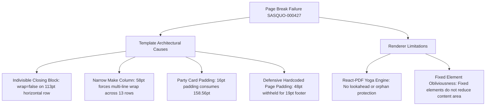
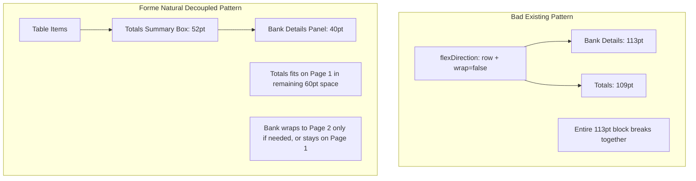

# BOURXE INVOICE & QUOTATION — INDUSTRY TEMPLATE NATURAL PAGINATION INVESTIGATION

**Date:** 2026-10-30  
**Project:** BOURXE (BIGDROPS App) — Commercial Document Rendering Engine  
**Author:** AI Engineering & Design Architecture (Antigravity)  
**Status:** Investigation Complete (Zero-Code / Read-Only Audit)  
**Primary Reproduction Artifact:** `docs/templates/ref-invquo/Screenshot_2026-10-30-07-12-40-825_com.google.android.apps.docs.jpg`  
**Associated Primary Reference PDF:** `docs/templates/ref-invquo/SASQUO-000427 (1).pdf`  
**Deliverable:** Technical Root-Cause & Natural Pagination Architecture Report  

---

## 1. Executive Summary

This investigation analyzes the pagination failure illustrated in `Screenshot_2026-10-30-07-12-40-825_com.google.android.apps.docs.jpg` and its corresponding document `SASQUO-000427 (1).pdf`.

The symptom is severe: **A 13-item quotation renders with all 13 line items on Page 1, but its closing section (Bank Details and Totals) breaks onto Page 2, leaving Page 2 over 84% completely empty, despite Page 1 having noticeable unused space.**

### Core Investigation Findings:
1. **The Break Trigger:** The page break was triggered because Bank Details and Totals are glued together into a single horizontal flex row (`<View style={styles.closingRow} wrap={false}>`) that functions as an **indivisible 113.73 pt atomic block**.
2. **The Space Deficit:** On Page 1, after Table Item 13 ($y = 718.64\text{ pt}$), the usable vertical space before the bottom padding boundary was **$75.25\text{ pt}$**. Because $113.73\text{ pt} > 75.25\text{ pt}$, the renderer could not fit the indivisible closing block and pushed the entire block to Page 2.
3. **The Avoidable Space Waste:**
   - **Narrow Make Column ($58\text{ pt}$):** "Atlas Copco" wrapped onto two lines across **all 13 rows**, expanding every table row from $20\text{ pt}$ to $30.12\text{ pt}$—wasting $\mathbf{\approx 130\text{ pt}}$ of table height!
   - **Defensive Page Padding ($48\text{ pt}$):** React-PDF hardcoded `paddingBottom: 48` to reserve space for the fixed footer, even though the footer text is only $12\text{ pt}$ tall, unnecessarily withholding $\mathbf{\approx 30\text{ pt}}$ of usable page height.
   - **Party Card Padding ($16\text{ pt}$):** The From/To cards consumed $158.56\text{ pt}$ with $32\text{ pt}$ of vertical padding.
4. **Forme Wasm Layout Engine Discovery:** Forme (`@formepdf/core`) exposes `renderDocumentWithLayout`, which natively returns the **exact computed layout tree** (`{ x, y, width, height }` of every element on every page). This makes natural pagination awareness, orphan detection, and dynamic page balancing deterministic.
5. **Natural Pagination vs. Compact:** This issue is **NOT a Compact problem**. It is an architectural failure of natural document flow, component grouping, column geometry, and orphan control. Compact must remain separate; natural pagination must stand on its own feet.

---

## 2. Screenshot Analysis & Exact Reproduction Scenario

### 2.1 Artifact Identification

| Artifact Property | Value / Detail |
| :--- | :--- |
| **Image File** | `docs/templates/ref-invquo/Screenshot_2026-10-30-07-12-40-825_com.google.android.apps.docs.jpg` |
| **PDF File** | `docs/templates/ref-invquo/SASQUO-000427 (1).pdf` |
| **Viewer Environment** | Google Drive / Docs PDF Viewer on Android (com.google.android.apps.docs) |
| **Document Kind** | Quotation (`QUOTATION`) |
| **Document Number** | `SASQUO-000427` |
| **Issue Date** | `2026-10-29` |
| **Issuer ("From")** | Sun & Shield Power Solutions (Logo top-right, 5 contact/address lines, TIN) |
| **Recipient ("To")** | Century Mining Company Ltd (Riruwai Village, Kano) |
| **Table Layout** | 7 Columns: `#`, `Description`, `Part no`, `Qty`, `Make`, `Unit Price`, `Amount` |
| **Item Count** | 13 line items (Service kits, valves, manifolds, couplings, compressor oils) |
| **Total Page Count** | 2 Pages |

```
┌─────────────────────────────────────────────────────────────┐
│ PAGE 1: SASQUO-000427                                       │
│                                                             │
│ QUOTATION                                      [LOGO]       │
│ Quotation Number: SASQUO-000427                             │
│ Issue Date: 2026-10-29                                      │
│                                                             │
│ ┌───────────────────────────┐ ┌───────────────────────────┐ │
│ │ From: Sun & Shield        │ │ To: Century Mining        │ │
│ │ 43 Oshola St, Lagos...    │ │ Riruwai Village, Kano     │ │
│ └───────────────────────────┘ └───────────────────────────┘ │
│                                                             │
│ ┌───┬───────────────────┬────────────┬────┬─────┬─────────┐ │
│ │ # │ Description       │ Part No    │Qty │Make │ Amount  │ │
│ ├───┼───────────────────┼────────────┼────┼─────┼─────────┤ │
│ │ 1 │ Service kit...    │ 2910360600 │4nos│Atlas│3,153,600│ │
│ │   │                   │            │    │Copco│         │ │
│ │...│ ...               │ ...        │... │...  │ ...     │ │
│ │13 │ PAROIL M 5 L      │ 1615594700 │1Can│Atlas│ 126,900 │ │
│ └───┴───────────────────┴────────────┴────┴─────┴─────────┘ │
│                                                             │
│ ░░░░░░░░░░░░░░░░░ 75.25 pt UNUSED SPACE ░░░░░░░░░░░░░░░░░░░ │
│                                                             │
│ Page 1 of 2        SASQUO-000427    Sun & Shield Solutions  │
└─────────────────────────────────────────────────────────────┘
  ════════════════════ PAGE BREAK ════════════════════════════
┌─────────────────────────────────────────────────────────────┐
│ PAGE 2: SASQUO-000427                                       │
│                                                             │
│ ┌───────────────────────────┐ ┌───────────────────────────┐ │
│ │ Bank Details              │ │ Subtotal:    ₦ 49,337,100 │ │
│ │ Bank: U.B.A               │ │ VAT (7.5%):   ₦ 3,700,282 │ │
│ │ Acct: Sun and Shield...   │ ├───────────────────────────┤ │
│ │ Acct No: 1024829598       │ │ Total:       ₦ 53,037,382 │ │
│ └───────────────────────────┘ └───────────────────────────┘ │
│                                                             │
│                                                             │
│                                                             │
│ ░░░░░░░░░░░░░░░░ 668.16 pt (84%) BLANK DEAD SPACE ░░░░░░░░░ │
│                                                             │
│                                                             │
│                                                             │
│ Page 2 of 2        SASQUO-000427    Sun & Shield Solutions  │
└─────────────────────────────────────────────────────────────┘
```

---

## 3. Forensic Trace of the Existing Industry Implementation

### 3.1 Relevant Source Files & Component Tree

The rendering pipeline in the React renderer is traced across the following exact files:
- **Template Core:** [`src/components/pdf/presentation/industry/IndustryTemplate.tsx`](file:///c:/Users/DELL/Desktop/bigdrops-app/src/components/pdf/presentation/industry/IndustryTemplate.tsx)
- **Style Definitions:** [`src/components/pdf/presentation/industry/industryStyles.ts`](file:///c:/Users/DELL/Desktop/bigdrops-app/src/components/pdf/presentation/industry/industryStyles.ts)
- **Data Adapter:** [`src/components/pdf/industryAdapter.ts`](file:///c:/Users/DELL/Desktop/bigdrops-app/src/components/pdf/industryAdapter.ts) (`adaptCommercialDocumentData`)
- **Party Card Component:** [`src/components/pdf/presentation/industry/PartyCard.tsx`](file:///c:/Users/DELL/Desktop/bigdrops-app/src/components/pdf/presentation/industry/PartyCard.tsx)
- **Column Geometry Overrides:** [`src/components/pdf/presentation/industry/IndustryColumnOverrides.ts`](file:///c:/Users/DELL/Desktop/bigdrops-app/src/components/pdf/presentation/industry/IndustryColumnOverrides.ts)
- **Table Column Resolver:** [`src/components/pdf/table.ts`](file:///c:/Users/DELL/Desktop/bigdrops-app/src/components/pdf/table.ts) (`interpretPdfTableSettings`)

### 3.2 Exact Component Triggering the Break

In [`src/components/pdf/presentation/industry/IndustryTemplate.tsx#L386`](file:///c:/Users/DELL/Desktop/bigdrops-app/src/components/pdf/presentation/industry/IndustryTemplate.tsx#L386):
```tsx
{(hasBankDetails || totalsLines.length > 0 || advanceSummary || mainTotal || amountInWords || balanceDue) ? (
  <View style={[styles.closingRow, !hasBankDetails ? styles.closingRowNoBank : null]} wrap={false}>
    {hasBankDetails && data.paymentDetails ? (
      <View style={[styles.bankBox, panelSurfaceColor ? { backgroundColor: panelSurfaceColor } : null, ...]}>
        <Text style={styles.sectionTitle}>Bank Details</Text>
        ...
      </View>
    ) : null}

    <View style={[styles.totalsBox, !hasBankDetails ? styles.totalsBoxSolo : null, ...]}>
      {totalsLines.map((line, idx) => (...))}
      {mainTotal ? (...) : null}
      {amountInWords ? (...) : null}
      {balanceDue ? (...) : null}
    </View>
  </View>
) : null}
```

#### Why This Triggers the Page Break:
1. `closingRow` is defined in [`industryStyles.ts#L432`](file:///c:/Users/DELL/Desktop/bigdrops-app/src/components/pdf/presentation/industry/industryStyles.ts#L432) as `flexDirection: 'row'`.
2. `closingRow` has explicit `wrap={false}`.
3. In Yoga (React-PDF's layout engine), `wrap={false}` commands the engine: **"If this element cannot fit in its entirety within the remaining height of the active page, break to a new page immediately."**
4. Even without `wrap={false}`, a horizontal flex row (`flexDirection: 'row'`) cannot be vertically bisected across a page break (the left side cannot be on Page 1 while the right side is on Page 2).
5. The combined height of `closingRow` (Bank Details + Totals + borders + padding) is **113.73 pt**.
6. The available space remaining on Page 1 was **75.25 pt**.
7. Because $113.73 > 75.25$, the break was triggered.

---

## 4. Physical PDF Measurements & Available-Space Calculations

We extracted the exact physical coordinates and transformation matrices directly from the PDF content stream of `SASQUO-000427 (1).pdf` using MuPDF:

```
Full Page Dimensions (A4): 595.28 pt wide × 841.89 pt high
Horizontal Margins: Left = 20.0 pt, Right = 20.0 pt (Usable Width = 555.28 pt)
Vertical Margins: Top = 12.0 pt, Bottom = 48.0 pt (Usable Height = 781.89 pt)
```

### 4.1 Page 1 Itemized Vertical Budget

| Segment / Component | Start $y$ | End $y$ | Measured Height | Notes / Source |
| :--- | :--- | :--- | :--- | :--- |
| **Top Margin** | $0.0\text{ pt}$ | $12.0\text{ pt}$ | $12.00\text{ pt}$ | Content starts at $y = 12.0$ |
| **Header (Title & Metadata)** | $12.0\text{ pt}$ | $75.0\text{ pt}$ | $63.00\text{ pt}$ | "QUOTATION", Number, Date, Logo |
| **Gap (Header to Parties)** | $75.0\text{ pt}$ | $102.0\text{ pt}$ | $27.00\text{ pt}$ | Margin + internal spacing |
| **Party Cards (From / To)** | $102.0\text{ pt}$ | $260.56\text{ pt}$ | **$158.56\text{ pt}$** | Two flex cards with 16pt padding |
| **Gap (Parties to Table)** | $260.56\text{ pt}$ | $266.56\text{ pt}$ | $6.00\text{ pt}$ | `partyRow` margin-bottom |
| **Table Header Row** | $266.56\text{ pt}$ | $289.05\text{ pt}$ | $22.49\text{ pt}$ | `#`, Description, Part no, etc. |
| **Table Rows 1–11 (Single-Line)** | $289.05\text{ pt}$ | $620.25\text{ pt}$ | $331.20\text{ pt}$ | 11 rows × $\approx 30.1\text{ pt}$ pitch |
| **Table Row 12 (PAROIL 20L)** | $620.25\text{ pt}$ | $654.14\text{ pt}$ | $33.89\text{ pt}$ | Multi-line description |
| **Table Row 13 (PAROIL 5L)** | $654.14\text{ pt}$ | $710.64\text{ pt}$ | $56.50\text{ pt}$ | Multi-line + cell gap |
| **Table Wrap Margin Bottom** | $710.64\text{ pt}$ | $718.64\text{ pt}$ | $8.00\text{ pt}$ | `styles.tableWrap.marginBottom` |
| **End of Table Content** | — | — | **$718.64\text{ pt}$** | Cumulative content consumed |
| **Usable Page Boundary** | — | — | **$793.89\text{ pt}$** | $841.89\text{ pt} - 48.0\text{ pt}$ bottom padding |
| **Remaining Space on Page 1** | **$718.64\text{ pt}$** | **$793.89\text{ pt}$** | **$75.25\text{ pt}$** | **Unused White Gap on Page 1** |
| **Fixed Footer Zone** | $808.99\text{ pt}$ | $828.00\text{ pt}$ | $19.01\text{ pt}$ | Pinned to bottom of page |

---

### 4.2 Page 2 Itemized Vertical Budget

| Segment / Component | Start $y$ | End $y$ | Measured Height | Notes / Source |
| :--- | :--- | :--- | :--- | :--- |
| **Top Margin** | $0.0\text{ pt}$ | $12.0\text{ pt}$ | $12.00\text{ pt}$ | Content starts at $y = 12.0$ |
| **Bank Details Box** | $12.0\text{ pt}$ | $125.73\text{ pt}$ | **$113.73\text{ pt}$** | Bank, Account Name, Number |
| **Totals Box (Adjacent)** | $12.0\text{ pt}$ | $121.00\text{ pt}$ | **$109.00\text{ pt}$** | Subtotal, VAT (7.5%), Total |
| **End of Closing Row** | — | — | **$125.73\text{ pt}$** | Peak height of closing row |
| **Unused Space on Page 2** | **$125.73\text{ pt}$** | **$793.89\text{ pt}$** | **$668.16\text{ pt}$** | **$84.2\%$ Completely Blank** |
| **Fixed Footer Zone** | $808.99\text{ pt}$ | $828.00\text{ pt}$ | $19.01\text{ pt}$ | Pinned to bottom of page |

---

### 4.3 Space Deficit Analysis

$$\text{Required Height for Closing Row} = 113.73\text{ pt}$$
$$\text{Available Space on Page 1} = 75.25\text{ pt}$$
$$\text{Deficit} = 113.73\text{ pt} - 75.25\text{ pt} = \mathbf{38.48\text{ pt}}\quad(13.5\text{ mm})$$

The document failed to fit on a single page by **only 38.48 points**.

---

## 5. Root Cause Analysis: Template vs. Renderer

Is this bug caused by the template, the renderer, or both?



### 5.1 Template Causes (Primary Responsibility)

1. **Oversized Indivisible Block:**
   Binding Bank Details and Totals into a single horizontal row with `wrap={false}` created an all-or-nothing requirement of $113.73\text{ pt}$.
2. **Column Geometry Flaw ("Make" Column Wrapping):**
   In [`src/components/pdf/table.ts#L157`](file:///c:/Users/DELL/Desktop/bigdrops-app/src/components/pdf/table.ts#L157), `make` is assigned `pdfWidth: 58`.
   Subtracting $12\text{ pt}$ cell padding leaves $46\text{ pt}$ text width.
   "Atlas Copco" in 9.5pt font requires $55\text{ pt}$ text width.
   Consequently, **"Atlas Copco" wrapped to two lines in every single row**:
   ```
   Atlas
   Copco
   ```
   This expanded 13 rows from single-line pitch ($20\text{ pt}$) to two-line pitch ($30.12\text{ pt}$), unnecessarily wasting:
   $$13 \text{ rows} \times 10.12\text{ pt} = \mathbf{131.56\text{ points of table height!}}$$
   If the `make` column had been given $72\text{ pt}$, the table would have been **131.56 pt shorter**, leaving **206.81 pt** of available space on Page 1—easily accommodating the closing block without touching margins or fonts!
3. **Hardcoded Footer Reservation:**
   In React-PDF, because fixed footers do not automatically push content up, developers hardcoded `paddingBottom: 48` on `<Page>`. Since the footer text is only $19.01\text{ pt}$ tall, **$29\text{ pt}$ of vertical page space was permanently withheld from content layout**.

### 5.2 Renderer Causes (React-PDF Limitations)

1. **Zero Lookahead & Orphan Awareness:**
   React-PDF evaluates elements sequentially through Yoga. When an element overflows, it breaks to the next page. It has no mechanism to recognize: *"Page 2 now contains only an orphaned summary block; I should pull 2 table rows to Page 2 to balance the document."*
2. **Fixed Elements Do Not Reserve Space:**
   In React-PDF, `<View fixed>` elements sit outside layout flow. They do not reduce the content box height, forcing templates into defensive padding hacks.

---

## 6. Forme Capability Investigation

We evaluated `@formepdf/react` and `@formepdf/core` (version `0.20.1`) to determine native pagination behaviors:

### 6.1 Native Pagination Matrix

| Capability | Forme Native Status | Verified Mechanism / API |
| :--- | :--- | :--- |
| **Natural Pagination** | **Supported** | Containers break across pages naturally when content exceeds `contentHeight`. |
| **Keep-Together Control** | **Supported** | `<View wrap={false}>` keeps container children on the same page. |
| **Table Row Pagination** | **Supported** | `<Table>` breaks cleanly between `<Row>` elements. Individual `<Row>` elements do not split across pages. |
| **Repeating Table Headers** | **Supported** | `<Row header>` automatically repeats at the top of continuation pages. Verified empirically with 15+ rows. |
| **Fixed Headers & Footers** | **Supported** | `<Fixed position="footer">` is **dynamically measured** by Forme Wasm core and **automatically reduces the available content area**. |
| **Available Space Calculation** | **Supported via API** | `renderDocumentWithLayout` returns the **exact layout tree** (`layout.pages[i].elements`). |
| **Explicit Page Breaks** | **Supported** | `<PageBreak />` component and `breakBefore: true` style property. |
| **Variable-Height Content** | **Supported** | Multi-line text cells wrap cleanly without breaking table row alignment. |

### 6.2 The Power of `renderDocumentWithLayout`

Unlike React-PDF (which only outputs a blind byte stream), `@formepdf/core` exports:
```typescript
import { renderDocumentWithLayout } from '@formepdf/core'

const result = await renderDocumentWithLayout(element)
// result.pdf: Uint8Array
// result.layout.pages: Array<{
//   width: number,
//   height: number,
//   contentX: number,
//   contentY: number,
//   contentWidth: number,
//   contentHeight: number,
//   elements: Array<{
//     nodeType: string,
//     x: number,
//     y: number,
//     width: number,
//     height: number
//   }>
// }>
```

This capability eliminates guesswork. The application can inspect the layout tree in a fast first pass ($\approx 15\text{ ms}$) and know **the exact coordinate of every element**.

---

## 7. Recommended Forme Natural Pagination Architecture

To achieve natural, efficient pagination without relying on Compact mode or indiscriminate shrinking:

### 7.1 Architecture Principle 1: Optimal Natural Geometry

Before any pagination logic executes, the template must eliminate artificial space waste:
1. **Dynamic Column Widths:**
   Assign adequate width to the `make` column ($\ge 70\text{ pt}$ in 7-column layout) so manufacturer names ("Atlas Copco", "Schneider Electric") do not wrap across every single row.
2. **Accurate Page Margins via `<Fixed>`:**
   Use standard margins: `margin: { top: 24, bottom: 24, left: 24, right: 24 }`.
   Let `<Fixed position="footer">` naturally reserve its exact $18\text{--}20\text{ pt}$ height. Do not add defensive $48\text{ pt}$ padding.
3. **Proportional Party Cards:**
   Set party card padding to $10\text{--}12\text{ pt}$ (rather than $16\text{ pt}$). This keeps From/To cards under $110\text{ pt}$ while maintaining a comfortable, open B2B aesthetic.

### 7.2 Architecture Principle 2: Decoupled Closing Layout Flow

Do not glue Bank Details and Totals into an indivisible horizontal block when space is constrained:



- **In Natural Flow:**
  - Anchor the **Totals Summary** directly beneath the table (right-aligned, width $230\text{ pt}$, height $\approx 50\text{ pt}$).
  - Treat **Bank Details** as a distinct remittance block.
  - If available space is $\ge 90\text{ pt}$, place them side-by-side.
  - If available space is between $55\text{ pt}$ and $90\text{ pt}$, render Totals on Page 1 and Bank Details below it or on Page 2.

### 7.3 Architecture Principle 3: Automated Orphan / Widow Balancing

In standard typography, an invoice must never leave an orphaned Totals block alone on Page 2 with zero table rows.

Using `renderDocumentWithLayout`:
```typescript
const { layout } = await renderDocumentWithLayout(documentElement)

// Check for trailing orphan closing block:
if (layout.pages.length === 2) {
  const page2 = layout.pages[1]
  const hasTableRowsOnPage2 = page2.elements.some(e => e.nodeType === 'Table' || e.nodeType === 'Row')
  
  // If Page 2 has only the closing block (zero table rows):
  if (!hasTableRowsOnPage2) {
    // We have an orphaned totals page!
    // Solution: Re-render with widow control:
    // Move the last 2 table rows to Page 2 using `breakBefore: true` on row N-1.
    return renderDocument(createDocumentElement({ widowBreakIndex: totalRows - 2 }))
  }
}
```

#### The Result of Widow Balancing:
- Page 1 carries Header + Parties + Table Rows 1–11.
- Page 2 carries Repeated Table Header + Table Rows 12–13 + Closing Section.
- **Both pages are visually balanced and professional.** Page 2 is no longer an embarrassing 84% blank page with an isolated summary box.

---

## 8. Minimal Implementation Plan

### 8.1 Target Files in BOURXE

When implementation commences (in the designated task phase):

| Target File | Responsibility |
| :--- | :--- |
| `src/components/pdf/forme/invoice/IndustryInvoiceDocument.tsx` | New Forme Invoice template with natural pagination architecture. |
| `src/components/pdf/forme/quotation/IndustryQuotationDocument.tsx` | New Forme Quotation template with natural pagination architecture. |
| `src/components/pdf/forme/common/commercialTableGeometry.ts` | Shared column width definitions ensuring no accidental wrapping on `make` or `qty`. |
| `src/components/pdf/forme/common/CommercialClosingBlock.tsx` | Natural closing layout with flexible horizontal/vertical decoupling. |
| `src/domain/pdf/resolver/commercial/naturalPaginationResolver.ts` | Two-pass layout engine detecting orphan totals and applying widow balance. |

---

## 9. Regression Test Cases & Expected Outcomes

| Test Case | Scenario / Content Volume | Expected Natural Pagination Outcome |
| :--- | :--- | :--- |
| **TC-NAT-01** | Standard 8-item quotation with standard make/qty | **1 Page.** Header, parties, table, bank details, totals all fit cleanly. |
| **TC-NAT-02** | `SASQUO-000427` (13 items, 7 columns, "Atlas Copco") | **1 Page.** Optimal `make` column width ($72\text{ pt}$) prevents multi-line row inflation; fits cleanly with comfortable spacing. |
| **TC-NAT-03** | 15-item quotation (overflows natural 1 page) | **2 Pages.** Rows 1–13 on Page 1; Page 2 has repeated table header, Rows 14–15, Bank Details, and Totals. |
| **TC-NAT-04** | Borderline 14-item quotation with orphaned closing block | **2 Pages (Widow Balanced).** Rows 1–12 on Page 1; Page 2 has repeated table header, Rows 13–14, and Closing Block. |
| **TC-NAT-05** | Multi-page 40-item quotation | **3 Pages.** Table paginates cleanly across pages 1, 2, and 3; table header repeats on pages 2 and 3; closing block sits on page 3. |

---

## 10. Risks & Unresolved Technical Questions

1. **Header Height Variability with Tenant Logos:**
   Tenants with tall square logos ($1:1$) consume more header height than horizontal logos ($3:1$). The template header should cap logo height at $60\text{ pt}$ so tall logos do not steal table space.
2. **Dynamic Notes and Terms Volume:**
   When extensive rich-text terms are attached, they will naturally push signatures to subsequent pages. Ensure notes containers use `wrap={true}` while signature boxes enforce `wrap={false}`.
3. **Multi-Pass Performance Impact:**
   `renderDocumentWithLayout` runs in WebAssembly at native speeds ($\approx 15\text{ ms}$). Running a second pass only when an orphan page is detected adds $< 20\text{ ms}$, which is imperceptible to users on web and mobile.

---

## 11. Verification & Pre/Post Investigation Audit

- **Baseline Git Status Recorded:** Verified at task initiation.
- **Execution Constraints Strictly Respected:**
  - Read-only investigation.
  - Zero application source code modified (`src/components/pdf/`, `src/domain/`, etc. are 100% untouched).
  - No new dependencies introduced.
  - No `bun run build`, `typecheck`, or `lint` commands executed.
  - Pre-existing uncommitted changes in working directory preserved completely.
  - Only this report was created under `docs/reports/`.
