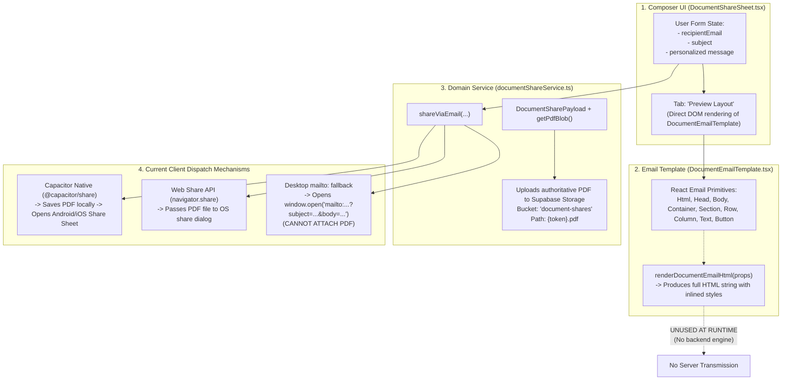

# BOURXE Resend Email Delivery Integration Audit

**Project:** BOURXE Business Management Suite  
**Stack:** React 19, Vite 7, TypeScript 5.9, Tailwind CSS 3.4, Supabase, Vercel  
**Runtime:** Bun Only  
**Audit Type:** Strict Read-Only Technical Architecture & Integration Audit  
**Date:** November 8, 2026  
**Status:** COMPLETE (Zero Code Changes)  

---

## 1. Executive Summary

This independent technical audit evaluates whether **Resend** (or any alternative transactional email delivery provider) is already installed, configured, or integrated into the BOURXE platform, and whether the existing document-sharing subsystem can support direct server-side email dispatch with authoritative PDF attachments.

### Primary Audit Verdict & Classification
> [!IMPORTANT]
> ### Final Classification: **C. RESEND NOT PRESENT; INTEGRATION REQUIRED.**
> 
> Static inspection across the entire BOURXE repository establishes with 100% certainty that:
> 1. **Resend is NOT installed:** The `resend` SDK does not exist in [package.json](file:///c:/Users/DELL/Desktop/bigdrops-app/package.json), [bun.lock](file:///c:/Users/DELL/Desktop/bigdrops-app/bun.lock), or any edge function manifest.
> 2. **Resend is NOT initialized or used:** There are zero instances of `new Resend()`, `resend.emails.send()`, or Resend REST API endpoints anywhere in the application source code or Supabase Edge Functions.
> 3. **No credentials exist:** No `RESEND_API_KEY` exists in [.env](file:///c:/Users/DELL/Desktop/bigdrops-app/.env), [.env.example](file:///c:/Users/DELL/Desktop/bigdrops-app/.env.example), [Vercel.json](file:///c:/Users/DELL/Desktop/bigdrops-app/Vercel.json), or Supabase configs.
> 4. **No alternative transactional delivery provider exists:** No SendGrid, Postmark, AWS SES, Mailgun, or Nodemailer client exists in executable code.
> 5. **Document-sharing email is strictly client-assisted:** Outbound email in [documentShareService.ts](file:///c:/Users/DELL/Desktop/bigdrops-app/src/domain/documentShare/documentShareService.ts) relies exclusively on mobile OS native share sheets (`@capacitor/share`), Web Share API (`navigator.share`), or desktop `mailto:` URL schemes. No server-side email transmission currently occurs.

### Feasibility Summary
Although Resend is completely absent today, the existing document-sharing architecture is **highly primed for integration**:
- **HTML Compilation:** [DocumentEmailTemplate.tsx](file:///c:/Users/DELL/Desktop/bigdrops-app/src/components/email/DocumentEmailTemplate.tsx) already exports `renderDocumentEmailHtml(props)` backed by `@react-email/render`, producing email-client-compatible HTML with inlined CSS that can be passed directly to Resend's `html` payload.
- **Authoritative PDF Attachment:** [documentShareService.ts](file:///c:/Users/DELL/Desktop/bigdrops-app/src/domain/documentShare/documentShareService.ts) already generates and persists the authoritative PDF binary in Supabase Storage (`document-shares` bucket). This binary can be retrieved by an Edge Function and attached to Resend's `attachments` array without changing PDFCN or existing document math.

---

## 2. Resend Dependency Status

| Manifest / Location | Verification Method | Status | Evidence / Details |
| :--- | :--- | :---: | :--- |
| **`package.json` (Root)** | Static line inspection & AST search | **NOT PRESENT** | No `resend`, `@resend/...`, or any email delivery package in `dependencies` or `devDependencies`. (Only `@react-email/components` and `@react-email/render` are installed). |
| **`bun.lock` (Lockfile)** | Substring search & integrity scan | **NOT PRESENT** | Zero resolved entries or transitive dependencies for `resend`. |
| **`api/` (Vercel Functions)** | Directory & file inspection | **NOT PRESENT** | [api/package.json](file:///c:/Users/DELL/Desktop/bigdrops-app/api) does not exist; existing endpoints (`edit-payment-caption.ts`, `upload-payment-attachment.ts`) integrate Telegram bot webhooks, not email. |
| **`supabase/functions/`** | Deno dependency imports inspection | **NOT PRESENT** | Zero imports of `https://esm.sh/resend` or `npm:resend` across all edge functions. |

---

## 3. Resend Runtime Integration

Systematic static analysis of all executable source code in `src/`, `api/`, and `supabase/functions/` establishes:

* **SDK Imports:** `0` instances of `import { Resend }` or `require('resend')`.
* **Client Initialization:** `0` instances of `new Resend(...)`.
* **Dispatch Calls:** `0` instances of `.emails.send(...)` or `resend.send(...)`.
* **Webhook Handling:** `0` handlers for Resend delivery/bounce/open webhooks.
* **Domain Verification References:** No DNS or domain verification records for Resend.
* **Documentation Occurrences:** Mentions of Resend exist exclusively in documentation and skills:
  - `.agents/skills/emails/SKILL.md`: Reference to Resend as a recommended modern transactional provider.
  - `docs/prd/Correspondence-module/Correspondence-modulev1.md`: Lists "Resend" as a candidate provider under the planned Correspondence module.
  - `docs/reports/EmailCN_Compatibility_and_Integration_Feasibility_Audit.md`: Previous audit highlighting that BOURXE has zero transactional email delivery infrastructure.
  - `docs/reports/Unified-Document-Sharing-Independent-Audit.md`: Explicitly noted the absence of Resend and backend email delivery.

---

## 4. Environment and Secret Configuration References

Inspected environment templates, active configuration manifests, and serverless deployment files:

1. **[.env.example](file:///c:/Users/DELL/Desktop/bigdrops-app/.env.example):**
   - Contains only `VITE_SUPABASE_URL`, `VITE_SUPABASE_ANON_KEY`, and `VITE_GIT_REPO`.
   - Zero references to `RESEND_API_KEY`.
2. **[.env](file:///c:/Users/DELL/Desktop/bigdrops-app/.env) (Local Environment Keys):**
   - Active variable names inspected (secret values masked per security protocol):
     - `VITE_SUPABASE_URL`, `VITE_SUPABASE_ANON_KEY`
     - `SUPABASE_URL`, `SUPABASE_SERVICE_ROLE_KEY`
     - `DATABASE_URL`
     - `TELEGRAM_BOT_TOKEN`, `TELEGRAM_GROUP_CHAT_ID`
     - `POLYFORK_KEY`
   - **`RESEND_API_KEY` is completely absent.**
3. **[Vercel.json](file:///c:/Users/DELL/Desktop/bigdrops-app/Vercel.json):**
   - Defines SPA rewrite rules and `/api/(.*)` routing. Contains zero environment variable declarations.
4. **[supabase/config.toml](file:///c:/Users/DELL/Desktop/bigdrops-app/supabase/config.toml):**
   - Contains standard Supabase local development configuration. Contains no Resend configuration.

---

## 5. Other Email Providers and SMTP Integrations

An investigation into whether alternative delivery engines are wired into the platform revealed:

1. **Supabase Auth Built-In SMTP ([supabase/config.toml](file:///c:/Users/DELL/Desktop/bigdrops-app/supabase/config.toml#L231-L240)):**
   - Lines 231–240 contain commented-out boilerplate:
     ```toml
     # [auth.email.smtp]
     # enabled = true
     # host = "smtp.sendgrid.net"
     # pass = "env(SENDGRID_API_KEY)"
     ```
   - *Status:* Disabled/commented out.
   - *Scope:* Supabase Auth internal emails only (user signups, magic links, password resets). This does not expose an API or client for application-level document sharing or custom attachments.
2. **Third-Party Email SDKs:**
   - No SendGrid, Postmark, AWS SES, Mailgun, EmailJS, or Nodemailer SDK is installed or imported.
3. **Push Notifications & Telegram:**
   - Mobile push notifications are handled by Firebase Cloud Messaging in [supabase/functions/dispatch-push-notifications](file:///c:/Users/DELL/Desktop/bigdrops-app/supabase/functions/dispatch-push-notifications/index.ts) using `FCM_SERVER_KEY`.
   - Payment notifications are dispatched to Telegram in [api/edit-payment-caption.ts](file:///c:/Users/DELL/Desktop/bigdrops-app/api/edit-payment-caption.ts) via `TELEGRAM_BOT_TOKEN`.
   - Neither provides email delivery.

---

## 6. Existing Document-Sharing Email Architecture

The document-sharing subsystem is partitioned across UI, template rendering, and client-side sharing:



### Architectural Realities of the Current Setup

1. **Email Composer:** Implemented in [DocumentShareSheet.tsx](file:///c:/Users/DELL/Desktop/bigdrops-app/src/components/document-view/shared/DocumentShareSheet.tsx#L463-L543). It collects `recipientEmail`, `subject`, and `message`, and displays a badge confirming the authoritative PDF attachment.
2. **Email HTML Generation:** Defined in [DocumentEmailTemplate.tsx](file:///c:/Users/DELL/Desktop/bigdrops-app/src/components/email/DocumentEmailTemplate.tsx#L164-L166) via `renderDocumentEmailHtml(props)`. It produces an executive BOURXE-branded HTML document with inlined CSS, key document details, and a primary CTA link to the secure document viewer.
3. **HTML Disconnect:** In the current codebase, `renderDocumentEmailHtml` is **never called during email sending**. The rendered HTML is only viewed inside the in-app modal preview (`activeTab === 'preview'`).
4. **Current Dispatch Behavior ([documentShareService.ts:366–438](file:///c:/Users/DELL/Desktop/bigdrops-app/src/domain/documentShare/documentShareService.ts#L366-L438)):**
   - **Capacitor Mobile:** Writes the PDF binary to the device cache and triggers `Share.share({ files: [saved.uri], text: fullBody })`. The device OS opens third-party mail apps, but recipient email prefill is ignored by standard mobile share intents.
   - **Desktop Web:** Falls back to `window.open("mailto:...?subject=...&body=...")`. Under RFC 2368, **`mailto:` links cannot attach binary files**. The user must manually download the PDF and attach it themselves.

---

## 7. PDF Attachment Feasibility with Resend

Can the existing authoritative PDF generated by PDFCN be attached to a direct email sent via Resend?  
**YES. It is completely feasible and technically straightforward.**

### Why It Works Seamlessly
1. **Authoritative PDF Generation is Already Decoupled:**
   - In [documentShareService.ts:37–160](file:///c:/Users/DELL/Desktop/bigdrops-app/src/domain/documentShare/documentShareService.ts#L37-L160), `createOrGetDocumentShare` invokes `payload.getPdfBlob()`.
   - This executes PDFCN's authoritative renderer (`renderPdfcnToBytes` or `renderToBlob`), ensuring identical visual fidelity, locked financial math, and official numbering across all documents.
2. **Persistent Storage in Supabase:**
   - The authoritative PDF binary is uploaded to the private Supabase Storage bucket `document-shares` under the key `${token}.pdf`.
3. **Resend Attachment Compatibility:**
   - Resend's API natively supports binary attachments in its `attachments` parameter:
     ```typescript
     await resend.emails.send({
       from: 'BOURXE Documents <billing@bouxre.com>',
       to: [recipientEmail],
       subject: subject,
       html: renderedHtml,
       attachments: [
         {
           filename: payload.fileName, // e.g. "Invoice-INV-2026-0042.pdf"
           content: pdfBuffer,         // Buffer or Base64 string
         },
       ],
     })
     ```
   - An Edge Function can either:
     - Receive the pre-uploaded `token`, fetch `${token}.pdf` from Supabase Storage using service credentials, and attach it directly; OR
     - Receive the base64-encoded PDF payload sent directly from the client.

---

## 8. Security and Authorization Assessment

If Resend is integrated in the future, the following security architecture must be observed:

| Security Vector | Risk / Attack Surface | Required Architecture & Controls |
| :--- | :--- | :--- |
| **Credential Storage** | Leakage of `RESEND_API_KEY` in frontend bundle | **STRICT ISOLATION:** The Resend API key must NEVER be prefixed with `VITE_` and must NEVER touch client-side code. It must reside exclusively in Supabase Vault / Edge Function Secrets. |
| **Authorization Barrier** | Unauthorized users spoofing emails for arbitrary documents | **TENANT RLS ENFORCEMENT:** The Edge Function must authenticate the caller (`auth.uid()`), query `public.document_shares` or the underlying document table, and verify that the user belongs to the active `tenant_id`. |
| **Spam / Relay Abuse** | Malicious users using BOURXE to send arbitrary emails | **STRICT INPUT VALIDATION:** Validate recipient email format (`z.string().email()`), enforce strict rate limits per user/tenant/IP, and reject arbitrary HTML injection into the template body. |
| **Attachment Tampering** | Replacing the official PDF with an arbitrary or malicious binary | **SERVER-SIDE BINDING:** The Edge Function must fetch the PDF directly from the trusted Supabase Storage bucket (`document-shares/${token}.pdf`) rather than accepting unverified binary uploads from the client request body. |
| **Fail-Closed Verification** | False positives in delivery feedback | The client must only report "Email sent" if the backend returns a verified Resend message ID (`{ id: "msg_..." }`). |

---

## 9. Integration Readiness & What Is Required

To transition from the current client-side fallback to full direct Resend email delivery, the required scope is strictly server-side and additive:

1. **Backend Edge Function (e.g. `supabase/functions/send-document-email/index.ts`):**
   - Imports Resend via `https://esm.sh/resend`.
   - Validates caller JWT and tenant membership.
   - Retrieves document metadata and rendered HTML (or renders via React Email in the Edge Function).
   - Fetches the authoritative PDF from `document-shares/${token}.pdf`.
   - Calls `resend.emails.send({ from, to, subject, html, attachments })`.
2. **Environment Configuration:**
   - Add `RESEND_API_KEY` to Supabase Edge Function secrets (`supabase secrets set RESEND_API_KEY=...`).
   - Configure and verify a custom sending domain in the Resend dashboard with SPF, DKIM, and DMARC DNS records.
3. **Client-Side Service Hook ([src/domain/documentShare/documentShareService.ts](file:///c:/Users/DELL/Desktop/bigdrops-app/src/domain/documentShare/documentShareService.ts)):**
   - In `shareViaEmail`, invoke `supabase.functions.invoke('send-document-email', { body: { token, recipientEmail, subject, message } })`.
   - Keep native Capacitor share and `mailto:` as explicit fallback options if the network or Edge Function is unreachable.
4. **Zero Impact on PDFCN or Host Modules:**
   - PDFCN requires no modifications.
   - The seven host modules ([Invoice](file:///c:/Users/DELL/Desktop/bigdrops-app/src/components/document-view/invoice/InvoiceOverlays.tsx), [Quotation](file:///c:/Users/DELL/Desktop/bigdrops-app/src/pages/ViewQuotation.tsx), [Receipt](file:///c:/Users/DELL/Desktop/bigdrops-app/src/pages/ViewReceipt.tsx), [Waybill](file:///c:/Users/DELL/Desktop/bigdrops-app/src/pages/ViewWaybill.tsx), [RFQ](file:///c:/Users/DELL/Desktop/bigdrops-app/src/pages/ViewRfq.tsx), [CPS](file:///c:/Users/DELL/Desktop/bigdrops-app/src/pages/ViewCps.tsx), [CSR](file:///c:/Users/DELL/Desktop/bigdrops-app/src/pages/ViewCSR.tsx)) require zero modifications because they communicate solely through [DocumentShareSheet.tsx](file:///c:/Users/DELL/Desktop/bigdrops-app/src/components/document-view/shared/DocumentShareSheet.tsx).

---

## 10. Exact Files Inspected

1. [`package.json`](file:///c:/Users/DELL/Desktop/bigdrops-app/package.json): Root dependency declarations.
2. [`bun.lock`](file:///c:/Users/DELL/Desktop/bigdrops-app/bun.lock): Resolved dependency lockfile.
3. [`.env.example`](file:///c:/Users/DELL/Desktop/bigdrops-app/.env.example): Environment variable documentation template.
4. [`.env`](file:///c:/Users/DELL/Desktop/bigdrops-app/.env): Local environment variables (names only, values masked).
5. [`Vercel.json`](file:///c:/Users/DELL/Desktop/bigdrops-app/Vercel.json): Deployment routing rules.
6. [`supabase/config.toml`](file:///c:/Users/DELL/Desktop/bigdrops-app/supabase/config.toml): Supabase local configuration and Auth SMTP settings.
7. [`supabase/functions/dispatch-push-notifications/index.ts`](file:///c:/Users/DELL/Desktop/bigdrops-app/supabase/functions/dispatch-push-notifications/index.ts): FCM push notification Edge Function.
8. [`supabase/functions/postgrest-schema-exposure/index.ts`](file:///c:/Users/DELL/Desktop/bigdrops-app/supabase/functions/postgrest-schema-exposure/index.ts): Management API schema configuration.
9. [`supabase/functions/public-document-pdf/index.ts`](file:///c:/Users/DELL/Desktop/bigdrops-app/supabase/functions/public-document-pdf/index.ts): Token-gated public PDF streaming endpoint.
10. [`api/edit-payment-caption.ts`](file:///c:/Users/DELL/Desktop/bigdrops-app/api/edit-payment-caption.ts) & [`api/upload-payment-attachment.ts`](file:///c:/Users/DELL/Desktop/bigdrops-app/api/upload-payment-attachment.ts): Telegram notification APIs.
11. [`src/components/email/DocumentEmailTemplate.tsx`](file:///c:/Users/DELL/Desktop/bigdrops-app/src/components/email/DocumentEmailTemplate.tsx): React Email executive template and HTML renderer.
12. [`src/components/document-view/shared/DocumentShareSheet.tsx`](file:///c:/Users/DELL/Desktop/bigdrops-app/src/components/document-view/shared/DocumentShareSheet.tsx): In-app document sharing modal and email composer.
13. [`src/domain/documentShare/documentShareService.ts`](file:///c:/Users/DELL/Desktop/bigdrops-app/src/domain/documentShare/documentShareService.ts): Cryptographic token creation, PDF storage upload, and email sharing channels.
14. [`src/domain/documentShare/types.ts`](file:///c:/Users/DELL/Desktop/bigdrops-app/src/domain/documentShare/types.ts): Data contracts for sharing payloads and action results.
15. [`docs/reports/EmailCN_Compatibility_and_Integration_Feasibility_Audit.md`](file:///c:/Users/DELL/Desktop/bigdrops-app/docs/reports/EmailCN_Compatibility_and_Integration_Feasibility_Audit.md): Architectural report on email design systems.
16. [`docs/reports/Unified-Document-Sharing-Independent-Audit.md`](file:///c:/Users/DELL/Desktop/bigdrops-app/docs/reports/Unified-Document-Sharing-Independent-Audit.md): Audit of document-sharing channels.

---

## 11. Verification and Git Status

### Pre-Audit Working Tree State
```
 M src/components/app/AppShell.tsx
 M src/lib/designLabPreviews.ts
?? src/components/cold-launch/ColdLaunchExperimentPreview.tsx
?? src/pages/ColdLaunchThemeExperiment.tsx
```

### Post-Audit Working Tree State
```
 M src/components/app/AppShell.tsx
 M src/lib/designLabPreviews.ts
?? docs/reports/BOURXE_Resend_Email_Delivery_Integration_Audit.md
?? src/components/cold-launch/ColdLaunchExperimentPreview.tsx
?? src/pages/ColdLaunchThemeExperiment.tsx
```

- **Zero modifications** were made to existing application code, dependencies, lockfiles, or migrations.
- **Only** this requested Markdown report was created under `docs/reports/`.
- No builds, linting, migrations, or typecheck commands were run.

---

## 12. Findings, Limitations, and Recommended Next Step

### Key Limitations
1. **Desktop Email Degrades to `mailto:`:** Desktop users currently cannot send an email directly from BOURXE or automatically attach a PDF without third-party email client intervention.
2. **Mobile Share Sheets Discard Email Recipient:** Capacitor's native share intent attaches the PDF but delegates destination selection to the Android/iOS OS menu, ignoring the typed recipient email address.

### Recommended Next Step
When project leadership authorizes transactional email delivery:
1. Provision a free-tier or production account on [Resend](https://resend.com) and verify the company sending domain (e.g., `bourxe.com`).
2. Add a lightweight Supabase Edge Function (`send-document-email`) to execute `resend.emails.send` with the authoritative PDF attached from `document-shares/${token}.pdf`.
3. Wire the "Send via Email" button in [DocumentShareSheet.tsx](file:///c:/Users/DELL/Desktop/bigdrops-app/src/components/document-view/shared/DocumentShareSheet.tsx) to invoke this function while preserving native Capacitor sharing as a mobile fallback.
