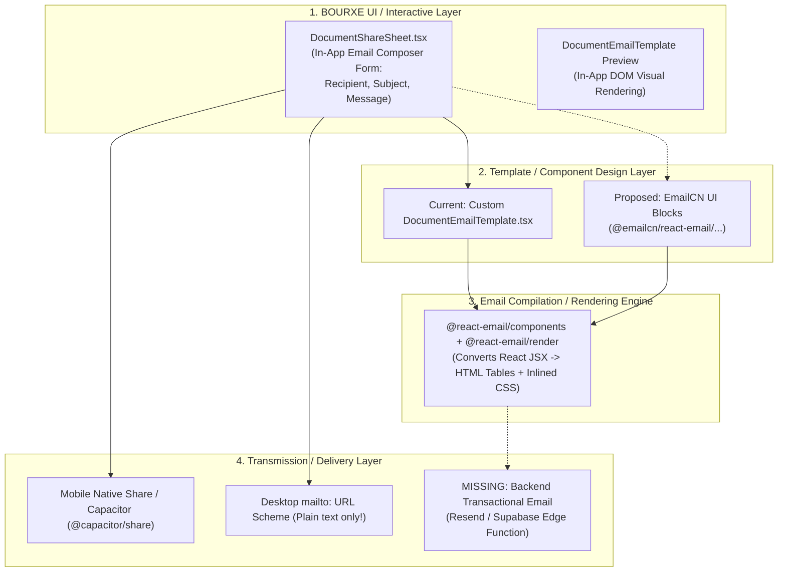

# BOURXE EmailCN Compatibility & Integration Feasibility Audit

**Project:** BOURXE Business Management Suite  
**Stack:** React 19, Vite 7, TypeScript 5.9, Tailwind CSS 3.4, Supabase, Vercel  
**Runtime:** Bun Only  
**Audit Type:** Strict Read-Only Technical Architecture & Capability Audit  
**Date:** November 7, 2026  
**Status:** COMPLETE (Zero Application Code Changes)  

---

## Executive Summary

This independent technical audit evaluates whether **EmailCN** is a viable, drop-in replacement for **React Email** within the BOURXE document-sharing subsystem.

### Key Audit Finding
> [!CRITICAL]
> **EmailCN is NOT an email rendering engine, nor is it an npm package.**  
> EmailCN (`https://emailcn.run`, created by Shadcn Labs / Aniket Pawar) is an open-source, `shadcn/ui`-inspired **component registry** of copy-paste React components. Critically, EmailCN’s React components **require and build directly upon React Email (`@react-email/components` and `@react-email/render`)** or alternatively MJML (`@faire/mjml-react`) as their underlying primitive runtime and HTML compiler.  
>  
> Consequently, **EmailCN cannot replace or eliminate React Email**. Attempting to uninstall React Email while adopting EmailCN is technically impossible because EmailCN is a consumer of React Email, not an alternative to it.

### Feasibility Verdict
* **Strict Evaluation (Complete React Email Removal & Replacement by EmailCN as "Sole Email System"):**  
  **`NOT FEASIBLE`**  
  *Justification:* EmailCN provides zero HTML rendering or inlining capabilities of its own. Without `@react-email/render` (or an equivalent compilation engine), EmailCN JSX cannot compile to email-client-compatible HTML.
* **Secondary Evaluation (Adopting EmailCN UI Blocks on Top of React Email Engine):**  
  **`FEASIBLE WITH MAJOR ARCHITECTURAL LIMITATIONS`**  
  *Justification:* EmailCN templates can be added via the `shadcn` CLI registry to style notification templates. However, BOURXE's existing document-sharing system (`src/domain/documentShare/documentShareService.ts`) does not currently feature a backend transactional email delivery engine (e.g., Resend, SendGrid, or Supabase Edge Functions). Emails are dispatched exclusively via mobile Web Share / Capacitor native share sheets or desktop `mailto:` URL schemes, which cannot transmit HTML email payloads.

---

## 1. EmailCN Identity & Availability

| Dimension | Verified Fact / Repository Finding |
| :--- | :--- |
| **Exact Project Identity** | **Emailcn** (`emailcn`), authored by Shadcn Labs / Aniket Pawar. |
| **Official Domain & Docs** | `https://emailcn.run` |
| **Official Repository** | `https://github.com/shadcn-labs/emailcn` |
| **Package Format** | **Not an npm package.** There is no standalone `emailcn` or `@emailcn` library published on `registry.npmjs.org`. It is distributed as a `shadcn/ui`-compatible component registry. |
| **Current Installation Status** | **Not Installed.** Verified via [package.json](file:///c:/Users/DELL/Desktop/bigdrops-app/package.json) and [components.json](file:///c:/Users/DELL/Desktop/bigdrops-app/components.json). |
| **Registry Configuration** | [components.json](file:///c:/Users/DELL/Desktop/bigdrops-app/components.json) currently registers `@componentry`, `@unlumen-ui`, and `@pdfcn` (`https://pdfcn.dev/r/{name}.json`). It does NOT register `@emailcn`. |
| **Supported Installation Method** | CLI-driven component scaffolding: `pnpm/bun dlx shadcn@latest add @emailcn/react-email/<block-name>` (or via custom registry JSON). |
| **Underlying Runtime Requirements** | Requires React 18/19, `react-dom`, `@react-email/components`, `@react-email/render`, and `@react-email/tailwind`. |
| **React 19 / Vite 7 / TS 5.9 Compatibility** | **Compatible with caveats.** EmailCN source files are plain TypeScript JSX. However, their execution relies on `@react-email/*`. In BOURXE, `@react-email/components` (`^1.0.12`) and `@react-email/render` (`^2.1.0`) are already installed and verified compatible with React 19 (`^19.2.0`) in [bun.lock](file:///c:/Users/DELL/Desktop/bigdrops-app/bun.lock). |

---

## 2. Actual Design Capabilities vs. Runtime Realities

To prevent architectural conflation, an in-app email composer must be strictly distinguished from an email HTML rendering engine:



### Detailed Capability Audit

| Capability | EmailCN Support | Technical Mechanism & Evidence |
| :--- | :--- | :--- |
| **Email Composition Interface** | **NO** | EmailCN does NOT provide form inputs, validation, or interactive composition UI. In BOURXE, this is fully owned by [DocumentShareSheet.tsx](file:///c:/Users/DELL/Desktop/bigdrops-app/src/components/document-view/shared/DocumentShareSheet.tsx#L463-L543). |
| **Email Templates & Reusable Components** | **YES** | Provides pre-styled transactional blocks (headers, receipt rows, CTA buttons, divider cards, footers) inspired by shadcn/ui. |
| **Responsive Email Layouts** | **YES (Constrained)** | Uses table-based responsive layouts generated via `@react-email/components` (`Row`, `Column`, `Section`). |
| **Email-Client-Compatible HTML Generation** | **NO (Delegated)** | **Cannot compile HTML on its own.** Relies entirely on `@react-email/render` to transform JSX into HTML compatible with Outlook, Gmail, and Apple Mail. |
| **Inline CSS / Client Rendering** | **NO (Delegated)** | EmailCN blocks rely on `@react-email/tailwind` and `@react-email/render` to inline CSS into HTML `style=""` attributes. |
| **Recipient, Subject & Message Composition** | **NO** | These are runtime application states handled in React form state, not part of any email design kit. |
| **Dynamic Document Metadata & Secure Links** | **YES (As Props)** | EmailCN components can accept props, but all token generation, URL construction, and tenancy resolution belong to BOURXE domain services ([documentShareService.ts](file:///c:/Users/DELL/Desktop/bigdrops-app/src/domain/documentShare/documentShareService.ts#L37-L160)). |

---

## 3. React Email Replacement Analysis

### Audit of `DocumentEmailTemplate.tsx`
Location: [src/components/email/DocumentEmailTemplate.tsx](file:///c:/Users/DELL/Desktop/bigdrops-app/src/components/email/DocumentEmailTemplate.tsx)

```
Imports from @react-email/components:
  - Html, Head, Preview, Body, Container, Section, Row, Column, Heading, Text, Button, Hr
Imports from @react-email/render:
  - render
```

#### Responsibility Inventory
1. **Metadata Contract:** Defines `DocumentEmailProps` ([lines 18–31](file:///c:/Users/DELL/Desktop/bigdrops-app/src/components/email/DocumentEmailTemplate.tsx#L18-L31)), accepting `documentType`, `documentNumber`, `totalFormatted`, `dueDate`, `shareUrl`, `message`, `fileName`, and issuer information.
2. **Visual Layout:** Implements an executive BOURXE-branded card ([lines 51–162](file:///c:/Users/DELL/Desktop/bigdrops-app/src/components/email/DocumentEmailTemplate.tsx#L51-L162)) containing:
   - Header with BOURXE branding and document-type pill badge.
   - Dynamic recipient greeting and personalized message callout box.
   - Structured key-value document details table with dashed total row.
   - Centered primary CTA button pointing to `shareUrl`.
   - Verified attachment notification pill.
   - Legal disclaimer and tenant contact footer.
3. **In-App Sheet Preview:** Mounted inside [DocumentShareSheet.tsx](file:///c:/Users/DELL/Desktop/bigdrops-app/src/components/document-view/shared/DocumentShareSheet.tsx#L559-L574) under `activeTab === 'preview'` to render a live browser preview.
4. **HTML String Compiler:** Exports `renderDocumentEmailHtml(props)` ([lines 164–166](file:///c:/Users/DELL/Desktop/bigdrops-app/src/components/email/DocumentEmailTemplate.tsx#L164-L166)) using `render()` from `@react-email/render`.

#### What EmailCN Can and Cannot Replace
* **Can Replace:** The internal visual JSX structure of `DocumentEmailTemplate.tsx` could be restyled using EmailCN block templates.
* **Cannot Replace:** 
  - Cannot replace `@react-email/components` (EmailCN blocks import these exact components).
  - Cannot replace `@react-email/render` (EmailCN cannot generate HTML strings).
  - Cannot replace `renderDocumentEmailHtml` orchestration.
  - Cannot replace `DocumentShareSheet.tsx` composer logic.
* **Is Complete React Email Removal Feasible?**  
  **NO.** Removing React Email breaks EmailCN. They are not alternatives; EmailCN is a component library built on React Email.

---

## 4. PDFCN Compatibility Assessment

| Parameter | PDFCN Architecture | EmailCN Architecture | Conflict / Coexistence Evaluation |
| :--- | :--- | :--- | :--- |
| **Registry Identity** | `@pdfcn`: `https://pdfcn.dev/r/{name}.json` | `@emailcn`: `https://emailcn.run` | **No Conflict.** Both follow the standard shadcn multi-registry format in `components.json`. |
| **Underlying Engine** | `@formepdf/core`, `@formepdf/react`, `takumi-pdf`, `@react-pdf/renderer` | `@react-email/components`, `@react-email/render` | **No Conflict.** Engines reside in isolated modules and execute in separate subtrees. |
| **Output Artifact** | Vector PDF Binary (`application/pdf`, `Uint8Array` / `Blob`) | HTML Document String / Email Client Markup | **No Conflict.** Completely orthogonal formats and destinations. |
| **Styling Paradigms** | Page media rules, mm/pt dimensions, physical page breaks | Table-based fluid grids, email client CSS inlining | **No Conflict.** Neither leaks styles into the other. |
| **Shared State & Contract** | Consumes `DocumentSharePayload` via `getPdfBlob()` | Consumes `DocumentSharePayload` metadata for email body | **Full Coexistence.** Both consume identical domain payloads from `DocumentSharePayload`. |
| **Authoritative PDF Artifact** | Generates authoritative PDF blob uploaded to Supabase storage | References PDF via metadata, file size, name, and attachment link | **Coexists Seamlessly.** PDFCN provides the true binary; EmailCN only presents metadata. |

---

## 5. Document-Sharing Integration & Delivery Reality

The BOURXE unified document-sharing subsystem is implemented in [src/domain/documentShare/documentShareService.ts](file:///c:/Users/DELL/Desktop/bigdrops-app/src/domain/documentShare/documentShareService.ts) and consumed by [src/components/document-view/shared/DocumentShareSheet.tsx](file:///c:/Users/DELL/Desktop/bigdrops-app/src/components/document-view/shared/DocumentShareSheet.tsx).

### Current Channel Audit

1. **Direct Link (`createOrGetDocumentShare`):**
   - Generates a 192-bit cryptographic token.
   - Uploads the authoritative PDFCN PDF blob to the private Supabase Storage bucket `document-shares`.
   - Generates a branded public link: `/shared/:token`.
   - *Impact of EmailCN:* Zero. Completely independent of email presentation.
2. **WhatsApp Sharing (`shareViaWhatsApp`):**
   - On native Capacitor: saves PDF to cache and calls `Share.share` with file URI and text.
   - On mobile web: uses Web Share API (`navigator.share`) with `File([blob])`.
   - On desktop: informs user of browser file injection restrictions and prompts PDF download.
   - *Impact of EmailCN:* Zero.
3. **Email Sharing (`shareViaEmail`):**
   - Lines 366–438 of [documentShareService.ts](file:///c:/Users/DELL/Desktop/bigdrops-app/src/domain/documentShare/documentShareService.ts#L366-L438):
     - Native Capacitor: calls `Share.share({ files: [saved.uri], text: fullBody })`.
     - Web Share API: calls `navigator.share({ files: [file], text: fullBody })`.
     - Desktop Fallback: opens a standard `mailto:` link:  
       `mailto:client@example.com?subject=...&body=...`

### The Transactional Email Delivery Gap
> [!WARNING]
> **A visual email template designer does NOT send emails.**  
> Neither `DocumentEmailTemplate.tsx` nor any proposed EmailCN component is currently transmitted over the wire to recipient inboxes.  
> - BOURXE has **no transactional email service provider** (e.g., Resend, Postmark, SendGrid, Amazon SES) configured in `documentShareService.ts`.
> - There is **no Supabase Edge Function** dedicated to compiling and sending HTML emails (the existing edge functions are `dispatch-push-notifications`, `postgrest-schema-exposure`, and `public-document-pdf`).
> - The `mailto:` protocol used on desktop **cannot render or transmit HTML**; it only accepts plain text strings.
> - Therefore, `DocumentEmailTemplate.tsx` currently functions purely as an **in-app visual preview** in the UI sheet. Introducing EmailCN without a transactional email backend provides zero end-to-end delivery capability.

---

## 6. Seven-Module Document-Sharing Integration

Document sharing is fully standardized across seven core modules via [DocumentShareSheet](file:///c:/Users/DELL/Desktop/bigdrops-app/src/components/document-view/shared/DocumentShareSheet.tsx):

| # | Document Module | Host View / Component | Integration Mechanism |
| :---: | :--- | :--- | :--- |
| 1 | **Invoice** | [src/components/document-view/invoice/InvoiceOverlays.tsx](file:///c:/Users/DELL/Desktop/bigdrops-app/src/components/document-view/invoice/InvoiceOverlays.tsx#L55) | Passes `DocumentSharePayload` with PDFCN blob generator |
| 2 | **Quotation** | [src/pages/ViewQuotation.tsx](file:///c:/Users/DELL/Desktop/bigdrops-app/src/pages/ViewQuotation.tsx#L380) | Passes `DocumentSharePayload` with PDFCN blob generator |
| 3 | **Receipt** | [src/pages/ViewReceipt.tsx](file:///c:/Users/DELL/Desktop/bigdrops-app/src/pages/ViewReceipt.tsx#L182) | Passes `DocumentSharePayload` with PDFCN blob generator |
| 4 | **Waybill** | [src/pages/ViewWaybill.tsx](file:///c:/Users/DELL/Desktop/bigdrops-app/src/pages/ViewWaybill.tsx#L198) | Passes `DocumentSharePayload` with PDFCN blob generator |
| 5 | **RFQ** | [src/pages/ViewRfq.tsx](file:///c:/Users/DELL/Desktop/bigdrops-app/src/pages/ViewRfq.tsx#L191) | Passes `DocumentSharePayload` with PDFCN blob generator |
| 6 | **CPS** | [src/pages/ViewCps.tsx](file:///c:/Users/DELL/Desktop/bigdrops-app/src/pages/ViewCps.tsx#L240) | Passes `DocumentSharePayload` with PDFCN blob generator |
| 7 | **CSR** | [src/pages/ViewCSR.tsx](file:///c:/Users/DELL/Desktop/bigdrops-app/src/pages/ViewCSR.tsx#L210) | Passes `DocumentSharePayload` with PDFCN blob generator |

Because all 7 modules connect to the unified `DocumentShareSheet`, changes to the email presentation layer are completely isolated to `src/components/email/` and `DocumentShareSheet.tsx`. Zero module files need modification.

---

## 7. Comprehensive Feasibility Verdict & Evaluation

### Verdict: `NOT FEASIBLE` as a Standalone Replacement / `FEASIBLE WITH LIMITATIONS` as a Component Kit

| Target Architecture Under Evaluation | Verdict | Technical Reason |
| :--- | :---: | :--- |
| **EmailCN as Sole Email System (Retiring React Email Completely)** | **NOT FEASIBLE** | EmailCN is not an email engine. It possesses no HTML compiler or CSS inliner. It depends directly on `@react-email/components` and `@react-email/render`. Removing React Email breaks EmailCN. |
| **EmailCN as a Component Registry on Top of React Email** | **FEASIBLE WITH LIMITATIONS** | EmailCN components can be imported into `src/components/email/`, but provide no functional advantage over the existing custom `DocumentEmailTemplate.tsx`, while leaving the transactional delivery gap unaddressed. |

---

## 8. Proposed Implementation Scope (If Ever Authorized)

> [!NOTE]
> Per the read-only audit constraints, **no code changes or package installations were performed**. The following is documented strictly for future planning.

### Expected Configuration & Dependency Changes
1. **Registry Addition in `components.json`:**
   ```json
   "registries": {
     "@componentry": "https://componentry.fun/r/{name}.json",
     "@unlumen-ui": "https://ui.unlumen.com/r/{name}.json",
     "@pdfcn": "https://pdfcn.dev/r/{name}.json",
     "@emailcn": "https://emailcn.run/r/{name}.json"
   }
   ```
2. **Dependencies to Retain (Must NOT be uninstalled):**
   - `@react-email/components`
   - `@react-email/render`
3. **Target Files to Touch:**
   - `src/components/email/DocumentEmailTemplate.tsx` (re-composed using EmailCN primitives).
   - `src/components/document-view/shared/DocumentShareSheet.tsx` (adjust preview container styling if needed).
   - New Supabase Edge Function (e.g., `send-document-email`) AND transactional email API integration (e.g., Resend) if real email delivery is desired.

### Migration Sequence
1. Confirm whether transactional backend delivery is funded and required. If not, retain the current working setup.
2. If styling updates are desired, add `@emailcn` registry to `components.json`.
3. Use `bun dlx shadcn@latest add @emailcn/...` to scaffold desired layout blocks into `src/components/email/`.
4. Bind BOURXE's existing `DocumentEmailProps` into the new EmailCN blocks.
5. Retain `@react-email/render` for HTML compilation.
6. Verify PDFCN generation and sharing flows remain 100% decoupled.

---

## 9. Residual Risks & Unresolved Architectural Questions

1. **Category Confusion Risk:** Project leadership must recognize that EmailCN is a UI kit, not an engine. Removing React Email under the impression that EmailCN replaces it will immediately break email compilation.
2. **Delivery Illusion Risk:** End users seeing a "Compose Email" tab in `DocumentShareSheet` may assume the platform is emailing their clients directly from BOURXE servers. On desktop, it merely opens the default email client with a `mailto:` link.
3. **Maintenance Overhead:** Adding external registry components for a single email template increases code surface area without adding business value over the current 359-line, well-typed `DocumentEmailTemplate.tsx`.

---

## 10. Audit Verification & Zero-Code Confirmation

### Initial Git Status (Audit Start)
- Working tree contained pre-existing modifications and untracked files across domain, tests, and documentation.
- No `emailcn` package or files existed.

### Final Git Status (Audit Completion)
- Verified that **ZERO** application source files, package manifests (`package.json`), lockfiles (`bun.lock`), Supabase migrations, or configuration files (`components.json`, `vite.config.ts`) were created, edited, or deleted.
- Only this audit report was written to `docs/reports/EmailCN_Compatibility_and_Integration_Feasibility_Audit.md`.
- No build, typecheck, linting, or migration commands were executed.
- Strict read-only audit compliance verified.
