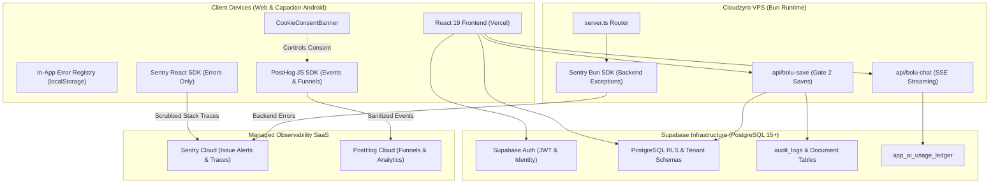

# BOUXRE: Zero-Code Infrastructure & Capability Audit
## Observability, Application Analytics, and Authentication Architecture

- **Document Path:** `docs/reports/BOUXRE_Existing_Observability_Analytics_Authentication_Audit.md`
- **Audit Date:** November 17, 2026
- **System Stack:** React 19, Vite 7, TypeScript 5.9, Tailwind CSS 3.4, Supabase (PostgreSQL 15+), Bun 1.x runtime, Capacitor 8 (Android/iOS), Vercel SPA Hosting, Cloudzyro Persistent VPS.
- **Audit Type:** Strict Read-Only Forensic Architecture & Capability Investigation (Zero Code Edits).

---

## 1. Executive Summary

### 1.1 Infrastructure Readiness
BOUXRE is an established, production-grade B2B business management suite serving Nigerian SMEs across invoicing, quotations, field job management (CSR), waybills, purchase orders, and AI assistance (Bolu). The application's architectural baseline is split across a static SPA edge frontend hosted on Vercel, a persistent Bun server hosted on Cloudzyro (`https://bouxre-api.cloudzyro.app`), and an operational Supabase PostgreSQL cluster implementing schema-based multi-tenancy with PostgreSQL Row Level Security (RLS).

From an infrastructure perspective, **core identity and compliance logging are highly mature and operational**. However, **frontend crash observability, distributed error monitoring, and product telemetry represent genuine, unaddressed operational gaps**.

### 1.2 Existing Capabilities Discovered
1. **Authentication & Multi-Tenant Authorization:** Fully operational via Supabase Auth (`@supabase/supabase-js` v2.112.3), supporting email/password, OAuth, session refresh, hardware-backed native biometrics (`@capgo/capacitor-native-biometric` v8.6.7), and PostgreSQL schema switching (`TenantClient` via `client.schema(schemaName)`).
2. **Document & Compliance Audit Trail:** Fully operational via `src/lib/audit.ts` (738 lines), writing immutable audit records (`CREATE`, `UPDATE`, `STATUS_CHANGE`, `ARCHIVE`) to tenant database schemas for invoices, quotations, purchase orders, projects, and expenses.
3. **AI Telemetry & Model Ledger:** Fully operational via `src/lib/ai-assistant/bolu-usage-ledger.ts` and `api/ai-usage.ts`, recording token consumption, latency, Time To First Token (TTFT), tokens per second, and dollar cost into `app_ai_usage_ledger`.
4. **Local Client-Side Error Logging:** Operational in-browser via `src/lib/errorRegistry.ts` (capturing up to 200 entries in `localStorage['bd-error-registry']`) and visualizable through `src/pages/debug/ErrorsDashboard.tsx` and `src/pages/settings/SystemLogsSettingsSection.tsx`.
5. **Cookie & Telemetry Consent Infrastructure:** Accessible, non-blocking consent UI operational via `src/components/compliance/CookieConsentBanner.tsx` managing `localStorage['bouxre_cookie_consent']`.
6. **Persistent Bun VPS Runtime:** Operational on Cloudzyro executing `server.ts` with streaming endpoints (`/api/bolu-chat`), Gate 2 transactional persistence (`/api/bolu-save`), provider discovery (`/api/bolu-provider-config`), and payment attachment management.

### 1.3 Genuine Gaps Discovered
1. **Zero Production Error Monitoring (APM / RUM):** The application has **no external error tracking SDK**. In `src/components/ErrorBoundary.tsx`, errors in production are completely swallowed without network transmission. In `src/main.tsx`, Sentry initialization code is commented out as an unfulfilled `TODO`. Unhandled JavaScript errors, React lifecycle crashes, and mobile webview fatal exceptions on user devices are permanently lost.
2. **Zero Product Analytics & Funnel Tracking:** No analytics SDK (PostHog, Mixpanel, Amplitude, or Google Analytics) is present in `package.json` or `index.html`. Conversion rates through onboarding, quotation generation, invoice settlement, and Bolu AI workflows cannot be measured.
3. **No Centralized Server Logging:** Cloudzyro API routes (`server.ts`, `api/*.ts`) rely solely on standard `console.error` and `console.log`. There is no log shipping, centralized indexing, or automated alerting when upstream AI providers or database transactions fail.

### 1.4 Necessity of Proposed External Services
- **Better Auth:** **REJECT (Redundant & Destructive).** Introducing Better Auth would duplicate identity management, fracture native biometric authentication, and invalidate 100+ SQL Row Level Security policies and schema routing mechanisms tied to Supabase `auth.uid()`.
- **Sentry:** **ADD (High Necessity / P0).** Resolves the single highest operational risk in the codebase: silent client crashes in production and unmonitored runtime exceptions on Capacitor Android.
- **PostHog:** **ADD (High Necessity / P1).** Bridges the complete absence of product analytics, feature adoption metrics, and workflow drop-off analysis. Can also absorb lightweight web traffic analytics, eliminating the need for a separate visitor tracker.
- **Plausible:** **REJECT (Redundant).** BOUXRE is an authenticated business application, not a public content blog. PostHog covers web pageviews and marketing attribution with zero additional bundle overhead.

---

## 2. Existing Capability Inventory

### 2.1 Authentication & Identity Infrastructure
- **Implementation Location:** `src/supabase.ts`, `src/lib/tenantClient.ts`, `src/lib/native/biometric.ts`, `src/pages/Login.tsx`, `src/pages/ResetPassword.tsx`, `src/pages/WorkspaceSelection.tsx`.
- **Core Mechanism:** Supabase Auth (`@supabase/supabase-js` v2.112.3).
- **Session Management:** Built-in JWT lifecycle with automatic refresh (`autoRefreshToken: true`, `persistSession: true`) and custom retry logic in `src/supabase.ts:59-80` specifically handling network dropouts during token refresh (`/auth/v1/token`).
- **Security Hardening:** `src/supabase.ts:31-34` inspects the anon key JWT payload and explicitly throws an unhandled exception if a `service_role` key is accidentally configured in the frontend client.
- **Multi-Tenant Isolation:** `src/lib/tenantClient.ts:11-34` abstracts tenant schema access via `client.schema(schemaName).from(table)` and `client.schema(schemaName).rpc(fn)`. Row-level authorization is enforced by PostgreSQL RLS using `auth.uid() = user_id`.
- **Biometric Integration:** Hardware-backed biometric authentication (`@capgo/capacitor-native-biometric` v8.6.7) in `src/lib/native/biometric.ts` allows face and fingerprint authentication on native Android/iOS, storing encrypted session tokens in device keychain/keystore.
- **Status:** **EXISTS AND OPERATIONAL.**

### 2.2 Error Handling, Crash Reporting, and Logging
- **Implementation Location:**
  - `src/components/ErrorBoundary.tsx`
  - `src/lib/errorRegistry.ts`
  - `src/lib/feedback.ts`
  - `src/lib/ai-assistant/routing/bolu-error-classifier.ts`
  - `src/main.tsx:12-23`
- **Frontend React Boundary:** `src/components/ErrorBoundary.tsx` wraps routes and app shell components. In development (`import.meta.env.DEV`), it logs to `console.error`. In production, it suppresses console output, renders a fallback card ("Something went wrong"), and provides a retry button. **It does not dispatch telemetry to any backend or remote service.**
- **Client-Side Error Registry:** `src/lib/errorRegistry.ts` implements a ring buffer of up to 200 error records persisted in browser `localStorage['bd-error-registry']`. Entries store `id`, `timestamp`, `route`, `title`, and `diagnostic`.
- **Bolu AI Error Classifier:** `src/lib/ai-assistant/routing/bolu-error-classifier.ts` (296 lines) provides pure, deterministic classification of AI provider HTTP status codes and headers into categories (`rate_limit`, `quota_exhausted`, `provider_unavailable`, `timeout`), parsing `Retry-After` intervals and generating sanitized, user-safe error messages.
- **Server-Side API Error Handling:** `server.ts:81-97`, `server.ts:116-127` wraps route imports and request handlers in `try/catch`, printing to `console.error` and returning JSON error responses with status codes (404, 405, 500).
- **Status:** **EXISTS BUT INCOMPLETE.** Local logging and error classification exist, but zero external or centralized crash ingestion exists.

### 2.3 Analytics, Consent, and Tracking
- **Implementation Location:**
  - `src/components/compliance/CookieConsentBanner.tsx`
  - `src/lib/ai-assistant/bolu-usage-ledger.ts`
  - `docs/prd/Technical-SEO-AND-Metadata-Hardening-PRD/site-features-prd.md`
- **Consent Mechanism:** `CookieConsentBanner.tsx` displays an accessible banner managing `localStorage['bouxre_cookie_consent']` (`'accepted' | 'declined'`).
- **Telemetry Reality:** No analytics SDK is installed. As documented in `site-features-prd.md`: *"No analytics SDKs installed (constraint); telemetry is disclosed as prospective ('to improve BOUXRE') without shipping a tracker — an explicit, documented gap vs the original PRD wish-list (Plausible/GA4), which was deliberately de-scoped."*
- **Status:** **DOES NOT EXIST (Consent UI exists, but tracking engine is absent).**

### 2.4 Performance and Latency Monitoring
- **Implementation Location:**
  - `src/lib/saveTiming.ts`
  - `src/hooks/useDocumentSave.ts:49-96`
  - `src/lib/ai-assistant/bolu-usage-ledger.ts:50-80`
- **Document Save Timing:** `useDocumentSave.ts` uses `createSaveTimer` to measure document serialization and Supabase mutation times (`timer.finish()`), but the resulting measurement is not stored or transmitted.
- **AI Streaming Metrics:** `bolu-usage-ledger.ts` computes TTFT (Time To First Token), generation duration, and token velocity (`tokensPerSecond`) for every streaming completion and commits these metrics to PostgreSQL.
- **Web Vitals & APM:** No Core Web Vitals tracking (LCP, FID, CLS, INP) is configured.
- **Status:** **EXISTS BUT INCOMPLETE.** AI stream performance is recorded to DB; general application and network APM is absent.

### 2.5 Infrastructure and Health Monitoring
- **Implementation Location:** `server.ts:38-54`
- **Health Endpoint:** `GET /`, `GET /health`, and `GET /api/health` return:
  ```json
  {
    "status": "ok",
    "service": "bouxre-ai-backend",
    "uptime": 123.45,
    "timestamp": "2026-11-17T09:00:00.000Z"
  }
  ```
- **External Uptime Monitoring:** No active pinging or synthetic uptime monitor is declared in repository config.
- **Status:** **EXISTS AND OPERATIONAL (Endpoint operational; synthetic monitoring external).**

### 2.6 Existing Operational Dashboards & Diagnostic Views
- **In-App Error Inspector:** `src/pages/debug/ErrorsDashboard.tsx` provides route-level log browsing, search/filtering, and clipboard export for errors stored in `localStorage['bd-error-registry']`.
- **System Settings Logs Section:** `src/pages/settings/SystemLogsSettingsSection.tsx` allows administrative users to inspect and clear local diagnostic errors.
- **Financial Document Audit Trails:** `src/pages/Reports.tsx` and document view pages (`ViewInvoice.tsx`, `ViewQuotation.tsx`) display immutable audit records logged by `src/lib/audit.ts`.
- **Status:** **EXISTS AND OPERATIONAL (Client-scoped).**

### 2.7 Dependencies and Architectural Integrations Inventory
Inspection of `package.json` and `package.backend.json` reveals:
- **No Sentry packages:** `@sentry/react`, `@sentry/vite-plugin`, `@sentry/node` are NOT present.
- **No PostHog packages:** `posthog-js`, `posthog-node` are NOT present.
- **No Plausible packages:** `plausible-tracker` is NOT present.
- **No Better Auth packages:** `better-auth` is NOT present.
- **Active Backend Dependencies:** `@supabase/supabase-js`, `decimal.js`, `zod`, `resend`, `@react-email/render`, `pdf-lib`, `@formepdf/core`.

---

## 3. Provider-by-Provider Comparison

### 3.1 Better Auth vs. Supabase Auth

| Evaluation Dimension | Existing Supabase Auth | Proposed Better Auth | Forensic Assessment |
| :--- | :--- | :--- | :--- |
| **Operational Status** | EXISTS AND OPERATIONAL | DOES NOT EXIST | Supabase Auth is actively running in production across web and mobile. |
| **Multi-Tenant Schema Binding** | Native integration with PostgreSQL schemas via `createTenantClient(supabase, schemaName)`. | Requires custom session schema resolvers or single-database foreign key joins. | Better Auth would break schema-per-tenant architectural assumptions. |
| **Row Level Security (RLS)** | Directly backed by PostgreSQL `auth.uid()` across 100+ migration files. | Requires custom JWT minting or middleware proxying to satisfy PostgreSQL RLS. | Severe security regression; bypasses native database engine security. |
| **Hardware Biometrics** | Seamlessly bridged via `@capgo/capacitor-native-biometric` and stored refresh tokens. | No native Capacitor plugin integration; requires bespoke native bridge. | Adds mobile maintenance burden without functional benefit. |
| **Architectural Redundancy** | Zero redundancy (single unified identity plane). | 100% duplicate identity management layer. | High architectural violation. |

**Verdict on Better Auth:** **REJECT AS REDUNDANT & HARMFUL.**
Supabase Auth fulfills all identity, session, security, and multi-tenant requirements. Adopting Better Auth would introduce severe architectural complexity, fracture database RLS policies, and break native mobile biometric authentication.

---

### 3.2 Sentry vs. Existing Error Handling and Logging

| Evaluation Dimension | Existing In-App Error Handling | Proposed Sentry Integration | Forensic Assessment |
| :--- | :--- | :--- | :--- |
| **Error Scope** | Traps errors into `localStorage` (`errorRegistry.ts`); silent in prod (`ErrorBoundary.tsx`). | Captures unhandled React render crashes, window `onerror`, unhandled promise rejections. | Sentry covers the exact blindspot where current code silently swallows exceptions. |
| **Device & Environment Context** | Basic route string and error message. | Full stack traces, source-mapped files, browser/OS version, Android WebView details. | Critical for debugging Capacitor Android crashes on diverse SME devices. |
| **Aggregation & Alerting** | None. Requires user to manually open debug page and copy JSON. | Automated grouping by issue fingerprint, regression detection, Slack/Email alerts. | Genuine operational capability upgrade. |
| **Server Runtime Coverage** | `console.error` to stdout on Cloudzyro Bun VPS. | Sentry Node/Bun SDK captures uncaught exceptions and rejected promises on backend. | Bridges server-side operational visibility. |
| **Data Privacy Sensitivity** | Stays local on device. | Risk of sending invoice numbers, client names, or financial totals in breadcrumbs. | Requires strict `beforeSend` scrubbing of financial PII. |

**Verdict on Sentry:** **ADD (Essential / P0).**
The codebase already anticipated Sentry (commented out in `src/main.tsx:12-23`). The lack of production error monitoring is a critical operational liability. Sentry should be integrated with strict privacy rules preventing financial and customer PII leakage.

---

### 3.3 PostHog vs. Existing Product Analytics

| Evaluation Dimension | Existing Repository Analytics | Proposed PostHog Integration | Forensic Assessment |
| :--- | :--- | :--- | :--- |
| **Feature Adoption Tracking** | None. | Tracks button clicks, route transitions, modal engagement, feature retention. | Fills a complete vacuum in product intelligence. |
| **Conversion Funnel Visibility** | None. | Measures Onboarding $\rightarrow$ Client Creation $\rightarrow$ Quote $\rightarrow$ Invoice $\rightarrow$ Payment. | Essential for SME conversion optimization. |
| **Session Replay Capability** | None. | DOM session recording with event timeline. | High diagnostic value, but requires strict masking of financial and invoice fields. |
| **Feature Flags / Experiments** | Hardcoded experiments (`ColdLaunchThemeExperiment.tsx`). | Remote feature flags and rollout percentages. | Can replace hardcoded UI experiment scaffolding. |
| **Hosting & Cloudzyro Impact** | Zero. | Uses PostHog Cloud (SaaS ingestion). Zero load on Cloudzyro VPS. | Zero hosting friction if SaaS tier is utilized. |

**Verdict on PostHog:** **ADD (High Value / P1).**
PostHog fills the total absence of product analytics. It provides conversion funnels and feature usage without overburdening Cloudzyro. Session Replay must be strictly locked down with input masking.

---

### 3.4 Plausible vs. Existing Website Analytics

| Evaluation Dimension | Existing Repository Analytics | Proposed Plausible Integration | Forensic Assessment |
| :--- | :--- | :--- | :--- |
| **Focus Area** | None. | Lightweight, cookieless website visitor tracking (pageviews, referrers). | Designed for static marketing websites, not authenticated B2B SPAs. |
| **Feature Overlap with PostHog** | N/A | 100% overlapped by PostHog's autocapture and pageview tracking. | Running both Plausible and PostHog is completely redundant. |
| **Bundle & Network Overhead** | Zero. | ~1-2 KB script tag, additional DNS lookup and HTTP beacon per page transition. | Unnecessary duplicate network traffic for mobile users on metered connections. |

**Verdict on Plausible:** **REJECT AS REDUNDANT.**
PostHog already provides pageview tracking and referrer attribution. Because BOUXRE is primarily an authenticated application, running a separate marketing analytics script alongside PostHog provides zero incremental value.

---

## 4. Cloudzyro Deployment Assessment

### 4.1 Documented Architecture vs. Repository Reality
- **Reference Document:** `docs/integrations/persistent-bun-vps-deployment.md`
- **Architecture Described:** A persistent Bun container deployed via a sanitized archive payload (`package.backend.json` renamed to `package.json`, omitting Vite, React, and frontend build tools) to prevent auto-detecting buildpacks from classifying the backend as an Nginx static SPA.
- **Repository Verification:**
  - `package.backend.json` exists and matches the documented specification (only server dependencies: `@supabase/supabase-js`, `resend`, `pdf-lib`, etc.).
  - `server.ts` exists as the single entry point (`port: process.env.PORT || 3000`).
  - Active Cloudzyro URL in production is `https://bouxre-api.cloudzyro.app`.
  - CORS handling in `server.ts:1-12` supports origin reflection for `https://bigdrops-app.vercel.app` and local development hosts with `Access-Control-Allow-Credentials: 'true'`.

### 4.2 Relationship with Bolu AI Subsystem
Cloudzyro is the dedicated, stateful backend host for Bolu AI:
1. `POST /api/bolu-chat`: Manages persistent, long-lived Server-Sent Events (SSE) streaming connections between the client and upstream AI providers (Anthropic, DeepSeek, Google, OpenAI, Groq, OpenRouter).
2. `POST /api/bolu-save`: Executes Gate 2 document persistence into Supabase PostgreSQL, ensuring transactional integrity before returning success to the frontend.
3. `GET/POST /api/bolu-provider-config`: Discovers and configures LLM gateway routing and credentials.
4. `POST /api/ai-usage`: Commits token usage and cost metrics to `app_ai_usage_ledger`.

### 4.3 Runtime, Memory, and Resource Constraints
- **Runtime:** Bun 1.x running in a Linux VPS container.
- **Process Model:** Single-process asynchronous event loop.
- **Resource Boundary:** Cloudzyro instances operate under fixed RAM allocations (typically 512 MB to 2 GB). Heavy in-memory operations (such as large PDF generation with `pdf-lib` or concurrent streaming buffers) can push memory limits.
- **Buildpack Sensitivity:** The buildpack fails if any frontend build artifacts or lockfiles (`bun.lock`) are included that trigger `bun install --frozen-lockfile`.

### 4.4 Feasibility of Extending Existing Deployment
- **Feasible Extensions:**
  - Adding lightweight Sentry Node/Bun instrumentation to `server.ts` to capture backend exceptions during AI streaming or Gate 2 saves.
  - Adding a structured Prometheus-style `/metrics` endpoint to `server.ts` for monitoring HTTP request latencies and active SSE streams.
- **Infeasible Extensions:**
  - **Self-hosting PostHog or Sentry:** Self-hosting ClickHouse, Redis, Kafka, and PostgreSQL on Cloudzyro is completely impossible given memory, storage, and CPU constraints.
  - Any server-side analytics ingestion pipeline that writes high-frequency clickstream data to a local disk or SQLite instance.

### 4.5 Service Colocation vs. Architectural Independence
- Bolu streaming and payment attachment processing should remain the **primary workload** of the Cloudzyro deployment.
- External analytics (PostHog) and error tracking (Sentry) must use their respective **managed SaaS clouds** for ingestion. Cloudzyro should only act as a telemetry *client* (reporting its own internal errors), never as a telemetry *server*.

### 4.6 Persistent Storage and Database Considerations
- Cloudzyro's local filesystem is ephemeral across redeployments. No database, logs, or state can be stored on the local container disk.
- All persistent state must continue to reside in **Supabase PostgreSQL** via service-role API calls over HTTPS.

### 4.7 Security Boundaries and Operational Risks
- **CORS & Origin Reflection:** `server.ts:1-12` reflects the incoming `Origin` header. While necessary for credentialed fetches across Vercel previews and local dev, it must be restricted in production to known domains (`bigdrops-app.vercel.app`, custom BOUXRE domains) to prevent unauthorized cross-origin request forging.
- **Service Role Key Security:** Cloudzyro holds `SUPABASE_SERVICE_ROLE_KEY` in environment variables to execute Gate 2 saves. Telemetry SDKs initialized on Cloudzyro must be scrubbed so that this key is never exposed in error breadcrumbs or request dumps.

---

## 5. Gap Analysis

| Capability Area | Specific Feature | Current Status | Forensic Location / Evidence |
| :--- | :--- | :--- | :--- |
| **Authentication** | User Sign In / Registration | **EXISTS AND OPERATIONAL** | `src/pages/Login.tsx`, `src/supabase.ts` |
| | Session Refresh & Network Recovery | **EXISTS AND OPERATIONAL** | `src/supabase.ts:59-80` |
| | Multi-Tenant Schema Routing | **EXISTS AND OPERATIONAL** | `src/lib/tenantClient.ts:11-34` |
| | Native Mobile Biometrics | **EXISTS AND OPERATIONAL** | `src/lib/native/biometric.ts:53-110` |
| | Alternative Auth (Better Auth) | **DOES NOT EXIST** | Unnecessary; would duplicate Supabase Auth |
| **Error Monitoring** | React Lifecycle Crash Catching | **EXISTS BUT INCOMPLETE** | `src/components/ErrorBoundary.tsx` (swallowed in prod) |
| | In-Browser Diagnostic Log Ring | **EXISTS AND OPERATIONAL** | `src/lib/errorRegistry.ts` (localStorage only) |
| | Remote Production Crash Telemetry | **DOES NOT EXIST** | `src/main.tsx:12-23` (Sentry commented out) |
| | AI Subsystem Error Classification | **EXISTS AND OPERATIONAL** | `src/lib/ai-assistant/routing/bolu-error-classifier.ts` |
| | Cloudzyro Backend Error Logging | **EXISTS BUT INCOMPLETE** | `server.ts:81-127` (`console.error` only) |
| **Analytics** | Cookie & Telemetry Consent Banner | **EXISTS AND OPERATIONAL** | `src/components/compliance/CookieConsentBanner.tsx` |
| | Product Feature Adoption Tracking | **DOES NOT EXIST** | No analytics SDK installed in `package.json` |
| | Funnel & Conversion Tracking | **DOES NOT EXIST** | No event dispatchers in document workflows |
| | Website Visitor Analytics | **DOES NOT EXIST** | Plausible de-scoped in `site-features-prd.md` |
| | AI Token & Cost Telemetry | **EXISTS AND OPERATIONAL** | `src/lib/ai-assistant/bolu-usage-ledger.ts` |
| **Audit & Performance**| Financial Document Audit Trail | **EXISTS AND OPERATIONAL** | `src/lib/audit.ts` (738 lines to DB) |
| | Core Web Vitals Monitoring | **DOES NOT EXIST** | No RUM or Vitals listener configured |
| | Document Save Latency Timing | **EXISTS BUT INCOMPLETE** | `src/hooks/useDocumentSave.ts:95` (timer unlogged) |
| | Backend Uptime Healthcheck | **EXISTS AND OPERATIONAL** | `server.ts:38-54` (`/health` endpoint) |

---

## 6. Recommended Target Architecture

### 6.1 Architectural Allocation Matrix



### 6.2 Component Placement Breakdown
1. **BOUXRE Application (Frontend SPA & Capacitor Mobile):**
   - **Retain:** Supabase Auth client, `TenantClient` schema switcher, `errorRegistry.ts` (for local user diagnostic support), `CookieConsentBanner.tsx`.
   - **Add:** `@sentry/react` (configured in `src/main.tsx` with `beforeSend` financial data scrubbing) and `posthog-js` (configured in `src/App.tsx`, conditionally activated only when `localStorage['bouxre_cookie_consent'] === 'accepted'`).
2. **Cloudzyro (Persistent Bun VPS):**
   - **Retain:** `server.ts` entry point, `/health` endpoint, `/api/bolu-chat`, `/api/bolu-save`, `/api/bolu-provider-config`, `/api/ai-usage`.
   - **Add:** Lightweight Sentry Bun/Node error handler wrapping route execution to catch unhandled async errors without burdening container memory.
3. **Supabase (PostgreSQL & Storage):**
   - **Retain:** Supabase Auth engine, all PostgreSQL multi-tenant schema isolation, Row Level Security policies, `audit_logs` document tracking, and `app_ai_usage_ledger`.
   - **Add:** Zero changes required. Do not store clickstream or high-frequency analytics in Supabase.
4. **External Monitoring & Analytics Providers:**
   - **Sentry Cloud:** Ingests frontend and backend exceptions, stack traces, and release health.
   - **PostHog Cloud:** Ingests sanitized UI events, conversion funnels, and feature engagement.

### 6.3 Data Privacy & Financial Data Scrubbing Protocol
To protect SME confidentiality and adhere strictly to BOUXRE security guardrails:
- **Zero Financial Data Transmission:** Invoices, line items, unit prices, total amounts, and customer contact information must NEVER be sent as event properties or breadcrumbs.
- **Session Replay Hardening:** If PostHog Session Replay is enabled, it must configure `maskAllInputs: true` and `maskTextSelector: ".financial-value, [data-sensitive='true'], input, textarea"` to prevent invoice and banking information from appearing on screen recordings.
- **AI Chat Privacy:** Prompts and responses sent to Bolu must NEVER be passed to PostHog or Sentry. Telemetry is restricted to provider name, model ID, latency, and token count.

---

## 7. Implementation Priority

| Rank | Capability / Initiative | Operational Value | Security Impact | Implementation Complexity | Hosting Resource Impact | Financial Cost |
| :---: | :--- | :---: | :---: | :---: | :---: | :---: |
| **1** | **Sentry Frontend Integration** | **Critical (P0)** | Positive (identifies security/auth failures) | Low (uncomment & configure `src/main.tsx`) | Zero (SaaS ingestion) | Free Tier (5K errors/mo) |
| **2** | **Sentry Cloudzyro Error Wrapper** | **High (P0)** | Positive (catches silent SSE crashes) | Low (wrapper in `server.ts:116`) | Negligible (<5 MB RAM) | Shared with Sentry quota |
| **3** | **PostHog Product Analytics** | **High (P1)** | Neutral (requires strict PII masking) | Medium (wire consent banner & funnels) | Zero (SaaS ingestion) | Free Tier (1M events/mo) |
| **4** | **Synthetic Uptime Pings (/health)** | **Medium (P2)** | Neutral | Trivial (external uptime robot on `/health`) | Zero | Free (UptimeRobot/BetterStack) |
| **5** | **Plausible Analytics** | **None** | Neutral | Low | Low | Redundant expense |
| **6** | **Better Auth Migration** | **Negative** | **High Risk (breaks RLS & biometrics)** | Extremely High (rewrite entire auth layer) | High | Pointless duplication |

---

## 8. Cost and Resource Considerations

### 8.1 External SaaS Tier Dynamics
- **Sentry Cloud:**
  - *Developer Free Tier:* 5,000 errors/month, 10,000 performance transactions/month. Ample for current SME traffic volume.
  - *Cost at Scale:* \$26/month (Team tier) only if transaction volume expands significantly.
- **PostHog Cloud:**
  - *Free Tier:* 1,000,000 events/month, 5,000 session replays/month. Covers all current BOUXRE business workflows with zero platform cost.
- **Plausible Cloud:**
  - *No Free Tier:* Starts at \$9/month. Completely avoidable by leveraging PostHog.
- **Better Auth:**
  - Open-source, but requires database storage and self-hosted infrastructure maintenance.

### 8.2 Client-Side Bundle & Mobile Device Overhead
- **Sentry SDK (`@sentry/react`):** Adds approximately 22-28 KB gzipped. Minimal impact on modern mobile networks; Vite tree-shaking ensures only core error reporting is bundled.
- **PostHog SDK (`posthog-js`):** Adds approximately 35 KB gzipped. Initialized asynchronously; must not block React hydration or app bootstrap.
- **Capacitor Android Impact:** Client SDKs run inside the Android WebView. Strict rate limiting on event dispatching must be enforced to avoid battery and network drain.

### 8.3 Bandwidth and Database Load
- **Bandwidth:** Telemetry payloads are small JSON packets (<2 KB) dispatched asynchronously via `navigator.sendBeacon` or fetch with keepalive.
- **Supabase Database Load:** **Zero additional load.** External SaaS ingestion diverts all error and analytics traffic away from the PostgreSQL database, preserving database CPU and connection pools for core financial transactions.

### 8.4 Cloudzyro Server Overhead
- Cloudzyro's persistent Bun server has limited memory. Sentry Node/Bun SDK adds less than 5 MB of RSS memory footprint and negligible CPU overhead during normal execution.
- No analytics aggregation, event buffering, or log processing should ever run on Cloudzyro.

---

## 9. Final Recommendation

### 9.1 Retain
1. **Supabase Auth:** Retain as the sole, authoritative identity provider. It is deeply coupled to PostgreSQL RLS, multi-tenant schema isolation, and biometric authentication.
2. **`src/lib/audit.ts`:** Retain as the immutable document compliance audit log for invoices, quotes, waybills, and expenses.
3. **`src/lib/errorRegistry.ts` & Debug Dashboards:** Retain for client-side offline debugging and customer support diagnostics.
4. **`src/lib/ai-assistant/bolu-usage-ledger.ts`:** Retain for internal Bolu token accounting, latency measurements, and provider cost tracking.
5. **Cloudzyro Bun Deployment:** Retain as the persistent host for Bolu AI streaming and Gate 2 save coordination.

### 9.2 Add
1. **Sentry Error Tracking:** Install `@sentry/react` on the frontend and `@sentry/node` (or Bun equivalent) on Cloudzyro. Enable source-map uploading in the Vercel build pipeline. Implement strict financial PII scrubbing in `beforeSend`.
2. **PostHog Product Analytics:** Install `posthog-js` on the frontend. Connect it to `CookieConsentBanner.tsx` so tracking only activates upon user acceptance. Define core conversion funnels (Client Creation $\rightarrow$ Quotation $\rightarrow$ Invoice $\rightarrow$ Receipt).
3. **External Synthetic Uptime Monitoring:** Configure a free external monitor (e.g., BetterStack, UptimeRobot) targeting `https://bouxre-api.cloudzyro.app/health`.

### 9.3 Reject as Redundant
1. **Better Auth:** **REJECT.** Duplicates Supabase Auth, breaks PostgreSQL RLS security policies, and complicates multi-tenant schema switching.
2. **Plausible Analytics:** **REJECT.** Duplicates PostHog pageview and referrer tracking without providing product analytics.

### 9.4 Investigate Further
1. **Cloudzyro CORS Tightening:** Investigate replacing wildcard origin reflection in `server.ts:1-12` with an explicit whitelist of production domains to enhance cross-origin security.
2. **PostHog Session Replay Masking:** Conduct a privacy audit on form inputs before turning on Session Replay to ensure Nigerian banking details, BVN, and financial totals are 100% masked.

---

## 10. Evidence and File Scope

### 10.1 Inspected Files and Codebase Locations
- `docs/integrations/persistent-bun-vps-deployment.md`: Sanitized Bun archive deployment strategy on Cloudzyro.
- `package.json` & `package.backend.json`: Dependency manifests verifying total absence of third-party telemetry SDKs.
- `server.ts:1-146`: Bun HTTP server, CORS headers, `/health` route, and API dynamic imports.
- `api/bolu-chat.ts`, `api/bolu-save.ts`, `api/bolu-provider-config.ts`, `api/ai-usage.ts`: Cloudzyro backend handlers.
- `src/main.tsx:12-23`: Commented-out Sentry initialization code and root React mounting.
- `src/components/ErrorBoundary.tsx:1-60`: React error boundary suppressing production exceptions.
- `src/lib/errorRegistry.ts:1-94`: Client-side 200-entry error ring buffer in `localStorage['bd-error-registry']`.
- `src/pages/debug/ErrorsDashboard.tsx:1-155`: Client-side error viewing and clipboard export dashboard.
- `src/pages/settings/SystemLogsSettingsSection.tsx`: Administrative local log viewer.
- `src/components/compliance/CookieConsentBanner.tsx:1-78`: Telemetry and cookie consent manager.
- `src/lib/audit.ts:1-738`: Financial document and entity compliance audit logger.
- `src/lib/ai-assistant/bolu-usage-ledger.ts:1-427`: Bolu token usage, TTFT, and latency database logger.
- `src/lib/ai-assistant/routing/bolu-error-classifier.ts:1-296`: Deterministic AI provider error categorization.
- `src/supabase.ts:1-133`: Supabase client initialization, security checks, and token refresh retry logic.
- `src/lib/tenantClient.ts:1-34`: Multi-tenant schema routing abstraction.
- `src/lib/native/biometric.ts:53-110`: Hardware biometric authentication bridge.
- `src/pages/Login.tsx:99,167`: Supabase password and OAuth authentication integration.
- `src/hooks/useDocumentSave.ts:49-96`: Save timing and validation orchestration.
- `vercel.json:1-16`: SPA routing configuration.
- `docs/prd/Technical-SEO-AND-Metadata-Hardening-PRD/site-features-prd.md`: Documented de-scoping of Plausible.
- `docs/reports/architecture/forensic-audit-2026-09-09.md`: P0 tracking item `E-P0-01` flagging absent Sentry error tracking.

### 10.2 Verification Limitations & External Black-Box Boundaries
- **Cloudzyro Host Environment:** Live CPU/RAM limits, hypervisor noisy-neighbor dynamics, and exact PaaS container restart policies are external black-box attributes managed by Cloudzyro.
- **Supabase Cloud Managed Tier:** Actual database connection pool saturation and IOPS limits are hosted in Supabase's cloud infrastructure and cannot be directly measured via static repository inspection.

---

## 11. Git Status Verification

### 11.1 Working-Tree Baseline Verification
`git status` was executed prior to beginning the investigation (at 09:11:29 UTC / 09:16:42 UTC). Pre-existing unstaged modifications from ongoing development activities were noted on:
- `docs/prd/conversational-document-assistant/*`
- `src/App.tsx`, `src/components/ai-assistant/*`
- `src/lib/ai-assistant/*`, `src/pages/settings/bolu-provider/*`
- `supabase/migrations/20261117000000_release_acknowledgements.sql`
- Untracked assets and tests in `src/assets/`, `src/lib/`, `src/tests/`, and `docs/reports/android/`

### 11.2 Pre-Creation State
Zero application code files, dependencies, lockfiles, or configurations were modified by this audit.

### 11.3 Post-Creation Confirmation
Only the requested audit report:
`docs/reports/BOUXRE_Existing_Observability_Analytics_Authentication_Audit.md`
was authored. Zero application source files, configuration files, migrations, or dependencies were altered.
