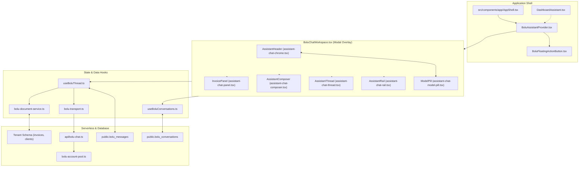
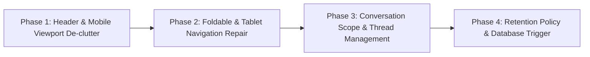

# Bolu 2.0 — Pre-Redesign Architectural and UI Audit

**Date:** 2026-11-16  
**Auditor:** Antigravity AI Systems Architect  
**Documentation Standard:** ASD-STE100 Simplified Technical English  
**Hardware Constraint Policy:** Strict zero-code audit. `bun run build`, `bun run typecheck`, and automated mutations permanently excluded.  
**File Output:** `docs/reports/bolu-pre-redesign-architectural-and-ui-audit-2026-11-16.md`  

---

## 1. Executive Summary

This audit evaluates the production Bolu conversational business operations assistant in BOUXRE before architectural redesign and visual refactoring.

The audit team conducted a zero-code static inspection across all layers:
- User interface presentation and responsiveness (`src/components/ai-assistant/*`, `src/components/design-lab/*`, `src/pages/settings/bolu-provider/*`).
- Client-side data management, hooks, and transport (`src/lib/ai-assistant/*`).
- Serverless API runtime and atomic inference routing (`api/bolu-chat.ts`, `api/bolu-provider-config.ts`).
- Database schema, row-level security (RLS), and persistence (`supabase/migrations/*`).

### 1.1 Summary of Core Findings

1. **Four-Viewport Breakpoint Breakdown:**
   The production workspace (`BoluChatWorkspace.tsx`) uses arbitrary JavaScript window-width boundaries (`< 768`, `< 1024`, `< 1280`, `>= 1280`) that conflict directly with repository Design Lab presets (`designLabViewports.ts`) and Settings Viewport stages (`BoluViewportStage.tsx`). Specifically, an 834px tablet is misclassified as `fold-open`, while a 673px foldable is misclassified as `fold-closed`. There are zero responsive `@media (min-width)` queries in the CSS bundle; responsiveness relies entirely on runtime JavaScript branching.

2. **Mobile Header Button Saturation & Collision:**
   On mobile phones (360px–390px), the workspace header places 6 interactive controls in a single row (`History`, `ModelPill`, `PanelRight`, `MoreVertical`, `Settings2`, `X`). These controls require over 330px of horizontal width. This saturation compresses the identity block to 0px width, causing the primary "B" mark to collide directly with the conversation history clock icon (the `B🕒` overlap demonstrated in production screenshot 1).

3. **Trapped Foldable Navigation (`fold-open`):**
   In the `fold-open` viewport, the conversation history rail (`AssistantRail`) is omitted from the DOM, and `showRailToggle` is disabled (`false`). Users on open foldable devices have no method to switch or view conversation history. Concurrently, the right document panel is permanently mounted at 380px, consuming 50% of the screen even when no document is active.

4. **Deceptive UI Controls & Hidden Actions:**
   The composer context badge (`Invoice`) has the visual appearance of an interactive attachment or document picker, but is a static `<span>` with zero event listeners. Conversely, the conversation delete control in `AssistantRail` relies on `group-hover:opacity-100`, making it invisible on mobile touchscreens, and performs an immediate hard delete without a confirmation dialog.

5. **Module-Scoped Conversation Disappearance:**
   `useBoluConversations` filters conversations by `module: pageContext.origin.page`. Conversations created on the dashboard (`module = 'dashboard-home'`) vanish when navigating to invoices (`module = 'invoices'`). Users perceive total conversation loss when navigating across pages.

6. **Retention Policy Feasibility:**
   The approved retention policy (maximum 10 active conversations per user with a 48-hour deletion grace period) is technically feasible but currently has zero database or scheduling support. Deletion in production today is an immediate hard SQL cascade. Safe implementation requires a PostgreSQL trigger with row locking and a dedicated cleanup schedule.

---

## 2. Scope and Methodology

### 2.1 Scope of Inspection

The audit team examined all production assistant files, backend routes, and database migrations:

| Subsystem | Files Inspected |
| :--- | :--- |
| **Workspace & Presentation** | `src/components/ai-assistant/chat/BoluChatWorkspace.tsx`, `assistant-chat-chrome.tsx`, `assistant-chat-rail.tsx`, `assistant-chat-thread.tsx`, `assistant-chat-composer.tsx`, `assistant-chat-panel.tsx`, `assistant-chat-model-pill.tsx`, `assistant-chat-parts.tsx`, `bolu-thinking-orb.tsx` |
| **Stylesheets** | `src/components/ai-assistant/chat/assistant-chat.css`, `assistant-chat-clerk.css`, `assistant-chat-premium-dark.css`, `src/components/ai-assistant/boluFab.css` |
| **Application Launchers & Providers** | `src/components/ai-assistant/BoluAssistantProvider.tsx`, `BoluFloatingActionButton.tsx`, `DashboardAssistant.tsx`, `AssistantSheet.tsx`, `src/components/app/AppShell.tsx` |
| **Client Hooks & Data Services** | `src/lib/ai-assistant/hooks/useBoluConversations.ts`, `src/lib/ai-assistant/hooks/useBoluThread.ts`, `bolu-data.ts`, `bolu-context.ts`, `bolu-capabilities.ts`, `bolu-operations.ts`, `bolu-document-service.ts`, `bolu-formatting.ts`, `bolu-transport.ts` |
| **Backend & Routing** | `api/bolu-chat.ts`, `api/bolu-provider-config.ts`, `src/lib/ai-assistant/routing/*`, `src/lib/ai-assistant/bolu-usage-ledger.ts` |
| **Database Migrations** | `supabase/migrations/20261114180000_bolu_conversation_persistence.sql`, `20261114160000_bolu_provider_credentials.sql`, `20261114170000_bolu_provider_connections.sql`, `20261115150000_bolu_per_connection_model_selection.sql`, `20261115170000_bolu_usage_ledger.sql` |
| **Design Lab & Viewport References** | `src/lib/designLabViewports.ts`, `src/components/design-lab/viewport-stage.tsx`, `src/pages/settings/bolu-provider/BoluViewportStage.tsx` |

### 2.2 Audit Methodology

- **Zero-Code Execution:** The working tree was confirmed clean before investigation (`git status --porcelain`). No source files, styles, tests, or migrations were modified.
- **Trace Analysis:** Complete tracing of state transitions, props, DOM composition, and network payloads from user interaction to PostgreSQL tables.
- **Visual Evidence Reconciliation:** Analysis of user-supplied mobile screenshots (`media_1794804361260_c26e2eb9.jpg`, `media_1794804362143_ed882e45.jpg`) against component code.

---

## 3. Existing Component Architecture

### 3.1 Production Architecture Diagram



### 3.2 Dual Runtime Divergence

A significant architectural divergence exists in `src/components/ai-assistant/BoluAssistantProvider.tsx`:
- Lines 29–41 initialize `createBoluRuntime` with `bolu-reducer.ts` (in-memory ephemeral state machine).
- However, lines 71–76 mount `BoluChatWorkspace`, which ignores `runtime` completely.
- `BoluChatWorkspace` instantiates `useBoluConversations` and `useBoluThread` directly against Supabase persistence tables.
- The `createBoluRuntime` instance in `BoluAssistantProvider` is dead computation, running subscribers and listeners that never connect to the visible chat interface.

---

## 4. Four-Viewport Investigation

Bolu defines four explicit design targets:
1. Mobile / Fold Closed
2. Fold Open
3. Tablets
4. Desktop

### 4.1 Viewport Dimension Discrepancies Across Codebase

The audit revealed three mutually contradictory definitions of these viewports in the repository:

| Target | `BoluChatWorkspace.tsx` (`detectViewport`) | `designLabViewports.ts` (PRD Presets) | `BoluViewportStage.tsx` (Settings Stage) | Discrepancy Impact |
| :--- | :--- | :--- | :--- | :--- |
| **Fold Closed / Mobile** | `< 768px` | `360px` (Fold Closed) / `430px` (Mobile) | `390px × 812px` | High: Up to 767px is treated as a phone. |
| **Fold Open** | `768px – 1023px` | `673px` | `828px × 700px` | Critical: A 673px foldable is forced into Phone mode. |
| **Tablet** | `1024px – 1279px` | `834px` | `1024px × 740px` | Critical: An 834px iPad is forced into Fold-Open mode. |
| **Desktop** | `>= 1280px` | `1440px` | `1280px × 800px` | Moderate: Canvas width difference. |

### 4.2 Target 1: Mobile / Fold Closed (`viewport === 'fold-closed'`)

- **Trigger:** Window width `< 768px` in `BoluChatWorkspace.tsx` (line 29).
- **DOM Composition:** Single column layout (`flex flex-col flex-1 h-full min-w-0 overflow-hidden relative`).
  - Header (`AssistantHeader`)
  - Message log (`AssistantThread`)
  - Composer (`AssistantComposer`)
  - Mobile Rail Drawer (`mobileRailOpen ? ...`) as an absolute overlay (`z-50`).
  - Document Artifact Sheet (`panelOpen ? ...`) as a bottom sheet (`z-40`).
- **Demonstrated Findings & Defects:**
  1. **Header Saturation & Visual Collision (The `B🕒` Bug):**
     In `assistant-chat-chrome.tsx` (lines 54–165), the header consists of two flex boxes:
     - Left: Mark, title, and page subtitle (`min-w-0`).
     - Right: History toggle, ModelPill, Panel toggle, Overflow menu, Settings button, Close button (`shrink-0 flex items-center gap-1.5`).
     On screens between 360px and 390px (e.g. standard Samsung/Pixel phones), the right container measures ~335px. The left container is compressed to 0px. The title text vanishes and the "B" logo is jammed directly against the History clock icon (`History`), creating the visual collision in screenshot `media_1794804361260_c26e2eb9.jpg`.
  2. **Mobile Rail Nested Collapse Bug:**
     In `BoluChatWorkspace.tsx` (lines 374–401), opening history opens a drawer of width `w-[280px] max-w-[85vw]`. Inside this drawer, it renders `AssistantRail`. `AssistantRail` contains a `PanelLeftClose` button (`[<|`). If the user taps this icon, `railCollapsed` becomes `true`. The rail inside the 280px drawer collapses to 58px width, leaving 222px of empty, unusable whitespace inside the open drawer.
  3. **Touchscreen Action Invisibility:**
     In `AssistantRail.tsx` (line 118), the conversation deletion trash icon has CSS class `opacity-0 group-hover:opacity-100`. On mobile devices without hover capabilities, the trash icon is permanently invisible.
  4. **Composer Keyboard & Footer Waste:**
     The composer container uses `padding-bottom: max(16px, env(safe-area-inset-bottom, 16px))` in `assistant-chat.css` (line 209). It does not integrate with `@capacitor/keyboard` or software keyboard viewport resizing. When the soft keyboard opens on mobile, the modal (`h-[100dvh]`) does not resize gracefully.
     Furthermore, line 93 of `assistant-chat-composer.tsx` renders helper text: `"Enter to send · Shift + Enter for a new line · Two-Gate human verification enforced"`. On mobile keyboards with an action return key, this text consumes ~28px of vertical thumb-zone space without providing value.

### 4.3 Target 2: Fold Open (`viewport === 'fold-open'`)

- **Trigger:** Window width `768px – 1023px` in `BoluChatWorkspace.tsx` (line 30).
- **DOM Composition:** Dual-pane horizontal split (`flex flex-1 h-full min-w-0 divide-x divide-[var(--ac-line)]`).
  - Left: Header, Thread, Composer (`flex flex-col flex-1 h-full min-w-0`).
  - Right: Static InvoicePanel (`hidden md:flex flex-col w-[380px] lg:w-[420px] h-full shrink-0`).
- **Demonstrated Findings & Defects:**
  1. **Total Navigation Trapping (No History Access):**
     In `BoluChatWorkspace.tsx` lines 285 and 433–444:
     - `showRailToggle` is configured as `showRailToggle={viewport === 'fold-closed'}`.
     - Therefore, in `fold-open`, `showRailToggle` is `false`.
     - `AssistantRail` is NOT mounted in the DOM.
     - The mobile rail drawer is NOT present.
     - **Result:** Users on fold-open devices have no visual or interactive control to view, create, switch, or delete conversations. They are permanently locked into the current thread.
  2. **Empty Panel Screen Waste:**
     `InvoicePanel` is mounted permanently at 380px–420px. On an 800px foldable screen, this consumes over 50% of screen width. When no document proposal is active, it displays placeholder text ("No document selected", "Not set"), wasting high-value foldable display area.
  3. **No Artifact Toggle:**
     `showContext` is configured as `showContext={viewport === 'fold-closed' || viewport === 'tablet'}`. In `fold-open`, the toggle button is hidden, so users cannot collapse the panel to expand chat width.

### 4.4 Target 3: Tablet (`viewport === 'tablet'`)

- **Trigger:** Window width `1024px – 1279px` in `BoluChatWorkspace.tsx` (line 31).
- **DOM Composition:** Rail + Center Chat + Conditional Slide-out Drawer:
  - Left: `AssistantRail` (240px wide, collapsable to 58px).
  - Center: Header, Thread, Composer (`flex flex-col flex-1 h-full min-w-0 border-r`).
  - Right: `aside` drawer (`w-[340px] shrink-0 h-full border-l`) mounted only when `panelOpen === true`.
- **Demonstrated Findings & Defects:**
  1. **Center Chat Compression:**
     On a 1024px iPad in landscape orientation:
     - The modal wrapper has padding and borders (`max-w-7xl md:p-4`).
     - Available workspace width: ~992px.
     - Left Rail: 240px.
     - Right Drawer: 340px.
     - Remaining width for chat thread: ~412px.
     - When the artifact panel is open, the tablet chat log is narrower than a standalone mobile phone viewport.
  2. **Classification Inversion:**
     An iPad portrait orientation (768px or 834px) is classified by `detectViewport()` as `fold-open`, stripping the rail entirely.

### 4.5 Target 4: Desktop (`viewport === 'desktop'`)

- **Trigger:** Window width `>= 1280px` in `BoluChatWorkspace.tsx` (line 32).
- **DOM Composition:** Full 3-column canvas (`flex flex-1 h-full min-w-0 divide-x divide-[var(--ac-line)]`).
  - Column 1: `AssistantRail` (240px / 58px).
  - Column 2: Header, Thread, Composer (`flex flex-col flex-1 h-full min-w-0`).
  - Column 3: `InvoicePanel` (`w-[340px] xl:w-[380px] h-full shrink-0 bg-[var(--ac-surface)]`).
- **Demonstrated Findings & Defects:**
  1. **Permanent Panel Lock-in:**
     `InvoicePanel` is fixed in the DOM without collapse controls. Desktop users cannot hide the document panel to give full canvas width to conversational analysis or table records.
  2. **Unused Window Maxima:**
     The workspace modal is capped at `max-w-7xl` (1280px) and `md:max-h-[96vh]`. On a 1440px or 1920px desktop monitor, it floats as an isolated box surrounded by dark backdrop blur, rather than docking as a functional enterprise side-panel or full-screen workspace.

---

## 5. Complete Interactive Control Audit

The audit team inventoried every visible and interactive control in Bolu, tracing exact source locations, callbacks, state mutations, and current operational status.

| # | Control Name | File & Line Location | Visible Label / Icon | Event Handler & Callback | State Read / Modified | Service / API Invoked | Viewport Dependency | Redundancy / Duplication | Status |
| :--- | :--- | :--- | :--- | :--- | :--- | :--- | :--- | :--- | :--- |
| **1** | **Floating Action Button** | `BoluFloatingActionButton.tsx` L37–49 | Robot glyph, amber dot, "Ask Bolu" tooltip | `onClick={() => open('future-fab')}` | Reads `isOpen`; sets `open(true)` | Context `open()` | Hidden on `/design-lab`, `/debug` | Duplicates Dashboard launcher | **Working** |
| **2** | **Dashboard Launcher** | `DashboardAssistant.tsx` L8–17 | 36×36px gradient tile, "AI" text | `onClick={() => open('dashboard')}` | Calls `useBoluAssistant().open('dashboard')` | Context `open()` | Dashboard page only | Duplicates FAB launcher | **Working** |
| **3** | **Conversation History Toggle** | `assistant-chat-chrome.tsx` L68–78 | `History` (Clock with rewind arrow) | `onClick={onOpenRail}` | Sets `mobileRailOpen` (boolean) | None | Rendered **ONLY** when `viewport === 'fold-closed'` | None | **Working, but causes header crowding & `B🕒` overlap** |
| **4** | **Model & Provider Pill Trigger** | `assistant-chat-model-pill.tsx` L198–215 | Ready dot, Connection Name, Model Name, `ChevronDown` | `onClick={() => setOpen(v => !v)}` | Reads `selectedModel`, `connections`; toggles `open` | `boluProviderApi.getStatus()` | Global header | None | **Working** |
| **5** | **Model Search Input** | `assistant-chat-model-pill.tsx` L227–234 | `Search` icon, "Search models" placeholder | `onChange={(e) => setQuery(e.target.value)}` | Reads/writes `query` (string) | None | Inside Model Pill modal | None | **Working** |
| **6** | **Model Add Connection Action** | `assistant-chat-model-pill.tsx` L247–258 | `Plus` icon | `onClick={() => { setOpen(false); onManage(); }}` | Closes modal, calls `onManage` | Router `navigate('/settings')` | Inside Model Pill modal | Duplicates Settings button | **Working** |
| **7** | **Model Manage Action** | `assistant-chat-model-pill.tsx` L259–270 | `SlidersHorizontal` icon | `onClick={() => { setOpen(false); onManage(); }}` | Closes modal, calls `onManage` | Router `navigate('/settings')` | Inside Model Pill modal | Duplicates Settings button | **Working** |
| **8** | **Model Item Selector** | `assistant-chat-model-pill.tsx` L311–340 | Model label, "Free" badge, "Default >", `Check` | `onClick={() => handleSelect(group, model)}` | Writes `selectedModel`, writes `localStorage` | Prop `onSelectModel` | Inside Model Pill modal | None | **Working** |
| **9** | **Document Panel Toggle** | `assistant-chat-chrome.tsx` L82–92 | `PanelRight` (split rectangle) | `onClick={onOpenContext}` | Reads/toggles `panelOpen` (boolean) | None | **ONLY** visible when `showContext` is `true` (`fold-closed`, `tablet`) | None | **Working, but absent on fold-open & desktop** |
| **10** | **Export Menu Trigger** | `assistant-chat-chrome.tsx` L96–106 | `MoreVertical` (3 vertical dots) | `onClick={() => setMenuOpen(prev => !prev)}` | Reads/toggles `menuOpen` (boolean) | None | Global header | None | **Working** |
| **11** | **Export Markdown (.md)** | `assistant-chat-chrome.tsx` L113–125 | `Download` icon, "Export Markdown (.md)" | `onClick={() => onExportMarkdown()}` | Reads `messages`, `conversationTitle` | `exportChatAsMarkdown` (Blob download) | Inside export menu | None | **Working** |
| **12** | **Export JSON (.json)** | `assistant-chat-chrome.tsx` L126–138 | `Download` icon, "Export JSON (.json)" | `onClick={() => onExportJson()}` | Reads `messages`, `conversationTitle` | `exportChatAsJson` (Blob download) | Inside export menu | None | **Working** |
| **13** | **Settings Navigation** | `assistant-chat-chrome.tsx` L145–152 | `Settings2` (horizontal sliders) | `onClick={onOpenSettings}` | Calls `onClose()`, navigates to `/settings` | Router `navigate('/settings')` | Global header | Duplicated in Model Pill modal | **Working** |
| **14** | **Workspace Close Button** | `assistant-chat-chrome.tsx` L154–164 | `X` icon, "Close" label (`hidden sm:inline`) | `onClick={onClose}` | Calls `close()` in provider; sets `open = false` | None | Global header | None | **Working** |
| **15** | **Rail Collapse / Expand Toggle** | `assistant-chat-rail.tsx` L61–73 | `PanelLeftClose` / `PanelLeftOpen` (`[<|`, `[>|`) | `onClick={onToggle}` | Reads/toggles `railCollapsed` (boolean) | None | Inside `AssistantRail` | None | **Defective inside mobile drawer** |
| **16** | **New Conversation Action** | `assistant-chat-rail.tsx` L76–79 | `Plus` icon, "New conversation" label | `onClick={onNew}` | Triggers `createConversation({ title: 'New Conversation' })` | Supabase `insert` into `bolu_conversations` | Inside `AssistantRail` | None | **Working** |
| **17** | **Conversation Thread Item** | `assistant-chat-rail.tsx` L97–114 | `MessageSquare` icon, title, module subtitle | `onClick={() => onSelect(thread.id)}` | Writes `activeConversationId` | Supabase `select` from `bolu_messages` | Inside `AssistantRail` | None | **Working** |
| **18** | **Conversation Delete Action** | `assistant-chat-rail.tsx` L115–128 | `Trash2` (trash can) | `onClick={(e) => { e.stopPropagation(); onDelete(thread.id); }}` | Removes conversation from state | Supabase `delete` from `bolu_conversations` | Inside `AssistantRail` (hidden when collapsed) | None | **High Risk: Invisible on mobile touch; immediate hard delete** |
| **19** | **Mobile Rail Close Button** | `BoluChatWorkspace.tsx` L379–385 | `X` icon | `onClick={() => setMobileRailOpen(false)}` | Writes `mobileRailOpen = false` | None | Mobile rail drawer header | Duplicates backdrop tap | **Working** |
| **20** | **Mobile Sheet Close Button** | `BoluChatWorkspace.tsx` L414–421 | `X` icon | `onClick={() => setPanelOpen(false)}` | Writes `panelOpen = false` | None | Mobile artifact sheet header | Duplicates backdrop tap | **Working** |
| **21** | **Empty State Suggestion Chips** | `assistant-chat-thread.tsx` L107–118 | `Sparkles` icon, suggestion text | `onClick={() => onSend(sug)}` | Submits prompt to `handleSend` | Supabase message insert & AI provider call | Thread empty state | None | **Working** |
| **22** | **Scroll Jump to Latest** | `assistant-chat-thread.tsx` L227–237 | `ArrowDown` icon, "Jump to latest", "Live" badge | `onClick={onJump}` | Scrolls DOM log to bottom; sets `pinned = true` | DOM `scrollTo` | Visible when scrolled >80px up | None | **Working** |
| **23** | **Gate 1: Approve Proposal** | `assistant-chat-parts.tsx` L260–270 | `FileCheck` icon, "Approve Changes" | `onClick={onApproveGate1}` | Updates proposal status to `approved_pending_save` | Supabase `update` on `bolu_messages` | Inside proposal cards | None | **Working** |
| **24** | **Gate 1: Reject Proposal** | `assistant-chat-parts.tsx` L271–280 | `X` icon, "Reject" | `onClick={onRejectGate1}` | Updates proposal status to `rejected` | Supabase `update` on `bolu_messages` | Inside proposal cards | None | **Working** |
| **25** | **Gate 2: Confirm & Save** | `assistant-chat-parts.tsx` L284–295 | `ShieldAlert` icon, "Confirm & Save to Records" | `onClick={onConfirmGate2}` | Executes database mutation via `bolu-document-service` | Supabase insert/update in tenant tables | Inside approved proposal cards | Natural-language "save" interceptor | **Working** |
| **26** | **Gate 2: Cancel Save** | `assistant-chat-parts.tsx` L296–305 | `X` icon, "Cancel Save" | `onClick={onCancelGate2}` | Sets proposal status to `cancelled` | Supabase `update` on `bolu_messages` | Inside approved proposal cards | None | **Working** |
| **27** | **Composer Context Pill** | `assistant-chat-composer.tsx` L65–68 | `FileText` icon, context document label | **NONE** (Static `<span>`) | None | None | Inside composer bar | None | **Incomplete / Misleading: Styled like a button but non-interactive** |
| **28** | **Composer Textarea** | `assistant-chat-composer.tsx` L46–61 | Text input, dynamic placeholder | `onChange`, `onKeyDown` (Enter submits) | Reads/writes `inputDraft` | None | Inside composer card | None | **Working** |
| **29** | **Composer Send Action** | `assistant-chat-composer.tsx` L81–89 | `ArrowUp` icon | Form `onSubmit` via `handleSend` | Clears draft, initiates stream | Supabase inserts & `/api/bolu-chat` | Inside composer card | Enter key | **Working** |
| **30** | **Composer Stop Action** | `assistant-chat-composer.tsx` L71–79 | `Square` icon (`ac-send--stop`, red) | `onClick={onStop}` | Calls `abortController.abort()` | `AbortController.abort()` | Visible only when `busy === true` | None | **Working** |

---

## 6. Conversation Lifecycle Audit

The lifecycle was traced step-by-step through execution code:

```
[1. Open Bolu] ──> [2. Fetch Conversations] ──> [3. Auto-Select Latest]
                                                       │
         ┌─────────────────────────────────────────────┴──────────────────┐
         ▼                                                                ▼
[Existing Conversations Found]                                   [No Conversations Found]
- Active thread loaded into memory                              - activeConversationId = null
- bolu_messages queried                                         - Empty welcome thread rendered
         │                                                                │
         │   ┌────────────────────────────────────────────────────────────┘
         ▼   ▼
[4. User Sends First Message]
- If activeConversationId is null: onEnsureConversation provisions new row in bolu_conversations
- User message inserted into public.bolu_messages
- Temp assistant streaming bubble created in React state
         │
         ▼
[5. Streaming Inference]
- Request dispatched to POST /api/bolu-chat
- SSE chunks accumulated via onDelta with 35ms throttled flush
- Streaming ends: parseStructuredOperationEnvelope checks for Two-Gate operations
- Assistant message inserted into public.bolu_messages
- public.bolu_conversations.last_message_at bumped
         │
         ▼
[6. Switching Threads]
- User clicks thread in AssistantRail ──> setActiveConversationId(id)
- useBoluThread fetches messages where conversation_id = id
         │
         ▼
[7. Closing & Reopening / Refreshing]
- Close: Workspace unmounts. In-memory draft & local UI states destroyed.
- Reopen / Refresh: Conversations re-fetched. autoSelectLatest always selects mapped[0].
```

### 6.1 Lifecycle Verification Matrix

| Lifecycle Step | Behavior in Code | Verified Findings |
| :--- | :--- | :--- |
| **1. Opening Bolu** | `BoluAssistantProvider.tsx` sets `open = true`. `BoluChatWorkspace` mounts. | Workspace mounts fresh on every open. |
| **2. Initial Thread Selection** | `useBoluConversations.ts` fetches top 50 active threads for tenant. `autoSelectLatest: true` picks `mapped[0].id`. | If threads exist, the most recently active thread is restored. If none exist, `activeConversationId` is `null`. |
| **3. Duplicate Initialization Prevention** | `fetchConversations` is guarded by `resolvedTenantId`. `setActiveConversationId` preserves previous selection if it exists in data: `if (prev && mapped.some(c => c.id === prev)) return prev`. | Prevents thrashing when re-fetching. However, auto-provisioning is strictly lazy (only triggered on first message send). |
| **4. Storage of Active Thread Identity** | React state `activeConversationId` in `useBoluConversations.ts`. | **Not stored in `localStorage` or URL query params.** Closing Bolu resets selection to `mapped[0]` upon reopen. |
| **5. Message Persistence** | Realtime insert into Supabase `bolu_messages`. | Completed user messages and final assistant responses persist immediately. |
| **6. Switching Conversations** | `selectConversation(id)` triggers `useBoluThread` `fetchMessages()`. | Previous messages unloaded; target messages loaded sequentially (`created_at ASC`, limit 100). |
| **7. Closing Bolu** | `onClose` calls `setOpen(false)`. Workspace unmounts. | Component unmounts entirely. In-memory input draft (`inputDraft`) is cleared. Active thread selection is lost. |
| **8. Reopening Bolu** | Workspace remounts. | Runs `fetchConversations()` and auto-selects `mapped[0]`. Prior active conversation is forgotten if user had switched away from `mapped[0]`. |
| **9. Refreshing Page** | Page reloads. Bolu starts closed (`open: false`). | On next open, threads reload from Supabase. |
| **10. Cross-Tab Synchronization** | `useBoluConversations.ts` subscribes to Realtime channel `bolu_conversations_${resolvedTenantId}`. | Thread list synchronizes across tabs. **However, `useBoluThread` has NO Realtime subscription on `bolu_messages`**. Messages sent in Tab A do not appear in Tab B unless the user switches threads. |

---

## 7. AI Context and Provider Request Audit

### 7.1 Message Payload Construction

In `src/lib/ai-assistant/hooks/useBoluThread.ts` (lines 241–247) and `src/lib/ai-assistant/bolu-formatting.ts` (lines 36–41):
- `buildProviderMessages` takes the current conversation transcript, filters for roles `'user'` and `'assistant'`, applies `.slice(-12)`, and strips payloads.
- The new user message is appended, resulting in at most **13 conversation messages** sent to the provider.
- **Previous conversations are NEVER included.** Thread isolation is absolute.
- Summarization is not implemented; old messages beyond the 12-message window are discarded from context.

### 7.2 Business Context Retrieval & Fact Injection

In `useBoluThread.ts` (lines 182–200):
- Intent matching (`matchBoluIntent`) inspects the user message.
- If an operational query is recognized (e.g. invoice search or status check), `readBoluContextFacts` queries tenant tables directly through `tenantClient` using caller credentials.
- The retrieved records are formatted into a plaintext string (`factsAsPrompt`) capped at **8,000 characters**.
- This string is transmitted to `/api/bolu-chat` as `contextFacts`.

### 7.3 Backend Payload Assembly (`api/bolu-chat.ts`)

In `api/bolu-chat.ts` (lines 311–354):
- Validates payload:
  - `messages`: at most 24 items, each <= 4,000 characters, total <= 12,000 characters.
  - `contextFacts`: <= 8,000 characters.
- Constructs system prompt combining:
  - `SYSTEM_PREFIX`: Assistant persona, zero-hallucination rules, calculation locks, punctuation rules.
  - `Authorized application facts`: Injected `contextFacts`.
  - `Operational Instructions`: Two-Gate JSON schemas for `create-document` and `modify-document`.
- Assembles payload: `[{ role: 'system', content: systemPrompt }, ...validation.messages]`.

### 7.4 Context Limit Risk Evaluation

- **Maximum Prompt Size:** System prompt (~1,500 chars) + facts (8,000 chars) + messages (12,000 chars) = ~21,500 characters.
- In token equivalents, maximum prompt volume is ~5,000 to 5,500 tokens.
- **Overload Risk Assessment:**
  - For standard models (e.g., DeepSeek-V4-Flash, Gemini 1.5/2.0, GPT-4o-mini with 32k–128k context): Overload risk is **ZERO**.
  - For legacy models with 4k context limits (e.g., standard Llama-2-7b or legacy 4k endpoints): A maximum payload of 5,500 tokens will cause immediate HTTP 400 rejection from the provider.
  - Neither `bolu-chat.ts` nor `provider-adapters.ts` performs model-specific token budget calculation before transmission.

---

## 8. Persistence and Retention Architecture

### 8.1 Database Schema Inspection

Persistence is governed by migration `supabase/migrations/20261114180000_bolu_conversation_persistence.sql`:

#### 1. Table: `public.bolu_conversations`
- `id` (uuid, primary key, default `gen_random_uuid()`)
- `tenant_id` (uuid, foreign key `public.entities(id) ON DELETE CASCADE`)
- `user_id` (uuid, foreign key `auth.users(id) ON DELETE CASCADE`)
- `title` (text, default `'New Conversation'`)
- `module` (text, default `'dashboard'`)
- `origin_record_id` (uuid, nullable)
- `status` (text, default `'active'`, check `status IN ('active', 'archived', 'deleted')`)
- `last_message_at` (timestamptz, default `now()`)
- `metadata` (jsonb, default `'{}'`)
- `created_at`, `updated_at` (timestamptz)

#### 2. Table: `public.bolu_messages`
- `id` (uuid, primary key, default `gen_random_uuid()`)
- `conversation_id` (uuid, foreign key `public.bolu_conversations(id) ON DELETE CASCADE`)
- `tenant_id` (uuid, foreign key `public.entities(id) ON DELETE CASCADE`)
- `sender_id` (uuid, foreign key `auth.users(id) ON DELETE SET NULL`)
- `role` (text, check `role IN ('user', 'assistant', 'system')`)
- `content` (text, default `''`)
- `status` (text, default `'completed'`, check `status IN ('streaming', 'completed', 'failed', 'stopped')`)
- `proposal_payload` (jsonb, nullable)
- `records_payload` (jsonb, nullable)
- `metadata` (jsonb, default `'{}'`)
- `created_at`, `updated_at` (timestamptz)

### 8.2 Row-Level Security (RLS)

Strict tenant isolation is verified across both tables:
- `bolu_conversations` policies require:
  `auth.uid() = user_id AND EXISTS (SELECT 1 FROM public.entities e WHERE e.id = tenant_id AND public.is_workspace_member(e.workspace_id, auth.uid()))`
- `bolu_messages` policies require:
  `EXISTS (SELECT 1 FROM public.bolu_conversations c JOIN public.entities e ON e.id = c.tenant_id WHERE c.id = conversation_id AND c.user_id = auth.uid() AND public.is_workspace_member(e.workspace_id, auth.uid()))`
- Unauthorized users or cross-tenant actors cannot read or write conversations or messages.

### 8.3 Retention Policy Feasibility Assessment

The approved product policy specifies:
- Maximum 10 active conversations per user.
- Oldest eligible conversation scheduled for deletion when the limit is exceeded.
- 48-hour accessible grace period.
- Manual deletion permitted at any time.

#### Feasibility & Implementation Gaps:
1. **Existing Cap:** **Zero.** There is currently no check on conversation count.
2. **Deletion Mechanics:** In `useBoluConversations.ts` (line 273), deletion executes a hard SQL `DELETE FROM bolu_conversations WHERE id = id`. It does not perform a soft delete or schedule a grace period.
3. **Grace Period Infrastructure:**
   - Table `bolu_conversations` has no column for `scheduled_deletion_at`.
   - The status check constraint allows `'active'`, `'archived'`, `'deleted'`.
   - There are zero cron jobs, Supabase Edge Functions, or background workers configured to purge expired threads.
4. **Race Conditions:**
   If a user opens two browser tabs and sends prompts simultaneously, client-side count checks can be bypassed.
   **Requirement:** Conversation limit enforcement must be governed by a PostgreSQL `BEFORE INSERT` trigger on `public.bolu_conversations` using `FOR UPDATE` row locking on the user's active threads.
5. **Decoupling from Business Records:**
   Invoices and quotations created via Two-Gate proposals are persisted to tenant schema tables (`invoices`, `invoice_items`). Foreign keys to `bolu_conversations` do not exist in business tables. Deleting a conversation record **never** deletes or alters financial documents.

---

## 9. Existing Defects and Limitations

The audit confirmed the following technical and visual defects:

1. **Header Collapse Collision (`B🕒`):**
   Narrow viewports (<390px) compress the header brand container to 0px, causing the "B" icon to collide with the History toggle clock button. (File: `assistant-chat-chrome.tsx` L54–80).
2. **Fold-Open Navigation Lockout:**
   In `viewport === 'fold-open'`, the history rail is completely omitted from the layout and `showRailToggle` is false. Foldable users cannot switch threads. (File: `BoluChatWorkspace.tsx` L285, L433–444).
3. **Module-Scoped Thread Disappearance:**
   `useBoluConversations` filters conversations by `module: pageContext.origin.page`. Conversations created on the dashboard are invisible on invoice pages. (File: `BoluChatWorkspace.tsx` L181, `useBoluConversations.ts` L132–134).
4. **Touchscreen Delete Inaccessibility:**
   The delete trash icon in `AssistantRail` relies on `group-hover:opacity-100`, making it impossible to discover or trigger on touch devices. (File: `assistant-chat-rail.tsx` L118).
5. **Unconfirmed Hard Deletion:**
   Clicking delete triggers an immediate hard `DELETE` query without a confirmation modal. (File: `useBoluConversations.ts` L270–291).
6. **Deceptive Context Badge:**
   The composer context badge (`[📄 Invoice]`) renders with button-like styling but is a non-interactive `<span>`. (File: `assistant-chat-composer.tsx` L65–68).
7. **Redundant Drawer Collapse:**
   Inside the 280px mobile slide-out drawer, `AssistantRail` displays its collapse button (`[<|`), which shrinks the rail to 58px within the open drawer. (File: `assistant-chat-rail.tsx` L61–73).
8. **Missing Soft Keyboard Awareness:**
   The workspace uses fixed `h-[100dvh]` without `@capacitor/keyboard` listeners or mobile virtual keyboard adjustment. (File: `BoluChatWorkspace.tsx` L363, `assistant-chat.css` L208).
9. **Dead In-Memory Runtime:**
   `BoluAssistantProvider.tsx` runs `createBoluRuntime`, maintaining an unused in-memory state machine that wastes client CPU cycles. (File: `BoluAssistantProvider.tsx` L29–41).
10. **Lack of In-Conversation Realtime Sync:**
    While `useBoluConversations` subscribes to conversation list changes, `useBoluThread` has no Realtime channel for `bolu_messages`. Multi-tab conversations do not update live. (File: `useBoluThread.ts` L63–104).

---

## 10. Component & File Ownership Map

```
src/
├── components/
│   └── ai-assistant/
│       ├── BoluAssistantProvider.tsx        <-- Global Context Provider (Mounts FAB & Workspace)
│       ├── BoluFloatingActionButton.tsx     <-- Global Assistant Launcher (Fixed Bottom-Right)
│       ├── DashboardAssistant.tsx           <-- Dashboard Hero Launcher (Overview Header)
│       ├── AssistantSheet.tsx               <-- DEPRECATED / UNUSED (Orphaned bottom sheet)
│       ├── boluFab.css                      <-- Launcher animations & styles
│       └── chat/
│           ├── BoluChatWorkspace.tsx        <-- Primary Workspace Modal & Viewport Dispatcher
│           ├── assistant-chat-chrome.tsx    <-- Header, ViewportPicker, Export Dropdown
│           ├── assistant-chat-rail.tsx      <-- Conversation History List & Thread Controls
│           ├── assistant-chat-thread.tsx    <-- Message Stream, Bubble Renderer, Welcome State
│           ├── assistant-chat-composer.tsx  <-- Auto-resize Textarea, Send/Stop, Context Badge
│           ├── assistant-chat-panel.tsx     <-- Living Document Artifact Preview Panel
│           ├── assistant-chat-model-pill.tsx<-- Model / Provider Selector & Dropdown Dialog
│           ├── assistant-chat-parts.tsx     <-- Two-Gate Proposal Cards, B-Mark, Segmented
│           ├── bolu-thinking-orb.tsx        <-- Animated Clerk Orb SVG Graphic
│           ├── types.ts                     <-- Component Prop Interfaces & Viewport Types
│           └── assistant-chat.css           <-- Primary Component Styles & Variables
├── lib/
│   └── ai-assistant/
│       ├── hooks/
│       │   ├── useBoluConversations.ts      <-- Conversation Thread CRUD & Supabase Realtime
│       │   └── useBoluThread.ts             <-- Message Streaming, SSE Buffer, Two-Gate Hooks
│       ├── bolu-transport.ts                <-- Fetch Transport to /api/bolu-chat
│       ├── bolu-formatting.ts               <-- Prompt Formatting & Window Truncation (12 msgs)
│       ├── bolu-operations.ts               <-- Two-Gate Proposal Schemas & Envelope Parsing
│       ├── bolu-document-service.ts         <-- Authoritative Document Mutations (Invoices/Quotes)
│       ├── bolu-context.ts                  <-- Page Context Builder & Suggestion Generator
│       ├── bolu-data.ts                     <-- Tenant Data Retrieval & Security Boundaries
│       ├── bolu-capabilities.ts             <-- Operational Intent Pattern Matching
│       └── routing/                         <-- Server-side AI Provider Pools & Catalog
api/
├── bolu-chat.ts                             <-- Streaming AI API Endpoint & Usage Logger
└── bolu-provider-config.ts                  <-- Provider Pool Credential Resolution
supabase/
└── migrations/
    └── 20261114180000_bolu_conversation_persistence.sql <-- Conversations & Messages Schema
```

---

## 11. Redesign Opportunities

Opportunities are classified according to BOUXRE governance standards:

### 11.1 OBSERVATION
- **OBS-01:** The assistant workspace is currently a modal dialog (`role="dialog"`). On desktop, this isolates the assistant from the underlying page, preventing users from viewing table data while chatting.
- **OBS-02:** Bolu has two entry points on the Dashboard: the global FAB and the header "AI" tile. Users may be confused by dual launchers with identical behavior.
- **OBS-03:** The "Enter to send" footer text in the composer is Desktop-centric and adds no value on mobile devices.

### 11.2 PROBLEM
- **PRB-01 (Header Saturation):** Six action buttons in the mobile header cause visual clipping and squish the BOUXRE mark into the History icon.
- **PRB-02 (Foldable Navigation Lockout):** Fold-open viewports completely lack conversation rail controls.
- **PRB-03 (Module Scoping):** Filtering conversations by page module causes conversations to disappear when navigating routes.
- **PRB-04 (Deceptive Attachment Pill):** The composer context pill appears interactive but has zero functionality.
- **PRB-05 (Touch Delete Invisibility):** Hover-based trash buttons prevent touch users from deleting conversations.

### 11.3 PROPOSAL
- **PRP-01 (Consolidated Header Overflow):** On mobile (`fold-closed`), move `ModelPill`, `Export`, and `Settings` into a unified header action sheet or drawer, leaving only `History`, `Title`, and `Close` in the top bar.
- **PRP-02 (Global Conversation Scope):** Remove the `.eq('module', module)` filter in `useBoluConversations.ts` so users have access to all their conversations across all routes.
- **PRP-03 (Interactive Context Chip):** Convert the composer context pill into an interactive selector that allows users to attach or switch the active target document.
- **PRP-04 (Swipe-to-Action / Context Menu on Mobile):** Replace hover delete with explicit swipe-to-delete or a 3-dot thread context menu (`Rename`, `Export`, `Delete`).
- **PRP-05 (Persistent Thread Identity):** Store `activeConversationId` in `sessionStorage` or URL parameters (`?bolu_thread=<id>`) to preserve thread selection across reopens and page reloads.

### 11.4 DECISION
- **DEC-01 (Retention Architecture):** Implement the 10-conversation limit via a PostgreSQL trigger with row-locking, marking excess threads as `status = 'archived'` with `scheduled_deletion_at = now() + interval '48 hours'`.
- **DEC-02 (Hardware Policy):** Maintain zero-code discipline and RAM-safe guidelines (never execute `bun run build`).

---

## 12. Risks and Dependencies

1. **Database Schema Mutation Risk:** Adding the 48-hour retention grace period requires adding a `scheduled_deletion_at timestamptz` column to `public.bolu_conversations`. This requires an additive, non-breaking Supabase migration.
2. **Mobile Keyboard Reflow Dependency:** Supporting software keyboard transitions without layout breakage requires coordinating CSS `interactive-widget=resizes-content` meta tags and `@capacitor/keyboard` events.
3. **Provider Context Limits:** While DeepSeek and modern LLMs handle 64k+ tokens, any fallback to legacy 4k endpoints will fail if `contextFacts` approaches 8,000 characters.

---

## 13. Recommended Implementation Sequence

Following Product Owner review and approval, remediation should proceed in four sequential phases:



1. **Phase 1: Header De-clutter & Touch Accessibility**
   - Refactor mobile header: group secondary controls into an overflow sheet.
   - Resolve `B🕒` overlap by guaranteeing minimum brand width.
   - Add explicit touch-action menu (Rename / Delete) to conversation items.
   - Convert non-interactive composer badge into interactive context selector.
2. **Phase 2: Foldable & Tablet Responsive Layout Unification**
   - Align breakpoint definitions between `detectViewport`, `designLabViewports.ts`, and `BoluViewportStage.tsx`.
   - Restore `AssistantRail` drawer access in `fold-open`.
   - Implement collapsible artifact panel on Fold-Open and Desktop.
3. **Phase 3: Lifecycle & Thread Persistence Hardening**
   - Unify conversation scoping (global tenant conversations with module tags, removing route-filtering drop).
   - Persist active thread selection in `sessionStorage` or URL search params.
   - Add Supabase Realtime subscription to `bolu_messages` in `useBoluThread`.
   - Remove orphaned `createBoluRuntime` from `BoluAssistantProvider`.
4. **Phase 4: 10-Conversation Retention Policy Implementation**
   - Migration: Add `scheduled_deletion_at timestamptz` to `public.bolu_conversations`.
   - Migration: Add PostgreSQL `BEFORE INSERT` trigger enforcing the 10-conversation cap with 48-hour grace period.
   - Implement UI grace period banner and manual restore/delete actions in `AssistantRail`.
   - Provision serverless or pg_cron cleanup job to purge expired threads (`status = 'archived' AND scheduled_deletion_at < now()`).

---

## 14. Unresolved Questions Requiring Product-Owner Decisions

Before beginning Bolu 2.0 implementation, the product owner must resolve the following key questions:

1. **Header Control Hierarchy on Mobile:**
   Should the Model Pill remain directly visible in the mobile header, or should it move into an action sheet or settings menu to guarantee title legibility?
2. **Conversation Scoping Across Pages:**
   Should conversations be strictly global per tenant (recommended), or should conversations remain permanently partitioned by originating module (dashboard vs invoices)?
3. **Desktop Presentation Model:**
   Should desktop Bolu remain a modal dialog (`max-w-7xl` floating overlay), or should it support docking as a persistent right-hand workspace panel alongside application tables?
4. **Composer Context Badge Functionality:**
   Should the `[📄 Invoice]` pill open a document picker allowing the user to switch the active document context, or should it be removed if context is inferred automatically?
5. **Retention Grace Period UX:**
   When an 11th conversation is created and the oldest thread enters the 48-hour grace period, should it remain visible in the history rail with an amber warning badge, or should it move to an "Archived / Expiring" sub-section?

---
*End of Architectural Audit Report. Antigravity AI Systems Architect.*
