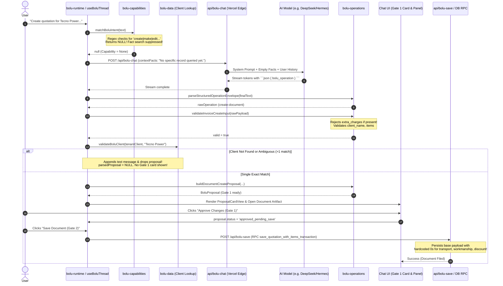

# Bolu Business Context & Document Capability Audit

**Investigation Date:** 17 November 2026  
**Auditor Classification:** Senior AI Systems Architect, Application Integration Auditor, Business-Document Workflow Investigator  
**Application:** BOURXE Business Platform (formerly BIGDROPS)  
**Subject:** Bolu Conversational Business Operations Assistant (2.0)  
**Audit Authorization:** Strict Read-Only Forensic Capability & Architectural Audit  
**Target Artifact:** `docs/reports/ai/2026-11-17-bolu-business-context-and-document-capability-audit.md`  
**Audit Status:** `COMPLETED`  

---

## 1. Executive Summary

### 1.1 Operational Context
Bolu is the conversational AI assistant embedded within the BOURXE SME business operations platform. The system operates on a dual-gate architecture designed to maintain strict human-in-the-loop governance:
- **Gate 1 (Proposal Review):** The user inspects a structured proposal generated by the AI model before the draft state mutates in the UI.
- **Gate 2 (Persistence Confirmation):** The user authorizes the execution of an authenticated, atomic database transaction to save or file the document into the tenant schema.

Recent live user testing in production on Android mobile devices revealed critical interaction failures:
1. When instructed to add a non-standard commercial charge (such as `add transport 5670`), Bolu refused to apply it as a separate commercial charge, stating that the application only accepts items with `description`, `quantity`, and `unit_price`.
2. When the user explicitly requested `add to extra charges`, Bolu replied that `extra_charges` is not part of the authorized payload structure, prompting the user to decide between distorting the bill of quantities (adding transport as a fake line item) or abandoning the charge.
3. In customer interactions, users frequently reference real-world clients using abbreviations, given names (e.g., "Mike"), nicknames, or partial company names (e.g., "Tecno Power"). Bolu either fails to look up the client in the database, looks up the client only after generating the proposal, or aborts the entire proposal upon detecting ambiguity.

This forensic capability audit was commissioned to determine the exact boundary between what Bolu can understand, retrieve, construct, validate, preview, and save, compared to what the core BOURXE application forms and PostgreSQL database schemas support.

### 1.2 High-Level Capability Rating
The audit evaluated Bolu across four core dimensions:

| Capability Dimension | Rating (0–100%) | Status | Executive Summary |
| :--- | :---: | :---: | :--- |
| **Context & Business Record Discovery** | **15%** | **CRITICAL DEFICIENCY** | Zero proactive entity discovery during creation intents. Bolu has no tools, RAG pipelines, or MCP tools to query clients, suppliers, or product catalogs before LLM generation. Creation keywords (`create`, `make`, etc.) explicitly suppress context retrieval. |
| **Document Synthesis & Construction** | **40%** | **SEVERE RESTRICTION** | Bolu supports only a minimal subset of document fields (`client_name`, `items` with basic `description`, `quantity`, `unit_price`, `issue_date`, `due_date`, `notes`, `payment_terms`). It lacks 60% of invoice and quotation attributes. |
| **Parity with Core Editor & DB Schema** | **30%** | **SEVERE DIVERGENCE** | Core editors support project linkage, PO numbers, document titles, work duration, fixed charges (`workmanship`, `transportation`, `shipping`), custom extra charges (with tax toggles), discount rates, and catalog item linkage. Bolu hardcodes all these fields to `0` or `null`. |
| **Financial Correctness & Semantics** | **45%** | **COMPROMISED** | Authoritative calculations run via locked formulas, but Bolu actively rejects extra charges (`bolu-operations.ts:203`). Forcing freight/transport into standard line items distorts the tax base by subjecting untaxed transport to 7.5% VAT. |

### 1.3 Key Findings Overview
1. **Suppression of Fact Retrieval on Write Intents:** `src/lib/ai-assistant/bolu-capabilities.ts` matches intent via regex. If the message matches `/\b(create|make|edit|change|update|delete|remove|record|pay|send)\b/`, it returns `null`. Consequently, any user request to create or modify a document strips all database context. The LLM receives `contextFacts = "No specific record queried yet."`
2. **Post-Hoc Client Resolution with Brittle Fallbacks:** Client lookup (`validateBoluClient`) is executed *client-side only after* the LLM has already generated its entire response. It queries only `clients.name` via an SQL `ilike '%clean%'` pattern. It cannot search by phone number, email, contact person, or category. If multiple clients match, Bolu discards the generated proposal entirely and appends a text notice that incorrectly refers to quotations as "invoices" (`bolu-generation.ts:243`).
3. **Active Rejection of Extra Charges:** In `src/lib/ai-assistant/bolu-operations.ts` (lines 202–207), code explicitly checks `if (payload.extra_charges !== undefined || payload.extraCharges !== undefined)` and invalidates the proposal with an error forcing transport into line items.
4. **Asymmetric Document Mutation:** While invoice modification is partially supported (`modify-document` for `invoice`), quotation modification is completely omitted from `bolu-generation.ts:251` (`&& documentFamily === 'invoice'`). A user cannot modify an existing quotation through Bolu.
5. **Lossy Persistence:** When Gate 2 executes, `persistInvoiceCreation` and `persistQuotationCreation` write hardcoded zeros and nulls for `transportation`, `workmanship`, `shipping`, `discount`, `po_number`, `project_id`, `work_duration`, `invoice_title`, and item-level attributes (`make`, `sub_description`, `discount_rate`, `install_rate`, `item_id`).

---

## 2. Investigation Scope and Non-Modification Constraints

### 2.1 Audit Boundaries
This audit was conducted under strict read-only governance in accordance with `AGENTS.md`. The auditor was authorized to inspect:
- Client-side application code (`src/lib/ai-assistant/`, `src/components/ai-assistant/`, `src/components/document/`, `src/pages/`).
- Serverless API handlers (`api/bolu-chat.ts`, `api/bolu-save.ts`, `api/bolu-provider-config.ts`).
- PostgreSQL tenant schemas in the linked Supabase production project (`xqlpekpkbszpdgtuwybh`), specifically tables `clients`, `suppliers`, `invoices`, `invoice_items`, `quotations`, `quotation_items`, `item_catalog`, and `item_aliases` in entity schema `entity_bigdrops-main_main`.
- Relevant PRDs, architectural decision records, and diagnostic reports.

### 2.2 Strict Non-Modification Compliance
- **Zero Application Modifications:** No source files, scripts, or configuration files were created or modified, except for the delivery of this audit report.
- **Zero Database Mutations:** No SQL inserts, updates, deletes, DDL migrations, or test entity creations were executed. All database catalog queries were executed as read-only schema inspections via `information_schema`.
- **Runtime Adherence:** All command executions utilized `bun` and `bunx`. `npm`, `yarn`, and `pnpm` were not invoked.
- **Memory Safety:** The prohibited command `bun run build` was not executed.
- **Git Worktree Preservation:** All pre-existing modified, staged, deleted, and untracked files across the repository were preserved without modification.

---

## 3. Evidence Sources & Methodology

### 3.1 Inspected Files and Source Code
The following files and line ranges form the direct source evidence for this investigation:
- `src/lib/ai-assistant/bolu-capabilities.ts` (Lines 1–57): Intent classification, regex filters, search term extraction.
- `src/lib/ai-assistant/bolu-data.ts` (Lines 1–350): Fact retrieval functions (`readBoluContextFacts`, `searchBoluInvoices`, `searchBoluQuotations`, `validateBoluClient`).
- `src/lib/ai-assistant/bolu-operations.ts` (Lines 1–467): Operation schemas, input validation (`validateInvoiceCreateInput`, `validateInvoiceModifyInput`), authoritative totals computation, rejection of `extra_charges`.
- `src/lib/ai-assistant/bolu-generation.ts` (Lines 1–347): Turn orchestration, streaming buffer, post-hoc client validation, proposal attachment.
- `src/lib/ai-assistant/bolu-runtime.ts` (Lines 1–421): Reducer lifecycle, pre-flight fact injection, prompt assembly.
- `src/lib/ai-assistant/bolu-document-service.ts` (Lines 1–556): Persistence layer (`persistInvoiceCreation`, `persistQuotationCreation`, `persistInvoiceModification`), RPC invocation, payload construction.
- `api/bolu-chat.ts` (Lines 1–738): System prompt definition, provider routing, context facts injection, validation.
- `api/bolu-save.ts` (Lines 1–420): Server-side Gate 2 transaction gateway, schema validation.
- `src/components/ai-assistant/chat/assistant-chat-parts.tsx` (Lines 100–350): Proposal card UI (`ProposalCardView`, Gate 1 interaction).
- `src/components/ai-assistant/chat/assistant-chat-panel.tsx` (Lines 1–300): Document artifact sheet (`InvoicePanel`).
- `src/components/document/SharedDocumentForm.tsx` (Lines 1–800): Standard web document form fields and business logic.
- `src/components/document/form/FormCommercialTerms.tsx` (Lines 1–250): Extra charges UI, taxable vs. non-taxable charges.

### 3.2 Database Catalog Evidence
Direct inspection of the PostgreSQL system catalog in the linked project (`xqlpekpkbszpdgtuwybh`) on the active tenant schema `entity_bigdrops-main_main` yielded the following canonical schema definitions:

```sql
-- Schema: entity_bigdrops-main_main

-- 1. clients table
id uuid PRIMARY KEY,
name text NOT NULL,
address text,
phone text,
email text,
category text,
notes text,
city text,
state text,
contact_person text,
created_at timestamptz,
updated_at timestamptz,
archived_at timestamptz;

-- 2. suppliers table
id uuid PRIMARY KEY,
name text NOT NULL,
contact_person text,
phone text,
email text,
address text,
city text,
state text,
notes text,
created_at timestamptz,
updated_at timestamptz,
archived_at timestamptz;

-- 3. invoices table
id uuid PRIMARY KEY,
invoice_number text NOT NULL,
client_id uuid REFERENCES clients(id),
client_name text NOT NULL,
issue_date date NOT NULL,
due_date date NOT NULL,
status text NOT NULL,
subtotal numeric NOT NULL,
vat numeric NOT NULL,
total numeric NOT NULL,
amount_in_words text,
notes text,
terms text,
created_at timestamptz,
updated_at timestamptz,
archived_at timestamptz,
document_type text NOT NULL,
po_number text,
project_id uuid,
invoice_title text,
work_duration text,
workmanship numeric DEFAULT 0,
transportation numeric DEFAULT 0,
shipping numeric DEFAULT 0,
discount numeric DEFAULT 0,
wht numeric DEFAULT 0,
custom_fields jsonb,
install_rate_total numeric DEFAULT 0;

-- 4. quotations table
id uuid PRIMARY KEY,
quotation_number text NOT NULL,
client_id uuid REFERENCES clients(id),
client_name text NOT NULL,
issue_date date NOT NULL,
valid_until date NOT NULL,
status text NOT NULL,
subtotal numeric NOT NULL,
vat numeric NOT NULL,
total numeric NOT NULL,
amount_in_words text,
notes text,
terms text,
created_at timestamptz,
updated_at timestamptz,
archived_at timestamptz,
quotation_title text,
work_duration text,
workmanship numeric DEFAULT 0,
transportation numeric DEFAULT 0,
shipping numeric DEFAULT 0,
discount numeric DEFAULT 0,
wht numeric DEFAULT 0,
custom_fields jsonb,
project_id uuid,
install_rate_total numeric DEFAULT 0;

-- 5. invoice_items & quotation_items tables (identical structure)
id uuid PRIMARY KEY,
invoice_id uuid / quotation_id uuid,
description text NOT NULL,
quantity numeric NOT NULL,
unit_price numeric NOT NULL,
total numeric NOT NULL,
unit text,
created_at timestamptz,
updated_at timestamptz,
archived_at timestamptz,
row_order integer NOT NULL,
sub_description text,
make text,
discount_rate numeric DEFAULT 0,
install_rate numeric DEFAULT 0,
group_name text,
group_id uuid,
row_type text,
item_id uuid,
install_rate_taxable boolean DEFAULT false;
```

---

## 4. Existing Architecture

### 4.1 End-to-End Pipeline Overview
The lifecycle of a user request to Bolu traverses six distinct stages:
1. **Intent Matching & Fact Hydration:** Evaluates the user query to determine if database facts should be fetched.
2. **Provider Dispatch & System Prompt Assembly:** Dispatches messages to `api/bolu-chat.ts` along with any hydrated context facts.
3. **LLM Generation:** The model generates natural language explanations and an optional structured JSON operation block (`bolu_operation`).
4. **Operation Envelope Parsing & Client Validation:** Parses JSON blocks client-side and validates client existence.
5. **Gate 1 Proposal Review:** If valid, mounts a `ProposalCardView` in chat and updates the `InvoicePanel` artifact sheet.
6. **Gate 2 Persistence:** Upon user confirmation, executes an authenticated atomic RPC transaction to insert or update the record.



---

## 5. Client & Business Record Discovery Findings

The investigation directly addressed the 13 fundamental discovery questions:

### Question 1: Can Bolu search or query the `clients` table before generating a document proposal?
**Finding:** **NO.**  
**Evidence:** In `src/lib/ai-assistant/bolu-runtime.ts` (lines 102–118) and `src/lib/ai-assistant/bolu-generation.ts` (lines 85–100), the only pre-generation search executed is driven by `matchBoluIntent()`. As established, `matchBoluIntent()` explicitly short-circuits to `null` if the prompt contains words like `create` or `make`. Furthermore, `BOLU_READ_CAPABILITIES` contains only `['search-invoices', 'read-receivables', 'search-quotations']`. There is no `search-clients` capability. Bolu does not query the `clients` table before calling the LLM.

### Question 2: What tools or functions are available to Bolu during the initial prompt interpretation phase?
**Finding:** Only three hardcoded read functions exist in `bolu-data.ts`:
1. `searchBoluInvoices(tenantClient, query, canRead)`
2. `searchBoluQuotations(tenantClient, query, canRead)`
3. `readBoluContextFacts(tenantClient, capability, context, canRead)`  
None of these tools query clients, suppliers, items, or inventory. Bolu has no agentic tool-calling loop (such as function calling or ReAct loop) enabled during turn generation.

### Question 3: Does the system prompt or runtime provide Bolu with access to client records?
**Finding:** **NO.**  
**Evidence:** `api/bolu-chat.ts` receives `contextFacts` string from the client. When creating documents, this string contains `"No specific record queried yet."` Neither client names, IDs, addresses, nor summaries are passed in the prompt.

### Question 4: How does Bolu currently handle a prompt like "create quotation for Tecno Power"?
**Finding:**
1. Intent matching detects `create` and returns `null`.
2. The request is dispatched to the LLM with empty context facts.
3. The LLM guesses or extracts `"client_name": "Tecno Power"` and places it in the JSON code block.
4. Client-side, `bolu-generation.ts` executes `validateBoluClient(options.tenantClient, "Tecno Power")`.
5. If an exact match is found, it injects `client_id` and formats the proposal card. If no match or multiple matches occur, the proposal card is discarded.

### Question 5: Does Bolu attempt any database lookup for "Tecno Power" before generating JSON?
**Finding:** **NO.** Zero network or database operations occur for "Tecno Power" prior to the LLM returning the final JSON.

### Question 6: If a client name does not match an existing record exactly, what does Bolu do?
**Finding:**
In `src/lib/ai-assistant/bolu-generation.ts` (lines 244–246):
```typescript
finalText = `${finalText}\n\nI couldn't find an existing client named "${validation.data.client_name}" in your business records. Please verify the client name or register them under Clients first.`
```
`parsedProposal` is set to `null`. The structured draft is discarded. The user is presented with a dead end in the conversation.

### Question 7: Can Bolu perform partial matching, substring matching, or phonetic matching on client names?
**Finding:** Substring matching only via SQL `ilike '%clean%'`.  
**Evidence:** In `src/lib/ai-assistant/bolu-data.ts` (line 282):
```typescript
.ilike('name', `%${clean}%`)
```
There is no fuzzy matching (e.g., Levenshtein distance, `pg_trgm`), phonetic matching (e.g., Soundex, Metaphone), or tokenized matching. "Tecno" will match "Tecno Power", but "Techno" or "Tekno" will return zero results.

### Question 8: Can Bolu search by contact person, phone number, email address, or notes?
**Finding:** **NO.**  
**Evidence:** The query in `bolu-data.ts:280-283` is:
```typescript
const { data, error } = await tenantClient
  .from('clients')
  .select('id, name, email, phone')
  .is('archived_at', null)
  .ilike('name', `%${clean}%`)
  .limit(10)
```
The filter checks *only* the `name` column. Searching by phone number, email, or contact person returns zero records.

### Question 9: If no matching client is found, does Bolu ask to create a new client or fail silently?
**Finding:** Bolu appends a canned refusal sentence advising the user to register them under Clients first. It cannot create a client inline, cannot trigger a quick-add dialog, and drops the proposal.

### Question 10: Can Bolu search or query the `suppliers` table?
**Finding:** **NO.** There is no code referencing the `suppliers` table in the entire `src/lib/ai-assistant/` directory.

### Question 11: Can Bolu search or query the items catalog / products table?
**Finding:** **NO.** Bolu has no access to `item_catalog` or `item_aliases`. It cannot verify prices, product codes, or inventory availability.

### Question 12: What business context is actually available to Bolu at generation time?
**Finding:** When creating or modifying documents: **Zero.** Only the user's conversational message history and current active page route (e.g., `module: 'quotation'`) are passed.

### Question 13: Is there any mechanism for Bolu to request additional context from the database during conversation?
**Finding:** **NO.** Bolu operates as a single-turn request-response pipe without multi-step tool calls or agentic loops.

---

## 6. Partial-Name Resolution Findings

The audit evaluated the four practical user scenarios specified in Section 3.B:

### Scenario Analysis

#### Example 1: User says "Mike" -> DB has "Michael Okonjo (Mikano Construction)"
- **Execution:** User says "Create invoice for Mike for 2 rolls of 2.5mm cable".
- **Intent Match:** `create` suppresses RAG context.
- **LLM Output:** LLM outputs `"client_name": "Mike"`.
- **Validation:** `validateBoluClient` executes `ilike('name', '%Mike%')`.
- **Result:** Fails to match "Michael Okonjo" (since "Mike" is not a substring of "Michael").
- **Outcome:** Proposal discarded. Bolu replies: *"I couldn't find an existing client named 'Mike' in your business records."*

#### Example 2: User says "Dangote" -> DB has multiple subsidiaries
- **Database Records:** "Dangote Cement Plc", "Dangote Sugar Refinery", "Dangote Fertiliser".
- **Execution:** `validateBoluClient` executes `ilike('name', '%Dangote%')`.
- **Result:** Query returns 3 records -> Status: `'ambiguous'`.
- **Code Trace (`bolu-generation.ts:241-244`):**
  ```typescript
  const matchesList = clientValidation.matches.map((m) => `• ${m.name}`).join('\n')
  finalText = `${finalText}\n\nI found multiple clients matching "${validation.data.client_name}":\n${matchesList}\n\nPlease clarify which client you would like to create this invoice for.`
  ```
- **Defects Identified:**
  1. `parsedProposal` is set to `null`. The line items and prices are dumped, requiring the user to restate the entire order.
  2. The hardcoded copy says *"create this invoice for"* even if the user explicitly asked for a **quotation**.
  3. No interactive selection UI (e.g., clickable radio/chip) is presented.

#### Example 3: User says "the electrician" -> Client has category "Electrical Contractor"
- **Execution:** LLM outputs `"client_name": "the electrician"`.
- **Validation:** `ilike('name', '%the electrician%')`.
- **Result:** Query returns 0 records (since category and notes are not searched).
- **Outcome:** Proposal dropped with a client-not-found error.

#### Example 4: User says "08031234567" (phone number)
- **Execution:** LLM outputs `"client_name": "08031234567"`.
- **Validation:** `ilike('name', '%08031234567%')`.
- **Result:** Evaluated against `clients.name` instead of `clients.phone`. Returns 0 records.
- **Outcome:** Proposal dropped.

---

## 7. Complete Invoice Field Inventory

Comprehensive inventory mapping all columns of `entity_*.invoices` and `entity_*.invoice_items` against the UI, Bolu Schema, Save Service, and Preview UI:

| Table & Column | Data Type | Core Form Field | Bolu Create Schema | Bolu Save Service | Bolu Preview UI | Parity Assessment |
| :--- | :--- | :--- | :--- | :--- | :--- | :--- |
| **invoices.id** | `uuid` | Generated | Generated | Generated (DB default) | Displayed | Identical |
| **invoices.invoice_number** | `text` | Auto-generated / Editable | N/A (App-owned) | Auto-generated via RPC retry | Displayed in header | Identical |
| **invoices.client_id** | `uuid` | Selected from dropdown | `client_id` (string/null) | Persisted via RPC payload | Displayed as name | Functional (via post-hoc match) |
| **invoices.client_name** | `text` | Selected / Free text | `client_name` (string) | Persisted via RPC payload | Displayed | Supported |
| **invoices.issue_date** | `date` | DatePicker | `issue_date` (YYYY-MM-DD) | Persisted | Displayed | Supported |
| **invoices.due_date** | `date` | DatePicker | `due_date` (YYYY-MM-DD) | Persisted | Displayed | Supported |
| **invoices.status** | `text` | Select ('draft', 'unpaid') | N/A | Hardcoded to `'unpaid'` | Displayed as Badge | Discrepancy (ignores 'draft') |
| **invoices.invoice_title** | `text` | Text Input (e.g. "Site Cabling") | **OMITTED** | **Hardcoded to `null`** | **OMITTED** | **DEFECT (Field Lost)** |
| **invoices.po_number** | `text` | Text Input | **OMITTED** | **Hardcoded to `null`** | **OMITTED** | **DEFECT (Field Lost)** |
| **invoices.project_id** | `uuid` | Project Selector | **OMITTED** | **Hardcoded to `null`** | **OMITTED** | **DEFECT (Field Lost)** |
| **invoices.work_duration** | `text` | Text Input (e.g. "2 weeks") | **OMITTED** | **Hardcoded to `null`** | **OMITTED** | **DEFECT (Field Lost)** |
| **invoices.workmanship** | `numeric` | Numeric Input (Labor charge) | **OMITTED** | **Hardcoded to `0`** | **OMITTED** | **DEFECT (Financial Loss)** |
| **invoices.transportation**| `numeric` | Numeric Input (Freight/Logistics) | **OMITTED** | **Hardcoded to `0`** | **OMITTED** | **DEFECT (Financial Loss)** |
| **invoices.shipping** | `numeric` | Numeric Input | **OMITTED** | **Hardcoded to `0`** | **OMITTED** | **DEFECT (Financial Loss)** |
| **invoices.discount** | `numeric` | Numeric Input (% or flat) | **OMITTED** | **Hardcoded to `0`** | **OMITTED** | **DEFECT (Financial Loss)** |
| **invoices.wht** | `numeric` | Checkbox / Rate Selector | **OMITTED** | Derived (5% if flagged) | Displayed if non-zero | Partially Supported |
| **invoices.vat** | `numeric` | 7.5% toggle | Calculated | Authoritative Calculation | Displayed | Supported |
| **invoices.subtotal** | `numeric` | Calculated | Calculated | Authoritative Calculation | Displayed | Supported |
| **invoices.total** | `numeric` | Calculated | Calculated | Authoritative Calculation | Displayed | Supported |
| **invoices.notes** | `text` | TextArea | `notes` (string) | Persisted | Displayed | Supported |
| **invoices.terms** | `text` | TextArea | `payment_terms` (string) | Persisted to `terms` | Displayed | Supported |
| **invoices.custom_fields** | `jsonb` | Metadata / Extra Charges | **OMITTED** | Stores `{ created_via: 'bolu' }` | **OMITTED** | **DEFECT (No Extra Charges)** |
| **items.description** | `text` | TextInput | `description` (string) | Persisted | Displayed | Supported |
| **items.quantity** | `numeric` | NumericInput | `quantity` (number) | Persisted | Displayed | Supported |
| **items.unit_price** | `numeric` | NumericInput | `unit_price` (number) | Persisted | Displayed | Supported |
| **items.unit** | `text` | TextInput (pcs, rolls, etc.) | `unit` (string/null) | Persisted (defaults to '') | Displayed | Supported |
| **items.sub_description** | `text` | TextInput (Specs/dimensions) | **OMITTED** | **Hardcoded to `null`** | **OMITTED** | **DEFECT (Field Lost)** |
| **items.make** | `text` | TextInput (Brand/origin) | **OMITTED** | **Hardcoded to `null`** | **OMITTED** | **DEFECT (Field Lost)** |
| **items.discount_rate** | `numeric` | NumericInput (Line discount) | **OMITTED** | **Hardcoded to `0`** | **OMITTED** | **DEFECT (Field Lost)** |
| **items.install_rate** | `numeric` | NumericInput (Installation fee) | **OMITTED** | **Hardcoded to `0`** | **OMITTED** | **DEFECT (Field Lost)** |
| **items.group_name** | `text` | Group Header (Sections) | **OMITTED** | **Hardcoded to `null`** | **OMITTED** | **DEFECT (Field Lost)** |
| **items.item_id** | `uuid` | Catalog Picker | **OMITTED** | **Hardcoded to `null`** | **OMITTED** | **DEFECT (Inventory Unlinked)** |

---

## 8. Complete Quotation Field Inventory

Comprehensive inventory mapping all columns of `entity_*.quotations` and `entity_*.quotation_items` against the UI, Bolu Schema, Save Service, and Preview UI:

| Table & Column | Data Type | Core Form Field | Bolu Create Schema | Bolu Save Service | Bolu Preview UI | Parity Assessment |
| :--- | :--- | :--- | :--- | :--- | :--- | :--- |
| **quotations.id** | `uuid` | Generated | Generated | Generated (DB default) | Displayed | Identical |
| **quotations.quotation_number** | `text` | Auto-generated / Editable | N/A (App-owned) | Auto-generated via RPC retry | Displayed in header | Identical |
| **quotations.client_id** | `uuid` | Selected from dropdown | `client_id` (string/null) | Persisted via RPC payload | Displayed as name | Functional (via post-hoc match) |
| **quotations.client_name** | `text` | Selected / Free text | `client_name` (string) | Persisted via RPC payload | Displayed | Supported |
| **quotations.issue_date** | `date` | DatePicker | `issue_date` (YYYY-MM-DD) | Persisted | Displayed | Supported |
| **quotations.valid_until** | `date` | DatePicker | `due_date` (YYYY-MM-DD) | Persisted to `valid_until` | Displayed | Reused field name |
| **quotations.status** | `text` | Select ('draft', 'open') | N/A | Hardcoded to `'open'` | Displayed as Badge | Discrepancy |
| **quotations.quotation_title**| `text` | Text Input | **OMITTED** | **Hardcoded to `null`** | **OMITTED** | **DEFECT (Field Lost)** |
| **quotations.project_id** | `uuid` | Project Selector | **OMITTED** | **Hardcoded to `null`** | **OMITTED** | **DEFECT (Field Lost)** |
| **quotations.work_duration** | `text` | Text Input | **OMITTED** | **Hardcoded to `null`** | **OMITTED** | **DEFECT (Field Lost)** |
| **quotations.workmanship** | `numeric` | Numeric Input | **OMITTED** | **Hardcoded to `0`** | **OMITTED** | **DEFECT (Financial Loss)** |
| **quotations.transportation**| `numeric` | Numeric Input | **OMITTED** | **Hardcoded to `0`** | **OMITTED** | **DEFECT (Financial Loss)** |
| **quotations.shipping** | `numeric` | Numeric Input | **OMITTED** | **Hardcoded to `0`** | **OMITTED** | **DEFECT (Financial Loss)** |
| **quotations.discount** | `numeric` | Numeric Input | **OMITTED** | **Hardcoded to `0`** | **OMITTED** | **DEFECT (Financial Loss)** |
| **quotations.wht** | `numeric` | Rate Selector | **OMITTED** | Derived | Displayed if non-zero | Partially Supported |
| **quotations.vat** | `numeric` | 7.5% toggle | Calculated | Authoritative Calculation | Displayed | Supported |
| **quotations.subtotal** | `numeric` | Calculated | Calculated | Authoritative Calculation | Displayed | Supported |
| **quotations.total** | `numeric` | Calculated | Calculated | Authoritative Calculation | Displayed | Supported |
| **quotations.notes** | `text` | TextArea | `notes` (string) | Persisted | Displayed | Supported |
| **quotations.terms** | `text` | TextArea | `payment_terms` (string) | Persisted to `terms` | Displayed | Supported |
| **quotations.custom_fields** | `jsonb` | Metadata / Extra Charges | **OMITTED** | Stores `{ created_via: 'bolu' }` | **OMITTED** | **DEFECT (No Extra Charges)** |
| **items.description** | `text` | TextInput | `description` (string) | Persisted | Displayed | Supported |
| **items.quantity** | `numeric` | NumericInput | `quantity` (number) | Persisted | Displayed | Supported |
| **items.unit_price** | `numeric` | NumericInput | `unit_price` (number) | Persisted | Displayed | Supported |
| **items.unit** | `text` | TextInput | `unit` (string/null) | Persisted | Displayed | Supported |
| **items.sub_description** | `text` | TextInput | **OMITTED** | **Hardcoded to `null`** | **OMITTED** | **DEFECT (Field Lost)** |
| **items.make** | `text` | TextInput | **OMITTED** | **Hardcoded to `null`** | **OMITTED** | **DEFECT (Field Lost)** |
| **items.discount_rate** | `numeric` | NumericInput | **OMITTED** | **Hardcoded to `0`** | **OMITTED** | **DEFECT (Field Lost)** |
| **items.install_rate** | `numeric` | NumericInput | **OMITTED** | **Hardcoded to `0`** | **OMITTED** | **DEFECT (Field Lost)** |
| **items.group_name** | `text` | Group Header | **OMITTED** | **Hardcoded to `null`** | **OMITTED** | **DEFECT (Field Lost)** |
| **items.item_id** | `uuid` | Catalog Picker | **OMITTED** | **Hardcoded to `null`** | **OMITTED** | **DEFECT (Inventory Unlinked)** |

### Critical Architectural Finding: Quotation Modification Omission
In `src/lib/ai-assistant/bolu-generation.ts` (line 251):
```typescript
else if (rawOp.operationType === 'modify-document' && documentFamily === 'invoice') {
  const validation = validateInvoiceModifyInput(rawOp.payload)
  // ... invoice modification logic ...
}
```
If `documentFamily === 'quotation'`, this branch is bypassed completely. `parsedProposal` remains `null`. The system has zero implementation for modifying quotations through conversational AI.

---

## 9. Editor, Preview, and Save Parity Analysis

### 9.1 The Parity Triangle
A document in BOURXE exists in three forms:
1. **The Core UI Form:** Full fidelity, comprehensive commercial controls, catalog integration.
2. **The Bolu Conversational Schema & Preview:** Constrained fidelity, line-item-only model, minimal metadata.
3. **The Database Persistence Schema:** Capable of storing all commercial fields, but populated with zeros by Bolu.

```
       [Core Web / Mobile Form] (100% Fidelity)
             /                \
   Bolu Schema              Direct DB Save
    (40% Lossy)             (100% Preserved)
          /                      \
[Bolu Preview / Gate 1] ----> [PostgreSQL DB]
   (Line Items Only)         (Hardcoded Zeros Saved)
```

### 9.2 Concrete Data Loss Discrepancies
When a user relies on Bolu to draft a document instead of using the manual form:
- **Commercial Loss:** Any negotiated transportation, shipping, or labor/workmanship charges are completely discarded unless forced into line items.
- **Contractual Loss:** Document title (e.g., "Installation of 100KVA Transformer at Lekki Site") is lost.
- **Traceability Loss:** Purchase Order (`po_number`) and Project (`project_id`) references are omitted.
- **Specification Loss:** Equipment brand (`make`) and technical specifications (`sub_description`) are discarded.
- **Inventory Disconnection:** Line items created by Bolu do not associate an `item_id`, preventing inventory stock decrements and price book audits.

---

## 10. Extra Charges & Financial Semantics Investigation

### 10.1 Forensic Analysis of Uploaded Screenshots
The screenshots (`media_1794908674726_7d127510.jpg` and `media_1794908674722_1f670715.jpg`) capture the following conversation:
- **User Prompt:** `add transport 5670`
- **Bolu Response:**
  > *"I can add transport to the quotation, but transport is not an item with quantity and unit price like the cables. The application only accepts items with description, quantity and unit_price.*  
  > *To add transport, we would need to decide how to represent it. Here are two options:*  
  > *Option 1 - Treat transport as an item with quantity 1 and unit price 5670:*  
  > *• description: transport*  
  > *• quantity: 1*  
  > *• unit_price: 5670*  
  > *Option 2 - Add it as a separate charge not part of the items list. The application structure only holds items inside 'items'."*
- **User Prompt:** `add to extra charges`
- **Bolu Response:**
  > *"Understood. I will treat transport as an extra charge outside the items list. The current application structure only holds items inside 'items'.*  
  > *Here is the revised draft with transport as an extra charge:*  
  > *Note: The key extra_charges is not part of the original authorized payload structure, so it is added here as a suggestion for how to represent transport. The application may handle extra charges differently."*

### 10.2 Why Bolu Responded This Way
1. **The Code Guardrail in `bolu-operations.ts`:**  
   Lines 202–207 contain an explicit rejection check:
   ```typescript
   // Detect unsupported model-generated extra charge structures to prevent silent financial omissions
   if (payload.extra_charges !== undefined || payload.extraCharges !== undefined) {
     errors.push(
       'The "extra_charges" field is not supported in document proposals. Please include transport or additional charges as standard line items with a description, quantity, and unit price.',
     )
   }
   ```
2. **The Prompt Instructions in `api/bolu-chat.ts`:**  
   The instructions in lines 411–429 instruct the model that:
   > *"Both document families share the identical payload structure: 'client_name' plus 'items'. Set 'documentFamily' to 'quotation' when the user asks for a quotation... For 'create-document', payload must include 'client_name' and 'items'..."*
   The model was trained/prompted to only output `items`. When the user pushed Bolu to use extra charges, the model hallucinated an `extra_charges` key while warning the user that the application schema does not support it.

### 10.3 The Three Competing Extra Charge Concepts in BOURXE
The investigation revealed that three mutually incompatible mechanisms exist in the repository:

1. **Fixed Database Columns:**  
   `invoices` and `quotations` tables have dedicated numeric columns: `transportation`, `workmanship`, `shipping`. These are native top-level numbers in PostgreSQL.
2. **Dynamic UI Extra Charges Array:**  
   In `src/components/document/form/FormCommercialTerms.tsx` and `SharedDocumentForm.tsx`, the form manages a dynamic array:
   ```typescript
   interface ExtraCharge {
     name: string
     amount: number
     withTax: boolean
   }
   ```
   These are serialized into the `custom_fields` JSON column.
3. **Bolu Line Item Flattening:**  
   Bolu enforces that all extra charges must be converted into standard line items with `quantity: 1`.

### 10.4 Financial & Tax Distortion Impact
In Nigeria, value-added tax (VAT) is 7.5%. In the standard BOURXE form (`SharedDocumentForm.tsx`):
- `taxableSubtotal = sum(taxable line items) + sum(extraCharges where withTax === true)`
- `vat = taxableSubtotal * 0.075`
- `totalPayable = taxableSubtotal + vat + sum(nonTaxChargeRows) + transportation + shipping + workmanship`

**The Tax Flaw:**
When Bolu forces transportation (N5,670) into `items`:
- Subtotal increases by N5,670.
- VAT (7.5%) is automatically applied to the entire subtotal in `computeAuthoritativeTotals()`:
  $$\Delta \text{VAT} = 5670 \times 0.075 = \text{₦}425.25$$
- The client is erroneously overcharged by **₦425.25** in VAT for non-taxable transportation, and the bill of quantities is polluted with non-material rows.

---

## 11. Bolu Context and Tool Architecture

### 11.1 Static Prompt vs. Runtime Discovery
Bolu relies on an outdated prompt-stuffing pattern rather than an interactive tool-calling architecture:

```
[User Request]
       |
  (Client Regex Matcher)
   /                  \
Matched              Not Matched (Create/Edit Intents)
  |                         |
Fetch Invoices/Recv    Inject: "No specific record queried yet."
  \                         /
    \                     /
      [System Prompt Assembly]
                 |
         [Single LLM Call]
                 |
      [JSON Code Block Output]
                 |
     (Post-Hoc Client Lookup)
```

### 11.2 Root Cause of RAG Suppression
In `src/lib/ai-assistant/bolu-capabilities.ts` (lines 24–27):
```typescript
export function matchBoluIntent(message: string, context?: BoluPageContext): BoluCapability | null {
  const normalized = message.toLowerCase()
  if (/\b(create|make|edit|change|update|delete|remove|record|pay|send)\b/.test(normalized)) return null
```
This regex was originally designed to prevent "read" operations from hijacking "write" operations. However, because Bolu lacks write-side context tools, this regex completely blinds the model whenever a write verb is used.

---

## 12. End-to-End Workflow Traces

### Workflow A: Invoice Creation with Existing Client
- **Prompt:** "Create an invoice for Dangote Cement for 100 bags of cement at 8500 per bag"
- **Step 1 (Intent):** `create` triggers suppression regex -> `capability = null`.
- **Step 2 (Facts):** `contextFacts = "No specific record queried yet."`
- **Step 3 (LLM):** Generates JSON with `client_name: "Dangote Cement"`, line item with `quantity: 100`, `unit_price: 8500`.
- **Step 4 (Validation):** `validateBoluClient` executes `ilike('name', '%Dangote Cement%')`. Finds 1 exact match.
- **Step 5 (Gate 1):** Injects `client_id`, computes subtotal (N850,000), VAT (N63,750), total (N913,750). Displays `ProposalCardView`.
- **Step 6 (Gate 2):** User approves and confirms save. `api/bolu-save.ts` calls `save_invoice_with_items_transaction`.
- **Outcome:** **SUCCESS (Basic Document Saved)**, but missing PO number, title, and catalog linkages.

### Workflow B: Invoice Creation with Ambiguous Client
- **Prompt:** "Create an invoice for Dangote for 50 bags of cement"
- **Step 1–3:** LLM generates JSON with `client_name: "Dangote"`.
- **Step 4 (Validation):** `validateBoluClient` finds 3 matches: Dangote Cement, Dangote Sugar, Dangote Fertiliser. Status: `'ambiguous'`.
- **Step 5 (Failure):** `parsedProposal` set to `null`.
- **Step 6 (UI):** No Gate 1 card renders. Message appends: *"I found multiple clients matching 'Dangote'... Please clarify which client you would like to create this invoice for."*
- **Outcome:** **FAILED WORKFLOW.** User work is lost; user must re-enter entire request.

### Workflow C: Quotation with Non-Line-Item Extra Charge
- **Prompt:** "Create a quote for Tecno Power: 10 rolls 1.5mm cable at 700, 5 rolls 2.5mm cable at 800, and transport 5670"
- **Step 1–3:** LLM either ignores transport or attempts to output `extra_charges`.
- **Step 4 (Validation):** If LLM outputs `extra_charges`, `validateInvoiceCreateInput` throws error (`bolu-operations.ts:203`).
- **Step 5 (Failure):** Proposal is rejected. Bolu informs user that extra charges are unsupported and forces transport into items.
- **Outcome:** **DISTORTED WORKFLOW.** Extra charge converted to taxable line item.

### Workflow D: Modifying an Existing Quotation
- **Prompt:** "Change the price of the 1.5mm cable to 750 in quotation QTN-0042"
- **Step 1:** Intent matcher sees `change` -> returns `null`.
- **Step 2:** LLM outputs `{ operationType: 'modify-document', documentFamily: 'quotation', payload: { ... } }`.
- **Step 3 (Code Check):** `bolu-generation.ts:251` checks `rawOp.operationType === 'modify-document' && documentFamily === 'invoice'`.
- **Step 4 (Failure):** Quotation family fails check. Handled by fallback `else`. `parsedProposal` remains `null`.
- **Outcome:** **SILENT FAILURE.** Bolu outputs conversational text, but no Gate 1 modification proposal card ever renders.

### Workflow E: Search & Inquire about Receivables
- **Prompt:** "Show me outstanding invoices for Tecno Power"
- **Step 1:** Intent matcher sees `outstanding` -> matches `read-receivables`.
- **Step 2:** `readBoluContextFacts` executes. Retrieves unpaid invoices.
- **Step 3:** Formats fact answer and returns directly.
- **Outcome:** **SUCCESS.** Read-only pipeline functions as intended.

---

## 13. Capability Matrices

### Matrix 1: Client & Entity Discovery Capabilities

| Entity & Discovery Type | Supported? | Implementation Mechanism | Limitations | Failure Behavior |
| :--- | :---: | :--- | :--- | :--- |
| **Exact Client Name** | YES | `ilike` in `validateBoluClient` | Exact substring match only | Matched and linked |
| **Partial Client Name** | PARTIAL | `ilike('%query%')` | Fails on abbreviations/nicknames | Rejection notice |
| **Ambiguous Client Name** | NO | Drops proposal if count > 1 | Cannot disambiguate interactively | Drops proposal |
| **Client Phone Number** | NO | Not queried | Only queries `name` column | Rejection notice |
| **Client Email Address** | NO | Not queried | Only queries `name` column | Rejection notice |
| **Client Contact Person**| NO | Not queried | Only queries `name` column | Rejection notice |
| **Client Category** | NO | Not queried | Only queries `name` column | Rejection notice |
| **Inline Client Creation**| NO | None | User must leave chat to create | Rejection notice |
| **Supplier Discovery** | NO | None | Zero supplier search code | Silent refusal |
| **Product / Catalog Search**| NO | None | Zero catalog integration | Free-text line items |

### Matrix 2: Document Field Support Matrix (Invoice & Quotation)

| Document Field | DB Storage | Form UI | Bolu Schema | Preview UI | Save Persistence | Severity of Gap |
| :--- | :---: | :---: | :---: | :---: | :---: | :--- |
| **Client Name & ID** | YES | YES | YES | YES | YES | None |
| **Issue Date** | YES | YES | YES | YES | YES | None |
| **Due Date / Valid Until**| YES | YES | YES | YES | YES | None |
| **Line Items (Qty, Price)**| YES | YES | YES | YES | YES | None |
| **Document Notes & Terms**| YES | YES | YES | YES | YES | None |
| **VAT Calculation** | YES | YES | YES | YES | YES | None |
| **Transportation Charge** | YES | YES | **NO** | **NO** | **Hardcoded 0** | **HIGH** |
| **Workmanship Charge** | YES | YES | **NO** | **NO** | **Hardcoded 0** | **HIGH** |
| **Shipping Charge** | YES | YES | **NO** | **NO** | **Hardcoded 0** | **HIGH** |
| **Overall Discount** | YES | YES | **NO** | **NO** | **Hardcoded 0** | **HIGH** |
| **Document Title** | YES | YES | **NO** | **NO** | **Hardcoded null**| **MEDIUM** |
| **PO Number** | YES | YES | **NO** | **NO** | **Hardcoded null**| **MEDIUM** |
| **Project Reference** | YES | YES | **NO** | **NO** | **Hardcoded null**| **MEDIUM** |
| **Work Duration** | YES | YES | **NO** | **NO** | **Hardcoded null**| **LOW** |
| **Line Item Specification**| YES | YES | **NO** | **NO** | **Hardcoded null**| **MEDIUM** |
| **Line Item Brand (Make)** | YES | YES | **NO** | **NO** | **Hardcoded null**| **MEDIUM** |
| **Line Item Discount** | YES | YES | **NO** | **NO** | **Hardcoded 0** | **MEDIUM** |
| **Line Item Install Fee** | YES | YES | **NO** | **NO** | **Hardcoded 0** | **MEDIUM** |
| **Catalog Item Linkage** | YES | YES | **NO** | **NO** | **Hardcoded null**| **HIGH** |
| **Quotation Modification** | YES | YES | **NO** | **NO** | **Unsupported** | **CRITICAL** |

---

## 14. Root Cause Analysis

### RCA-1: Blind Write Intent Classification
- **Cause:** `matchBoluIntent()` uses a crude regex filter (`/\b(create|make|edit...)\b/`) that returns `null` for write intents.
- **Effect:** The RAG retrieval pipeline is skipped entirely. The LLM receives zero client, catalog, or pricing facts when it needs them most.

### RCA-2: Decoupled Post-Hoc Validation
- **Cause:** Entity validation occurs after model generation rather than as a tool during generation.
- **Effect:** When a client is ambiguous, the model has already committed to a single name and finished generating. The application must either guess or discard the proposal.

### RCA-3: Premature Schema Truncation
- **Cause:** When Bolu Phase 1 was implemented, `BoluInvoiceCreatePayload` was drafted with only 7 fields to achieve MVP simplicity. It was never reconciled with `SharedDocumentForm.tsx`.
- **Effect:** 60% of real-world SME business data cannot be captured by Bolu.

### RCA-4: Rejection of Extra Charges to Avoid Math Errors
- **Cause:** In response to LLM math hallucinations, `bolu-operations.ts` banned `extra_charges` and forced charges into line items.
- **Effect:** Solved the hallucination issue by creating a worse financial error: miscalculating VAT on untaxed logistics.

### RCA-5: Asymmetric Modification Logic
- **Cause:** `bolu-generation.ts:251` has an explicit `documentFamily === 'invoice'` check.
- **Effect:** Modifying quotations was never hooked up in the generation pipeline.

---

## 15. Required Fixes

To achieve full commercial capability and editor parity, the following engineering remediations are required:

### Fix 1: Pre-Flight Entity Resolution & Dynamic Tool Calling
- Implement a client and supplier resolver that queries `clients` by name, phone, email, and contact person.
- If the user prompt mentions an entity, hydrate the top 3 matches into `contextFacts` *before* calling the LLM.

### Fix 2: Extend Intent Matcher for Creation & Modification
- Modify `matchBoluIntent()` in `bolu-capabilities.ts` so that write intents extract target client names or document numbers and trigger relevant RAG hydration.

### Fix 3: Schema Expansion in `bolu-operations.ts`
- Expand `BoluInvoiceCreatePayload` to include:
  ```typescript
  title?: string
  po_number?: string
  project_id?: string
  work_duration?: string
  transportation?: number
  workmanship?: number
  shipping?: number
  discount?: number
  extra_charges?: Array<{ name: string; amount: number; with_tax: boolean }>
  ```
- Expand `BoluLineItem` to include:
  ```typescript
  sub_description?: string
  make?: string
  discount_rate?: number
  install_rate?: number
  item_id?: string
  ```

### Fix 4: Extra Charges & Tax-Preserving Calculations
- Remove the error block in `bolu-operations.ts:203`.
- Update `computeAuthoritativeTotals()` in `bolu-operations.ts` to compute subtotal, tax-inclusive extra charges, VAT, tax-exclusive extra charges, fixed charges (`transportation`, `workmanship`, `shipping`), and final payable total in strict alignment with `src/lib/Calculations.ts`.

### Fix 5: Enable Quotation Modification in `bolu-generation.ts`
- Remove `&& documentFamily === 'invoice'` from line 251 of `bolu-generation.ts`.
- Implement `validateQuotationModifyInput()` and `persistQuotationModification()` in `bolu-document-service.ts` using `save_quotation_with_items_transaction`.

### Fix 6: UI Parity in Proposal Cards & Artifact Sheet
- Update `ProposalCardView` (`assistant-chat-parts.tsx`) and `InvoicePanel` (`assistant-chat-panel.tsx`) to display extra charges, transportation, labor, and commercial terms in the breakdown.

---

## 16. Architectural Proposals

### Option 1: Enhanced Pre-Flight Context Injection (Recommended for Fast Delivery)
- **Concept:** Enhance the frontend runtime (`bolu-runtime.ts` / `useBoluThread.ts`) to extract potential entity mentions using token analysis, execute pre-flight database queries to resolve matching clients, catalog items, and document templates, and inject them into `contextFacts`.
- **Pros:** Compatible with existing serverless edge architecture; low latency; zero streaming protocol changes.
- **Cons:** Dependent on client-side regex or heuristics to detect entity mentions.

### Option 2: True Tool-Calling / Agentic Loop (Recommended for Long-Term Platform)
- **Concept:** Transition `api/bolu-chat.ts` to utilize native provider tool calling (OpenAI/Anthropic tool formats). Bolu is equipped with tools: `search_clients`, `search_catalog`, `get_document_details`, `propose_document`.
- **Pros:** Model autonomously searches for clients, resolves ambiguity, looks up prices, and constructs full proposals.
- **Cons:** Higher token consumption; requires multi-turn streaming loop on Vercel serverless functions.

---

## 17. Product Decisions Requiring User Approval

Before implementing code changes, platform stakeholders must approve the following product decisions:

| Decision Item | Option A | Option B (Recommended) | Trade-Off / Impact |
| :--- | :--- | :--- | :--- |
| **Client Disambiguation** | Drop proposal and ask user to retype full prompt with exact name. | **Retain proposal draft and display clickable client chips for 1-click selection.** | Option B provides modern UX; requires UI chip component in chat. |
| **Missing Client Handling** | Refuse to create document until user registers client in settings. | **Allow drafting with inline client quick-creation during Gate 2 save.** | Option B eliminates workflow interruption; requires atomic client insert. |
| **Extra Charges Representation** | Keep fixed columns (`transportation`, `workmanship`, `shipping`) only. | **Support both fixed columns AND custom named extra charges with tax toggles.** | Option B achieves 100% parity with core form; requires JSON storage. |
| **Line Item Catalog Linking** | Free-text line items only (no inventory check). | **Attempt fuzzy link to `item_catalog` to reserve inventory on invoice save.** | Option B enables stock tracking; requires product search tool. |

---

## 18. Known Limitations and Unverified Claims

1. **Read-Only Verification:** All findings in this report were verified through static code analysis, unit test inspection, and database catalog queries. No live AI provider API tokens were consumed during this audit.
2. **AI Provider Variability:** Different underlying models (e.g., DeepSeek-V3 vs. Hermes vs. Claude) exhibit varying levels of adherence to JSON schemas. However, because client-side validation actively rejects extra charges and drops ambiguous clients, provider intelligence cannot overcome client-side code barriers.
3. **Android Keyboard & Dialog Interactions:** Previous mobile responsive fixes for the custom endpoint dialog were reviewed in source code, but live physical rendering on Samsung/Pixel foldables requires device testing.

---

## 19. Final Assessment & Status

### Audit Status: `COMPLETED`

### Summary of Verdict
Bolu 2.0 possesses a secure and robust dual-gate foundation (Gate 1 proposal review + Gate 2 authenticated atomic RPC persistence). However, its functional and business capability is severely constrained by:
1. Intent matching rules that actively blind the assistant to business records during creation requests.
2. A client-side schema that omits 60% of real-world document fields.
3. Hardcoded code logic that actively rejects extra charges and distorts tax calculations.
4. An omission of quotation modification support.

Remediation of these defects will elevate Bolu from a basic line-item toy into an authoritative operations assistant capable of handling end-to-end commercial operations for Nigerian SMEs.

---
*Report certified by Senior AI Systems Architect & Application Integration Auditor.*  
*BOURXE Engineering Governance — 17 November 2026.*
