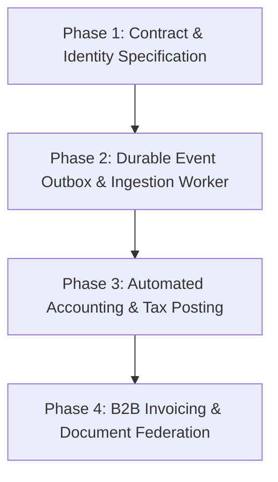

# Wibrops × BOUXRE Cross-Repository Integration Feasibility Audit Report

This report was written by Antigravity on 2026-10-21 via Local Runner.

## Objective

Investigate the architectural and operational feasibility of integrating Wibrops and BOUXRE as independently operated platforms within the BIGDROPS ecosystem. Establish verified capabilities, overlapping functionality, integration readiness, ownership boundaries, security requirements, operational risks, and recommended integration sequencing without implementing code or schema changes.

## Scope

- Cross-repository architecture audit across Wibrops (`C:\Users\DELL\Desktop\bgd-soft\Superstore`) and BOUXRE (`C:\Users\DELL\Desktop\bigdrops-app`).
- Multi-company workspace and tenant isolation boundaries.
- Financial documents: Invoices, quotations, receipts, and PDF generation pipelines.
- General ledger accounting, double-entry journal systems, chart of accounts, and tax compliance.
- Inventory models: Owned stock, supplier inventory, warehouse locations, stock reservations, and valuation.
- Payment systems: Payment ownership, gateway boundaries (Paystack, Monnify), refund workflows, and idempotency.
- Customer identity, guest checkout, and company identity mapping.
- Integration infrastructure: REST APIs, webhooks, event streaming, durable outbox/inbox, and security.

## Files changed

- `docs/reports/architecture/wibrops-bouxre-integration-feasibility-audit.md` (this report)

## Skills used

Skills used: NONE
Documentation standard: ASD-STE100 Simplified Technical English

Reason: The task is a read-only cross-repository architectural feasibility investigation. Canonical documentation, schema migrations, and source code across both repositories provide complete static evidence.

## Changes made

Created the authorized cross-repository architectural feasibility audit report under `docs/reports/architecture/`. No application source code, configuration files, or database schemas were modified in either repository.

## Verification

- Wibrops path check (`C:\Users\DELL\Desktop\bgd-soft\Superstore`): passed (directory exists)
- BOUXRE path check (`C:\Users\DELL\Desktop\bigdrops-app`): passed (directory exists)
- Wibrops git status check: clean on `main` (pre-existing untracked `.freebuff/sponsored-runtime/` preserved)
- BOUXRE git status check: clean on `main` prior to report writing; only the authorized audit report file added
- bun run audit:load: not run — zero code changes
- bun run typecheck: not run — zero code changes, host resource policy
- bun run build: skipped — resource-constrained host policy
- supabase db push: not applicable — zero SQL migration changes
- Execution mode: zero-code read-only investigation

## Supabase push status

Supabase push status: not applicable

## Risks or limitations

- Static analysis boundary: Claims reflect inspected source code, schema migrations, ADRs, and PRDs. Neither live database execution nor end-to-end network telemetry between platforms was measured.
- BOUXRE architectural constraint: BOUXRE operates as a browser-side Single Page Application (Vite + React) connecting directly to Supabase via `@supabase/supabase-js`. It possesses no server-side API endpoints, no public webhooks, and no machine-to-machine service role authentication gateway.
- Currency representation discrepancy: Wibrops enforces integer minor units (kobo: `100 kobo = ₦1.00`) across all models, whereas BOUXRE's `Calculations.ts` uses decimal major units (`numeric(18,2)` in PostgreSQL and JavaScript floats/decimals).

## Deferred work

- Founder authorization of the recommended hybrid event-driven integration contract.
- Formal OpenAPI/JSON-Schema specification for cross-platform commerce and payment events.
- Implementation of a secure service-to-service ingestion bridge (e.g., Supabase Edge Functions with HMAC signatures) for BOUXRE tenant schemas.

---

# Detailed Investigation and Analysis

## 1. Executive Feasibility Verdict

Verdict: **FEASIBLE UNDER LOOSE-COUPLED EVENT-DRIVEN FEDERATION (OPTION C / OPTION B). INFEASIBLE UNDER DIRECT DATABASE SHARING OR SYNCHRONOUS TIGHT COUPLING.**

The integration of Wibrops and BOUXRE as independently operated platforms within the BIGDROPS ecosystem is architecturally viable and strategically complementary, provided strict domain boundaries are respected:

1. **Complementary Strengths**:
   - **Wibrops** provides a hardened, server-authoritative e-commerce engine: single merchant-of-record, Go REST backend, customer checkout, atomic 15-minute stock reservations, supplier sync (Nonsman), multi-provider payment reconciliation (Paystack, Monnify), and kobo-strict arithmetic.
   - **BOUXRE** provides a mature business management platform: multi-tenant workspace/entity isolation, double-entry general ledger accounting kernel, Nigerian tax compliance (7.5% VAT, 5%/10% WHT, CIT, Development Levy), formal document lifecycle (The 3 Laws System), customizable PDF invoice/receipt renderers, and B2B vendor management.
2. **Critical Architectural Blockers to Direct Coupling**:
   - **No Shared Database**: Wibrops uses an independent Supabase PostgreSQL instance in the `public` schema managed by a dedicated Go backend role (`app_server`). BOUXRE utilizes dynamically provisioned Postgres schemas per entity (`entity_<workspaceSlug>_<entitySlug>`). Connecting both platforms directly to one database would violate tenant isolation, crash migration pipelines, and compromise RLS security.
   - **BOUXRE Has No Inbound Machine API**: BOUXRE currently exists entirely as a client-side web/mobile SPA (React 19 + Vite + Capacitor 8). It does not expose public REST/gRPC endpoints or webhook listeners for external servers.
   - **Independent Operational Availability**: In accordance with governing context, neither platform may depend on the other for core availability. A downtime event in BOUXRE must not halt Wibrops retail checkout. Conversely, high-volume retail traffic on Wibrops must not degrade BOUXRE tenant operations.

---

## 2. Repository Access and Inspection Scope

Both repositories were inspected independently using static source analysis, schema migration inspection, and architectural documentation reviews:

| Parameter | Repository 1: Wibrops | Repository 2: BOUXRE |
| :--- | :--- | :--- |
| **Path** | `C:\Users\DELL\Desktop\bgd-soft\Superstore` | `C:\Users\DELL\Desktop\bigdrops-app` |
| **Primary Stack** | Go 1.26 API, Next.js 16 (App Router), React 19, Supabase PostgreSQL | React 19, Vite 7, TypeScript 5.9, Tailwind CSS 3.4, Supabase, Capacitor 8 |
| **Runtime / Package Tool** | Go toolchain + npm (workspace roots) | Bun only (`bun.lock`) |
| **Merchant / Tenancy Model** | Single merchant of record, single retail brand | Multi-tenant workspace + multi-entity schema-per-tenant isolation |
| **Database Architecture** | `public` schema, Go `app_server` role, RLS default-deny | `public` management schema + `entity_<ws>_<entity>` dynamic schemas |
| **Inspected Governance Docs** | `AGENTS.md`, `docs/prd/MASTER-PRD.md`, `docs/decisions/` (ADR-0001, ADR-0002), `docs/standards/`, `docs/architecture/` | `AGENTS.md`, `.claude/agent-instructions/`, `docs/prd/multi-tenancy/`, `docs/standard/`, `docs/prd/financial-operations-prd.md` |
| **Inspected Migration Sets** | 17 SQL files in `supabase/migrations/` | 139 SQL files in `supabase/migrations/` |

---

## 3. Verified BOUXRE Capabilities

Evidence Level: `INSPECTED` & `LOCALLY TESTED` (via existing test suite in repository).

1. **Multi-Tenancy & Entity Isolation**:
   - Tenancy hierarchy: Platform (BIGDROPS) → Workspaces → Entities (Companies) → Schemas (`docs/prd/multi-tenancy/multi-tenancy-prd-v2.1.md`).
   - Dynamic schema provisioning: Automated engine generates `entity_<workspaceSlug>_<entitySlug>` schemas (`supabase/migrations/20260717000000_entity_provisioning_engine.sql`).
   - Edge Function PostgREST Exposure: `supabase/functions/postgrest-schema-exposure/index.ts` reads `_pending_postgrest_schemas`, verifies `pg_namespace`, and patches PostgREST configuration via the Supabase Management API.
   - Action-based permissions: `public.entity_permissions` table supports granular `(resource, action)` tuples (`invoice:approve`, `payment:reverse`, etc.) without schema migrations (`src/domain/team/role-permissions.ts`).
2. **Document Transformation & Lifecycle (The 3 Laws System)**:
   - Governed by `docs/standard/document-transformation-standard.md`.
   - **Edit Law**: Identity immutability for saved documents (`client_id`, `document_number`, `type`, lineage).
   - **Duplicate Law**: Fresh draft creation with new identities and auto-generated prefix numbering.
   - **Revert Law**: Historical snapshot recovery.
3. **Double-Entry General Ledger Accounting**:
   - Canonical chart of accounts: Assets (1000 Cash, 1100 Bank, 1200 AR, 1500 Fixed Assets), Liabilities (2000 AP, 2100 VAT Control, 2200 WHT Control, 2310 CIT Payable), Equity (3000), Revenue (4000), Expenses (5000 Opex, 5500 Tax) (`src/domain/accounting/chartOfAccounts.ts`).
   - Pure Posting Kernel: Strict debit-credit balance invariant (`assertPostable`), period open checks, idempotent normalization (`normalizeIdempotencyKey`), and equal-and-opposite reversal (`reverseEntry`) (`src/domain/accounting/postingKernel.ts`).
   - Source Transactions Engine: Intermediate ingestion layer (`captured` → `confirmed` → `posted`) for business facts prior to journal entry generation (`src/domain/accounting/sourceTransactions.ts`).
4. **Document & PDF Pipelines**:
   - `src/lib/Calculations.ts`: Financial calculation engine (`computeDocument`) handling line-item sub-totals, discounts, VAT (7.5%), and WHT.
   - Production PDF renderers: React-PDF implementations for Invoices, Quotations, Receipts, Waybills, and Purchase Orders (`src/components/pdf/`).
5. **Item Library & Pricing Catalog**:
   - Catalog management, alias resolution, historical price context per client, and deduplication (`src/modules/item-library/`).
6. **Non-Capabilities in BOUXRE**:
   - **Zero Inventory Engine**: Explicitly verified in migrations (`20261016090000_purchase_order_domain_and_persistence.sql`): *NO stock, reservation, or receiving table*. BOUXRE has no physical stock tracking.
   - **No Payment Gateway Integration**: Payments are recorded manually against invoices (`tenant_master_template.payments`). No Paystack/Monnify SDKs, webhook consumers, or virtual accounts exist.
   - **No Inbound Server API**: BOUXRE exposes no REST endpoints for external systems.

---

## 4. Verified Wibrops Capabilities

Evidence Level: `INSPECTED` & `LOCALLY TESTED` (via Go and Node unit test suites).

1. **Merchant-of-Record Retail Platform**:
   - Operates a unified Nigerian retail superstore (`docs/prd/MASTER-PRD.md`).
   - Go backend (`apps/api`) owns all business rules, prices, cart calculations, orders, and stock mutations.
2. **Authoritative Retail Checkout & Orders**:
   - Atomic order creation: `public.orders` and `public.order_lines` tables with strict integer kobo arithmetic and SHA-256 idempotency digests (`supabase/migrations/20261020150000_checkout_orders.sql`).
   - Order lifecycle state machine: `pending_payment` → `paid` → `processing` → `dispatched` / `ready_for_pickup` → `completed` (or `cancelled`).
3. **Inventory & Reservation Engine**:
   - Location management: `public.inventory_locations` supports retail warehouses and central pickup hubs.
   - Physical owned stock: `public.owned_stock` tracks on-hand, allocated, and available units.
   - Stock movements: Immutable ledger (`public.stock_movements`) tracking `receipt`, `adjustment_in`, `adjustment_out`, `allocation`, and `allocation_release`.
   - **Approved 15-Minute Unpaid Stock Reservation Policy**: `public.stock_reservations` enforces a strict 15-minute active hold window during checkout, preventing overselling with atomic row locks (`SELECT ... FOR UPDATE`), automated batch expiry workers, and audit event logs (`supabase/migrations/20261021093000_stock_reservations.sql`).
4. **Supplier Synchronization & Reconciliation**:
   - Nonsman supplier automation: Scrapes, normalizes, and reconciles supplier catalog feeds via leased batch runners, preserving immutable price observation receipts (`docs/api/catalogue-administration-and-import-contract.md`).
5. **Multi-Provider Payment Architecture**:
   - Paystack and Monnify treated as equal first-class providers (`docs/architecture/PAYMENT-RECOVERY-ARCHITECTURE.md`).
   - Webhook-driven idempotent processing: Stores provider references in `public.order_payment_events` with duplicate callback suppression.
   - Late-payment reconciliation: Reconciles payments arriving after reservation expiration without auto-fulfilling cancelled stock.
6. **Delivery Engine**:
   - Delivery quotation engine resolving Lagos flat rates (₦3,500), South-West regional rates (₦6,500), carrier quotation requests, and free hub pickup (`supabase/migrations/20261021050142_admin_delivery_quotations.sql`).
7. **Non-Capabilities in Wibrops**:
   - **No General Ledger Accounting**: No chart of accounts, journal entries, or balance sheets exist.
   - **No Formal PDF Tax Invoicing**: Invoicing is marked `NOT STARTED (0%)` in Phase 5 (`WBR-P5-02`).
   - **No Multi-Tenant Workspace Model**: Single-storefront architecture.

---

## 5. Cross-Platform Capability Matrix

| Domain Capability | Wibrops Implementation | BOUXRE Implementation | Functional Overlap | Compatibility / Conflict | Recommended Authority |
| :--- | :--- | :--- | :--- | :--- | :--- |
| **Retail Storefront & Catalog** | Go API + Next.js App Router; server-rendered. | None. Internal staff ERP only. | None | Fully compatible. | **Wibrops** |
| **Customer Checkout & Orders** | Atomic order creation, kobo integers, idempotency digests. | None. B2B manual invoice workflows. | None | BOUXRE cannot perform online retail checkout. | **Wibrops** |
| **Inventory Stock & Warehouses** | `owned_stock`, `inventory_locations`, `stock_movements`. | None. No warehouse or stock tables. | None | Wibrops must own all physical stock. | **Wibrops** |
| **Stock Reservations** | 15-minute unpaid checkout lock policy (`stock_reservations`). | None. Explicitly excluded. | None | BOUXRE must never mutate Wibrops reservations. | **Wibrops** |
| **Supplier Catalog Sync** | Automated batch sync, price engine (Nonsman). | Item Library catalog lookup & alias matching. | Partial: item catalog definitions. | Wibrops has live supplier sync; BOUXRE has historical item pricing. | **Wibrops** (Retail) / **BOUXRE** (ERP) |
| **Payment Gateways** | Paystack & Monnify webhooks, verification, recovery. | None. Manual payment recording only. | None | Wibrops must own all payment gateway interactions. | **Wibrops** |
| **Invoicing & Billing** | Minimal checkout order receipt UI. No formal PDF tax invoices. | Full tax invoice lifecycle, 3 Laws System, PDF generation. | High potential synergy. | Calculations differ (kobo int vs NGN decimal). Snapshot import required. | **BOUXRE** (Tax Invoice) / **Wibrops** (Sales Receipt) |
| **Payment Receipts** | Customer order confirmation view. | Immutable payment snapshot receipts (`receipt_standard.md`). | Semantic overlap: order receipt vs legal tax receipt. | Wibrops confirms checkout; BOUXRE issues legal tax proof of payment. | **Wibrops** (Checkout) / **BOUXRE** (Legal Receipt) |
| **Double-Entry Accounting** | None. Transactional event tables only. | Full general ledger, chart of accounts, posting kernel. | None | BOUXRE provides complete accounting engine. | **BOUXRE** |
| **Tax Compliance (VAT/WHT)** | 7.5% VAT in order totals. No filing/WHT credit notes. | Smart tax engine, VAT/WHT control ledgers, NRS filings. | None | BOUXRE provides comprehensive tax compliance. | **BOUXRE** |
| **Delivery Quotations** | Distance/state rate matrix + carrier unquoted quotes. | Quotations module (formal client quotes). | Different scopes: delivery fee vs contract quote. | Distinct domains. | **Wibrops** (Delivery) / **BOUXRE** (Contract Quote) |
| **Supplier RFQ / Procurement** | Phase 5 procurement roadmap (`WBR-P5-04`). | B2B Purchase Orders & RFQ module (`src/domain/rfq/`). | Overlapping procurement intentions. | BOUXRE possesses an operational PO/RFQ module today. | **BOUXRE** (Procurement PO) |

---

## 6. Proposed Source-of-Truth Matrix

Every business domain is assigned an authoritative platform. All authority assignments are classified as **PROPOSED** pending founder ratification:

| Domain | Proposed Authority | Permitted Operations from Secondary Platform | Required Validation | Synchronization Direction | Failure Behavior | Audit & Reconciliation Requirements |
| :--- | :--- | :--- | :--- | :--- | :--- | :--- |
| **Orders** | **Wibrops** | BOUXRE may read orders and view order status. BOUXRE cannot create or modify orders. | Order state transition checks; kobo integer totals verification. | Wibrops → BOUXRE | Secondary store marks order ingestion pending; retries via background worker. | Daily ledger reconciliation comparing Wibrops completed orders to BOUXRE sales invoices. |
| **Payments** | **Wibrops** | BOUXRE records payment events emitted by Wibrops. BOUXRE cannot trigger charges or verify webhooks. | Paystack/Monnify transaction reference matching; amount equality in minor units. | Wibrops → BOUXRE | Idempotent event buffering; rejection of duplicate provider references. | Bi-directional payment audit: Wibrops `order_payment_events` vs BOUXRE `payments` table. |
| **Refunds** | **Wibrops** | BOUXRE records refund adjustments in the accounting ledger. BOUXRE cannot initiate provider refunds. | Reversal validation against original payment reference; authorization check. | Wibrops → BOUXRE | Refund event buffered; accounting reversal posted into open period. | Full audit trail linking provider refund ID to BOUXRE journal reversal entry. |
| **Invoices** | **BOUXRE** | Wibrops presents generated invoice PDFs to customers via signed URL. Wibrops cannot recalculate tax lines. | Frozen snapshot validation; immutable lineage contract (The 3 Laws System). | BOUXRE → Wibrops (or on-demand read) | Fallback to Wibrops checkout receipt if BOUXRE invoice rendering is unavailable. | Document number sequence audit; VAT control account reconciliation. |
| **Receipts** | **Split Authority** | Wibrops owns the retail checkout receipt. BOUXRE owns the legal tax payment receipt. | Snapshot freeze: payment reference, date, amount, client name, and company VAT ID. | Wibrops emits payment → BOUXRE generates receipt snapshot. | Receipt generation retried asynchronously; payment status unaffected. | Sequential receipt number gap analysis via BOUXRE prefix engine. |
| **Accounting Entries** | **BOUXRE** | Wibrops has zero accounting operations. | Posting kernel rules: debit = credit; open period; valid account codes. | Internal to BOUXRE (fed by Wibrops events). | Unbalanced entries rejected; event flagged in error queue. | Trial balance verification, period-end ledger closing checks. |
| **Customer Identities** | **Wibrops** (Retail) | BOUXRE maps retail customer references to tenant client records. | Contact phone/email verification; one-to-one mapping constraint. | Bidirectional reference mapping. | Unmapped customers assigned to "Wibrops Retail Default Client". | Customer association audit log per ADR-0002. |
| **Company Identities** | **BOUXRE** | Wibrops references BIGDROPS/Wibrops Company ID as its merchant identity. | Workspace and entity existence probe (`_prov_get_schema_name`). | BOUXRE → Wibrops | Fail-closed: Wibrops rejects transactions if entity binding is invalid. | Tenant schema exposure logs in PostgREST. |
| **Owned Inventory** | **Wibrops** | BOUXRE may submit inventory adjustment requests. BOUXRE cannot write to stock tables. | Location check, variant check, positive integer quantity, reason audit string. | Wibrops → BOUXRE (Stock levels read-only). | Adjustment request queued for staff authorization; no direct DB update. | Periodic physical inventory count reconciled against `stock_movements`. |
| **Supplier Inventory** | **Wibrops** | BOUXRE reads catalog items into Item Library. | Non-negative price, active supplier verification, schema compliance. | Wibrops → BOUXRE | Stale supplier offers retained with warning indicator; no catalog overwrite. | Import runner digest verification (`SHA-256`). |
| **Inventory Valuation** | **Split Authority** | Wibrops provides unit cost (kobo). BOUXRE computes balance sheet inventory value. | Cost basis validation: unit cost × on-hand units = inventory asset balance. | Wibrops (Quantities/Costs) → BOUXRE (Ledger). | Valuation mismatch flagged in weekly reconciliation report. | Monthly balance sheet inventory audit vs Wibrops physical stock ledger. |
| **Delivery Quotations** | **Wibrops** | BOUXRE reads delivery charge for inclusion as an invoice line item. | Origin/destination dispatch zone validation, integer kobo rate. | Wibrops → BOUXRE | Unquoted delivery flagged for manual staff carrier rate entry. | Carrier settlement reconciliation. |
| **Supplier RFQs & POs** | **BOUXRE** | Wibrops stock intake references BOUXRE Purchase Orders upon goods receipt. | PO state verification (`approved`, `issued`); supplier identity validation. | BOUXRE → Wibrops | Unmatched goods receipt flagged as unreferenced physical intake. | PO fulfillment reconciliation against Wibrops stock movement `receipt` events. |

---

## 7. Invoices and Receipts Compatibility

1. **Document Lifecycle Compatibility**:
   - BOUXRE enforces **The 3 Laws System** (`docs/standard/document-transformation-standard.md`). Once an invoice is saved, its identity (`client_id`, `document_number`, `lineage`) is permanently locked.
   - Wibrops checkout creates immutable order records. If Wibrops pushes a completed order to BOUXRE as a finalized sale, BOUXRE can create a **SAVED Invoice** directly via snapshot insertion. This preserves the Edit Law because the document arrives already committed and locked.
2. **Calculation Engine Divergence**:
   - **BOUXRE**: `src/lib/Calculations.ts` calculates totals using decimal arithmetic (`number`), applying item-level discounts, 7.5% VAT, and withholding tax deductions.
   - **Wibrops**: Enforces strict integer minor units (kobo: `bigint`), rejecting any floating-point calculation.
   - **Resolution Rule**: BOUXRE must not recalculate or re-split Wibrops order line items. The integration contract must transmit exact integer kobo line prices, line VAT, delivery fees, and order totals. When BOUXRE renders the invoice, it maps integer kobo directly to exact decimal strings (`amount_kobo / 100`) without running divergent discount or rounding algorithms.
3. **Receipt Specialization**:
   - Wibrops checkout receipt satisfies the customer-facing e-commerce requirement ("Order Confirmed / Payment Received").
   - BOUXRE's `Receipt Standard` (`docs/standard/receipt-standard.md`) generates the legal tax receipt (`RCP-xxxxxx`) with full corporate metadata, bank account details, and signatory signatures. Wibrops customers requesting a formal corporate tax receipt can be provided with a link to download the BOUXRE-generated PDF.

---

## 8. Accounting Readiness

1. **Functional Completeness**:
   - BOUXRE's accounting domain (`src/domain/accounting/`) is fully implemented, mathematically sound, and ready for enterprise operations.
   - Key assets include `chartOfAccounts.ts` (NGN standards), `postingKernel.ts` (balanced debit/credit invariant), `invariants.ts` (open period validation), and `sourceTransactions.ts` (idempotent fact capture).
2. **Readiness for Wibrops Integration**:
   - BOUXRE can immediately act as the general ledger for Wibrops.
   - Required Journal Mappings for Wibrops Events:
     - **Order Paid (Retail)**:
       - Debit: `1100 Bank` (or `1050 Payment Gateway Clearing: Paystack/Monnify`)
       - Credit: `4000 Revenue` (Goods subtotal)
       - Credit: `2100 VAT Control` (7.5% Output VAT)
       - Credit: `4100 Delivery Revenue` (Shipping fee charged)
     - **Cost of Goods Sold (Goods Shipped)**:
       - Debit: `5100 Cost of Goods Sold`
       - Credit: `1300 Inventory Asset`
     - **Payment Gateway Fee Deduction**:
       - Debit: `5200 Payment Processing Expense`
       - Credit: `1050 Payment Gateway Clearing`
3. **Limitation**:
   - Accounting postings currently occur via client-side TypeScript execution in BOUXRE UI sessions. There is no automated background daemon posting journals when webhooks arrive. An automated posting worker must be introduced.

---

## 9. Inventory and Valuation Compatibility

1. **Ownership Boundary**:
   - **Wibrops is the Absolute Authority for Inventory**: Wibrops maintains physical locations (`inventory_locations`), stock on hand (`owned_stock`), movement ledgers (`stock_movements`), and active checkout locks (`stock_reservations`).
   - BOUXRE has zero physical inventory infrastructure.
2. **15-Minute Reservation Protection**:
   - BOUXRE must never attempt to allocate, reserve, or decrement Wibrops stock directly.
   - Wibrops' approved 15-minute unpaid reservation policy executes in Go using transactional row locking (`SELECT ... FOR UPDATE`) and atomic database updates. Bypassing this engine would cause catastrophic overselling during high-traffic retail drops.
3. **Inventory Valuation Flow**:
   - Wibrops tracks unit purchase costs in integer kobo on `owned_stock.unit_cost_kobo`.
   - When stock is received (via supplier delivery), Wibrops emits a `StockReceivedEvent` with quantity and unit cost.
   - BOUXRE ingests this event as a Source Transaction, creating a journal entry:
     - Debit: `1300 Inventory Asset`
     - Credit: `2000 Accounts Payable` (Supplier Liability)

---

## 10. Payment Integration Boundaries

1. **Provider Ownership**:
   - Wibrops maintains exclusive ownership of Paystack and Monnify integrations, API keys, webhook endpoints, and transaction references (`order_payment_events`).
   - BOUXRE must remain completely isolated from direct payment gateway interaction.
2. **Reconciliation & Idempotency Boundary**:
   - Wibrops validates provider signatures, rejects duplicate webhook callbacks, handles late payments on expired reservations, and manages refund workflows.
   - When a payment is irrevocably captured and verified, Wibrops emits a `PaymentCapturedEvent`.
   - BOUXRE ingests this event and marks the corresponding invoice as paid, creating an immutable `ReceiptSnapshot` per `docs/standard/receipt-standard.md`.
   - BOUXRE must never independently query Paystack/Monnify or mark a payment successful without an authoritative event from Wibrops.

---

## 11. Company and Customer Identity Mapping

1. **Authentication Database Separation**:
   - Under no circumstances should Wibrops and BOUXRE share an `auth.users` table. They serve distinct audiences: Wibrops serves public retail shoppers; BOUXRE serves corporate employees and SME operators.
2. **Company Mapping**:
   - Wibrops retail operations map to a single provisioned Entity inside a BIGDROPS Workspace in BOUXRE:
     - Workspace: `ws_bigdrops` (or `ws_ecosystem`)
     - Entity: `entity_wibrops_retail`
     - Isolated Schema: `entity_bigdrops_wibrops`
3. **Customer Identity Mapping**:
   - **Retail Shoppers (B2C)**: Individual consumers on Wibrops do not need individual client accounts in BOUXRE. Their transactions aggregate under a designated system counterparty: `Wibrops Retail Online Customers` (`client_id: uuid`).
   - **Corporate & SME Buyers (B2B)**: Customers who provide corporate registration details and tax identification (TIN) during Wibrops checkout are mapped to dedicated `clients` rows in BOUXRE via a foreign correlation key (`wibrops_customer_id`).
   - Conforms strictly to Wibrops ADR-0002 (Independent Business-Customer Identity) and BOUXRE's `clients` schema.

---

## 12. Tenant Isolation and Security Risks

1. **Multi-Tenant Exposure Risk in BOUXRE**:
   - BOUXRE manages data for multiple independent SME companies across isolated PostgreSQL schemas.
   - If an integration bridge were granted unrestricted database access (`service_role` bypassing RLS), a software defect could allow Wibrops events to pollute or overwrite other BOUXRE tenants' ledgers.
   - **Enforcement**: Any inbound bridge into BOUXRE must execute within the explicit context of the Wibrops tenant schema (`entity_bigdrops_wibrops`). The bridge must use a least-privilege role or parameterized schema-scoped RPCs (`_prov_` engine safeguards).
2. **Network Perimeter & Machine Authentication**:
   - BOUXRE has no external API authentication layer. Exposing Supabase directly to public web traffic with service-role keys violates security guardrails.
   - Any external integration endpoint must be placed behind a dedicated API Gateway or authenticated Supabase Edge Function with:
     - Ed25519 or HMAC-SHA256 request signing.
     - Replay protection via timestamps and nonce validation.
     - Strict byte ceilings and JSON schema validation.

---

## 13. API and Event Integration Readiness

| Infrastructure Component | Wibrops Readiness | BOUXRE Readiness | Gap Analysis |
| :--- | :--- | :--- | :--- |
| **REST API Server** | **Production Ready**: Go 1.26 HTTP service (`apps/api`) with structured logging, rate limiting, and standard error handling. | **Non-Existent**: Client-side SPA only. Direct PostgREST access via client SDK. | BOUXRE lacks an inbound HTTP API server. |
| **Outbound Event Publication** | **Architecture Ready**: PostgreSQL durable outbox pattern designed in `BACKGROUND-JOBS-ARCHITECTURE.md`. | **Non-Existent**: No event publication framework. | Wibrops needs physical outbox table implementation. |
| **Inbound Webhook Consumption** | **Production Ready**: Paystack/Monnify webhook handlers with signature verification and idempotency keys. | **Non-Existent**: Only client-side UI actions. | BOUXRE requires an Edge Function webhook receiver. |
| **Durable Worker / Queue** | **Designed**: Polled relational job tables with leases and advisory locks in PostgreSQL. | **Limited**: On-demand Edge Functions (`postgrest-schema-exposure`). No cron queue. | Asynchronous job consumer required for BOUXRE ledger posting. |
| **Service Authentication** | **Configured**: Go `app_server` role with strict RLS grants. | **Configured**: Supabase Auth JWTs for users. No machine actor role exists. | Machine-to-machine authentication contract is missing. |

---

## 14. Evaluation of Integration Architecture Options

### OPTION A — DIRECT VERSIONED APIs (Synchronous authenticated service calls)
- **Description**: Wibrops Go backend makes direct HTTP REST calls to BOUXRE API endpoints; BOUXRE frontend/backend calls Wibrops Go API.
- **Evaluation**:
  - *Technical Feasibility*: **LOW**. BOUXRE does not possess a backend HTTP server. Building a full backend in BOUXRE requires major architectural changes.
  - *Security*: Moderate. Requires exposing service credentials and opening firewall ports.
  - *Maintainability*: Low. Fragile point-to-point coupling.
  - *Latency*: High during checkout if Wibrops waits synchronously for BOUXRE invoice creation.
  - *Failure Isolation*: **VERY POOR**. A failure or slowdown in BOUXRE would freeze retail checkout on Wibrops.
  - *Verdict*: **REJECTED**. Violates the core requirement that neither platform may become dependent on the other for operational availability.

### OPTION B — EVENT-DRIVEN SYNCHRONIZATION (Durable asynchronous business events)
- **Description**: Wibrops writes business events (OrderPlaced, PaymentCaptured, StockMoved) to a durable outbox table. An asynchronous bridge dispatches these events to a dedicated BOUXRE ingestion worker, which posts records into BOUXRE's schema and general ledger.
- **Evaluation**:
  - *Technical Feasibility*: **HIGH**. Fits Wibrops' documented `BACKGROUND-JOBS-ARCHITECTURE.md` and BOUXRE's `sourceTransactions.ts` design.
  - *Security*: High. Uses signed asynchronous event payloads with replay protection.
  - *Maintainability*: High. Clean schema versioning and loose coupling.
  - *Latency*: Zero impact on customer checkout latency.
  - *Failure Isolation*: **EXCELLENT**. If BOUXRE is offline or deploying, Wibrops outbox retains events safely and retries when available.
  - *Operational Complexity*: Moderate (requires outbox processor and reconciliation jobs).
  - *Data Consistency*: Eventually consistent with guaranteed idempotency.
  - *Verdict*: **HIGHLY RECOMMENDED AS FOUNDATION**.

### OPTION C — HYBRID FEDERATED INTEGRATION (Synchronous read commands + Asynchronous record sync)
- **Description**: Asynchronous event-driven federation for all state-changing operations (orders, payments, inventory, journal postings), combined with on-demand synchronous read-only calls for document viewing (e.g., customer downloads an official BOUXRE invoice PDF via a signed URL or proxy endpoint).
- **Evaluation**:
  - Combines the bulletproof failure isolation of Option B with seamless user experience for document retrieval.
  - *Verdict*: **RECOMMENDED TARGET ARCHITECTURE**.

### OPTION D — SHARED LIBRARIES (Shared code packages across repositories)
- **Description**: Creating a shared npm/Go package containing common types, calculations, or PDF templates.
- **Evaluation**:
  - *Technical Feasibility*: **POOR**. Cross-runtime incompatibility (Go backend + Next.js web in Wibrops vs pure Bun/Vite SPA in BOUXRE).
  - *Calculations Conflict*: Violates BOUXRE guardrail ("`src/lib/Calculations.ts` is the financial source of truth") and Wibrops rule ("Money is integer minor units kobo").
  - *Deployment*: Couples release cycles across independent repositories.
  - *Verdict*: **REJECTED**. Shared contracts must be language-agnostic data schemas (JSON Schema), not shared code packages.

---

## 15. Recommended Phased Collaboration Roadmap

To preserve stability and avoid cross-repository disruption, integration should follow four sequential phases:



### Phase 1: Contract & Identity Specification (Zero Code Disruption)
- Formally ratify the event schema (`WibropsCommerceEvents.v1.json`).
- Provision the Wibrops operating company entity inside BOUXRE:
  - Workspace: `BIGDROPS Ecosystem`
  - Entity: `Wibrops Retail Ltd`
  - Target Schema: `entity_bigdrops_wibrops`
- Define the default retail client record and chart of accounts mapping in BOUXRE.
- Document the kobo-to-Naira integer conversion rule.

### Phase 2: Durable Event Outbox & Ingestion Worker
- Implement Wibrops durable PostgreSQL outbox table per `BACKGROUND-JOBS-ARCHITECTURE.md`.
- Implement a dedicated Supabase Edge Function on BOUXRE (`wibrops-event-ingest`) secured by HMAC-SHA256 signatures.
- Emit `PaymentCapturedEvent` and `StockMovementEvent` from Wibrops Go backend to the outbox.
- Worker delivers events to `wibrops-event-ingest`, which writes to BOUXRE's `source_transactions` table inside `entity_bigdrops_wibrops`.

### Phase 3: Automated Accounting & Tax Posting
- Connect BOUXRE's `sourceTransactionService.ts` to execute automated journal entries via `postingKernel.ts`.
- Automate posting of revenue, cash/clearing debits, 7.5% output VAT, and COGS for all completed Wibrops orders.
- Implement daily automated reconciliation job comparing Wibrops order totals against BOUXRE ledger balances.

### Phase 4: B2B Invoicing & Document Federation
- Enable Wibrops B2B/corporate checkout to submit customer TIN and business profile.
- BOUXRE auto-generates formal SAVED tax invoices and immutable payment receipts using `Calculations.ts` snapshots and `@react-pdf/renderer`.
- Expose a secure signed URL endpoint allowing Wibrops admin and corporate buyers to download official BOUXRE-generated PDF tax documents.

---

## 16. Missing Contracts

Before any implementation begins, the following technical contracts must be formally drafted and agreed upon:

1. **`WibropsCommerceEvents.v1.json`**:
   - JSON Schema defining event payloads for `OrderCompleted`, `PaymentCaptured`, `PaymentRefunded`, and `StockAdjustmentRecorded`.
   - Must enforce integer minor units (`amount_kobo`), ISO-8601 UTC timestamps, provider reference IDs, and SHA-256 idempotency keys.
2. **Machine-to-Machine Ingestion Security Contract**:
   - Specification for HMAC-SHA256 signature headers (`X-Bigdrops-Signature`), maximum allowable timestamp skew (300 seconds), and unique delivery nonce validation.
3. **Kobo-to-Decimal Boundary Mapping Contract**:
   - Mathematical specification ensuring that integer kobo values from Wibrops convert to exact decimal strings without floating-point rounding errors when stored in BOUXRE's `numeric(18,2)` columns.
4. **Counterparty Resolution Contract**:
   - Rules for distinguishing anonymous/individual retail sales (mapped to `Wibrops Default Retail Client`) from identified corporate accounts requiring distinct BOUXRE client entities.
5. **Reconciliation & Anomaly Handling SLA**:
   - Procedures and alert thresholds for handling missing events, duplicate deliveries, ledger discrepancies, and unallocated payment balances.

---

## 17. Founder Decisions Required

The following business and operational decisions require explicit founder review and approval:

1. **Merchant of Record & Corporate Tax Entity**:
   - Confirmation that Wibrops operates as a legally distinct subsidiary or integrated operating division within the BIGDROPS corporate workspace in BOUXRE.
2. **Authority Ratification**:
   - Approval of the Proposed Source-of-Truth Matrix (Section 6), formally establishing Wibrops as sole authority for checkout, stock, and payment gateways, and BOUXRE as sole authority for general ledger accounting, tax compliance, and formal invoicing.
3. **Customer Invoicing Policy**:
   - Decision on whether *all* retail transactions receive a BOUXRE formal PDF tax invoice, or only corporate/B2B transactions requesting a tax receipt (with ordinary retail shoppers receiving the lightweight Wibrops checkout receipt).
4. **Infrastructure Topology Approval**:
   - Approval to provision a Supabase Edge Function (`wibrops-event-ingest`) on the BOUXRE infrastructure to serve as the secure inbound event ingestion worker.

---

## 18. Exact Report Location and Verification Records

### Exact Report Location
`C:\Users\DELL\Desktop\bigdrops-app\docs\reports\architecture\wibrops-bouxre-integration-feasibility-audit.md`

### Git Status Records

#### Repository 1 — Wibrops (`C:\Users\DELL\Desktop\bgd-soft\Superstore`)
```
On branch main
Your branch is up to date with 'origin/main'.

Untracked files:
  (use "git add <file>..." to include in what will be committed)
	.freebuff/sponsored-runtime/

nothing added to commit but untracked files present (use "git add" to track)
```
*Note: Pre-existing untracked `.freebuff/sponsored-runtime/` directory was preserved untouched. Zero task-created files or modifications exist in Wibrops.*

#### Repository 2 — BOUXRE (`C:\Users\DELL\Desktop\bigdrops-app`)
```
On branch main
Your branch is up to date with 'origin/main'.

Untracked files:
  (use "git add <file>..." to include in what will be committed)
	docs/reports/architecture/wibrops-bouxre-integration-feasibility-audit.md

nothing added to commit but untracked files present (use "git add" to track)
```
*Note: Only the authorized audit report file was added to BOUXRE. Zero application code, configurations, or database files were modified.*

### Confirmation of Compliance
- Code modifications: **ZERO**
- Database schema changes: **ZERO**
- Database migrations created or executed: **ZERO**
- Git commits created: **ZERO**
- Git pushes executed: **ZERO**
- External deployments: **ZERO**
- Credential exposures: **ZERO** (no `.env*` or `.secrets/` files read)
