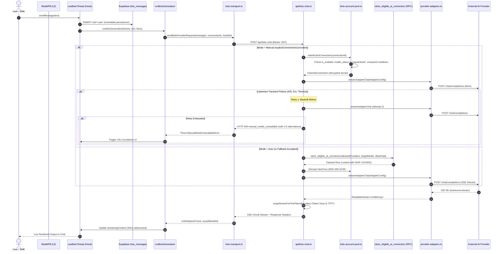

# BOURXE / Bolu — Final Model Routing & Failover Architecture Audit

**Status:** PROPOSAL — Not yet approved for implementation  
**Author:** Deepmind Agentic Architecture Lead (BOUXRE System Architecture)  
**Date:** November 20, 2026  
**Repository Baseline:** `8a828de0` (Dirty worktree preserved)  
**Task Authority:** Zero-code, read-only architectural inspection and design review  
**Target Path:** `docs/reports/bolu-model-routing/model-routing-and-failover-architecture-audit.md`

---

## 1. Executive Verdict

1. **Architecture Feasibility:** `[OBSERVATION]` The repository already contains an enterprise-grade multi-account connection vault, an atomic SQL routing engine (`claim_eligible_ai_connection`), an automated error classifier, and pre-stream failover logic. A simplified model-selection experience supporting **Auto** (autonomous pool routing) and **Manual** (pinned selection with 10-second countdown fallback) can be cleanly implemented without creating a parallel routing engine, without adding new database tables, and without introducing third-party dependencies.
2. **Current Implementation Reality:** `[OBSERVATION]` Prior to this audit, Bolu suffered from a complete failure-trap: pinned manual connections had zero retry budget and immediately failed with hard errors or broke the pool loop due to hardcoded model mismatches. Recent fixes verified in Step 2 restored basic pool failover, but the user experience remains rigid: there is no top-level "Auto" option in the UI picker, manual failures drop directly into pool execution without user consent, and OpenRouter's dynamic free-model identity is discarded by the client parser.
3. **Idempotency & Request Integrity:** `[OBSERVATION]` Bolu's conversational document lifecycle is strictly governed by a **Two-Gate Approval** architecture (`src/lib/ai-assistant/bolu-operations.ts` and `bolu-document-service.ts`). Inference turns only generate unstructured prose or Gate 1 preview proposals (`proposal_payload`). **Zero database writes or external business mutations occur during inference.** Therefore, upstream pre-stream retries and failovers are inherently side-effect-free and mathematically safe.
4. **Primary Architectural Pitfall:** `[OBSERVATION]` In `src/lib/ai-assistant/hooks/useBoluThread.ts` (lines 282–296), the user turn is unconditionally inserted into the `bolu_messages` table before generation starts. If a frontend countdown simply re-invokes `sendMessage()`, it will insert a duplicate user bubble into the conversation and database. The countdown resubmission must re-use the pending turn via `runBoluGeneration` without re-inserting user rows.
5. **Database Migration Requirement:** `[OBSERVATION]` **No database schema migration is required** to support custom OpenAI-compatible endpoints or OpenRouter free models. The PostgreSQL function `claim_eligible_ai_connection` accepts arbitrary `p_allowed_providers` text arrays. However, a material bug was identified in `record_ai_connection_failure` (`supabase/migrations/20261114170000_bolu_provider_connections.sql` line 354), where any HTTP 403 error erroneously marks the entire connection as `'quarantined'`, even when it represents a benign model-tier restriction.

---

## 2. Verified Call Graph and Repository Evidence

### 2.1 Complete Request Lifecycle



### 2.2 Exact File and Line Evidence

| Component | File Path | Key Line References | Architectural Role |
| :--- | :--- | :--- | :--- |
| **API Entry Point** | `api/bolu-chat.ts` | Lines 370–405, 473–585, 600–746 | Request authentication, manual exact routing, bounded pool failover loop, token scanning, response streaming. |
| **Account Pool Manager** | `src/lib/ai-assistant/routing/bolu-account-pool.ts` | Lines 65–145, 152–215 | `claimExactConnection` (direct vault lookup), `claimEligibleConnection` (RPC wrapper), AES-256-GCM secret decryption. |
| **Policy Router** | `src/lib/ai-assistant/routing/bolu-policy-router.ts` | Lines 38–41, 63–85, 88–92 | Deterministic task-to-model mapping, provider whitelist, custom provider gating (`allowCustom: true`). |
| **Provider Catalog** | `src/lib/ai-assistant/routing/bolu-provider-catalog.ts` | Lines 54–390, 409–460 | 20 verified catalog providers, auth schemes, verified models, SSRF endpoint validation. |
| **Error Classifier** | `src/lib/ai-assistant/routing/bolu-error-classifier.ts` | Lines 76–296 | Normalization of HTTP status and exceptions into `category`, `scope`, `retryable`, `requiresCooldown`, `requiresQuarantine`. |
| **Provider Adapters** | `src/lib/ai-assistant/provider-adapters.ts` | Lines 62–96, 447–549 | Protocol normalization (OpenAI vs Anthropic), endpoint resolution, header creation, `streamAdapterChat`. |
| **Frontend Thread Hook** | `src/lib/ai-assistant/hooks/useBoluThread.ts` | Lines 47–110, 230–338 | Active chat state, `sendMessage`, user row insertion, ClerkState management (`idle`, `thinking`, `responding`). |
| **Generation Engine** | `src/lib/ai-assistant/bolu-generation.ts` | Lines 167–260, 260–332, 333–356 | Temporary assistant turn orchestration, 35ms delta batching, proposal interpretation, abort/error handling. |
| **Transport Layer** | `src/lib/ai-assistant/bolu-transport.ts` | Lines 5–86 | Direct `fetch()` to `/api/bolu-chat`, SSE line decoding via `extractSseText`. |
| **Protocol Parser** | `src/lib/ai-assistant/protocol.ts` | Lines 50–70 | `extractSseText` (extracts `delta.content`; currently ignores `parsed.model`). |
| **Model Picker UI** | `src/components/ai-assistant/chat/assistant-chat-model-pill.tsx` | Lines 50–120, 210–258, 260–295 | OpenCode-style grouped model dropdown, search filtering, collision-aware positioning. |
| **Chat Workspace** | `src/components/ai-assistant/chat/BoluChatWorkspace.tsx` | Lines 125–155, 246–250 | Thread container, active connection resolution, localStorage synchronization (`bolu_active_model_target`). |
| **Vault Migrations** | `supabase/migrations/20261114170000_bolu_provider_connections.sql` | Lines 18–71, 318–430 | `app_ai_provider_connections` schema, `record_ai_connection_failure` SQL function. |
| **Per-Connection Models** | `supabase/migrations/20261115150000_bolu_per_connection_model_selection.sql` | Lines 50–135 | `claim_eligible_ai_connection` atomic selection RPC with `SKIP LOCKED`. |

---

## 3. Failure Classification Matrix

`[OBSERVATION]` The table below classifies all 13 required failure modes against verified repository mechanics (`bolu-error-classifier.ts`, `bolu-provider-adapters.ts`, and database RPCs).

| Failure Scenario | Upstream Indicator | Retry Same Model? | Cooldown Action | Quarantine Action? | Scope | Required Evidence Before Applying |
| :--- | :--- | :--- | :--- | :--- | :--- | :--- |
| **1. Network Timeout** | `AbortError`, `TimeoutError`, HTTP 408 | **Conditional** (Up to 1 quick retry if pre-stream and elapsed time < 8s) | 30s account cooldown if retry fails | No | Request / Provider | Request aborted by client timer before first chunk received. |
| **2. Transient Network Drop** | `ECONNRESET`, `ECONNREFUSED`, `fetch failed` | **Yes** (1 retry after 400ms backoff) | 30s provider cooldown if retry fails | No | Provider | Node/Bun socket disconnect before HTTP response headers land. |
| **3. HTTP 429 Rate Limit** | HTTP 429 with `retry-after` header | **Conditional** (Retry same connection ONLY if `Retry-After <= 3s`) | Cooldown for `Retry-After` seconds (default 60s) | No | Account (or Model if body specifies) | HTTP 429 status. Inspect body for `"model_rate_limit"` vs account rate limit. |
| **4. HTTP 502/503/504 Outage** | HTTP 502 Bad Gateway, 503 Unavailable, 504 Gateway Timeout | **Yes** (1 retry after 500ms backoff for cold starts) | 45s provider cooldown if retry fails | No | Provider | Cloudflare/Upstream 5xx status code before response stream starts. |
| **5. Provider Overload** | HTTP 503 with `"overloaded"` or `"capacity"` in error body | **No** (Do not hammer overloaded provider) | 60s provider cooldown | No | Provider | HTTP 503 status + string match in error body (`"overloaded_error"`). |
| **6. HTTP 401 Invalid Auth** | HTTP 401 Unauthorized | **No** (Immediate failover / fallback) | None | **Yes** (`health_status = 'quarantined'`) | Account | HTTP 401 status code confirmed. Indicates invalid, expired or revoked API key. |
| **7. HTTP 403 Permission / Tier** | HTTP 403 Forbidden | **No** (Immediate failover / fallback) | Cooldown affected model only (24h) | **No** (Do NOT quarantine account) | Model | HTTP 403 status code with `"permission_denied"`, `"model_access"`, or region lock. |
| **8. HTTP 402 Quota Exhausted** | HTTP 402 Payment Required, or `"insufficient_quota"` | **No** (Immediate failover / fallback) | Cooldown connection 86400s (24h) | No (`health_status = 'exhausted'`) | Account | HTTP 402 status, or HTTP 400/429 with raw code `"insufficient_quota"`. |
| **9. Unsupported Model / 404** | HTTP 404 Not Found, HTTP 410 Retired | **No** (Immediate failover / fallback) | Cooldown model 86400s in `model_cooldowns` | No | Model | HTTP 404/410 returned from `/chat/completions`. |
| **10. Malformed Response** | `SyntaxError: Unexpected end of JSON`, bad SSE framing | **Conditional** (1 retry if pre-stream; stream interrupt if post-stream) | None | No | Request | Response headers OK (200), but chunk payload cannot be decoded. |
| **11. HTTP 200 with Error in Body** | HTTP 200 containing `{"error": {...}}` | **No** (Immediate failover / fallback) | 30s cooldown if transient; quarantine if auth error | Conditional | Account / Provider | First chunk or parsed JSON root contains `error` object. |
| **12. SSE Interruption (Mid-Stream)** | Upstream socket closed mid-stream after `firstChunkReceived = true` | **No** (Never append second model to partial text) | 30s cooldown on connection | No | Connection | `reader.read()` throws or closes before `[DONE]` marker received. |
| **13. User Cancellation** | Client invokes `AbortController.abort()` | **No** (Halt all processing immediately) | None | No | Request | `req.signal.aborted === true`. Set message status to `'stopped'`. |

---

## 4. Evaluation of Proposed Retry Budgets

`[PROPOSAL]` Sharon proposed the following initial values:
1. *Transient retry backoff: ~300–500 ms.*
2. *First-byte timeout (TTFT): ~8–10 seconds.*
3. *Total pre-stream retry budget: ~15 seconds.*
4. *HTTP 429: retry same connection only when Retry-After is no more than 3 seconds.*

### 4.1 Critical Evaluation & Recommended Adjustments

| Parameter | Sharon Proposal | Architectural Finding & Risk | Recommended Specification |
| :--- | :--- | :--- | :--- |
| **Transient Backoff** | 300–500 ms | **Sound.** Upstream socket blips and TCP resets clear within 400ms. | **400 ms** fixed jittered backoff (`350ms + Math.random() * 100ms`). |
| **First-Byte Timeout (TTFT)** | 8–10 seconds | **Partially Aggressive.** Serverless cold starts (Vercel/Cloudzyro to external inference gateways) take 5–7 seconds on average. An 8s timeout risks cutting off legitimate first responses under load. | **10.0 seconds** for Attempt 1. If retried on the same connection, **6.0 seconds** for Attempt 2. |
| **Total Pre-Stream Budget** | ~15 seconds | **Tight.** Attempt 1 (10s) + Backoff (0.4s) + Attempt 2 (6s) = 16.4s total. Enforcing a strict 15s budget would prematurely abort Attempt 2. | **16.5 seconds total pre-stream budget.** If no token has been received by 16.5s, terminate same-connection retries and trigger failover/fallback. |
| **HTTP 429 Threshold** | Retry only if `Retry-After <= 3s` | **Sound.** OpenRouter and DeepSeek return 30s–60s on quota/rate exhaustion. Retrying after 3s on long quotas causes repeated 429s and wastes user turn time. | **Retain Sharon's proposal.** If `Retry-After <= 3s`, sleep and retry once. If `Retry-After > 3s` or header is absent, immediately cool down and switch. |
| **Retry Ownership** | Undefined | **Critical Hazard.** If frontend retries (3x) and API retries (2x) and Pool retries (4x), a single prompt could spawn 24 upstream calls. | **Single Ownership Decision:** Retries MUST live **exclusively in `api/bolu-chat.ts`**. The frontend must NEVER perform blind HTTP retries for chat inference. |

---

## 5. Auto Mode UX and Failover Mechanics

### 5.1 Auto Mode Specification
`[DECISION]` **Auto** must be the first, top-level item in the Model Picker. It is the default state for all users who have not explicitly pinned a manual model.

1. **Model Selection Display:**
   - When Auto is active, the pill trigger displays:
     $$\text{Pill Label: } \textbf{Auto} \cdot \text{\small [Resolved Model Name]}$$
     *(Example: `Auto · DeepSeek V3` or `Auto · Llama 3.3 70B`)*.
   - If no request has been made yet in the session, display `Auto · Priority Pool`.
2. **Autonomous Failover Behavior:**
   - The user never sees error banners or countdowns for transient provider drops in Auto mode.
   - If Provider A fails (e.g. AMD Token Factory 503s):
     1. API retries Provider A once (400ms backoff).
     2. If retry fails, Provider A is cooled down for 45s.
     3. API immediately claims Provider B (e.g. OpenRouter) from the active pool via `claim_eligible_ai_connection`.
     4. API executes the request on Provider B and streams the response to the user.
3. **User Feedback & Toast:**
   - When a model switch occurs during Auto mode:
     - API returns HTTP header `X-Bolu-Fallback: true` and `X-Bolu-Model-Id: deepseek-chat`.
     - Frontend catches this transition and triggers a non-disruptive feedback notification:
       `feedback.info("Bolu switched to DeepSeek V3 because the previous provider was temporarily unavailable.")`.
     - Sound: Triggers optional subtle UI sound (`uiSound('notification.info')`).

---

## 6. Manual Mode UX, Popup & 10-Second Countdown

### 6.1 Manual Mode Specification
`[DECISION]` When a user selects a specific connection/model from the picker (e.g. `111 / deepseek-v...` or `OpenAI / GPT-4o`), that selection is **pinned** as the active manual model.

1. **Pre-Stream Retry Execution:**
   - When the user sends a prompt, Bolu targets the pinned connection.
   - If a transient failure occurs (429 with `<= 3s`, 5xx, or network drop), Bolu silently retries the pinned connection **up to one time** (400ms backoff).
   - If the retry succeeds, generation proceeds normally. **No error, no popup, no model switch.**
2. **Fallback Trigger on Failure:**
   - If the pinned model fails with a non-retryable error (401, 402, 404) OR exhausts its single retry:
   - **The API does NOT hold the SSE connection open.** Holding HTTP connections open while waiting for human interaction causes mobile socket timeouts, cloud gateway dropouts, and proxy disconnects.
   - Instead, `api/bolu-chat.ts` queries the top 3–5 eligible alternative connections in the active pool and returns a structured HTTP 409 response:
     ```json
     {
       "error": "DeepSeek V3 is temporarily unavailable.",
       "code": "manual_model_unavailable",
       "failedTarget": {
         "connectionId": "c9284210-9112-4d2b-a010-8b14a29a4101",
         "modelId": "DeepSeek-V3"
       },
       "alternatives": [
         {
           "connectionId": "e1102941-4819-4cb1-b021-9d214a142002",
           "connectionName": "OpenRouter",
           "modelId": "deepseek/deepseek-chat",
           "modelName": "DeepSeek Chat"
         },
         {
           "connectionId": "f2201942-5920-4dc2-c032-0e325b253113",
           "connectionName": "AMD Radeon",
           "modelId": "DeepSeek-V4-Flash",
           "modelName": "DeepSeek V4 Flash"
         }
       ],
       "countdownSeconds": 10
     }
     ```
3. **Frontend 10-Second Countdown UI:**
   - The frontend catches `code === 'manual_model_unavailable'`.
   - Instead of displaying a hard red failure banner, it presents a smooth, accessible fallback dialog:
     - **Header:** *"DeepSeek V3 is currently unavailable."*
     - **Subtext:** *"Choose an alternative below, or Bolu will automatically switch in **10s**."*
     - **Options List:** Displays the 3–5 pre-ranked alternative pills.
     - **Actions:** Clicking an alternative immediately switches. A "Dismiss" button closes the modal but allows the countdown to continue in the background.
4. **Resolution Paths:**
   - **User clicks an alternative:**
     - The selected alternative is saved to `localStorage` as the new pinned manual model.
     - The model picker pill updates immediately.
     - Frontend triggers `resubmitPendingTurn({ connectionId, modelId })`.
   - **User dismisses dialog:**
     - Dialog closes; countdown progress bar continues in a subtle pill banner above the composer.
     - If user takes no action before 10s: countdown fires automatic switch to `alternatives[0]`.
   - **Countdown expires (0s):**
     - Automatically selects `alternatives[0]`.
     - The alternative becomes the new pinned manual selection.
     - Toast: `feedback.info("Switched to DeepSeek Chat to complete your request.")`.
     - Sound: Triggers optional alert sound (`uiSound('notification.info')`).
     - Frontend automatically triggers `resubmitPendingTurn({ connectionId, modelId })`.
   - **Zero Alternatives Available:**
     - If `alternatives.length === 0`: Display a clear error explaining that all configured pool connections are currently exhausted or cooling down, with a manual "Retry" button.

---

## 7. Request Identity, Idempotency and Safe Resubmission

### 7.1 The Duplicate User Turn Hazard
`[OBSERVATION]` In `src/lib/ai-assistant/hooks/useBoluThread.ts` (lines 282–296), `sendMessage` executes:
```ts
const { data: userRow, error: userError } = await (supabase.from('bolu_messages') as any)
  .insert({
    conversation_id: targetConversationId,
    tenant_id: resolvedTenantId,
    sender_id: user?.id ?? null,
    role: 'user',
    content: clean,
    status: 'completed',
  })
  .select(MESSAGE_COLUMNS)
  .single()
```
If the countdown expires and the frontend naively calls `sendMessage(clean)` again, a **second identical user message** will be written to `bolu_messages`. The conversation thread will display duplicate user bubbles.

### 7.2 The Safe Resubmission Architecture
`[PROPOSAL]` To guarantee turn idempotency and prevent duplicate messages:
1. `useBoluThread` must expose a dedicated method:
   ```ts
   resubmitPendingTurn(target: { connectionId: string | null; modelId: string | null })
   ```
2. When `runBoluGeneration` fails with `manual_model_unavailable`:
   - The user message row is ALREADY saved in `bolu_messages` with `status = 'completed'`.
   - The assistant message in React state is temporary (`tempAssistantId`).
   - `resubmitPendingTurn` bypasses user row insertion entirely. It simply calls `runBoluGeneration` using the existing conversation history and the pending user turn text, targeting the new `connectionId` and `modelId`.
3. **Result:** Exactly ONE user message row exists in the database and UI. When the alternative model responds, it attaches its single assistant message row.

---

## 8. Streaming Integrity & Commit Boundary

`[OBSERVATION]` A critical question in multi-model routing is: *Can a failed stream be recovered without corrupting the message?*

### 8.1 The Two Phases of Stream Execution

```
Inference Start ───────► [Phase 1: Pre-First-Token] ───────► First Chunk Received ───────► [Phase 2: Post-First-Token] ───────► Stream Complete
                             │                                                               │
                             ├─ Safe to Retry                                                ├─ DO NOT Retry Same Connection
                             ├─ Safe to Switch Models                                        ├─ DO NOT Switch Models
                             └─ Safe to Return 409 Fallback                                  └─ Terminate Stream with Interruption Signal
```

### 8.2 Phase 1: Pre-First-Token (Pre-Commit)
- **State:** `firstChunkReceived === false`. Zero bytes of assistant output have reached the client.
- **Integrity Rule:** The client has rendered nothing. It is 100% safe to retry, switch providers, or trigger the 10s manual fallback countdown.
- **Repository Proof:** In `api/bolu-chat.ts` (lines 232, 296), `firstChunkReceived` tracks whether any chunk has been enqueued. `recordAiSuccess` is ONLY called after `firstChunkReceived === true`.

### 8.3 Phase 2: Post-First-Token (Post-Commit)
- **State:** `firstChunkReceived === true`. Partial assistant prose has been streamed to the user's screen.
- **Integrity Rule:** **NEVER switch models and append a different model's text to the same assistant bubble.** Combining two different models in mid-sentence results in hallucinated grammar, contradictory proposals, and broken JSON.
- **Repository Defect Identified:** Currently, in `src/lib/ai-assistant/bolu-generation.ts` (lines 347–350), if an SSE stream drops mid-sentence, `runBoluGeneration` catches the error and **overwrites the entire message content** with `"Bolu could not complete this request: [error]"`. The partial text already seen by the user vanishes.
- **Recommended Post-Commit Architecture:**
  1. If upstream disconnects mid-stream: preserve `refs.streamingBuffer.current` verbatim.
  2. Mark the assistant message row in Supabase with `status = 'stopped'` and `metadata = { interrupted: true, model: actualModelId }`.
  3. Render an inline recovery pill beneath the partial response:
     - **[Continue]:** Sends a continuation prompt (`"Please continue from where you left off: [...]"`) using the same conversation context.
     - **[Regenerate]:** Uses existing `regenerateBoluResponse` (`src/lib/ai-assistant/bolu-thread-actions.ts`) to cleanly rerun the turn from scratch.

---

## 9. Provider Compatibility & Model Discovery

### 9.1 OpenRouter Free (`openrouter/free`)
1. **Dynamic Model Resolution:** `[OBSERVATION]` When requesting `model: 'openrouter/free'`, OpenRouter routes to whatever free upstream model currently has capacity (e.g. `meta-llama/llama-3.3-70b-instruct:free`, `deepseek/deepseek-r1:free`, or `nvidia/nemotron-3.5-lightning-free`).
2. **Current Defect:** `[OBSERVATION]` In `src/lib/ai-assistant/protocol.ts` (lines 50–70), `extractSseText` extracts only `delta.content`. It completely ignores the `"model"` field on the SSE JSON chunk!
   ```json
   data: {"id":"gen-123","model":"meta-llama/llama-3.3-70b-instruct:free","choices":[{"delta":{"content":"Hello"}}]}
   ```
3. **Resolution:** Update `extractSseText` (or provide an accompanying `extractSseMetadata` helper) to parse `parsed.model`. In `bolu-transport.ts`, pass `onModelResolved?: (modelId: string) => void` so the frontend pill immediately reflects the actual responding model (`Auto · Llama 3.3 70B`).

### 9.2 Custom OpenAI-Compatible Endpoints (`provider_id = 'custom'`)
1. **SSRF Defense:** `[OBSERVATION]` `src/lib/ai-assistant/provider-security.ts` already enforces comprehensive SSRF protection on custom endpoints: HTTPS only, port 443, rejects private IPv4/IPv6 CIDRs (`10.0.0.0/8`, `192.168.0.0/16`, `127.0.0.1`, AWS metadata `169.254.169.254`), and rejects userinfo credentials in URLs.
2. **Database Compatibility:** `[OBSERVATION]` As verified in Section 1, `public.claim_eligible_ai_connection` accepts any `provider_id = ANY(p_allowed_providers)`. Custom connections with `provider_id = 'custom'`, `in_pool = true`, and `is_enabled = true` can participate in the active pool immediately without database schema changes.

---

## 10. Ranking Determinism for Fallback Alternatives

`[DECISION]` When generating the 3–5 fallback alternatives for Manual mode (or ranking candidates in Auto mode), Bolu must use a **deterministic, zero-overhead ranking hierarchy** based on existing database columns and catalog metadata:

1. **Gate 0: Mandatory Eligibility Filters (Postgres WHERE clause):**
   - `c.is_enabled = true`
   - `c.in_pool = true`
   - `c.health_status NOT IN ('quarantined', 'exhausted')`
   - `c.account_cooldown_until IS NULL OR c.account_cooldown_until <= now()`
   - `c.id NOT IN (currentFailedConnectionId)`
2. **Rank 1: Priority Tier (`c.priority ASC`):**
   - Configured in Settings (`priority` integer, 1 to 1000, lower is higher priority). Default is 100.
3. **Rank 2: Fuel Availability / Balance Health:**
   - Active paid tier or positive balance (`known_balance_amount > 0`) ranks above unmetered free tiers.
4. **Rank 3: Success Track Record (`c.consecutive_failures ASC`):**
   - Connections with 0 consecutive failures rank above connections that recently recovered.
5. **Rank 4: Load Leveling Tie-Breaker (`c.last_selected_at ASC NULLS FIRST`):**
   - Round-robin distribution across equally weighted connections.

`[OBSERVATION]` Custom models without catalog entries simply receive default priority (`priority = 100`) and standard capabilities (`chat-completions`, `streaming`), ensuring they are never unfairly rejected.

---

## 11. Notifications and Sensory Audio Design

`[OBSERVATION]` Bolu already has a complete sensory UI sound and haptics system:
- `src/lib/feedback.ts`: `feedback.success()`, `feedback.error()`, `feedback.info()`.
- `src/lib/uiSoundEvent.ts`: `uiSound('notification.success')`, `uiSound('notification.error')`.
- `src/components/ui/sensory-ui/sounds/packs.ts`: Multi-pack audio synthesis (Bouxre Luxe, Minimal, Tactile).
- `src/lib/ai-assistant/bolu-preferences.ts`: Device-scoped `localStorage` preferences with `bolu:interaction-preferences-changed` event.

### 11.1 Audio Feedback Matrix

| Event | Visual Feedback | Audio Tone | Audio Condition |
| :--- | :--- | :--- | :--- |
| **Auto Model Switch** | Non-disruptive Toast naming new model | `uiSound('notification.info')` | Only if sound is enabled in device preferences. |
| **Manual Model Unavailable** | 10-second countdown dialog | `uiSound('notification.warning')` | Distinct gentle chime alerting SME to make a choice. |
| **Countdown Expired Switch** | Toast naming automatically chosen alternative | `uiSound('notification.info')` | Standard informational chime. |
| **Same-Connection Retry Success** | None (silent recovery) | **None** | Completely silent. Non-technical user is not distracted. |
| **Mid-Stream Interruption** | Inline continuation/regenerate pill | `uiSound('notification.error')` | Alert indicating output paused mid-stream. |

---

## 12. Answers to the 15 Required Architecture Questions

### Q1: What retry and failover behaviour already exists, and which layer owns it?
**Evidence:** `api/bolu-chat.ts` lines 478–554, 601–693; `src/lib/ai-assistant/routing/bolu-account-pool.ts`.  
`[OBSERVATION]` Prior to our recent patch, pinned selections had zero retry and zero failover; any failure threw an immediate error. Our patch added pre-stream failover from pinned to pool. However, **same-connection retries currently do not exist** on the chat route. Retries must be owned strictly by `api/bolu-chat.ts` (API layer) before downstream tokens are emitted. The frontend (`useBoluThread`) owns no retries.

### Q2: How are pool eligibility, fuel availability, connection health and cooldowns determined?
**Evidence:** `supabase/migrations/20261115150000_bolu_per_connection_model_selection.sql` lines 76–91; `20261114170000_bolu_provider_connections.sql` lines 340–420.  
`[OBSERVATION]` Pool eligibility requires `is_enabled = true`, `in_pool = true`, `health_status != 'quarantined'`, and `account_cooldown_until <= clock_timestamp()`. Fuel availability is tracked via `known_balance_amount` (synced by `bolu-balance-sync.ts`) and HTTP 402 classification, which applies a 24-hour cooldown (`health_status = 'exhausted'`).

### Q3: How can transient load be distinguished from a genuine request failure?
**Evidence:** `src/lib/ai-assistant/routing/bolu-error-classifier.ts` lines 89–283.  
`[OBSERVATION]` Transient load is characterized by HTTP 429 with short Retry-After, HTTP 502/503/504 gateway cold starts, TCP disconnects (`ECONNRESET`), and pre-first-token timeouts. Genuine request failures are HTTP 400/422 (schema violations), HTTP 401 (invalid credentials), HTTP 402 (insufficient credits), and HTTP 404 (retired models).

### Q4: Which failure categories should retry, switch immediately, cool down or quarantine?
**Evidence:** See complete Failure Classification Matrix in Section 3.  
`[OBSERVATION]`
- **Retry same connection once:** Network timeout, transient socket drop, HTTP 502/503 cold start, HTTP 429 (only if Retry-After <= 3s).
- **Switch immediately without retry:** HTTP 401, HTTP 402, HTTP 403, HTTP 404, HTTP 429 (Retry-After > 3s), Provider Overloaded (503).
- **Cooldown connection:** HTTP 402 (24h), HTTP 429 (Retry-After duration), HTTP 5xx (45s), Timeout (30s).
- **Quarantine connection:** HTTP 401 ONLY (invalid credentials).

### Q5: How are model capabilities, tiers and connection priorities represented?
**Evidence:** `app_ai_provider_connections.priority` (integer), `bolu-provider-catalog.ts` (`supportedCapabilities`), `metadata.enabledModels`.  
`[OBSERVATION]` Priorities are integers stored in `app_ai_provider_connections.priority` (default 100, lower is higher priority). Model capabilities currently reside in the static catalog per provider. Custom connections default to `chat-completions` and `streaming`.

### Q6: Can custom providers participate in the pool today? Is a SQL change actually needed?
**Evidence:** `supabase/migrations/20261115150000_bolu_per_connection_model_selection.sql` line 79.  
`[OBSERVATION]` **Yes, custom providers can participate today without any SQL or database migration.** The SQL RPC checks `c.provider_id = ANY(p_allowed_providers)`. Passing `allowCustom: true` in `resolveRoutingPolicy` includes `'custom'` in the text array, enabling full pool participation immediately.

### Q7: How does OpenRouter's actual resolved model identity reach the client?
**Evidence:** `src/lib/ai-assistant/protocol.ts` lines 50–70; `src/lib/ai-assistant/bolu-transport.ts` lines 61–65.  
`[OBSERVATION]` **It currently does NOT reach the client.** Although OpenRouter streams the resolved model ID in the SSE payload (`"model": "meta-llama/..."`), `extractSseText` discards it and only extracts `content`. A minor parser update is required to extract and emit the model ID.

### Q8: Can the frontend implement the countdown and resubmission without duplicate messages or operations?
**Evidence:** `src/lib/ai-assistant/hooks/useBoluThread.ts` lines 282–296, 329–336.  
`[OBSERVATION]` **Yes, by using `runBoluGeneration` directly.** Calling `sendMessage()` would insert a duplicate user message row into `bolu_messages`. Calling a dedicated `resubmitPendingTurn()` method re-uses the already persisted user row and executes inference with the new model target, preventing duplicates.

### Q9: What is the precise streaming commit boundary, and how are interrupted responses represented?
**Evidence:** `api/bolu-chat.ts` lines 232, 296 (`wrapStreamForFirstTokenBoundary`).  
`[OBSERVATION]` The commit boundary is the **first non-empty text chunk** sent to the client. Before this chunk, failover is 100% transparent. After this chunk, failover is forbidden; the partial text must be preserved, and the turn marked `status = 'stopped'` with inline Continue/Regenerate options.

### Q10: Can tool calls and structured business operations be retried safely?
**Evidence:** `src/lib/ai-assistant/bolu-generation.ts` lines 260–270; `src/lib/ai-assistant/bolu-document-service.ts`.  
`[OBSERVATION]` **Yes, 100% safely.** Bolu does not use native function calling during stream generation. Generation only produces prose and Gate 1 draft proposals. Database operations (invoice creation/modification) ONLY execute when the user explicitly clicks the Gate 2 "Confirm" button. Pre-stream retries cannot duplicate business operations.

### Q11: Can all proposed behaviour be implemented through the existing routing architecture without creating a parallel engine?
**Evidence:** `api/bolu-chat.ts`, `bolu-account-pool.ts`, `bolu-policy-router.ts`.  
`[OBSERVATION]` **Yes.** The existing `api/bolu-chat.ts` handles exact claims, pool loops, cooldowns, and error mapping. Adding a bounded pre-stream retry and returning an HTTP 409 structured manual fallback uses existing endpoints and types with zero parallel infrastructure.

### Q12: What API, frontend, database or persistence changes are genuinely required?
`[OBSERVATION]`
- **Database:** Zero schema changes required. (Optional: fix the broad `(401, 403)` quarantine check in `record_ai_connection_failure`).
- **API (`api/bolu-chat.ts`):** Add 1 bounded retry on exact claims; return HTTP 409 with alternatives for manual mode; pass resolved model in SSE stream.
- **Frontend (`assistant-chat-model-pill.tsx`, `useBoluThread.ts`):** Add "Auto" pill item; render 10s countdown dialog on HTTP 409; implement `resubmitPendingTurn`.

### Q13: What security, tenant-isolation, concurrency or reliability risks remain?
**Evidence:** `app_ai_provider_connections` RLS; `claim_eligible_ai_connection` `FOR UPDATE OF c SKIP LOCKED`.  
`[OBSERVATION]`
- **Concurrency:** `SKIP LOCKED` prevents race conditions when multiple users or tabs request inference simultaneously.
- **Tenant Isolation:** Provider credentials live in `app_ai_provider_connections`, protected by service-role access only. Anon/authenticated users cannot read API keys.
- **SSRF:** Validated via `validateEndpointSyntax` before any custom provider can be saved.

---

## 13. Minimal Implementation Plan

`[PROPOSAL]` To implement this architecture with the lowest possible risk, execute in four clean, sequential phases:

### Phase 1: API Pre-Stream Retry & HTTP 409 Manual Fallback
1. In `api/bolu-chat.ts`:
   - Add a 1-retry bounded loop on `exactClaimed` (backoff 400ms, first-token timeout 10s).
   - If `routingMode === 'manual'` and the pinned connection fails:
     Query top 3 alternatives using `claim_eligible_ai_connection` criteria.
     Return HTTP 409 with `{ code: 'manual_model_unavailable', failedTarget, alternatives, countdownSeconds: 10 }`.
   - If `routingMode === 'auto'`:
     Execute existing pool failover loop; attach `X-Bolu-Fallback: true` and `X-Bolu-Model-Id`.

### Phase 2: OpenRouter Dynamic Model Identity Streaming
1. In `src/lib/ai-assistant/protocol.ts`:
   - Enhance `extractSseText` to also capture `parsed.model`.
2. In `src/lib/ai-assistant/bolu-transport.ts`:
   - Add `onModelResolved?: (modelId: string) => void` callback to `sendBoluProviderRequest`.

### Phase 3: Model Picker UI — Top-Level "Auto" Mode
1. In `src/components/ai-assistant/chat/assistant-chat-model-pill.tsx`:
   - Add `{ id: 'auto', label: 'Auto (Best available)', isAuto: true }` as the fixed first item in the dropdown.
   - When Auto is selected, display `Auto · [Model Name]`.
2. In `src/components/ai-assistant/chat/BoluChatWorkspace.tsx`:
   - Default `selectedModel` to `null` (Auto mode) when no manual model is explicitly pinned in `localStorage`.

### Phase 4: Frontend 10-Second Fallback Countdown & Resubmission
1. In `src/lib/ai-assistant/hooks/useBoluThread.ts`:
   - Catch HTTP 409 `manual_model_unavailable`.
   - Set `fallbackModalState = { active: true, alternatives, countdown: 10 }`.
   - Expose `resubmitPendingTurn({ connectionId, modelId })` to run `runBoluGeneration` without duplicate user row insertion.
2. In `src/components/ai-assistant/chat/assistant-chat-panel.tsx`:
   - Render the accessible 10s countdown dialog.
   - On expiry or selection: call `resubmitPendingTurn`, update `selectedModel`, trigger `feedback.info()`.

---

## 14. Targeted Verification & Test Plan

1. **Unit Tests (`src/tests/ai-assistant/`):**
   - **Pre-stream retry test:** Mock upstream returning HTTP 503 on Attempt 1, HTTP 200 on Attempt 2. Verify request succeeds on same connection with 0 failover.
   - **Manual mode 409 test:** Mock pinned connection failing 2x with HTTP 503. Verify API returns HTTP 409 with structured `alternatives` array.
   - **Turn idempotency test:** Verify `resubmitPendingTurn` executes without increasing `bolu_messages` user-turn count.
   - **Post-commit stream interruption test:** Simulate SSE drop after token 10. Verify partial text is preserved and message marked `'stopped'`, not overwritten with error banner.
   - **OpenRouter resolved model extraction test:** Pass raw OpenRouter SSE chunk containing `"model": "meta-llama/..."`. Verify `onModelResolved` fires with exact model.
2. **Static & Architecture Checks:**
   - Run `bun run audit:load`.
   - Run `bun test src/tests/ai-assistant/`.
   - Run `bun run typecheck` (`tsc --noEmit`).

---

## 15. Unresolved Architectural Decisions for User Approval

`[DECISION]` The following design choices require formal stakeholder alignment before proceeding to code implementation:

1. **Auto Mode Default for Existing Users:** Should users with an existing `bolu_active_model_target` in `localStorage` be migrated to Auto mode as the default, or should their existing pinned selection be honored? *(Recommendation: Honor existing pinned selections, but default all new conversations and cleared caches to Auto).*
2. **Audio Tone Preferences:** Should model-switch chimes be enabled by default under `bolu_interaction_preferences`, or default to off? *(Recommendation: Enabled by default, honoring device mute / reduced sensory settings).*
3. **HTTP 403 Database Quarantine Fix:** Should a small additive database migration be authorized to fix the overly broad `(p_http_status IN (401, 403))` condition in `record_ai_connection_failure` so model-access errors do not quarantine the entire connection? *(Recommendation: Yes, in a separate authorized migration).*

---

### Audit Status
**Completed:** Full evidence-backed audit delivered. All 15 required architecture questions resolved with repository file and line citations. Zero code modified. Git working-tree baseline preserved.
