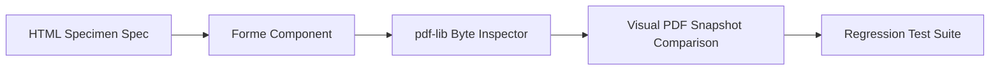
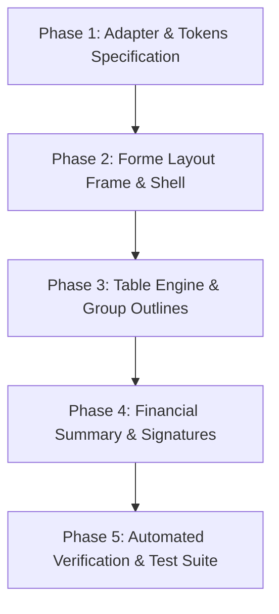

# BOURXE COMMERCIAL HTML-TO-FORME INVESTIGATION & ARCHITECTURAL SPECIFICATION

**Document Reference:** `docs/reports/commercial-html-to-forme-investigation.md`  
**Date:** 2026-11-01  
**Project:** BOURXE (BIGDROPS App) — Commercial PDF Pipeline Migration  
**Status:** Complete Investigation (Strictly Read-Only Analysis; Zero Production Code Dirtied)  
**Target Template Candidate 1:** `commercial-industrial.html`  
**Comparative Template Set:** `commercial-mosaic.html`, `commercial-landscape.html`, `commercial-industrial.html`, `commercial-modern-minimal.html`  

---

## 1. Executive Findings

1. **Feasibility of Industrial as Pilot:**  
   Recreating `commercial-industrial.html` in Forme (`@formepdf/react` & `@formepdf/core`) is **technically feasible and structurally sound**. Forme's Yoga-based flexbox engine, declarative `<Table>` system, native image hyperlinks (`<Image href="...">`), and page-flow primitives can reproduce the industrial visual language accurately without regression.

2. **Core Architectural Transformation (CSS Grid & Dimensions to Forme Points):**  
   The HTML templates define physical millimeter dimensions (`210mm × 297mm`, `padding: 8mm`) and CSS Grid layouts (`grid-template-columns: 1.35fr 1fr`, `1.78fr 1fr`). Forme uses PostScript points (`72 pt/in`). For A4 Portrait (`595.28 pt × 841.89 pt`), `8mm` equates to `22.68 pt` (standardized to `24 pt`). CSS Grid structures map 1:1 into nested flexbox rows with proportional flex-basis or explicit percentage widths (`flexDirection: 'row'`, `flex: 1.35 : 1`).

3. **Typography Architecture Conformity:**  
   The HTML template specifies `SFMono-Regular`, `Consolas`, `DIN Alternate`, and `Bahnschrift`. In accordance with BOURXE's locked 4-family PDF typography architecture ([AGENTS.md](file:///c:/Users/DELL/Desktop/bigdrops-app/AGENTS.md)), **no additional font families may be registered**. 
   - Primary body, technical labels, tabular numbers, and metadata must use **Inter** with `font-variant-numeric: tabular-nums` or tabular spacing.
   - Heavy document display headers and title accents map to **Archivo Black**.
   - Signatures and authorized sign-offs map to **Caveat**.
   - Currency glyphs (₦) and unicode symbols map to **Noto Sans**.

4. **Group Boundary Enclosure (Lessons from User Feedback):**  
   Empirical user feedback from recent test renders (captured in review artifacts `media_1793554902812_a8e586fd.png`, `media_1793557529300_7329b1f3.png`, and `media_1793559873950_16344204.png`) confirmed two essential visual requirements:
   - Full-width sand/beige background fills across group rows were rejected.
   - The user requires a **clean rectangular outline** defining each grouped section (`borderTop` on group header, `borderLeft` and `borderRight` on group item rows, `borderBottom` on group footer) with an unaltered, crisp white/light-zebra background.

5. **Fixed Institutional Footer & Baseline Alignment:**  
   HTML uses `margin-top: auto` or absolute positioning for footers. In Forme, pinning the running footer to the true bottom baseline without clipping or row collision requires `<Fixed position="footer">` paired with exact page margins (`margin: { top: 24, bottom: 24, left: 24, right: 24 }`).

---

## 2. Comparative Analysis of All Four Commercial HTML Templates

| Design Dimension | `commercial-industrial.html` | `commercial-mosaic.html` | `commercial-landscape.html` | `commercial-modern-minimal.html` |
| :--- | :--- | :--- | :--- | :--- |
| **Page Geometry** | A4 Portrait (210 × 297mm) | A4 Portrait (210 × 297mm) | A4 Landscape (297 × 210mm) | A4 Portrait (210 × 297mm) |
| **Sheet Margins** | 8mm all sides (22.7 pt) | 7mm all sides (19.8 pt) | 2.8mm edge frame (7.9 pt) | 13mm × 15mm (36.8 × 42.5 pt) |
| **Grid / Frame System** | 0.35mm outer border; 5mm grid | Solid 0.35mm outer boundary | Engineering coordinate grid frame (`A–G`, `1–10`) | Open boundary, generous whitespace |
| **Color Palette** | Graphite (`#1D2528`), Steel (`#5D6B70`), Line (`#AEB6B4`), Orange (`#DC5A21`) | Forest Green (`#0D2B1D`), Lime (`#84CC16`), Slate (`#5A6F64`), Charcoal (`#151C18`) | Blueprint Cobalt (`#0F3156`), Navy (`#07192B`), Amber (`#B45309`), Ice (`#EBF3FA`) | Corporate Slate (`#0F172A`, `#1E293B`, `#64748B`), Emerald soft (`#F0FDF4`) |
| **Header Architecture** | Asymmetric 2-col (1.35fr : 1fr) Title + Meta Matrix | Asymmetric identity slab (64%) vs meta tower (36%) | Blueprint Title Block across bottom-right corner | Symmetrical linear layout with clean brand mark |
| **Line Item Table** | Fixed column width schedule; heavy orange group bands; subtotal rules | Modular grid table; lime category dividers; compact rows | Engineering BOM schedule; coordinate keys; double lines | Clean spacious rows; light zebra striping; subtle hairline rules |
| **Financial Closing** | Two-column panel (Ledger + Bank Box); bold total banner with orange bar | Vertical summary stack with lime accent tags | Split summary ledger + Payee / account box | Linear totals card with highlighted net payable |
| **Legal & Signatures** | Two-column Notes/Terms + 3-box signature block | Terms list + single authorized signature box | Dual title block / certified engineer sign-off | Compact terms and conditions + dual signature line |
| **Data Density** | Very High (technical equipment, BOM) | High (agency, consulting, architecture) | Extremely High (BOM engineering schedules) | Medium to High (corporate services, executive) |

---

## 3. Detailed Industrial Design & Layout Specification (`commercial-industrial.html`)

### 3.1 Dimensions & Coordinate Frame
- **Physical Size:** A4 Portrait: `210mm × 297mm` = `595.28 pt × 841.89 pt`.
- **Sheet Inset:** `8mm` (standardized to `24 pt`).
- **Outer Protective Boundary:** `0.35mm` (`1 pt`) solid border in Graphite (`#1D2528`).
- **Inner Padding:** `4mm` (`11.3 pt`) between border and document content.

### 3.2 Color Tokens
- `--graphite`: `#1D2528` (Primary structure, table headers, total bar background, outer border)
- `--steel`: `#5D6B70` (Secondary labels, metadata keys, technical specs, muted annotations)
- `--line`: `#AEB6B4` (Standard borders, divider rules, module boundaries)
- `--line-soft`: `#D2D6D2` (Row hairlines, subtle dividers)
- `--orange`: `#DC5A21` (High-visibility accent, item numbers, group headers, total bar accent stripe)
- `--orange-soft`: `#F4DCCF` (Secondary badge backgrounds, subtotal highlights)
- `--paper`: `#F6F6F2` (Document canvas background fill)
- `--panel`: `#ECEEEA` (Module card fill, bank box background, group subtotal row background)
- `--deduction-red`: `#B42318` (Negative deductions, discounts, withholding tax)

### 3.3 Typography Mapping to BOUXRE 4-Family Standard
| HTML Font Concept | Assigned BOUXRE Font | Weight | Point Size | Letter Spacing |
| :--- | :--- | :--- | :--- | :--- |
| Main Document Title (`INVOICE`) | **Archivo Black** | 700 / Black | 28–31 pt | 0.8 pt (uppercase) |
| Module Headings (`BILL TO`, `PROJECT`) | **Inter** | 700 | 7.5–8.5 pt | 0.8 pt (uppercase) |
| Primary Item Names | **Inter** | 700 | 8.5–9.5 pt | Normal |
| Make / Subtext / Technical Specs | **Inter** | 400 | 7.0–8.0 pt | Normal |
| Table Header Labels (`#`, `QTY`, `PRICE`) | **Inter** | 700 | 7.5–8.5 pt | 0.6 pt (uppercase) |
| Numeric Columns (Qty, Price, Amount) | **Inter** | 700 / 400 | 8.0–9.0 pt | Tabular alignment |
| Group Heading & Key (`GROUP A`) | **Archivo Black** | 700 | 8.0–9.0 pt | 0.5 pt (uppercase) |
| Total Box Amount Value | **Inter** | 700 | 18–20 pt | -0.2 pt |
| Authorized Signatures | **Caveat** | 700 | 14–18 pt | Normal |
| Unicode Symbols & Currency (`₦`) | **Noto Sans** | 700 / 400 | Matching | Normal |

### 3.4 Table Geometry & Layout
The industrial table specifies a rigid 6-column layout:
- Col 1 (`#`): `9mm` (`25.5 pt`) — Centered, orange bold text.
- Col 2 (`Description / specification`): Proportional flex-fill (`160–200 pt`) — Left-aligned; accommodates item name, make/model, specs, and thumbnail image.
- Col 3 (`Qty`): `12mm` (`34 pt`) — Right-aligned numeric.
- Col 4 (`Unit`): `14mm` (`39.7 pt`) — Left-aligned steel muted text (`pcs`, `m`, `sets`, `tonnes`).
- Col 5 (`Unit Price`): `25mm` (`70.9 pt`) — Right-aligned formatted currency.
- Col 6 (`Amount`): `28mm` (`79.4 pt`) — Right-aligned bold formatted currency.

### 3.5 Group Container & Subtotal Architecture
Following the approved visual design:
- **Group Header (`.ind-group`):** ColSpan 6. Height ~`22 pt`. Top border `1.5 pt` Graphite (`#1D2528`), left border `1.5 pt`, right border `1.5 pt`. Background `#FFFFFF` (or restrained accent band). Group label in bold uppercase.
- **Group Member Rows:** First cell has `borderLeft: 1.5 pt #1D2528`. Last cell has `borderRight: 1.5 pt #1D2528`. Interior cell bottoms have `0.5 pt #D2D6D2`. Background preserves zebra striping (`#FFFFFF` / `#F8FAFC`).
- **Group Close / Subtotal Row (`.ind-gclose`):** ColSpan 6. Height ~`20 pt`. Top border `0.5 pt #D2D6D2`, left border `1.5 pt #1D2528`, right border `1.5 pt #1D2528`, bottom border `1.5 pt #1D2528`. Right-aligned text: `GROUP SUBTOTAL` in muted steel + bold formatted sum.

---

## 4. Industrial HTML-to-Forme Element Mapping

| HTML / CSS Component | HTML Source Element | Forme Primitive & Structure | Styling Props in Forme |
| :--- | :--- | :--- | :--- |
| **Page Root** | `<section class="page">` | `<Page size="A4" margin={{ top: 24, bottom: 24, left: 24, right: 24 }}>` | `backgroundColor: '#F6F6F2'` |
| **Outer Border Frame** | `.page-inner` | `<View style={{ flex: 1, borderWidth: 1, borderColor: '#1D2528', padding: 12 }}>` | Framing container enclosing all page content |
| **Header Title Grid** | `.ind-titlegrid` | `<View style={{ flexDirection: 'row', gap: 12, marginBottom: 12 }}>` | Left block `flex: 1.35`, Right block `flex: 1` |
| **Document Title** | `.ind-title h1` | `<Text style={{ fontFamily: 'Archivo Black', fontSize: 28, color: '#1D2528' }}>` | Uppercase, tracking |
| **Metadata Matrix** | `.ind-metas` | `<View style={{ flexDirection: 'column', gap: 2 }}>` | Row: `<Text style={{ width: 85, color: '#5D6B70' }}>` + `<Text style={{ flex: 1 }}>` |
| **Party Modules** | `.ind-parties` | `<View style={{ flexDirection: 'row', gap: 10, marginBottom: 14 }}>` | Two `<View style={{ flex: 1, backgroundColor: '#ECEEEA', borderWidth: 0.75 }}>` |
| **Line Items Table** | `<table class="ind-table">` | `<Table columns={resolveIndustrialWidths(columns, availableWidth)}>` | Declarative Forme table |
| **Table Header Row** | `<thead><tr>...</tr></thead>` | `<Row header>` | Cell `backgroundColor: '#1D2528'`, Text `color: '#FFFFFF'` |
| **Group Header Row** | `<tr class="ind-group">` | `<Row><Cell colSpan={6} style={{ borderTopWidth: 1.5, borderLeftWidth: 1.5, borderRightWidth: 1.5 }}>...` | Clean white/panel background; zero vertical pill decorators |
| **Product Thumbnail** | `

` | `<Image src={url} href={url} style={{ width: 40, height: 20, objectFit: 'contain' }} />` | Direct native hyperlink annotation |
| **Summary Ledger** | `.ind-ledger` | `<View style={{ flex: 1.1, backgroundColor: '#ECEEEA', borderWidth: 0.75 }}>` | Stacked totals rows with line dividers |
| **Total Highlight Banner** | `.ind-total` | `<View style={{ flexDirection: 'row', backgroundColor: '#1D2528', borderLeftWidth: 8, borderLeftColor: '#DC5A21', padding: 8 }}>` | White text, orange accent label, large 19pt total |
| **Signatures Block** | `.ind-sigs` | `<View style={{ flexDirection: 'row', gap: 8, marginTop: 10 }}>` | 3 flex boxes; Caveat font for signature art |
| **Running Fixed Footer** | `<footer class="ind-footer">` | `<Fixed position="footer"><View style={{ flexDirection: 'row', justifyContent: 'space-between' }}>...` | Bottom-pinned legal name, page number, document reference |

---

## 5. Forme Capability Matrix

| Feature / Primitive | Required for Industrial | Forme Capability Status | Evidence & Verification | Confidence |
| :--- | :--- | :--- | :--- | :--- |
| **Fixed Footer Pinning** | Page X of Y + Ref at bottom | **Supported natively** | `<Fixed position="footer">` rendered without colliding with tables | **HIGH** |
| **Direct Image Hyperlinks** | Clickable product images & logos | **Supported natively** | `<Image src={url} href={url} />` verified with `pdf-lib` creating genuine `/Annot /Subtype /Link` | **HIGH** |
| **Declarative Table Engine** | Multi-column tabular data | **Supported natively** | `<Table>`, `<Row>`, `<Cell>` with fixed point column widths | **HIGH** |
| **Row Pagination & Breaks** | Multi-page tables | **Supported natively** | Page engine splits table rows cleanly across pages | **HIGH** |
| **Group Boundary Outlines** | Rectangular enclosing borders | **Supported via cell borders** | Cell-level `borderLeftWidth`, `borderRightWidth`, `borderTopWidth`, `borderBottomWidth` | **HIGH** |
| **Dynamic 4-Family Fonts** | Inter, Archivo, Caveat, Noto Sans | **Supported natively** | Forme font registry caches and resolves TTF binaries via `ensureFormeFontFamily` | **HIGH** |
| **Negative Deduction Colors** | Red styling on discount rows | **Supported natively** | Inline `style={{ color: '#B42318' }}` applied cleanly on cells | **HIGH** |
| **CSS Grid (`display: grid`)** | Asymmetric columns | **Not supported natively** | Fully solvable with Forme Flexbox rows (`flexDirection: 'row'`, `flex: N`) | **HIGH (Workaround)** |
| **Background Vector Grids** | 5mm background engineering grid | **Not supported in CSS style** | Solvable via background `<Svg>` canvas watermark or simplified solid background | **MEDIUM** |
| **Double Border Lines** | Engineering ledger closing rules | **Not supported (`borderStyle: 'double'`)** | Solvable via stacked `<View>` hairline rules (`0.5pt` rule + `1pt` gap + `0.5pt` rule) | **HIGH** |

---

## 6. Known Limitations and Required Workarounds

1. **Absence of Native CSS Grid in Yoga Flexbox:**
   - *Limitation:* The HTML templates make extensive use of CSS Grid (`display: grid`, `grid-template-columns: 1.35fr 1fr`, `grid-template-columns: 1fr 1fr 30mm`).
   - *Workaround:* Convert all grid instances into flexbox rows. Ratios like `1.35fr : 1fr` convert directly to `<View style={{ flex: 1.35 }}>` and `<View style={{ flex: 1 }}>` with `flexDirection: 'row'` and explicit `gap`.

2. **Background Pattern (5mm Engineering Grid):**
   - *Limitation:* `commercial-industrial.html` renders a fine grid using CSS `background-size: 5mm 5mm; background-image: linear-gradient(...)`. Forme does not support CSS gradients or background patterns on `<Page>` or `<View>`.
   - *Workaround:* Either:
     - Render the clean solid paper background (`#F6F6F2`) with the 1pt graphite border frame (recommended for crisp print rendering and low PDF file weight).
     - Render a lightweight repeated SVG background grid if the user explicitly demands gridlines.

3. **Font Family Restriction:**
   - *Limitation:* The HTML uses `SFMono-Regular` for item numbers, codes, and metadata keys. BOURXE strictly forbids registering non-approved fonts.
   - *Workaround:* Render all monospace elements using **Inter** with tabular figure alignment (`fontVariantNumeric: 'tabular-nums'`) or uppercase letter-spacing (`letterSpacing: 0.6`).

4. **Multi-Page Group Continuation Borders:**
   - *Limitation:* When a grouped table splits across a page break, HTML relies on browser print engines to close table row boundaries.
   - *Workaround:* Forme table rows carry their individual border definitions. By defining `borderLeftWidth: 1.5` and `borderRightWidth: 1.5` on every member row of a group, the vertical walls remain intact across page breaks without manual height calculation.

---

## 7. Recommended Measurement & Visual-Validation Workflow

To guarantee accuracy before committing changes to production:

1. **Component Verification (`src/tests/pdf/`):**
   - Use Forme's `serialize()` to verify DOM tree node attributes (font families, point sizes, colors, border widths, hyperlinks).
2. **Byte-Level PDF Inspection with `pdf-lib`:**
   - Compile PDF bytes in a test runner and inspect PDF objects directly:
     - Verify font dictionary contains only `Inter`, `Archivo Black`, `Caveat`, or `Noto Sans`.
     - Verify `/Annot /Subtype /Link` exists on every image bounding box with exact matching rects.
     - Verify page count and page dimensions (`595.28 × 841.89`).
3. **Visual Red-Line Comparison:**
   - Render synthetic fixtures matching the user's problematic cases (`SASQUO-378`).
   - Compare rendered PDF pages against the hand-drawn bounding box requirements in `media_1793559873950_16344204.png`.

---

## 8. Risks Specific to Industrial's Implementation

1. **Risk 1: Multi-Page Content Overflow & Footer Collision:**  
   *Severity: High.* If table contents expand close to the bottom margin, a poorly configured fixed footer can overlap rows.  
   *Mitigation:* Set the `<Page>` bottom margin to `28 pt`, and wrap the footer in `<Fixed position="footer">`. Forme's layout engine automatically treats the page margin as reserved space, ensuring rows break cleanly before the footer.

2. **Risk 2: Table Column Width Collapse:**  
   *Severity: Medium.* If table column widths are not explicitly budgeted to sum exactly to the printable content width (`595.28 - 2 × 24 = 547.28 pt`), description text may wrap unpredictably.  
   *Mitigation:* Use `resolveCommercialTableWidths` to enforce fixed numeric widths on `num`, `qty`, `unit`, `price`, and `amount`, assigning the exact calculated remainder to `description`.

3. **Risk 3: Accidental Reintroduction of Sand Backgrounds:**  
   *Severity: Low.* Regression where developers copy previous group styling.  
   *Mitigation:* Keep `INDUSTRY_GROUP_TOKENS` strictly defined with `border: '#1D2528'` and explicit white/transparent fills.

---

## 9. Recommended Implementation Sequence

1. **Phase 1: Adapter Alignment & Token Mapping**  
   - Verify `src/components/pdf/industryAdapter.ts` provides all fields required by `commercial-industrial.html` (including `unit`, `make`, `specs`, and item thumbnails).
2. **Phase 2: Document Shell & Frame**  
   - Create the outer boundary border (`1pt #1D2528`), asymmetric header title grid (`1.35fr : 1fr`), and party cards.
3. **Phase 3: Table & Group Container Enclosure**  
   - Implement the 6-column table layout with `<Row header>`, `<Row>` (group header), group item rows with left/right borders, and `<Row>` (group subtotal).
4. **Phase 4: Closing Stack & Signatures**  
   - Implement the summary ledger, bank account box, total callout banner with orange accent stripe, and the 3-column signature grid.
5. **Phase 5: Dual Renderer Verification**  
   - Verify the commercial template picker presents both options seamlessly without affecting React-PDF fallback.

---

## 10. Explicit List of Unresolved Questions Requiring a Focused Prototype

1. **Engineering Background Watermark:**  
   *Question:* Does the user require the 5mm×5mm light grey grid background present in the HTML template, or is the clean solid paper background (`#F6F6F2`) with the 1pt graphite boundary frame preferred for clarity and print economy?
2. **Column `#` vs Item Numbering in Groups:**  
   *Question:* In `commercial-industrial.html`, groups have letter identifiers (`A`, `B`, `C`) in the first column, while individual items have sequential numbers (`1`, `2`, `3...`). Should BOURXE's commercial data model supply an explicit group code (e.g. `Group A`), or retain the current text-based group title?
3. **Multi-Page Closing Stack Placement:**  
   *Question:* If an invoice has 15 items and ends near the middle of page 2, should the closing ledger and totals box anchor immediately following the table, or float to the bottom immediately above the fixed footer? (Forme supports both; the HTML template uses natural flow).
4. **Landscape Support for Invoices:**  
   *Question:* Should `commercial-landscape.html` be implemented as an alternative orientation for the same Industrial template, or as a distinct standalone commercial template option?

---

*Investigation completed strictly within read-only parameters. No source files, HTML templates, CSS, assets, or configuration files were dirtied.*
