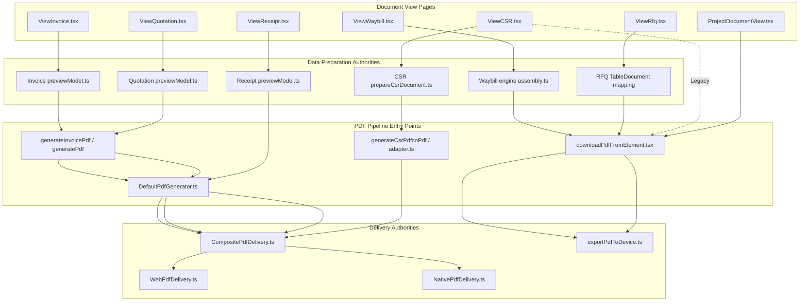
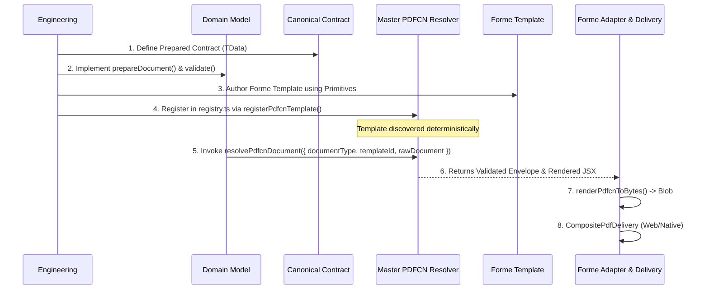
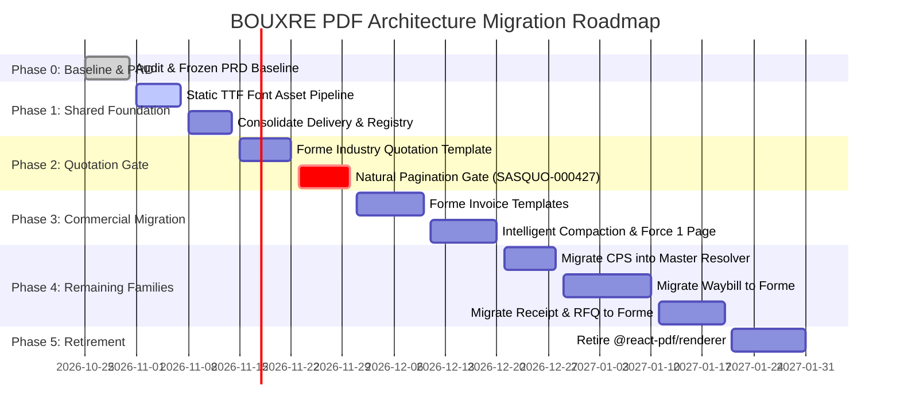

# BOUXRE PDF Architecture Audit — Existing Standards, React-PDF Central Authority & Forme Migration Foundation

**Date:** 2026-10-31  
**Project:** BOUXRE (BIGDROPS App) — B2B Business Management Suite  
**Classification:** Core System Architecture Audit & Migration Specification  
**Status:** Complete Architectural Audit (Strictly Read-Only Investigation)  
**Deliverable File:** `docs/reports/pdf/pdf-architecture-audit-react-pdf-central-authority-and-forme-migration.md`  
**Writing Standard:** ASD-STE100 Simplified Technical English  

---

## 1. Executive Summary

### 1.1 Scope & Objective
This audit provides a comprehensive, evidence-driven architectural assessment of the PDF generation and delivery infrastructure in the BOUXRE business platform. The investigation focuses on:
1. Discovering how PDF standards are currently defined, configured, shared, and enforced across the application.
2. Determining whether `@react-pdf/renderer` possesses a **central configuration authority** or whether authority is fragmented across disconnected templates, domain builders, presentation adapters, and local delivery routines.
3. Evaluating the operational state of the eight document families in scope:
   - **Commercial:** Invoice, Quotation, Purchase Order (PO), Cost Pricing Sheet (CPS), Receipt
   - **Procurement:** Request for Quotation (RFQ)
   - **Logistics:** Waybill
   - **Technical / Field Service:** Customer Service Report (CSR)
   *(Bill of Quantities / BOQ is explicitly excluded from scope).*
4. Analyzing the current Forme (`@formepdf/core` and `@formepdf/react` v0.20.1) and `pdfcn` infrastructure to establish what has already been built, what must be preserved, what requires consolidation, and what is missing.
5. Formulating a common foundation, document family taxonomy, future document integration standard, and dependency-aware migration roadmap.

### 1.2 Primary Architectural Answer: Does a React-PDF Central Authority Exist?
**No. React-PDF does NOT possess a single central configuration authority.**

Instead, the codebase operates under a **tri-partite fragmented authority model** characterized by:
1. **A Partially Unified Delivery Layer (`src/lib/pdf/`):** Built following the "PDF Architecture v1" initiative, providing `DefaultPdfGenerator`, `CompositePdfDelivery`, `WebPdfDelivery`, `NativePdfDelivery`, and `DefaultFeedbackBus`. However, this layer is consumed by only 3 of the 8 document types (Invoice, Quotation, Receipt). The remaining 5 document types bypass it entirely, using either `downloadPdfFromElement` (`src/components/document-view/shared/downloadPdf.tsx`) or direct, inline calls to `@react-pdf/renderer`'s `pdf(element).toBlob()`.
2. **A Global Font & Currency Registry (`src/lib/pdfFontRegistry.ts`):** Centralizes the registration of Google/Fontsource WOFF fonts into the React-PDF `Font` singleton. However, it is coupled directly to React-PDF's font pipeline and fails when accessed by Forme (which requires TrueType `.ttf` or OpenType `.otf` font binaries).
3. **An Isolated Commercial Presentation Layer (`src/components/pdf/`):** Houses the 7 commercial templates (Industry, Ledger, Crest, Minimal, Evergreen, Bolt, Ember) and the `interpretPdfTableSettings` / `buildPdfRowCells` table logic. This layer was historically named `pdf-new` and operates as an island: Waybill, CSR, RFQ, and external Project Documents built duplicate styling, table geometry, and page layouts independently.

### 1.3 Overall Consistency & Fragmentation Assessment
- **Rendering Engines:** 2 distinct engines currently operate simultaneously in production:
  - `@react-pdf/renderer` (v4.3.2) drives Invoice, Quotation, Waybill, RFQ, Receipt, and legacy CSR templates.
  - `@formepdf/react` & `@formepdf/core` (v0.20.1) drive Cost Pricing Sheet (CPS) and the newly qualified CSR templates (`csr-blueprint-landscape` and `csr-reference-portrait`).
- **Blob Generation:** Exists in at least **5 separate locations** across the codebase, violating Principle 6 of `PDF-Architecture-v1.md` (*"Blob generation occurs exactly once"*):
  1. `src/lib/pdf/DefaultPdfGenerator.ts` (consumed by Invoice, Quotation, Receipt)
  2. `src/components/document-view/shared/downloadPdf.tsx` (consumed by Waybill, RFQ, legacy CSR)
  3. `src/components/waybill/blankWaybillTemplate.tsx` (isolated blank waybill generator)
  4. `src/pages/CsrFormPage.tsx` (direct `pdf().toBlob()` calls for blank CSR exports)
  5. `src/pages/ProjectDocumentView.tsx` (direct `pdf().toBlob()` for project attachments)
- **Table Layouts:** 4 completely independent table calculation engines exist:
  1. Commercial: `src/components/pdf/table.ts` (`interpretPdfTableSettings`)
  2. Waybill: `src/domain/waybill/contracts/waybillContract.ts` & `src/components/waybill/waybillUtils.ts`
  3. RFQ: `src/components/table-document/TableDocumentPdfDocument.tsx` (`widthsByKey`)
  4. CSR: `src/components/pdf/pdfcn/csr/csrPdfcnUtils.tsx` (`getAdaptiveMaterialColumns`)
- **Document Customization:** `src/domain/pdf/customization/resolver.ts` provides a clean 3-layer resolution engine (Capabilities, Policy, Defaults), but it is wired only for Invoice, Quotation, Waybill, CPS, and CSR. Purchase Order, RFQ, and Receipt are absent from its domain definitions.

### 1.4 Most Important Migration Implications
1. **Preserve the Master PDFCN Resolver:** The newly implemented resolver in `src/domain/pdf/resolver/` (`registerPdfcnTemplate`, `resolvePdfcnDocument`, `PdfcnDocumentEnvelope`) is the legitimate architectural foundation for Forme. It separates raw data from canonical prepared contracts and renders deterministic templates. It must be extended to all 8 document types.
2. **Consolidate Delivery Under `CompositePdfDelivery`:** Delivery must never know which renderer created the PDF. The Forme adapter (`src/components/pdf/pdfcn/adapter.ts`) already outputs a standard `Blob` and invokes `CompositePdfDelivery`. All documents must route through this single delivery pipeline.
3. **Solve Font Packaging Centrally:** Forme cannot use `@fontsource/*.woff` files. Forme requires static `.ttf` assets (such as `public/fonts/ArchivoBlack-Regular.ttf` and `public/fonts/inter-*.ttf`). A unified, renderer-agnostic font asset pipeline must be established before migrating commercial documents.
4. **Natural Pagination Gate Before Compaction:** As established in `SASQUO-000427 (1).pdf`, premature page breaks result from indivisible flex closing blocks and uncalibrated table columns. Forme migration must achieve flawless **Natural Pagination** in Normal Mode before Compact or Force 1 Page heuristics are enabled.

---

## 2. Existing PDF Standards Inventory

| Standard / Rule | Source Documentation | Code Implementation | Enforcement Level | Consuming Document Types | Key Files & Evidence |
| :--- | :--- | :--- | :--- | :--- | :--- |
| **Renderer Neutrality & Document Ownership** | `docs/standard/pdf-migration-standard.md` | `src/domain/pdf/resolver/`, `src/components/pdf/index.ts` | **Centrally Enforced** via Resolver | CSR, CPS, Invoice, Quotation | `src/standard/pdf-migration-standard.md:8-19`, `src/domain/pdf/resolver/registry.ts` |
| **Delivery / Generator Decoupling** | `docs/prd/Pdf-print-prd/PDF-Architecture-v1.md` | `src/lib/pdf/` (`PdfGenerator`, `CompositePdfDelivery`) | **Partially Enforced** (3/8 docs) | Invoice, Quotation, Receipt | `src/lib/pdf/DefaultPdfGenerator.ts`, `src/lib/pdf/CompositePdfDelivery.ts` |
| **Locked Financial Math & Formatting** | `AGENTS.md`, `docs/standard/Commercial Party Architecture Standard.md` | `src/lib/Calculations.ts`, `src/lib/formatters/money.ts` | **Centrally Enforced** | Invoice, Quotation, CPS, Receipt | `src/lib/Calculations.ts`, `src/lib/formatters/pdfCurrency.ts` |
| **PDF Customization Sockets** | `docs/standard/pdf-customization-extension-standard.md` | `src/domain/pdf/customization/` | **Centrally Enforced** (5/8 docs) | Invoice, Quotation, Waybill, CPS, CSR | `src/domain/pdf/customization/resolver.ts`, `src/domain/pdf/customization/commercial.ts` |
| **Canonical Document Logo Extraction** | `docs/standard/document-image-upload-policy.md` | `src/domain/documentMedia.ts` (`resolveCanonicalLogoUrl`) | **Convention-Only** (templates format locally) | Invoice, Quotation, Waybill, CPS, Receipt, CSR | `src/domain/documentMedia.ts:40-65`, `src/components/pdf/pdfcn/csr/csrPdfcnUtils.tsx` |
| **Commercial Table Column Layout** | PRD Draft, `docs/prd/pdf-rendering-migration/functional-req.md` | `src/components/pdf/table.ts` | **Locally Shared** (Commercial only) | Invoice, Quotation | `src/components/pdf/table.ts:16-150`, `src/components/pdf/templateTableLayout.ts` |
| **Adaptive Orientation Switching** | PRD Section 14, `pageLayoutPipeline.test.js` | `src/components/pdf/table.ts` (`resolvePdfPageLayout`) | **Locally Shared** (Commercial only) | Invoice, Quotation | `src/components/pdf/table.ts:133-146`, `src/tests/pdf/pageLayoutPipeline.test.js` |
| **Rich Text & Glyph Run Sanitization** | PRD Section 16, `functional-req.md` | `src/components/pdf/core/safeText.ts`, `PdfGlyphText.tsx` | **Locally Shared** (Commercial only) | Invoice, Quotation | `src/components/pdf/core/safeText.ts:47-114`, `src/components/pdf/core/PdfGlyphText.tsx` |
| **Waybill Item Schedule & Transport Contract** | `docs/reports/waybill/waybill-render-engine-docs-update.md` | `src/domain/waybill/engine/assembly.ts` | **Document-Local** | Waybill | `src/domain/waybill/engine/assembly.ts`, `src/domain/waybill/contracts/waybillContract.ts` |
| **Receipt Payment Acknowledgment** | `docs/standard/receipt-standard.md` | `src/domain/receipt/previewModel.ts` | **Document-Local** | Receipt | `src/domain/receipt/previewModel.ts`, `src/components/pdf/ReceiptPdf.tsx` |
| **CSR Canonical Service Record Contract** | `docs/reports/pdf/csr-final-pdfcn-reference-report.md` | `src/domain/pdf/resolver/csr/` | **Centrally Enforced** (via PDFCN) | CSR | `src/domain/pdf/resolver/csr/csrPreparedContract.ts`, `prepareCsrDocument.ts` |
| **Table Document Shared Layout** | Legacy standard | `src/components/table-document/TableDocumentPdfDocument.tsx` | **Duplicated / Legacy** | RFQ, (legacy CPS) | `src/components/table-document/TableDocumentPdfDocument.tsx` |

---

## 3. React-PDF Central Authority Map

Below is the concrete mapping of all 11 architectural responsibilities within the existing `@react-pdf/renderer` landscape:



### 3.1 Breakdown by Responsibility Area

#### 1. Central Configuration Authority: **FRAGMENTED**
There is no universal configuration singleton or context. 
- For customization settings: `src/domain/pdf/customization/resolver.ts` computes flat settings (`ResolvedPdfCustomization`) from capabilities, policy, and defaults.
- For template metadata: `src/domain/invoice/types.ts` defines `InvoicePdfTemplateId` (`'industry' | 'ledger' | 'crest' | 'minimal' | 'evergreen' | 'bolt' | 'ember'`). Waybill defines its own template list in `src/components/waybill/WaybillPDF.tsx` (`'evergreen' | 'minimal' | 'thermal' | 'classic' | 'premium' | 'slate'`). CSR defines its templates in `src/components/csr/preview-templates/types.ts` and `src/domain/pdf/resolver/csr/`.

#### 2. Font Authority: **CENTRALLY DEFINED, ENGINE-COUPLED**
- **Location:** [`src/lib/pdfFontRegistry.ts`](file:///c:/Users/DELL/Desktop/bigdrops-app/src/lib/pdfFontRegistry.ts)
- **Mechanics:** Executes `Font.register()` against `@react-pdf/renderer`'s singleton. Imports font definitions from [`src/lib/pdfSharedFonts.ts`](file:///c:/Users/DELL/Desktop/bigdrops-app/src/lib/pdfSharedFonts.ts) (11 font families) and [`src/lib/pdfFillableFonts.ts`](file:///c:/Users/DELL/Desktop/bigdrops-app/src/lib/pdfFillableFonts.ts) (5 handwriting fonts).
- **Hyphenation Callback:** Registers a global callback on line 71 to prevent hyphenation of tokens like `1800m`, `120set`, `210pcs`.
- **Limitation:** Imports `@fontsource/*/*.woff` assets via Vite asset loader. These WOFF files cannot be consumed by Forme or node canvas engines without extraction to TTF/OTF.

#### 3. Branding Authority: **CENTRALLY RESOLVED, LOCALLY RENDERED**
- **Location:** [`src/domain/documentMedia.ts`](file:///c:/Users/DELL/Desktop/bigdrops-app/src/domain/documentMedia.ts) (`resolveCanonicalLogoUrl`)
- **Mechanics:** Pure functional utility that inspects `settings.company_logo_url`, `settings.logo_url`, or tenant branding, enforcing secure URL schemes (`https:` or `data:`).
- **Enforcement:** Templates must manually invoke this function. Template presentation varies widely:
  - `IndustryTemplate`: 86×86pt contain.
  - `ReceiptPdf`: 60×60pt contain.
  - `TableDocumentPdfDocument` (RFQ): Completely ignores logo.
  - `CsrPortraitReferenceTemplate` (Forme): Custom `BrandLogo` component with SVG fallback.

#### 4. Geometry & Page Layout Authority: **COMPLETELY ABSENT**
- React-PDF has no shared geometry authority. Page margins and bounding boxes are hardcoded per template:
  - `IndustryTemplate`: `paddingTop: 12`, `paddingBottom: 48`, `paddingHorizontal: 20`
  - `Ledger`: `paddingTop: 24`, `paddingBottom: 48`, `paddingHorizontal: 24`
  - `Crest`: `padding: 30`
  - `Waybill`: `padding: 24` (Evergreen), `padding: 20` (Minimal), `padding: 16` (Thermal)
  - `ReceiptPdf`: `padding: 30`
  - `TableDocumentPdfDocument` (RFQ): `padding: 28`
  - `CSR` (Forme): `padding: 18` (Landscape), `padding: 20` (Portrait)
- Only orientation is partially resolved via `src/components/pdf/table.ts` (`resolvePdfPageLayout`), which returns `{ size: 'A4', orientation: 'portrait' | 'landscape' }` based on total column width.

#### 5. Typography Authority: **DOCUMENT-FAMILY SPLIT**
- Commercial templates (`src/components/pdf/templates/`): Driven by `src/components/pdf/designTokens.ts` and `src/lib/pdfDesignPreset.ts`, mapped to `Inter` by default with `Helvetica` fallback.
- Waybill: Driven by `src/domain/pdf/customization/waybill.ts` with fillable font support.
- CSR: Driven by `src/components/pdf/pdfcn/csr/csrPortraitFonts.ts` using bundled `ArchivoBlack-Regular.ttf` for display headings and `Inter` for tabular copy.
- RFQ: Hardcoded to `Helvetica-Bold` and `Helvetica-Oblique`.

#### 6. Table Authority: **FRAGMENTED ACROSS 4 ENGINES**
1. Commercial Table Engine (`src/components/pdf/table.ts`): Resolves columns, checks landscape threshold, merges Qty+Unit when requested, generates cell arrays.
2. Waybill Table Engine (`src/components/waybill/waybillUtils.ts`): Maps items into S/N, Description, Quantity, Unit, Remarks.
3. RFQ Table Engine (`src/components/table-document/TableDocumentPdfDocument.tsx`): Hardcoded percentage-like widths (`widthsByKey`).
4. CSR Materials Engine (`src/components/pdf/pdfcn/csr/csrPdfcnUtils.tsx`): Intelligent content-aware partitioning (single table for 1–4 items, 2 balanced columns for 5–8 items, 4 balanced columns for 9+ items).

#### 7. Pagination Authority: **DELEGATED TO YOGA ENGINE (NO CODE AUTHORITY)**
- React-PDF contains zero runtime pagination computation. Layout is delegated entirely to the Yoga C++ flexbox engine.
- Pagination is controlled exclusively by declarative JSX flags: `wrap={false}` (keep together) and `break` (force page break).
- Defensive `paddingBottom: 48` is applied universally to prevent content from overlapping fixed footers.

#### 8. Image & Asset Authority: **LOCAL FETCHING & BASE64 CONVERSION**
- `src/components/pdf/core/safeText.ts` and `src/domain/documentMedia.ts` resolve URLs.
- In Forme, browser canvas cannot always access remote image URLs due to CORS. Both CPS (`src/domain/cps/pdfDownloadHandler.ts#L47`) and CSR (`src/domain/pdf/resolver/csr/prepareCsrDocument.ts`) implement independent `toDataUri()` fetchers to convert remote images into base64 data URIs before rendering.

#### 9. Document Preparation Authority: **STRICTLY DOMAIN-OWNED (CLEAN SEPARATION)**
- Conforms to Principle 4 of the architecture: **Documents own their own data.**
- Invoices: Prepared by `src/domain/invoice/previewModel.ts`.
- Quotations: Prepared by `src/domain/quotation/previewModel.ts`.
- CPS: Prepared by `src/domain/cps/viewData.ts` and `calculateCpsTotals.ts`.
- CSR: Prepared by `src/domain/pdf/resolver/csr/prepareCsrDocument.ts`.
- Waybill: Prepared by `src/domain/waybill/engine/assembly.ts`.
- Receipt: Prepared by `src/domain/receipt/previewModel.ts`.
- No rendering adapter mutates database entities or calculates tax/totals.

#### 10. Renderer / Factory Authority: **TWO COMPETING FACTORIES**
1. **React-PDF Factory:** `src/components/pdf/index.ts` (`generatePdf` $\to$ `DefaultPdfGenerator`). Dynamically imports `@react-pdf/renderer` and wraps templates with `PdfRenderer`.
2. **Forme/PDFCN Factory:** `src/domain/pdf/resolver/registry.ts` (`resolvePdfcnDocument`) $\to$ `src/components/pdf/pdfcn/adapter.ts` (`generatePdfcnPdf`). Validates prepared contracts, renders Forme JSX, produces byte arrays, and invokes `CompositePdfDelivery`.

#### 11. Shared Validation & Test Authority: **HIGH COVERAGE ON ISOLATED UNITS**
- Commercial PDF unit tests: `src/tests/pdf/index.test.js`, `table.test.js`, `industryLayout.test.js`, `pageLayoutPipeline.test.js`.
- PDFCN Master Resolver tests: `src/tests/critical/pdfcnMasterResolver.test.js` (10 tests covering registration, discovery, validation, byte generation, asset embedding, and adaptive layout).
- CPS Forme tests: `src/tests/critical/cpsPdf.test.js`.
- Gaps: No automated regression tests exist for RFQ PDF output or ProjectDocument PDF generation.

---

## 4. React-PDF Enforcement Assessment

| Enforcement Category | Architectural Features | Operational Reality & Impact |
| :--- | :--- | :--- |
| **Centrally Enforced** | Locked financial math, locked totals formatting, PDF font registration singleton, tenant client security. | Consistent NGN currency display and tax calculations across all documents. |
| **Shared but Configurable** | PDF Customization Engine (`src/domain/pdf/customization/`), `PdfDesignPreset`, Commercial table settings (`interpretPdfTableSettings`). | Working cleanly for Invoice, Quotation, Waybill, CPS, and CSR. Customization properties correctly fall back to template defaults when disabled. |
| **Duplicated Across Templates** | Party card rendering (`PartyCard.tsx` vs `components.tsx` vs `WaybillPDF.tsx`), fixed footer structures, status badges, sign-off blocks. | Changes to company header or footer layouts require manual edits across 4 different template codebases. |
| **Implemented Locally** | Page padding, margins, table border styling, zebra striping, currency glyph handling, signature layout. | Visual inconsistency between document families; subtle differences in stroke weights and typography sizes. |
| **Bypassed or Inconsistently Applied** | `DefaultPdfGenerator` and `CompositePdfDelivery` (bypassed by Waybill, RFQ, Blank Waybill, CsrFormPage), `PdfGlyphText` (used only in commercial templates). | Waybill and RFQ do not emit `FeedbackBus` events on download; character corruption like `2″` occurs in unshielded templates. |
| **Missing Entirely** | Universal geometry/margin manager, dynamic footer height reservation, cross-renderer font asset manager, automatic page-budget calculation. | Document spill bugs like `SASQUO-000427 (1).pdf` where 113pt closing block breaks to Page 2 over an 86pt gap. |

---

## 5. Eight-Document Coverage Matrix

| Document Type | Existing React-PDF Implementation | Existing Forme Implementation | Canonical Preparation / Resolver | Shared Components Used | Font & Branding Handling | Pagination Implementation | Relevant Test Suites | Known Architectural Gaps |
| :--- | :--- | :--- | :--- | :--- | :--- | :--- | :--- | :--- |
| **1. Invoice** | **PRESENT** (`src/components/pdf/templates/`: 7 templates) | **ABSENT** (POC reference only in `docs/reports/pdf/poc/`) | **PRESENT** (`buildInvoicePreviewModel`, `adaptCommercialDocumentData`) | `PartyCard`, `buildPdfRowCells`, `PdfGlyphText`, `PdfRenderer` | `pdfFontRegistry`, `resolveCanonicalLogoUrl`, `designTokens` | Declarative Yoga flex; `wrap={false}` on `closingRow`; fixed footer | `src/tests/pdf/index.test.js`, `table.test.js`, `industryLayout.test.js` | Closing section spill (`wrap={false}`); unwired compaction overrides; WinAnsi glyph corruption. |
| **2. Quotation** | **PRESENT** (Shares all 7 templates with Invoice) | **ABSENT** (POC reference only in `docs/reports/pdf/poc/`) | **PRESENT** (`buildQuotationPreviewModel`, `pdfDownloadHandler.ts`) | Same as Invoice | Same as Invoice | Same as Invoice | `src/tests/pdf/pageLayoutPipeline.test.js`, `src/tests/critical/cpsQuotationTransactionParity.test.js` | Benchmark failure `SASQUO-000427 (1).pdf` (closing block spilled to Page 2); `SASQUO-000428.pdf` (prime character corruption). |
| **3. Purchase Order (PO)** | **ABSENT** in core module; **PARTIAL** in `ProjectDocumentPDF.tsx` | **ABSENT** | **ABSENT** in core domain; **PARTIAL** in `src/domain/projectDocuments.ts` | Uses generic `ProjectDocumentPDF` | Uses Helvetica; company name from settings | Basic React-PDF Page; no multi-page table header repeat | None for core PO | Core `purchase_orders` module has no dedicated PDF download or canonical preview model. |
| **4. Cost Pricing Sheet (CPS)** | **PARTIAL** (Legacy `TableDocumentPdfDocument.tsx`) | **PRESENT** (`src/components/pdf/forme/`: `LedgerCpsDocument`, `CpsIndustryDocument`) | **PRESENT** (`buildCpsFormeModel` in `pdfDownloadHandler.ts`) | Forme primitives; `cpsScheduleGeometry.ts` | Forme `fonts.ts` (falls back to Helvetica due to `.woff` bug); base64 logo | Forme native `<Table>` and `<Row header>`; landscape/portrait support | `src/tests/critical/cpsPdf.test.js`, `cpsIndustry.test.js`, `cpsLedger.test.js` | Forme `fonts.ts` cannot load `@fontsource` `.woff` files; independent download pipeline from `pdfcn`. |
| **5. Request for Quotation (RFQ)** | **PRESENT** (`src/components/table-document/TableDocumentPdfDocument.tsx`) | **ABSENT** | **PARTIAL** (`normalizeDbRfq`, inline `mapItemsToRows`) | TableDocument shared renderer | Hardcoded Helvetica; no logo rendering | Basic React-PDF `<Page>`; hardcoded percentage column widths | `src/tests/rfq/normalize.test.js` (data only) | Primitive table layout; bypasses `DefaultPdfGenerator` and `CompositePdfDelivery`; no branding customization. |
| **6. Waybill** | **PRESENT** (`src/components/waybill/`: 6 templates + Blank) | **ABSENT** | **PRESENT** (`buildWaybillRenderModel` in `assembly.ts`) | Isolated waybill components; fillable font bridge | Uses `registerPdfCustomizationFillableFonts`; local logo scaling | Declarative Yoga flex; no natural multi-page calibration | `src/tests/waybill/` suite | Bypasses `src/lib/pdf/DefaultPdfGenerator`; duplicate Blob generation in `blankWaybillTemplate.tsx`. |
| **7. Receipt** | **PRESENT** (`src/components/pdf/ReceiptPdf.tsx`) | **ABSENT** | **PRESENT** (`buildReceiptPreviewData` in `previewModel.ts`) | `PdfCurrencyText`, `DefaultPdfGenerator`, `CompositePdfDelivery` | Uses `pdfFontRegistry`, `resolvePdfFontFamily`, local logo contain | Single-page layout; manual flex blocks | `src/tests/critical/accountingPersistenceContract.test.js` | Standalone template with local `StyleSheet.create`; not integrated into customization engine. |
| **8. Customer Service Report (CSR)** | **PRESENT** (Legacy: 3 templates in `preview-templates/`) | **PRESENT** (Qualified: `CsrLandscapeBlueprintTemplate`, `CsrPortraitReferenceTemplate`) | **PRESENT** (`prepareCsrDocument.ts` conforming to `csrPreparedContract.ts`) | Forme primitives (`src/components/pdf/pdfcn/primitives.tsx`), `BrandLogo`, `SignatureStage` | Bundled `ArchivoBlack-Regular.ttf` for portrait; vector SVG path fallback for Cummins logo | Adaptive material partitioning (1–4, 5–8, 9+ items); zero spill on single page | `src/tests/critical/pdfcnMasterResolver.test.js` (10 tests passing) | Ready for production; dual-path dispatch active in `ViewCSR.tsx` (`isPdfcnCsrTemplate`). |

---

## 6. Forme / PDFCN Current Infrastructure

### 6.1 What Already Exists
1. **Installed Packages (`package.json`):**
   - `@formepdf/core` (v0.20.1)
   - `@formepdf/react` (v0.20.1)
2. **Master Document Resolver (`src/domain/pdf/resolver/`):**
   - [`registry.ts`](file:///c:/Users/DELL/Desktop/bigdrops-app/src/domain/pdf/resolver/registry.ts): Deterministic Map-based registry (`registerPdfcnTemplate`, `getPdfcnTemplate`, `listPdfcnTemplates`, `resolvePdfcnDocument`).
   - [`types.ts`](file:///c:/Users/DELL/Desktop/bigdrops-app/src/domain/pdf/resolver/types.ts): Universal `PdfcnDocumentEnvelope<TData>`, `PdfcnTemplateDefinition`, `PdfcnPageConfig`.
   - Extensible for any document family (`csr`, `invoice`, `quotation`, `waybill`, `cps`, etc.).
3. **Forme Presentation Primitives (`src/components/pdf/pdfcn/primitives.tsx`):**
   - Drop-in wrappers for Forme components: `Document`, `Page`, `View`, `Text`, `Table`, `Row`, `Cell`, `Image`, `Fixed`, `Svg`.
   - `mergeStyles`: Flattens arrays and conditional styles into a concrete Forme `Style` object.
4. **Forme Renderer Adapter (`src/components/pdf/pdfcn/adapter.ts`):**
   - `renderPdfcnToBytes`: Resolves `@formepdf/core/browser` or `@formepdf/core` dynamically and generates `Uint8Array`.
   - `renderPdfcnToBlob`: Converts bytes to standard `Blob([bytes], { type: 'application/pdf' })`.
   - `generatePdfcnPdf`: Coordinates rendering, file naming, and delivery via `CompositePdfDelivery`.
5. **Two Qualified CSR Forme Templates:**
   - [`CsrLandscapeBlueprintTemplate.tsx`](file:///c:/Users/DELL/Desktop/bigdrops-app/src/components/pdf/pdfcn/csr/CsrLandscapeBlueprintTemplate.tsx) (A4 Landscape blueprint engineering drawing).
   - [`CsrPortraitReferenceTemplate.tsx`](file:///c:/Users/DELL/Desktop/bigdrops-app/src/components/pdf/pdfcn/csr/CsrPortraitReferenceTemplate.tsx) (A4 Portrait industrial safety reference).
6. **Two Working CPS Forme Templates:**
   - [`LedgerCpsDocument.tsx`](file:///c:/Users/DELL/Desktop/bigdrops-app/src/components/pdf/forme/LedgerCpsDocument.tsx) and [`CpsIndustryDocument.tsx`](file:///c:/Users/DELL/Desktop/bigdrops-app/src/components/pdf/forme/CpsIndustryDocument.tsx).

### 6.2 Identified Duplications & Competing Authorities in Forme
- **Font Registration:** `src/components/pdf/forme/fonts.ts` (CPS) vs `src/components/pdf/pdfcn/csr/csrPortraitFonts.ts` (CSR). 
  - `forme/fonts.ts` attempts to inspect `REGISTERED_SHARED_FONTS`, but rejects them because they are `.woff`.
  - `csrPortraitFonts.ts` registers `Archivo Black` directly via physical path.
- **Generation Entry Points:** `generateCpsFormePdf` in `src/components/pdf/index.ts` duplicates the stage tracking and delivery logic of `generatePdfcnPdf` in `src/components/pdf/pdfcn/adapter.ts`.
- **Target Resolution:** CPS should be registered into the master resolver (`src/domain/pdf/resolver/`) rather than maintaining its own ad-hoc renderer entry point.

---

## 7. React-PDF vs. Forme Responsibility Matrix

| Responsibility Area | Existing React-PDF Implementation | Current Forme / PDFCN Implementation | Reusable Renderer-Independent Logic | Renderer-Specific Logic | Migration Treatment |
| :--- | :--- | :--- | :--- | :--- | :--- |
| **Font Registration** | `Font.register()` with `@fontsource` `.woff` imports | `Font.register()` with `.ttf` filesystem/URL paths | Font family selection, fallbacks, typography presets | Font binary loading, binary format conversion (`.woff` $\to$ `.ttf`) | **CONSOLIDATE**: Create central TTF asset store for Forme; retire WOFF once React-PDF is deprecated. |
| **Unicode & Special Chars** | `splitGlyphRuns()`, `PdfGlyphText.tsx` (DejaVu Sans) | UTF-8 native in Forme, but requires embedded TTF covering characters | `safeText()` stringifier, AST sanitizer, character filtering | Text node splitting into sub-fonts vs single OpenType font embedding | **ADAPT**: Forme handles Unicode natively if the embedded TTF font has the glyphs. Strip unsupported chars centrally. |
| **Branding & Logo** | `resolveCanonicalLogoUrl()`, React-PDF `<Image>` | `BrandLogo` component, base64 data URI conversion, SVG path fallback | `resolveCanonicalLogoUrl()`, URL sanitization | SVG path rendering (`<Svg><path d="..." /></Svg>`), Forme `<Image src={base64} />` | **PRESERVE & CONSOLIDATE**: Use `BrandLogo` pattern across all Forme templates. |
| **Page Geometry & Margins** | Hardcoded per-template padding; Yoga flex | Declarative `pageConfig` in `PdfcnDocumentEnvelope` (`[top, right, bottom, left]`) | Layout metadata (`size: 'A4'`, `orientation`) | Padding vs Margin box model in PDF page context | **CONSOLIDATE**: Drive all Forme page geometry from canonical `PdfcnPageConfig`. |
| **Table Layout & Geometry** | `interpretPdfTableSettings`, manual flex cell percentages | Forme `<Table>`, `<Row>`, `<Cell width="...">`, `<Row header>` | Column visibility, sorting, alignment, data extraction | Table layout calculation, vertical borders, cell padding | **CONSOLIDATE**: Adopt Forme's native `<Table>` with automatic header repetition across all documents. |
| **Pagination & Page Breaks** | Rigid `wrap={false}`, defensive `paddingBottom: 48` | Content-aware adaptive layout; Forme `renderDocumentWithLayout` | Data grouping, sectioning, item counts | Break calculation, keep-together thresholds, footer reservation | **ADAPT**: Implement adaptive section uncoupling (Bank Details separate from Totals) and natural pagination. |
| **Headers & Footers** | Fixed position absolute views with manual offsets | `<Fixed position="footer">`, `<Fixed position="header">` | Company metadata, page numbering text, document number | Absolute positioning calculations vs Forme `<Fixed>` | **REPLACE**: Replace manual flex footers with native Forme `<Fixed>` elements. |
| **PDF Delivery & Download** | Split between `DefaultPdfGenerator` and `downloadPdfFromElement` | `generatePdfcnPdf` calling `CompositePdfDelivery` | Platform detection, native file saving, user toasts, feedback events | Blob vs Byte generation | **CONSOLIDATE**: Route all 8 document types through `CompositePdfDelivery`. |
| **Customization Engine** | `usePdfCustomization`, `resolveFull`, `PdfDesignPreset` | Fully compatible; maps `customization.accentColor` and `documentFont` | Capability gating, policy gating, localStorage persistence | Preset-to-Style mapping | **PRESERVE**: Retain `src/domain/pdf/customization/` as the single source of truth for user styling. |

---

## 8. Proposed Common PDF Foundation

The unified PDF infrastructure must serve all 8 document types without forcing fundamentally different document families into a monolithic template:

```
┌────────────────────────────────────────────────────────────────────────┐
│                        Universal PDF Foundation                        │
│                                                                        │
│  1. Common Font & Unicode Infrastructure (Static TTF Font Assets)      │
│  2. Master Deterministic Resolver (src/domain/pdf/resolver/)           │
│  3. Standard Document Envelope & Geometry (PdfcnDocumentEnvelope)      │
│  4. Forme Core Rendering Adapter (src/components/pdf/pdfcn/adapter.ts) │
│  5. Composite Delivery Pipeline (src/lib/pdf/CompositePdfDelivery.ts) │
│  6. Unified Feedback & Diagnostics Bus (DefaultFeedbackBus.ts)         │
│  7. Shared PDF Customization Engine (src/domain/pdf/customization/)    │
└────────────────────────────────────────────────────────────────────────┘
                                    │
         ┌──────────────────────────┼──────────────────────────┐
         ▼                          ▼                          ▼
┌──────────────────┐       ┌──────────────────┐       ┌──────────────────┐
│ Commercial Docs  │       │ Logistics Docs   │       │ Technical / CSR  │
│ (Inv, Quo, PO,   │       │ (Waybill)        │       │ (Field Service)  │
│  CPS, Receipt)   │       │                  │       │                  │
│                  │       │                  │       │                  │
│ • Two-Party Card │       │ • Consignor/     │       │ • Engineering    │
│ • Commercial     │       │   Consignee      │       │   Header & Spec  │
│   Table (Price,  │       │ • Transport &    │       │ • Dynamic 1-4 Col│
│   VAT, Totals)   │       │   Carrier Strip  │       │   Materials Grid │
│ • Adaptive Bank/ │       │ • Item / Package │       │ • Dual Signature │
│   Totals Closing │       │   Schedule       │       │   Sign-Off Block │
│ • Terms & Notes  │       │ • Handover Line  │       │ • Reading Strips │
└──────────────────┘       └──────────────────┘       └──────────────────┘
         │                          │                          │
         ▼                          ▼                          ▼
┌──────────────────┐       ┌──────────────────┐       ┌──────────────────┐
│ Forme Commercial │       │ Forme Waybill    │       │ Forme CSR        │
│ Templates        │       │ Templates        │       │ Templates        │
│ (Industry,       │       │ (Evergreen,      │       │ (Blueprint,      │
│  Ledger, Crest)  │       │  Minimal, Slate) │       │  Reference)      │
└──────────────────┘       └──────────────────┘       └──────────────────┘
```

### 8.1 Universal Infrastructure Specifications
1. **Font Assets:** Place production TrueType fonts in `public/fonts/`:
   - `Inter-Regular.ttf`, `Inter-Bold.ttf`, `Inter-Italic.ttf` (Primary copy)
   - `ArchivoBlack-Regular.ttf` (Industrial display)
   - `Caveat-Regular.ttf` (Fillable handwriting)
   - `NotoSans-Regular.ttf` (Currency symbols)
2. **Deterministic Resolver:** Standardize template discovery across all document families using the established `registerPdfcnTemplate` API:
   ```ts
   registerPdfcnTemplate({
     documentType: 'invoice',
     templateId: 'industry',
     templateName: 'Industry',
     templateVersion: '1.0.0',
     defaultPageConfig: { orientation: 'portrait', size: 'A4', margin: [20, 20, 20, 20] },
     prepare: prepareInvoiceDocument,
     validate: validateInvoiceDocument,
     render: (envelope) => <InvoiceIndustryTemplate envelope={envelope} />,
   })
   ```
3. **Safe Delivery:** Enforce that no template or page ever calls `pdf().toBlob()`. All output must flow through `generatePdfcnPdf(envelope, element)`, returning `{ status: 'generated', filename, uri }`.

---

## 9. Document Family Assessment

The audit reveals that while infrastructure must be universal, layout structures naturally divide into four distinct document families based on structural overlap:

### 9.1 Commercial Family: Invoice, Quotation, Purchase Order, CPS, Receipt
- **Structural Overlap:** **High (80–90%)**.
- **Shared Primitives:**
  - Two-Party Cards (`From` / Issuer vs `To` / Recipient).
  - Financial Table: Quantity, Unit, Unit Price, Tax/VAT, Line Total.
  - Closing Summary: Subtotal, VAT breakdown, WHT, Discounts, Grand Total, Amount in Words.
  - Payment Details: Bank Accounts, Sort Codes, Payment Terms.
- **Specific Distinctions:**
  - *Receipt:* Omits future payment terms; emphasizes Payment Received banner and Transaction/Voucher Reference.
  - *CPS:* Contains internal Cost Price (CP) alongside Selling Price (SP), Profit, and Margin.
  - *PO:* Issuer is the Buyer; Recipient is the Supplier/Vendor; includes Delivery Address and PO Terms.

### 9.2 Procurement Family: RFQ (Request for Quotation)
- **Structural Overlap with Commercial:** **Medium (50%)**.
- **Distinctions:** An RFQ solicits prices; it contains **no pricing, no tax, and no totals**. Its table focuses on Specifications, Required Quantities, Units, and Make/Brand compliance notes. It shares company header and vendor recipient structures.

### 9.3 Logistics Family: Waybill
- **Structural Overlap with Commercial:** **Medium-Low (35%)**.
- **Distinctions:** Commercial pricing is optional (often suppressed on delivery copies). Core structure is physical movement: Consignor (Sender), Consignee (Receiver), Delivery Location, Transporter/Driver Name, Vehicle Reg Number, Goods Condition, Waybill Purpose, and Dispatcher/Receiver Sign-Off blocks.

### 9.4 Technical / Service Family: Customer Service Report (CSR)
- **Structural Overlap with Commercial:** **Low (20%)**.
- **Distinctions:** Operational engineering document. Contains no financial totals. Features technical equipment metadata (Model, S/N, Hours Run, Operating Status), before/after operational gauge readings (Volts, Amps, Pressure, Temp, Frequency), dynamic materials schedule (spare parts consumed), and field technician / client representative commissioning handovers. **Must retain its independent document structure.**

---

## 10. Future Document Integration Standard

Any new document type (e.g. Credit Note, Delivery Note, Proforma Invoice, Payment Voucher) must integrate into the platform using this standard:



### 10.1 Required Deliverables for a New Document Type
1. **Canonical Prepared Contract (`src/domain/pdf/resolver/<docType>/<docType>Contract.ts`):** Strictly typed, renderer-neutral TypeScript interface representing all displayable values.
2. **Preparation Function (`src/domain/pdf/resolver/<docType>/prepare<DocType>.ts`):** Pure functional mapper taking domain entity + tenant settings and producing the prepared contract. Zero database queries.
3. **Validator Function:** Ensures mandatory identifiers, dates, and non-empty lines exist before rendering.
4. **Template Component (`src/components/pdf/pdfcn/<docType>/`):** Forme component consuming `PdfcnDocumentEnvelope<TData>`.
5. **Deterministic Registration:** Call `registerPdfcnTemplate()` during application initialization.
6. **No Duplicated Infrastructure:** Forbidden from creating custom font loaders, custom delivery handlers, or local Blob generators.

---

## 11. Migration Roadmap



### 11.1 Milestone Breakdown

- **Milestone M0: Baseline Reconciliation & Audit (COMPLETE)**
  - PRD and architecture frozen.
  - Forme installed and verified in CSR and CPS.
  - Read-only architectural audit complete.

- **Milestone M1: Shared Foundation & Central Font Store**
  - Extract static TrueType (`.ttf`) fonts to `public/fonts/` for Inter, Archivo Black, Caveat, and Noto Sans.
  - Implement universal Forme font registry resolving physical TTF files in both Node/Bun tests and browser runtimes.
  - Unify `generateCpsFormePdf` and `generateCsrPdfcnPdf` into a single `generatePdfcnDocument` pipeline.

- **Milestone M2: The Quotation Natural-Pagination Gate (HARD GATE)**
  - Implement Forme **Industry** Quotation template.
  - **Verification Gate:** `SASQUO-000427 (1).pdf` benchmark must render on **exactly 1 page** in Normal Mode without compaction:
    - Make column calibrated to prevent avoidable line wraps.
    - Defensive 48pt bottom margin replaced with dynamic footer reservation.
    - Bank Details and Totals uncoupled to stack adaptively when horizontal space is restricted.
  - **Rule:** Do not mark the quotation gate as passed without empirical layout verification. Progress on CSR pagination does NOT substitute for passing this commercial gate.

- **Milestone M3: Commercial Template Rollout & Intelligent Compaction**
  - Port Invoice Industry, Ledger, and Crest templates to Forme.
  - Enable 3 density modes (Normal, Compact, Force 1 Page) using Forme's `renderDocumentWithLayout` for post-layout height inspection.

- **Milestone M4: Remaining Document Family Migrations**
  - Register CPS into the master resolver.
  - Build Forme Waybill templates (Evergreen, Minimal, Slate).
  - Build Forme Receipt and RFQ templates.
  - Build dedicated core Purchase Order PDF template.

- **Milestone M5: Visual Certification & React-PDF Retirement**
  - Run side-by-side visual regression testing against the representative document suite.
  - Switch production routing in `ViewInvoice.tsx`, `ViewQuotation.tsx`, etc., to Forme.
  - Remove `@react-pdf/renderer` from `package.json`.

---

## 12. Risks, Open Questions & Decisions Required

### 12.1 Verified Technical Risks & Mitigations
1. **Forme Font Format Mismatch (VERIFIED RISK):**
   - *Risk:* React-PDF relies on `@fontsource/*.woff` files. Forme fails silently or falls back to Helvetica when given WOFF files.
   - *Mitigation:* Bundle verified OFL-licensed `.ttf` font files in `public/fonts/` and register them via `Font.register({ family, src: '/fonts/...' })`.
2. **CORS on Remote Images in Forme (VERIFIED RISK):**
   - *Risk:* Remote image URLs from Supabase storage can trigger canvas security errors during client-side Forme rendering.
   - *Mitigation:* Canonical preparation functions must pre-fetch images and convert them into base64 data URIs before handing them to Forme templates.
3. **Premature Compaction Adoption (VERIFIED RISK):**
   - *Risk:* Masking structural table flaws by shrinking fonts and padding before fixing natural pagination.
   - *Mitigation:* Hard gate: Natural pagination must pass across all test documents before Compact Mode is activated.

### 12.2 Decisions Required from Technical Leadership
1. **Purchase Order PDF Status:** Should core `purchase_orders` adopt the Commercial Family Industry template immediately upon Forme migration, or continue without PDF export until Phase 4? *(Recommendation: Build canonical PO preparation during Phase 3 sharing the Commercial Industry template).*
2. **RFQ Placement:** Should RFQ join the Commercial Family templates (with pricing suppressed) or maintain a streamlined Procurement layout? *(Recommendation: Retain streamlined procurement layout sharing Forme table primitives).*
3. **Font Bundling Strategy:** Will TTF fonts be bundled in the web build output or loaded from an external CDN? *(Recommendation: Bundle locally in `public/fonts/` to ensure offline export reliability on Capacitor mobile builds).*

---

## 13. File Evidence Index

| File Path | Architectural Significance |
| :--- | :--- |
| [`AGENTS.md`](file:///c:/Users/DELL/Desktop/bigdrops-app/AGENTS.md) | Authoritative platform guardrails; locked math; Bun runtime rules; no build instruction. |
| [`docs/standard/pdf-migration-standard.md`](file:///c:/Users/DELL/Desktop/bigdrops-app/docs/standard/pdf-migration-standard.md) | Canonical migration rules; renderer neutrality; boundary requirements. |
| [`docs/standard/pdf-customization-extension-standard.md`](file:///c:/Users/DELL/Desktop/bigdrops-app/docs/standard/pdf-customization-extension-standard.md) | 3-layer customization architecture (Capabilities, Policy, Defaults, Resolver). |
| [`docs/prd/Pdf-print-prd/PDF-Architecture-v1.md`](file:///c:/Users/DELL/Desktop/bigdrops-app/docs/prd/Pdf-print-prd/PDF-Architecture-v1.md) | Original delivery architecture defining `PdfAsset`, `PdfGenerator`, and `PdfDelivery`. |
| [`docs/prd/pdf-rendering-migration/Readme.md`](file:///c:/Users/DELL/Desktop/bigdrops-app/docs/prd/pdf-rendering-migration/Readme.md) | Frozen PRD baseline for Forme and `pdfcn` migration. |
| [`src/lib/pdf/DefaultPdfGenerator.ts`](file:///c:/Users/DELL/Desktop/bigdrops-app/src/lib/pdf/DefaultPdfGenerator.ts) | Existing React-PDF Blob generation authority. |
| [`src/lib/pdf/CompositePdfDelivery.ts`](file:///c:/Users/DELL/Desktop/bigdrops-app/src/lib/pdf/CompositePdfDelivery.ts) | Universal delivery authority coordinating web download and native mobile saving. |
| [`src/lib/pdfFontRegistry.ts`](file:///c:/Users/DELL/Desktop/bigdrops-app/src/lib/pdfFontRegistry.ts) | React-PDF font registration singleton; hyphenation callback. |
| [`src/lib/pdfSharedFonts.ts`](file:///c:/Users/DELL/Desktop/bigdrops-app/src/lib/pdfSharedFonts.ts) | Fontsource WOFF imports; Latin subset definitions; DejaVu Sans glyph fallback. |
| [`src/domain/pdf/customization/resolver.ts`](file:///c:/Users/DELL/Desktop/bigdrops-app/src/domain/pdf/customization/resolver.ts) | Pure functional customization resolution engine. |
| [`src/domain/pdf/resolver/registry.ts`](file:///c:/Users/DELL/Desktop/bigdrops-app/src/domain/pdf/resolver/registry.ts) | Master deterministic registry for the target Forme/PDFCN architecture. |
| [`src/domain/pdf/resolver/csr/csrPreparedContract.ts`](file:///c:/Users/DELL/Desktop/bigdrops-app/src/domain/pdf/resolver/csr/csrPreparedContract.ts) | Authoritative canonical data contract for Customer Service Reports. |
| [`src/components/pdf/pdfcn/adapter.ts`](file:///c:/Users/DELL/Desktop/bigdrops-app/src/components/pdf/pdfcn/adapter.ts) | Forme byte rendering adapter invoking `@formepdf/core` and `CompositePdfDelivery`. |
| [`src/components/pdf/pdfcn/primitives.tsx`](file:///c:/Users/DELL/Desktop/bigdrops-app/src/components/pdf/pdfcn/primitives.tsx) | `pdfcn` presentation primitives wrapping Forme React elements. |
| [`src/components/pdf/pdfcn/csr/csrPdfcnUtils.tsx`](file:///c:/Users/DELL/Desktop/bigdrops-app/src/components/pdf/pdfcn/csr/csrPdfcnUtils.tsx) | Content-aware adaptive materials grid and SVG vector brand mark component. |
| [`src/components/pdf/forme/fonts.ts`](file:///c:/Users/DELL/Desktop/bigdrops-app/src/components/pdf/forme/fonts.ts) | Forme CPS font loader exhibiting WOFF file format limitation. |
| [`src/components/pdf/table.ts`](file:///c:/Users/DELL/Desktop/bigdrops-app/src/components/pdf/table.ts) | Existing React-PDF commercial table column resolver and landscape switcher. |
| [`src/components/document-view/shared/downloadPdf.tsx`](file:///c:/Users/DELL/Desktop/bigdrops-app/src/components/document-view/shared/downloadPdf.tsx) | Competing delivery entry point directly calling `pdf().toBlob()`. |
| [`src/tests/critical/pdfcnMasterResolver.test.js`](file:///c:/Users/DELL/Desktop/bigdrops-app/src/tests/critical/pdfcnMasterResolver.test.js) | Comprehensive 10-test test suite verifying PDFCN resolver and Forme rendering. |

---

## 14. Audit Execution & Git Status

### 14.1 Execution Safety & Verification
- This audit was conducted as a **strictly read-only investigation**.
- **No application code was modified.**
- **No dependencies were installed or modified.**
- **No tests, linters, or build commands were executed during this turn.**
- Exactly one new file was created: this report at [`docs/reports/pdf/pdf-architecture-audit-react-pdf-central-authority-and-forme-migration.md`](file:///c:/Users/DELL/Desktop/bigdrops-app/docs/reports/pdf/pdf-architecture-audit-react-pdf-central-authority-and-forme-migration.md).

### 14.2 Pre-Existing Changes Confirmation
The pre-existing dirty and untracked files in the working tree (`docs/prd/pdf-rendering-migration/Readme.md`, deleted reference PDFs in `docs/templates/ref-invquo/`, and untracked candidate HTML templates in `docs/templates/html-temps/invoice-templates/`) were left completely intact and unmodified.
