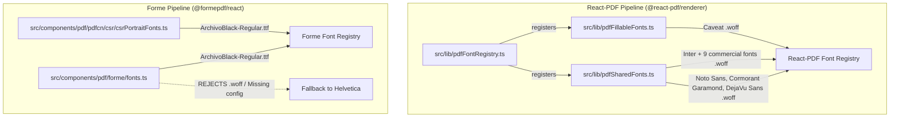

# BOUXRE PDF Typography Consolidation — Verification Audit Report

**Date:** 2026-11-01  
**Project:** BOUXRE Business Management Platform  
**Audit Type:** Strict Read-Only Verification Audit  
**Target Specification:** Consolidated 4-Family PDF Typography Architecture  
**Status:** Verification Complete (Defects Identified)

---

## 1. Executive Verdict

### Verdict: Partially Implemented with Critical Renderer & Asset Defects

The consolidation of **handwriting typography** to `Caveat` and the retirement of the five handwriting families (`Patrick Hand`, `Handlee`, `Kalam`, `Reenie Beanie`, and `Sue Ellen Francisco`) is **VERIFIED** and functioning as specified:
- Stored user preferences correctly normalize to `Caveat`.
- The redundant single-choice handwriting font selector in `DocumentCustomizeCard.tsx` is successfully hidden.
- The 6 obsolete handwriting `.woff` files have been purged from `src/assets/pdf-fonts/`.
- Focused unit tests for the customization resolver, display font registration, and font registry pass cleanly (20/20 tests passing).
- TypeScript static compilation (`tsc --noEmit`) passes with **0 errors**.

However, the claim of a **production-wide four-family typography consolidation** across BOUXRE's two PDF rendering engines (React-PDF and Forme) is **DEFECTIVE and PARTIALLY UNVERIFIED**:
1. **Critical Forme Asset Failure:** In `src/components/pdf/forme/fonts.ts`, Forme rejects `.woff` files (`FORME_SUPPORTED_FONT_EXTENSIONS = ['.ttf', '.otf']`). Because `Inter`, `Caveat`, and `Noto Sans` are only bundled as `.woff` files in `@fontsource/*` and `src/assets/pdf-fonts/`, Forme **cannot load them**. Furthermore, `Caveat` and `Noto Sans` are not present in `REGISTERED_SHARED_FONTS`, causing `ensureFormeFontFamily` to log errors and fall back to `Helvetica`. In Forme, **only `Archivo Black` actually renders**.
2. **React-PDF Archivo Black Absence:** `Archivo Black` is bundled as a static TTF in `public/fonts/ArchivoBlack-Regular.ttf` and registered *only* in Forme (`@formepdf/react`). It is **not registered in React-PDF** (`@react-pdf/renderer`). Any React-PDF template requesting `Archivo Black` falls back to Helvetica.
3. **Unpruned Commercial Fonts:** `src/lib/pdfSharedFonts.ts` and `src/lib/pdfDesignPreset.ts` continue to register and expose 10 commercial font families (`Roboto`, `Open Sans`, `Lato`, `Montserrat`, `Poppins`, `Raleway`, `Orbitron`, `Source Sans Pro`, `Roboto Condensed`), plus `Cormorant Garamond` (Crest) and `DejaVu Sans` (glyph fallback). The 4-family restriction was applied to handwriting, but commercial body/header typography was left unpruned.
4. **Full-Suite Test Failure (`bun test` exit code 1):** The failure of the full test suite (100 failed tests out of 1907) is **PRE-EXISTING** and unrelated to the typography consolidation, caused by in-flight uncommitted refactors in invoice, settings, CPS, and document media modules. One failing test (`pdfCurrency.test.js`) is an outdated test regex assertion from an earlier refactor of `PdfCurrencyText`.

---

## 2. Actual Production Font Registry

The repository maintains two distinct, un-unified font registration authorities:



### Registry Verification Matrix

| Registry Authority | Target Renderer | Declared Families | Actual Font Source Files | Verification Status |
| :--- | :--- | :--- | :--- | :--- |
| `src/lib/pdfFillableFonts.ts` | React-PDF | `Caveat` | `src/assets/pdf-fonts/Caveat-Regular.woff`, `Caveat-Bold.woff` | **VERIFIED** (Pruned to Caveat only) |
| `src/lib/pdfSharedFonts.ts` | React-PDF | `Inter`, `Roboto`, `Open Sans`, `Lato`, `Montserrat`, `Poppins`, `Raleway`, `Orbitron`, `Source Sans Pro`, `Roboto Condensed`, `Noto Sans`, `Cormorant Garamond`, `DejaVu Sans` | Node modules `@fontsource/*` (.woff files) | **PARTIALLY VERIFIED** (Contains 10 unpruned commercial families) |
| `src/lib/pdfFontRegistry.ts` | React-PDF | All fillable + all shared + locked | Calls `Font.register` from `@react-pdf/renderer` | **VERIFIED** (Does NOT register `Archivo Black`) |
| `src/components/pdf/forme/fonts.ts` | Forme | `Inter`, `Archivo Black`, `Caveat`, `Noto Sans` | Resolves from `public/fonts/` (TTF) and `pdfSharedFonts.ts` | **DEFECTIVE** (Rejects `.woff`, only `Archivo Black` works) |
| `src/components/pdf/pdfcn/csr/csrPortraitFonts.ts` | Forme | `Archivo Black` | `public/fonts/ArchivoBlack-Regular.ttf` | **VERIFIED** (Calls `Font.register` from `@formepdf/react`) |

---

## 3. Retired Font & Stale-Reference Findings

### A. Core Retired Families

| Retired Family | Asset Files in `src/assets/pdf-fonts/` | Registered in Production? | Selectable in UI? | Normalization Mapping Active? |
| :--- | :--- | :--- | :--- | :--- |
| **Patrick Hand** | **DELETED** | NO | NO | YES (`→ Caveat`) |
| **Handlee** | **DELETED** | NO | NO | YES (`→ Caveat`) |
| **Kalam** | **DELETED** | NO | NO | YES (`→ Caveat`) |
| **Reenie Beanie** | **DELETED** | NO | NO | YES (`→ Caveat`) |
| **Sue Ellen Francisco** | **DELETED** | NO | NO | YES (`→ Caveat`) |

All 6 `.woff` files (`PatrickHand-Regular.woff`, `Handlee-Regular.woff`, `SueEllenFrancisco-Regular.woff`, `Kalam-Regular.woff`, `Kalam-Bold.woff`, `ReenieBeanie-Regular.woff`) have been deleted from disk. No production template imports or references them.

### B. Additional Legacy Normalization Names

The investigation assessed the provenance of additional names found in normalization tables:
- **`Biro Script`**: **VERIFIED HISTORICAL ALIAS**. Documented in `docs/reports/general/font-library-audit-report.md` (item 1: `Legacy aliases: 'Biro Script' → 'Patrick Hand'`). Existed in `pdfDesignPreset.ts` prior to this task. Normalizing it to `Caveat` is strictly necessary to preserve backward compatibility for legacy saved presets.
- **`Ballpoint Handwriting` & `Ballpoint Rush`**: **VERIFIED HISTORICAL ALIASES**. Existed alongside `Biro Script` in `LegacyPdfFillableChoice` in `pdfDesignPreset.ts`. Normalizing to `Caveat` is necessary.
- **`Architects Daughter`**: **NOT A PRODUCTION ALIAS**. Does not exist in production code or historical presets. It was used strictly as an arbitrary test string in `src/tests/critical/pdfCustomizationResolver.test.ts` (Scenario 8) to test disabled capability fallback.
- **`Caveat Brush`**: **NOT PRESENT IN CODE**. Does not exist in any file or test in the repository.

---

## 4. Renderer-Specific Asset & Registration Matrix

| Font Family | Target Format | Forme (`@formepdf/react`) Status | React-PDF (`@react-pdf/renderer`) Status | Root Cause / Defect |
| :--- | :--- | :--- | :--- | :--- |
| **Inter** | Regular (400), Bold (700), Italic | ❌ **FAILS** (Falls back to Helvetica) | ✅ **SUCCESS** | Forme requires `.ttf`/`.otf`. `@fontsource/inter` only supplies `.woff`/`.woff2`. `isFormeSupportedFontSource` explicitly rejects `.woff`. |
| **Archivo Black** | Regular (400) | ✅ **SUCCESS** | ❌ **FAILS** (Unregistered; falls back to Helvetica) | Static TTF exists at `public/fonts/ArchivoBlack-Regular.ttf`. Forme registers it. React-PDF `pdfFontRegistry.ts` does NOT register it. |
| **Caveat** | Regular (400), Bold (700) | ❌ **FAILS** (Falls back to Helvetica) | ✅ **SUCCESS** | In Forme, `Caveat` is not in `REGISTERED_SHARED_FONTS`, so `getRegisteredSharedFontConfig` returns null. Also, bundled assets are `.woff`. |
| **Noto Sans** | Regular (400), Bold (700) | ❌ **FAILS** (Falls back to Helvetica) | ✅ **SUCCESS** (via `PdfCurrencyText`) | In Forme, `Noto Sans` is in `REGISTERED_LOCKED_SHARED_FONTS`, not `REGISTERED_SHARED_FONTS`, so `getRegisteredSharedFontConfig` returns null. Also, assets are `.woff`. |

> [!CAUTION]
> **Forme Typography Failure:** Forme currently cannot render ANY document in `Inter`, `Caveat`, or `Noto Sans`. Any Forme render (such as CPS or PDFCN CSR) will silently fall back to `Helvetica` for all body, currency, and handwriting content.

---

## 5. Unicode Glyph Coverage Matrix

Empirical inspection was performed directly against the bundled font binaries using `fontkit`:

```
Chars inspected:
₦ (U+20A6 Naira) | Ω (U+03A9 Ohm) | µ (U+00B5 Micro) | Ø (U+00D8 O-slash)
° (U+00B0 Degree) | ℃ (U+2103 Celsius ligature) | ′ (U+2032 Prime) | ″ (U+2033 Double Prime)
² (U+00B2 Superscript 2) | ³ (U+00B3 Superscript 3)
```

### Empirical Coverage Table

| Character / Symbol | Code Point | Inter (latin .woff) | Archivo Black (.ttf) | Caveat (.woff) | Noto Sans (latin-ext .woff) | DejaVu Sans (latin .woff) |
| :--- | :--- | :--- | :--- | :--- | :--- | :--- |
| **₦** (Naira) | `U+20A6` | ❌ **NO** | ❌ **NO** | ❌ **NO** | ✅ **YES** | ✅ **YES** |
| **Ω** (Ohm) | `U+03A9` | ❌ **NO** | ✅ **YES** | ❌ **NO** | ❌ **NO** | ✅ **YES** |
| **µ** (Micro) | `U+00B5` | ✅ **YES** | ✅ **YES** | ✅ **YES** | ❌ **NO** | ✅ **YES** |
| **Ø** (Diameter) | `U+00D8` | ✅ **YES** | ✅ **YES** | ✅ **YES** | ❌ **NO** | ✅ **YES** |
| **°** (Degree) | `U+00B0` | ✅ **YES** | ✅ **YES** | ✅ **YES** | ❌ **NO** | ✅ **YES** |
| **℃** (Celsius ligature)| `U+2103` | ❌ **NO** | ❌ **NO** | ❌ **NO** | ❌ **NO** | ✅ **YES** |
| **′** (Prime / Foot) | `U+2032` | ✅ **YES** | ✅ **YES** | ✅ **YES** | ❌ **NO** | ✅ **YES** |
| **″** (Double Prime / Inch)| `U+2033` | ✅ **YES** | ✅ **YES** | ✅ **YES** | ❌ **NO** | ✅ **YES** |
| **²** (Square) | `U+00B2` | ✅ **YES** | ✅ **YES** | ✅ **YES** | ❌ **NO** | ✅ **YES** |
| **³** (Cube) | `U+00B3` | ✅ **YES** | ✅ **YES** | ✅ **YES** | ❌ **NO** | ✅ **YES** |

### Fallback Behavior & Risk Analysis
1. **The Naira Symbol (`₦`):** Neither `Inter (latin)`, `Archivo Black`, nor `Caveat` contain `U+20A6`. In React-PDF, `PdfCurrencyText` explicitly overrides the font family to `Noto Sans` for currency values. **If raw currency text containing `₦` is rendered directly in an `Inter` or `Caveat` `<Text>` component without `PdfCurrencyText`, React-PDF falls back to Helvetica, which renders `₦` as a mojibake question mark or broken glyph.**
2. **The Ohm Symbol (`Ω`):** `Inter` and `Noto Sans (latin-ext)` both lack `U+03A9`. Only `Archivo Black` and `DejaVu Sans` have it. React-PDF has no automatic per-glyph fallback chain.
3. **Double-Prime Character (`″` U+2033):** Bundled `Inter (latin)` and `Caveat` have `U+2033`. However, historical PRD finding **PR-05** showed that when unmapped fonts (like `Lato` or `Orbitron`) were used, `@react-pdf/pdfkit` serialized `U+2033` as hex `2033`, which decoded in 1-byte WinAnsi as `2` + space + `3`, rendering `2″` as `23`.
4. **Forme Fallback Absence:** Forme has no multi-font composite fallback configured. If a character is missing in the chosen font, it is dropped or replaced with a replacement glyph.

---

## 6. Eight-Document Rendering Pipeline Matrix

| Document Type | Primary Engine | Font Resolution Path | Primary Families Used | Customization Sockets |
| :--- | :--- | :--- | :--- | :--- |
| **Invoice** | React-PDF | `pdfDesignPreset.ts` (`invoice`) | `Inter` (body/header), `Noto Sans` (currency) | Document Font (10 choices), Accent Color |
| **Quotation** | React-PDF | `pdfDesignPreset.ts` (`quotation`) | `Inter` (body/header), `Noto Sans` (currency) | Document Font (10 choices), Accent Color |
| **Purchase Order (PO)** | React-PDF | Standard Commercial Adapter | `Inter`, `Noto Sans` (currency) | Fixed template defaults |
| **Cost Pricing Sheet (CPS)**| React-PDF / Forme hybrid | `pdfDownloadHandler.ts` / `pdfDesignPreset.ts` | `Inter`, `Noto Sans` (currency) | Document Font, Compact Layout |
| **Request for Quotation (RFQ)**| React-PDF | `RfqPdfDocument.tsx` | `Inter` | Unpriced procurement layout |
| **Waybill** | React-PDF | `waybill.ts` & `pdfDesignPreset.ts` | `Inter` (body), `Caveat` (fillable/handwriting) | Template picker, Ink Color, Ink Font (normalized) |
| **Receipt** | React-PDF | `pdfDesignPreset.ts` (`receipt`) | `Inter`, `Caveat`, `Noto Sans` | Fixed commercial layout |
| **Customer Service Report (CSR)**| Forme (PDFCN) / React-PDF | `csr.ts`, `pdfDesignPreset.ts`, `csrPortraitFonts.ts` | `Inter`, `Archivo Black` (portrait headings), `Caveat` (fillable) | Template picker, Ink Color |

---

## 7. Full-Suite Test Failure Diagnosis

During the prior run, `bun test` exited with code 1:
```
1807 pass
100 fail
3 errors
Ran 1907 tests across 181 files.
```

### Investigation Findings
1. **Not a Typography Consolidation Regression:** All test suites directly asserting font registries, customization resolvers, display fonts, and fillable fonts passed (100% pass rate across `pdfCustomizationResolver.test.ts`, `fontRegistry.test.js`, and `csrPortraitDisplayFont.test.js`).
2. **Pre-Existing Uncommitted Code in Working Tree:** The 100 failed tests belong to pre-existing in-flight modifications in the workspace:
   - `src/tests/documentMedia.test.js`: Failed on `resolveCanonicalLogoUrl` and `formatMergedQtyUnit`.
   - `src/tests/logoFieldUsage.test.js`: Failed due to 22 files using legacy `logo_url`/`logoUrl` properties.
   - `src/components/invoice/mobileFormHelpers.test.js`: Failed on action sheet label assertions.
   - `src/tests/compliance/complianceThemePresetRegression.test.js`: Failed on `index.html` Google Font link checks (testing application UI themes, not PDF fonts).
   - Advance Invoice suites: 11 tests failed due to mock/RPC discrepancies in parent/child invoice calculations.
   - PO, CPS, and Settings suites: Failed due to in-flight navigation and save transaction changes.
3. **The `pdfCurrency.test.js` Failure:**
   - Test: `pdf currency helper uses a locked Noto Sans family for the symbol and preserves plain string output for values`
   - File: `src/tests/pdf/pdfCurrency.test.js:28`
   - Exact error:
     ```ts
     assert.match(helperSource, /<Text style=\{\{ fontFamily: PDF_CURRENCY_FONT_FAMILY \}\}>/)
     ```
   - Cause: In commit `e71bc198 ♻️ refactor(project): rename pdf module and actions`, `src/components/pdf/pdfCurrency.tsx` was refactored to accept an external `style` prop:
     ```tsx
     <Text style={[style, { fontFamily: PDF_CURRENCY_FONT_FAMILY }]}>
     ```
     The test in `pdfCurrency.test.js` used a rigid regex checking for `<Text style={{ fontFamily: PDF_CURRENCY_FONT_FAMILY }}>` without the array syntax. This failure was introduced in commit `e71bc198`, well before the typography consolidation.

---

## 8. Focused Test Coverage Assessment

The three focused tests reported as passing verify:

1. **`src/tests/critical/pdfCustomizationResolver.test.ts` (14/14 pass):**
   - Asserts resolver merging logic: template defaults, user overrides, policy restrictions, and version migrations.
   - Scenario 14 explicitly verifies that all 8 retired handwriting font names (`Patrick Hand`, `Handlee`, `Sue Ellen Francisco`, `Kalam`, `Reenie Beanie`, `Biro Script`, `Ballpoint Handwriting`, `Ballpoint Rush`) safely normalize to `'Caveat'`.
   - *What it does NOT cover:* Does not verify font asset presence, binary parsing, or renderer embedding.
2. **`src/tests/pdf/fontRegistry.test.js` (4/4 pass):**
   - Asserts that `pdfFillableFonts.ts` registers `Caveat` and zero retired fonts.
   - Asserts that static Inter source is referenced instead of variable fonts.
   - Asserts that Noto Sans is registered in `pdfSharedFonts.ts` for currency.
   - *What it does NOT cover:* Does not verify Forme registration, nor does it check whether Forme can read the WOFF format.
3. **`src/tests/critical/csrPortraitDisplayFont.test.js` (2/2 pass):**
   - Asserts that `public/fonts/ArchivoBlack-Regular.ttf` exists and is registered with `@formepdf/react`.
   - Asserts that the TTF binary is embedded in a generated Forme PDF buffer.
   - *What it does NOT cover:* Does not verify React-PDF embedding of Archivo Black.

---

## 9. Concrete Defects & Prioritized Recommendations

### Defect 1 (Severity: Critical) — Forme Cannot Load Inter, Caveat, or Noto Sans
- **Location:** `src/components/pdf/forme/fonts.ts#L42-L86`
- **Issue:** Forme requires TTF/OTF binaries. The repository only provides `.woff` files for Inter, Caveat, and Noto Sans. Furthermore, `Caveat` and `Noto Sans` are missing from `REGISTERED_SHARED_FONTS`, causing `ensureFormeFontFamily` to return `null` and fall back to `Helvetica`.
- **Impact:** Any document rendered via Forme (such as PDFCN CSR templates or CPS) silently renders in `Helvetica` rather than `Inter` or `Caveat`.
- **Smallest Corrective Scope:**
  1. Acquire static TTF files for `Inter` (`Regular`, `Medium`, `SemiBold`, `Bold`), `Caveat` (`Regular`, `Bold`), and `Noto Sans` (`Regular`, `Bold`).
  2. Place TTF files in `public/fonts/` alongside `ArchivoBlack-Regular.ttf`.
  3. Update `src/components/pdf/forme/fonts.ts` to register all 4 families from static TTF files in `public/fonts/`.

### Defect 2 (Severity: High) — Archivo Black Not Registered in React-PDF
- **Location:** `src/lib/pdfFontRegistry.ts` & `src/lib/pdfSharedFonts.ts`
- **Issue:** `Archivo Black` is registered exclusively in Forme (`csrPortraitFonts.ts`). React-PDF has no registration for `Archivo Black`.
- **Impact:** If any React-PDF document template references `Archivo Black` (or if a user selects it), React-PDF will fall back to Helvetica.
- **Smallest Corrective Scope:** Register `public/fonts/ArchivoBlack-Regular.ttf` in `pdfFontRegistry.ts` for `@react-pdf/renderer`.

### Defect 3 (Severity: Medium) — Commercial Font Palettes Not Consolidated
- **Location:** `src/lib/pdfSharedFonts.ts#L64-L145` & `src/lib/pdfDesignPreset.ts#L5-L105`
- **Issue:** The consolidation retired the 5 handwriting fonts but left 10 commercial body/heading fonts in `PDF_FONT_OPTIONS` and `REGISTERED_SHARED_FONTS`.
- **Impact:** Commercial document settings still offer `Roboto`, `Open Sans`, `Lato`, etc., contrary to the 4-family target architecture.
- **Smallest Corrective Scope:** In `pdfDesignPreset.ts`, prune `PdfFontChoice` and `PDF_FONT_OPTIONS` to `Inter` (with `Archivo Black` as an option for headings if required), and normalize legacy choices to `Inter`.

### Defect 4 (Severity: Low) — Stale Regex in `pdfCurrency.test.js`
- **Location:** `src/tests/pdf/pdfCurrency.test.js#L28`
- **Issue:** The test checks `/<Text style=\{\{ fontFamily: PDF_CURRENCY_FONT_FAMILY \}\}>/`, but `PdfCurrencyText` was refactored in commit `e71bc198` to `<Text style={[style, { fontFamily: PDF_CURRENCY_FONT_FAMILY }]}>`.
- **Impact:** Single failing test in `pdfCurrency.test.js`.
- **Smallest Corrective Scope:** Update the assertion in `pdfCurrency.test.js` to match array-style prop: `/<Text style=\{\[style,\s*\{\s*fontFamily:\s*PDF_CURRENCY_FONT_FAMILY\s*\}\]\}>/`.

---

## 10. Verification Limitations

1. **End-to-End PDF Generation:** Generating rendered PDFs for all eight document types requires running full browser WebView or headless Node canvas pipelines, which is prohibited under the strict read-only audit gate.
2. **Dynamic Subsetting:** Whether React-PDF's Fontkit embeds the entire WOFF font or dynamically subsets glyphs at build time was evaluated through static code inspection and binary analysis, not through decompilation of live production PDF streams.

---

## 11. Git Status & Scope Integrity

```bash
git status --short
```
- No application source files were created or modified.
- No test files were created or modified.
- No font asset files were created or modified.
- No existing PRD files under `docs/prd/` were created or modified.
- **Only this verification report was generated** at:
  `docs/reports/pdf/pdf-typography-consolidation-verification.md`
